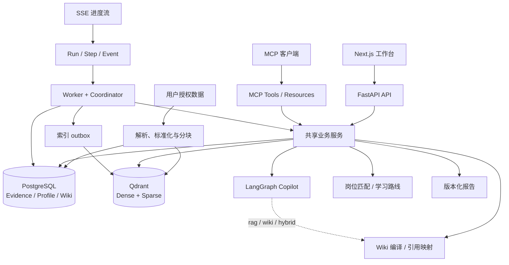

<div align="center">

# CareerLens

**把经历变成证据，再用证据回答"我适合什么岗位、还缺什么、下一步怎么做"。**

**[在 GitHub 上开始学习](tutorials/README.md#学习路径)** · [在线教程站](https://wenmo-yu.github.io/careerlens/) · [本机启动（需 Docker）](#快速开始) · [文档](docs/README.md) · [架构](docs/architecture.md) · [API 与配置](docs/api-and-configuration.md) · [路线图](ROADMAP.md)

[](https://github.com/wenmo-yu/careerlens/actions/workflows/quality.yml)
[](https://github.com/wenmo-yu/careerlens/releases)
[](LICENSE)
[](backend/pyproject.toml)
[](frontend/package.json)

</div>

CareerLens 是一个**证据驱动的职业决策 Agent**。它把你授权的简历、自述与平台导出内容整理成可追溯的 **Evidence**，构建持续更新的结构化画像；输入岗位 JD 后，逐条比对要求与证据，给出匹配判断、能力缺口、学习路线和职业报告——每个结论都能点开看到原始证据。

绝大多数求职建议的问题不是"不够流畅"，而是**没有依据**。CareerLens 把"证据是否足以支持结论"写进了整条输出链路。

> **说明**：
> 开源版本可在本机跑通完整业务闭环，**无需任何 API Key**：默认使用确定性 Demo 模型与轻量检索 Provider。真实模型（DeepSeek / OpenAI-compatible / 本地 Qwen、OCR/ASR）提供可选接入，效果取决于所用模型与运行环境。

## 核心能力

- **证据优先，结论可追溯** — 画像条目和岗位匹配都保留 Evidence ID；证据不足就显示缺口，不把推测写成经历。
- **长期画像可纠正** — 偏好修正先生成草案，用户确认后才写入，一句话不会静默改变长期资料。
- **岗位逐条匹配** — 每项要求判定 `strong / partial / gap`，按每周可投入时间安排学习路线；分数是规则权重，不是录用概率。
- **检索与知识双模态** — Qdrant Dense + Sparse 双路检索、RRF 融合、两级重排；编译带引用的 Wiki 主题页；提问期可在 `rag / wiki / hybrid` 间自由切换，**零重建**。
- **引用锚定到稳定证据** — Wiki 编译用 `c000` 短句柄让模型引用，落库前解析回稳定 evidence_id；未知句柄丢弃，表格行丢失会被写入守卫拒绝。
- **长任务后台化** — 导入、Wiki 编译、岗位分析、报告生成走持久化 Run + 独立 Worker；支持实时进度、断线续看、审批、取消、幂等与租约恢复。
- **个人数据可控** — Scope Token、数据导出、单条删除、整账号清理，敏感操作只留不含原文的审计记录。

## 快速开始

需要 Docker Desktop（或 Docker Engine + Compose v2）。在仓库根目录：

```powershell
docker compose up -d --build
.\scripts\docker-smoke.ps1
```

第二条命令用一次性合成资料跑通主流程与后台任务，并在结束时清理测试账号（加 `-KeepData` 可保留）。首次构建需下载镜像与依赖。

启动后访问：

| 服务 | 地址 |
| --- | --- |
| Web 工作台 | `http://localhost:3000/workspace` |
| API 文档 | `http://localhost:8000/docs` |
| MCP | `http://localhost:8001/mcp` |
| Qdrant | `http://localhost:16333/dashboard` |

工作台已预填**虚构**经历与 JD，无需 API Key 即可体验完整流程。更多启动方式（非 Docker、生产配置、真实模型）见[完整启动与配置指南](docs/api-and-configuration.md)。

## 界面预览


上面是产品首页，用于快速理解项目；完整的交互在工作台。截图来自本地 Docker 环境，案例为虚构资料。[查看更多页面展示](docs/showcase.md)。

## 工作流

```text
用户授权内容 → 标准化 Evidence → 带证据 ID 的画像
                                      ↓
目标岗位 JD → 逐条 Requirement → 带引用的画像对照
                                      ↓
                          Strong / Partial / Gap
                                      ↓
                    学习路线 · 版本化报告 · 可追问的回答
```

1. **导入经历**：粘贴自述、上传简历或平台导出 → 带来源与 ID 的 Evidence
2. **构建画像**：结构化条目 + 置信度 + 证据引用
3. **分析岗位**：逐条匹配判断、缺口与学习路线
4. **生成报告**：八章节、可下载、保留历史版本
5. **追问结论**：Career Copilot 多轮对话，可展开原始证据
6. **修正记忆**：草案 → 确认后写入长期画像

其中第 1、3、4 步与 Wiki 编译会进入后台任务，支持实时进度与断线续看；短对话仍走同步会话。

## 设计取舍

普通助手追求"说得顺"，CareerLens 追求"说得有据"：

- **检索与生成解耦**：生成模型可切换 API 或本地服务；检索后端从 Qdrant 自动降级到本地混合检索，并在响应中报告实际使用的 backend、fusion、reranker。
- **知识组织有版本**：Wiki 页版本只在用户可见内容变化时递增，乐观并发防止过期写入覆盖，回滚是一次普通编辑而非删除历史。
- **运行时以数据库为队列**：不引入 Redis，用租约、fencing 代次与提交边界保证"提交即终态"，取消与过期都能恢复。
- **隐私默认收敛**：审计不含原文，向量删除有补偿，账号删除返回匿名回执。

这些取舍的背景见[与 WeKnora 和 WorkBuddy 的实现对照](docs/agent-and-retrieval.md#与-weknora-和-workbuddy-的实现对照)。

## 系统架构



PostgreSQL 是业务数据源，Qdrant 是可从 Evidence 重建的检索索引；API 与 MCP 共用业务服务与权限规则。详见[架构文档](docs/architecture.md)。

## 技术栈

| 层 | 技术 | 用途 |
| --- | --- | --- |
| Web | Next.js 16、React 19、TypeScript | 导入、画像、匹配、报告、对话、评测工作台 |
| API / 数据 | FastAPI、Pydantic、SQLAlchemy Async、PostgreSQL、Alembic | 异步接口、持久化与版本化迁移 |
| Agent | LangGraph、PostgreSQL Checkpoint | 意图理解、证据检索、回答生成与多轮上下文 |
| 检索 | Qdrant、Dense + Sparse、RRF、Reranker | 用户隔离的双路检索、融合与两级重排 |
| 知识组织 | WikiPage / WikiRevision、短句柄、表格行守卫 | 带引用的主题页、版本与回滚 |
| 运行时 | Run / Step / Event、Worker、Coordinator、SSE | 幂等、租约恢复、fencing、取消、原子提交 |
| 模型 | Demo / DeepSeek / OpenAI-compatible / 本地 Qwen | 无密钥可复现，角色绑定与串级重排可配置 |
| 接入 | PDF / DOCX / XLSX / TXT / Markdown、平台导出、可选 OCR/ASR | 用户主动导入；XLSX 用标准库无需 openpyxl |
| 交付 | MCP SDK、Docker Compose、GitHub Actions | 工具接口、容器部署与质量门禁 |

完整代码导航见[技术文档](docs/README.md)。

## 零基础入门与教程

从八篇浏览器概念课开始，跟着林澈的资料学会找证据，并读懂项目实际用到的 LangGraph、混合 RAG 与 Wiki，再按第 01 篇把工作台跑起来。之后按章读 Agent 工作流、工具调用、子 Agent，再走到检索、Wiki、后台运行时和 MCP。每篇末尾都有下一课。 [GitHub 学习路径](tutorials/README.md#学习路径) · [在线教程站](https://wenmo-yu.github.io/careerlens/)

## 验证

| 项目 | 结果 |
| --- | --- |
| 后端 | Ruff 与 pytest，含教程 DOCX 双来源回归 |
| 前端 | ESLint、TypeScript 类型检查、production build 通过 |
| CI | backend / frontend / docker-smoke 三项全绿 |
| 全栈冒烟 | 双 Worker + 真实 PostgreSQL 跑通导入→画像→岗位→报告→对话、后台 run 与 SSE |
| 端到端实测 | 导入、画像、岗位、报告、三模式对话、Wiki 编译、后台 run、隐私导出逐项通过 |

这些结果验证默认链路，**不代表真实模型、硬件或用户数据下的效果**；评测口径见[评测文档](docs/evaluation-and-operations.md)。

## 参与贡献

欢迎 Issue 与 PR。建议先读[贡献指南](CONTRIBUTING.md)，从 [good first issue](https://github.com/wenmo-yu/careerlens/issues) 入手；提交前请让 CI 三项通过（main 已启用分支保护）。讨论与问题请用 [GitHub Issues](https://github.com/wenmo-yu/careerlens/issues)。安全漏洞请按[安全政策](SECURITY.md)私下报告，不要公开提交。

## 许可

[MIT](LICENSE)。本项目为学习和研究用途，求职决策仅供参考，不构成录用承诺或职业建议。
