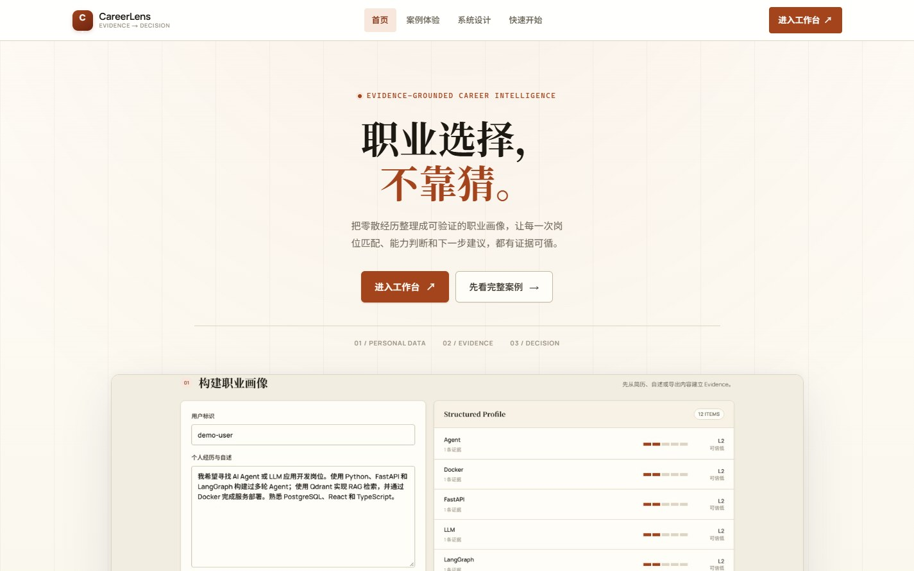

<div align="center">

# CareerLens

**把经历变成证据，再用证据回答"我适合什么岗位、还缺什么、下一步怎么做"。**

**[在线教程站](https://wenmo-yu.github.io/careerlens/)** · **[教程目录](#教程目录)** · **[本机启动](#快速开始)** · **[技术文档](docs/README.md)** · [界面展示](docs/showcase.md) · [系统架构](docs/architecture.md) · [API 与配置](docs/api-and-configuration.md) · [路线图](ROADMAP.md)

[](https://github.com/wenmo-yu/careerlens/actions/workflows/quality.yml)
[](https://github.com/wenmo-yu/careerlens/releases)
[](LICENSE)
[](backend/pyproject.toml)
[](frontend/package.json)

</div>

CareerLens 是一个**证据驱动的职业决策 Agent**：把简历、自述与平台导出整理成可追溯的 **Evidence**，构建结构化画像；输入岗位 JD 后逐条比对，给出匹配判断、能力缺口、学习路线和职业报告——**每个结论都能点开看到原始证据**。

多数求职建议的问题不是"不够流畅"，而是**没有依据**。CareerLens 把"证据是否足以支持结论"写进整条链路：证据不足就标缺口，不把推测写成经历。

> 本机运行默认使用确定性 Demo 模型与轻量检索，不需要配置模型密钥；真实模型（DeepSeek / OpenAI-compatible / 本地 Qwen、OCR/ASR）为可选接入。

## 为什么用 CareerLens

| 你关心的 | CareerLens 的做法 |
| --- | --- |
| **结论可信吗** | 画像与岗位匹配都带 Evidence ID 和证据条数；从证据列表、导入结果或 Copilot 引用卡都能追回原文 |
| **会被一句话改掉长期资料吗** | 偏好修正先生成草案，确认后才写入，不静默改变画像 |
| **缺口怎么变成行动** | 每项要求判 `strong / partial / gap`，按每周投入排学习路线，进度可回写为作品证据 |
| **长任务会中断吗** | 导入、分析、报告走持久化 Run + Worker，SSE 实时进度、断线续看、取消与幂等恢复 |
| **数据能带走吗** | Scope Token、JSON 导出、单条删除、整账号清理，审计不含原文 |
| **只是个演示吗** | 配套教程覆盖从概念到源码，394 项后端测试 + Quality Gate 7 个 job 全绿 |

**技术亮点**：LangGraph 条件路由 · 自研 Agent Core 与 Runtime JSONL v1 · 预热池/租约/fencing · 写工具审批与幂等账本 · Qdrant Dense+Sparse 混合检索与 RRF · 带引用的 Wiki 版本页 · MCP 工具接口 · 可切换生成模型 · Prometheus 指标。详见[架构文档](docs/architecture.md)。

## 核心能力

- **证据优先，结论可追溯** — 画像条目和岗位匹配都保留 Evidence ID 与证据条数；从证据列表、导入结果或 Copilot 引用卡可回看原文，证据不足就显示缺口。
- **长期画像可纠正** — 偏好修正先生成草案，用户确认后才写入，一句话不会静默改变长期资料。
- **岗位逐条匹配** — 每项要求判定 `strong / partial / gap`，按每周可投入时间安排学习路线；分数是规则权重，不是录用概率。
- **检索与知识双模态** — 默认 `auto + hash`；Qdrant 路径提供 Dense + Sparse 与 RRF 融合，不可用时自动降级到本地混合检索；二阶段重排按需启用，实际 backend / fusion / reranker / fallback 写在检索诊断里。编译带引用的 Wiki 主题页，提问期可在 `rag / wiki / hybrid` 间切换，**零重建**。
- **引用锚定到稳定证据** — Wiki 编译用 `c000` 短句柄让模型引用，落库前解析回稳定 evidence_id；未知句柄丢弃，表格行丢失会被写入守卫拒绝。
- **长任务后台化** — 导入、Wiki 编译、岗位分析、报告生成走持久化 Run + 独立 Worker；支持实时进度、断线续看、审批、取消、幂等与租约恢复。
- **自陈测评可选** — 工作偏好、RIASEC 兴趣和大五 20 题均为项目自写；自填 MBTI 标签只作线索，不复制官方题库、不进入事实画像、不改匹配分。见[测评题库与许可](docs/assessments.md)。
- **来源边界清晰** — 八平台当前页采集、用户导出文件、HTML/ZIP、公开链接证据卡和 GitHub 只读令牌按真实能力标注；互动只作兴趣线索，OAuth 未实现。见[接入、MCP 与安全](docs/integrations-and-security.md)。
- **个人数据可控** — Scope Token、数据导出、单条删除、整账号清理，敏感操作只留不含原文的审计记录。

## 功能地图

| 你想看什么 | 先看 |
| --- | --- |
| 所有页面与真实截图：导入结果、画像、岗位、报告、Copilot、测评、质量、数据控制 | [界面展示](docs/showcase.md) |
| 系统怎么跑：架构、数据、Agent、运行时、接口、配置 | [技术文档](docs/README.md) |
| 自陈测评、MBTI 边界、三份自写量表与计分 | [测评题库与许可](docs/assessments.md) |
| 用自备只读令牌导入 GitHub 仓库元数据与 README | [GitHub 仓库导入](docs/github-token-import.md) |
| V4 持久 Agent：会话、消息、审批、runtime 状态、实时事件、计划与通知 | `/agent` 工作台（需启动 scheduler） · [ADR 0019](docs/adr/0019-agent-workbench-ui.md) · [ADR 0028](docs/adr/0028-agent-workbench-live-events.md) |
| 桌面后台：开机自启（默认关闭）、托盘语义、日志滚动与数据库备份 | [ADR 0025](docs/adr/0025-desktop-autostart-and-wake.md) · [ADR 0027](docs/adr/0027-local-logs-and-backup.md) · `/settings` |
| 八平台当前页采集、公开链接卡、XLSX/HTML/ZIP 等来源边界 | [接入、MCP 与安全](docs/integrations-and-security.md) |
| 从零跟做：概念课、源码课、画像与岗位实战 | [教程目录](#教程目录) · [在线教程站](https://wenmo-yu.github.io/careerlens/) |

工作台分区：`#profile` 导入与画像、`#matching` 岗位与学习看板、`#report` 版本报告、`#copilot` 证据问答、`#assessment` 自我探索、`#quality` 质量门禁、`#privacy` 数据控制。

## 快速开始

需要 Docker Desktop（或 Docker Engine + Compose v2）。在仓库根目录：

```powershell
docker compose up -d --build
.\scripts\docker-smoke.ps1
```

第二条命令用一次性合成资料跑通主流程与后台任务，并在结束时清理测试账号（加 `-KeepData` 可保留）。首次构建需下载镜像与依赖。

启动后访问：

| 服务 | 地址 |
| --- | --- |
| Web 工作台 | `http://localhost:3000/workspace` |
| API 文档 | `http://localhost:8000/docs` |
| MCP | `http://localhost:8001/mcp` |
| Qdrant | `http://localhost:16333/dashboard` |

工作台已预填**虚构**经历与 JD，使用默认 Demo 模式即可走完整流程。更多启动方式（非 Docker、生产配置、真实模型）见[完整启动与配置指南](docs/api-and-configuration.md)。

## 界面预览



上面是产品首页，用于快速理解项目；完整的交互在工作台。截图来自本地 Docker 环境，案例为虚构资料。[查看更多页面展示](docs/showcase.md)。

## 工作流

1. **导入经历**：粘贴自述、上传简历或平台导出 → 带来源与 ID 的 Evidence
2. **构建画像**：结构化条目 + 置信度 + 证据引用
3. **分析岗位**：逐条匹配判断、缺口与学习路线
4. **生成报告**：八章节、可下载、保留历史版本
5. **追问结论**：Career Copilot 多轮对话，可展开原始证据
6. **修正记忆**：草案 → 确认后写入长期画像

第 1、3、4 步与 Wiki 编译进入后台 Run，由 Worker 执行，工作台经 SSE 看进度并可在断线后续看；短对话仍走同步会话。完整的数据流与时序见[架构文档](docs/architecture.md#一次完整请求如何流转)。

## 系统架构

CareerLens 分三层，职责清楚、可逐层替换：

| 层 | 组成 | 职责 |
| --- | --- | --- |
| 客户端 | Next.js 工作台、MCP 客户端 | 导入、画像、匹配、报告、对话等交互；MCP 客户端用 Bearer + Scope 访问工具 |
| 服务层 | FastAPI、MCP 服务、共享业务服务、Worker / Coordinator、LangGraph Copilot | HTTP 与 MCP 复用同一套业务规则和权限校验；长任务写入 Run，由 Worker 领取执行 |
| 数据层 | PostgreSQL、Qdrant | PostgreSQL 保存业务、对话与 Run/Event。Qdrant 保存可由 Evidence 重建的检索索引 |

工作台经 HTTP 调用 API、经 SSE 接收后台进度，聊天走 Copilot 路由；API 写 Run、Worker 领取并回写结果，索引更新经 outbox 进入 Qdrant。PostgreSQL 与 Qdrant 各有明确边界，API 与 MCP 共用业务服务。分层图、两条请求链与状态边界见[架构文档](docs/architecture.md)。

## 技术栈

| 层 | 技术 | 用途 |
| --- | --- | --- |
| Web | Next.js 16、React 19、TypeScript | 导入、画像、匹配、报告、对话、评测工作台 |
| API / 数据 | FastAPI、Pydantic、SQLAlchemy Async、PostgreSQL、Alembic | 异步接口、持久化与版本化迁移 |
| Agent | LangGraph、PostgreSQL Checkpoint | 意图理解、证据检索、回答生成与多轮上下文 |
| 检索 | Qdrant、Hash / Dense / Sparse、RRF | 默认 `auto + hash`；本地回退与二阶段重排按需启用，诊断随响应返回 |
| 知识组织 | WikiPage / WikiRevision、短句柄、表格行守卫 | 带引用的主题页、版本与回滚 |
| 运行时 | Run / Step / Event、Worker、Coordinator、SSE | 幂等、租约恢复、fencing、取消、原子提交 |
| 模型 | Demo / DeepSeek / OpenAI-compatible / 本地 Qwen | 无密钥可复现，角色绑定与串级重排可配置 |
| 接入 | PDF / DOCX / XLSX / CSV / TSV / TXT / Markdown、HTML / ZIP、图片音视频、公开链接卡、GitHub 只读令牌、八个平台当前页采集 | 只处理用户主动提供或授权的内容；互动只作兴趣线索，XLSX 由标准库解析 |
| 交付 | MCP SDK、Docker Compose、GitHub Actions | 工具接口、容器部署与质量门禁 |

完整代码导航见[技术文档](docs/README.md)。

## 教程目录

项目带一套**从零基础到源码实现**的完整教程。在线阅读请到[在线教程站](https://wenmo-yu.github.io/careerlens/)，仓库内的 Markdown 是同一套内容的源文件。

| 阶段 | 内容 | 在线阅读 |
| --- | --- | --- |
| 入门 | 3 分钟证据判断题、八篇概念课（Agent、提示词与证据、RAG、数据模型、LangGraph、LangChain、混合检索、Wiki） | [从这里开始](https://wenmo-yu.github.io/careerlens/#/tutorials/从这里开始.md) · [概念课目录](https://wenmo-yu.github.io/careerlens/#/tutorials/00-foundations/00-1-Agent是什么.md) |
| 跑产品 | 本机第一次运行，接上真实工作台 | [第一次跑起来](https://wenmo-yu.github.io/careerlens/#/tutorials/01-第一次跑起来.md) |
| Agent 源码 | 从空目录写证据助手，再逐节读请求状态、路由、工具、MCP、会话、子 Agent 与综合跟做 | [入门练习](https://wenmo-yu.github.io/careerlens/#/tutorials/01-agent-design/入门练习-从零写证据助手.md) · [源码课目录](https://wenmo-yu.github.io/careerlens/#/tutorials/01-agent-design/README.md) |
| 数据与知识库 | 数据模型、文件解析、证据去重、检索引用、Wiki 编译/版本/回滚 | [第四章目录](https://wenmo-yu.github.io/careerlens/#/tutorials/04-knowledge-base/README.md) |
| 任务与接入 | 后台运行时、匹配排期、MCP 服务 | [后台运行时](https://wenmo-yu.github.io/careerlens/#/tutorials/06-后台运行时.md) · [MCP](https://wenmo-yu.github.io/careerlens/#/tutorials/07-A-MCP服务与ACP对照.md) |
| 画像实战 | 用同一份合成材料做导入回查、岗位对比与学习进度 | [导入与可回查画像](https://wenmo-yu.github.io/careerlens/#/tutorials/10-导入与可回查画像.md) · [岗位对比与学习计划](https://wenmo-yu.github.io/careerlens/#/tutorials/11-岗位对比与学习计划.md) |
| 进阶 | 真实模型配置、评测、自陈测评与 GitHub 导入、贡献与结课 | [真实模型](https://wenmo-yu.github.io/careerlens/#/tutorials/08-advanced/08-1-真实模型.md) · [自陈测评](https://wenmo-yu.github.io/careerlens/#/tutorials/09-画像与自陈测评.md) |
| 查阅 | 术语表、常见问题、静态观察路线、更新记录 | [术语表](https://wenmo-yu.github.io/careerlens/#/tutorials/术语表.md) · [常见问题](https://wenmo-yu.github.io/careerlens/#/tutorials/常见问题.md) |

完整顺序与每篇的练习成果见[学习路径](https://wenmo-yu.github.io/careerlens/#/tutorials/README.md)。每篇都带可运行的练习与"先想想 → 参考思路 → 去哪核对"的闭环。

## 验证

| 项目 | 结果 |
| --- | --- |
| 后端 | Ruff 与 pytest（394 项），含教程 DOCX 双来源回归；覆盖率门槛 78%，实测 79.85% |
| 前端 | ESLint、TypeScript 类型检查、12 项 Node 单测、production build 通过 |
| 端到端 | Playwright 5 项：导入 → 画像 → 岗位匹配（真实确认与 worker）→ 报告，另有文档上传、空状态、首页跳转与 404 |
| CI | Quality Gate 四项（backend / frontend / e2e / docker-smoke）与 Dependency Audit 两项全绿；Pages 单独构建部署 |
| 依赖与监控 | Dependabot 每周检查（uv / npm / actions）；`GET /metrics` 暴露请求计数、延迟直方图与并发数 |
| 全栈冒烟 | 双 Worker + 真实 PostgreSQL 跑通导入→画像→岗位→报告→对话、后台 run 与 SSE |
| 端到端实测 | 导入、画像、岗位、报告、三模式对话、Wiki 编译、后台 run、隐私导出逐项通过 |

这些结果验证默认链路，**不代表真实模型、硬件或用户数据下的效果**；评测口径见[评测文档](docs/evaluation-and-operations.md)。

## 参与贡献

欢迎 Issue 与 PR。建议先读[贡献指南](CONTRIBUTING.md)，从 [good first issue](https://github.com/wenmo-yu/careerlens/issues) 入手；提交前请让全部检查通过（main 已启用分支保护）。讨论与问题请用 [GitHub Issues](https://github.com/wenmo-yu/careerlens/issues)。安全漏洞请按[安全政策](SECURITY.md)私下报告，不要公开提交。

## 许可

[MIT](LICENSE)。本项目为学习和研究用途，求职决策仅供参考，不构成录用承诺或职业建议。
