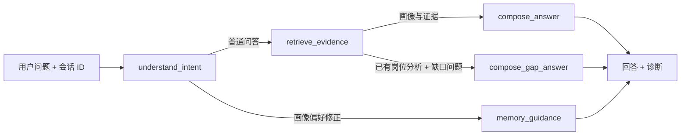

# Agent、检索与模型路线

项目使用 LangGraph 按问题意图做**有限条件路由**，而不是让模型自由调用一组 Agent。检索、画像构建和 JD 分析是不同的业务链路，不能把它们笼统地称作同一个 RAG 算法。

## Career Copilot 的条件路由

| 节点 | 当前实现 | 不是 |
| --- | --- | --- |
| `understand_intent` | 按问题关键词识别证据解释、技能缺口、方向、画像或修正意图 | 通用任务规划器 |
| `retrieve_evidence` | 限定当前用户，检索最多 5 条相关 Evidence | 跨用户全局知识搜索 |
| `compose_answer` | 先准备确定性答案；启用模型时把本次问题、意图、画像、检索证据与最近 12 条历史消息一并装配为模型输入，要求结构化 `answer` 与 `cited_evidence_ids`，过滤未检索到的 ID | 对自然语言每个断言的形式化证明 |
| `compose_gap_answer` | 从指定或最近一次同用户的 `JobAnalysis` 回答缺口与下一步实践 | 模型自主生成的新岗位结论 |
| `memory_guidance` | 提醒用户通过现有“草案 → 确认”接口更新长期画像 | 在聊天中静默写入长期记忆 |

图在 [`graph/career.py`](../backend/app/graph/career.py)；[`api/routes/chat.py`](../backend/app/api/routes/chat.py) 管理会话与岗位分析的用户归属，并在每次请求前加载该线程的 `ConversationMessage` 历史，把 `{role, content}` 列表作为 `history` 传入图，使追问能解析指代并保留先前约束。回答生成后，本轮 user 与 assistant 消息在同一事务内持久化，响应中的 `messages` 返回该线程的完整历史供前端渲染。

多轮上下文来自持久化的消息表，而不是 checkpoint：checkpoint 保存图的执行状态，消息表是可供回看与上下文装配的权威对话事实。模型失败、超时、JSON 不合法或正文包含不属于当前检索结果的 Evidence 引用时，回退到可解释的确定性回答；报告叙述也执行同样的引用校验。画像修正仍通过独立 API 人工确认，并非 LangGraph 自动提交。引用 ID 校验不代表语义事实核验已经完成。

## Evidence 混合检索

[`retrieval/qdrant_store.py`](../backend/app/retrieval/qdrant_store.py) 将每条 Evidence 建成 Dense 与 Sparse 两个表示：

1. Dense：默认是确定性 Hash Embedding（384 维），也可配置 Qwen3 Embedding。Hash 方案便于无模型启动，不应称为真实语义 Embedding。
2. Sparse：项目构建哈希 token 频次稀疏向量，并使用 Qdrant 的 IDF modifier。它**不是完整的 BM25 实现**。
3. Qdrant 对两路候选执行 RRF 融合，同时过滤 `user_id`，防止返回其他用户的证据。
4. 二阶段重排默认是词法相似度实现；配置 Qwen CrossEncoder 后可用模型重排。检索响应带实际 backend、fusion、reranker、fallback 等诊断信息。

`RETRIEVAL_BACKEND=auto` 优先走 Qdrant；异常或已有记录但 Qdrant 为空时，转到基于数据库记录的本地混合检索。强制 `qdrant` 模式会将故障暴露出来。**降级检索与 Qdrant RRF 的打分机制不同**，不能把本地回退结果写成相同的线上检索效果。索引缺失应调用 `POST /api/v1/evidence/reindex/{user_id}` 修复，而非长期依赖 fallback。

## 与其他 AI/规则链路的区别

- **画像**：从用户 Evidence 提取 `ProfileItem`。Demo 模式使用别名目录等规则；真实模型路径可产出更多类别，但会校验引用 ID。人工修正另走“草案 → 确认”流程。
- **JD 分析**：Demo 模式按技能别名、分句和显式优先级标题提取要求。模型可补充有原文依据的长尾技能，但不覆盖已识别的目录技能优先级。评分只使用当前用户仍有效的证据；必需项优先安排。详见[评分与学习路线](job-matching-and-planning.md)。当前实现**不**为每项 JD 要求单独做语义检索，长尾、隐含要求仍可能漏判。
- **报告**：以画像和 JD 分析为输入，固定生成八章节与历史版本。可选模型增强叙述，但存在确定性回退。

## 生成模型的两条部署路线

| 路线 | 配置思路 | 当前可验证范围 |
| --- | --- | --- |
| 无密钥 Demo | `AI_PROVIDER=demo` | 基础 Compose 已完成端到端验收；文本为确定性演示结果 |
| 托管 API | `AI_PROVIDER=deepseek` 或 `openai_compatible`，配置 Base URL、Key、Model | OpenAI-compatible `/chat/completions` 调用代码已实现；真实密钥、模型版本和输出质量需自行验收 |
| 本地模型 | `AI_PROVIDER=local`，接到 vLLM/Ollama 等兼容接口；可选 Qwen Embedding/Reranker | 接口与 Compose overlay 已预留；模型权重、显存、速度和效果需在目标机器验证 |

生成与检索分别由 `AI_*` 和 `RETRIEVAL_*` 配置，互不强制绑定；“本地 Qwen”可以只用于生成，也可以同时用于 Embedding/Reranker。具体启动命令见[项目首页](../README.md)。

## 设计与验证边界

项目把“有来源”作为必要条件，不把它误写成“结论一定正确”。真实评估需覆盖：Evidence 是否充分、画像抽取是否准确、JD 要求是否完整、错误证据是否被引用，以及用户修正后结果是否如预期变化。现有[开发回归基准](evaluation-and-operations.md)主要验证确定性规则与本地检索，无法证明真实 Qwen/DeepSeek 的质量。

## 与 WeKnora 和 WorkBuddy 的实现对照

CareerLens 的 Wiki 版本链与后台运行时参考了 WeKnora 与 WorkBuddy 的架构，但按本项目规模做了取舍。为避免把"参考"误读成"等价"，这里列出关键对照：

| 机制 | 来源 | CareerLens 的实现与取舍 |
| --- | --- | --- |
| Wiki 版本不变量 | WeKnora `wiki_page.go` | 版本仅用户可见内容变化才递增；快照记录被替换版本的作者；`base_version` 乐观并发；回滚=普通编辑；快照分级裁剪；零值字段显式持久化。扩展：引用（`chunk_refs`）变化也计入版本，便于核验引用变更。 |
| 短句柄引用映射 | WeKnora `HandleTable` | 编译器向模型呈现 `c000` 短句柄，落库前解析回稳定 evidence_id；未知句柄丢弃、内联标记剥离。用 `<c id>` + `[c000]` 正则替代上游的 word-boundary 编解码，效果等价。 |
| 表格行身份保护 | WeKnora `wiki_write_row_guard.go` | 拒绝静默丢行的重写；cell 身份按上游规则归一化（全角空格、强调/代码标记、大小写、空白折叠），避免模型仅改格式就被误判。有意更严格：loss 用多重集分母，丢掉重复行中的一行也计为损失。 |
| 运行时不变量 | WorkBuddy 运行时设计 | Run/Step/Event 持久化、幂等键、fencing 代次、取消、租约恢复与 SSE 断点续看均已落地；提交前二次校验代次，业务记录/终态/最终事件同事务。取舍：取消只标记状态并递增 fencing，运行中的外部调用在下一个锁检查点才感知，短任务可接受。 |

核对结论：未发现上游有而本项目缺失的核心不变量；更多实现细节以 `backend/app/wiki/`、`backend/app/runtime/` 代码为准。
