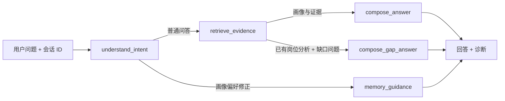

# Agent、检索与模型路线

项目使用 LangGraph 按问题意图做**有限条件路由**，而不是让模型自由调用一组 Agent。检索、画像构建和 JD 分析是不同的业务链路，不能把它们笼统地称作同一个 RAG 算法。

## Career Copilot 的条件路由

| 节点 | 当前实现 | 不是 |
| --- | --- | --- |
| `understand_intent` | 按问题关键词识别证据解释、技能缺口、方向、画像或修正意图 | 通用任务规划器 |
| `retrieve_evidence` | 限定当前用户，检索最多 5 条相关 Evidence | 跨用户全局知识搜索 |
| `compose_answer` | 先准备确定性答案；启用模型时要求结构化 `answer` 与 `cited_evidence_ids`，过滤未检索到的 ID | 对自然语言每个断言的形式化证明 |
| `compose_gap_answer` | 从指定或最近一次同用户的 `JobAnalysis` 回答缺口与下一步实践 | 模型自主生成的新岗位结论 |
| `memory_guidance` | 提醒用户通过现有“草案 → 确认”接口更新长期画像 | 在聊天中静默写入长期记忆 |

图在 [`graph/career.py`](../backend/app/graph/career.py)，checkpoint 可持久化多轮状态；[`api/routes/chat.py`](../backend/app/api/routes/chat.py) 管理会话与岗位分析的用户归属。模型失败、超时、JSON 不合法或正文包含不属于当前检索结果的 Evidence 引用时，回退到可解释的确定性回答；报告叙述也执行同样的引用校验。画像修正仍通过独立 API 人工确认，并非 LangGraph 自动提交。引用 ID 校验不代表语义事实核验已经完成。

## Evidence 混合检索

[`retrieval/qdrant_store.py`](../backend/app/retrieval/qdrant_store.py) 将每条 Evidence 建成 Dense 与 Sparse 两个表示：

1. Dense：默认是确定性 Hash Embedding（384 维），也可配置 Qwen3 Embedding。Hash 方案便于无模型启动，不应称为真实语义 Embedding。
2. Sparse：项目构建哈希 token 频次稀疏向量，并使用 Qdrant 的 IDF modifier。它**不是完整的 BM25 实现**。
3. Qdrant 对两路候选执行 RRF 融合，同时过滤 `user_id`，防止返回其他用户的证据。
4. 二阶段重排默认是词法相似度实现；配置 Qwen CrossEncoder 后可用模型重排。检索响应带实际 backend、fusion、reranker、fallback 等诊断信息。

`RETRIEVAL_BACKEND=auto` 优先走 Qdrant；异常或已有记录但 Qdrant 为空时，转到基于数据库记录的本地混合检索。强制 `qdrant` 模式会将故障暴露出来。**降级检索与 Qdrant RRF 的打分机制不同**，不能把本地回退结果写成相同的线上检索效果。索引缺失应调用 `POST /api/v1/evidence/reindex/{user_id}` 修复，而非长期依赖 fallback。

## 与其他 AI/规则链路的区别

- **画像**：从用户 Evidence 提取 `ProfileItem`。Demo 模式使用别名目录等规则；真实模型路径可产出更多类别，但会校验引用 ID。人工修正另走“草案 → 确认”流程。
- **JD 分析**：Demo 模式按技能别名和邻近关键词提取要求；配置真实模型后使用结构化抽取，并只接受能在 JD 中找到逐字引文的结果，失败时回退规则。模型提取的长尾技能也可参与规范化名称匹配。已有画像引用会再核对 Evidence 是否仍属于当前用户。匹配百分比仍来自固定权重与分级系数，**不是录用概率**；学习路线按缺口、现有等级、优先级、目标岗位与每周时间选择最多四个实践阶段。当前实现**不**为每项要求分别调用 Qdrant 语义检索或验证迁移能力；长尾、隐含要求仍可能漏判。
- **报告**：以画像和 JD 分析为输入，固定生成八章节与历史版本。可选模型增强叙述，但存在确定性回退。

## 生成模型的两条部署路线

| 路线 | 配置思路 | 当前可验证范围 |
| --- | --- | --- |
| 无密钥 Demo | `AI_PROVIDER=demo` | 基础 Compose 已完成端到端验收；文本为确定性演示结果 |
| 托管 API | `AI_PROVIDER=deepseek` 或 `openai_compatible`，配置 Base URL、Key、Model | OpenAI-compatible `/chat/completions` 调用代码已实现；真实密钥、模型版本和输出质量需自行验收 |
| 本地模型 | `AI_PROVIDER=local`，接到 vLLM/Ollama 等兼容接口；可选 Qwen Embedding/Reranker | 接口与 Compose overlay 已预留；模型权重、显存、速度和效果需在目标机器验证 |

生成与检索分别由 `AI_*` 和 `RETRIEVAL_*` 配置，互不强制绑定；“本地 Qwen”可以只用于生成，也可以同时用于 Embedding/Reranker。具体启动命令见[项目首页](../README.md)。

## 设计与验证边界

项目把“有来源”作为必要条件，不把它误写成“结论一定正确”。真实评估需覆盖：Evidence 是否充分、画像抽取是否准确、JD 要求是否完整、错误证据是否被引用，以及用户修正后结果是否如预期变化。现有[开发回归基准](evaluation-and-operations.md)主要验证确定性规则与本地检索，无法证明真实 Qwen/DeepSeek 的质量。
