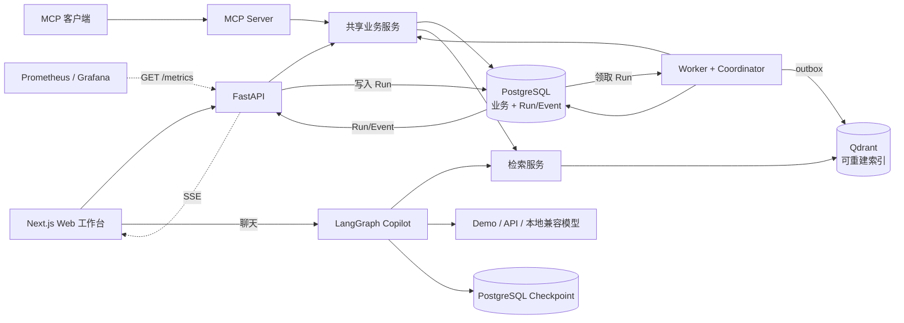
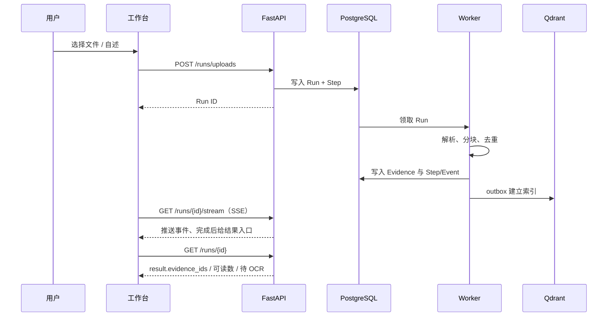
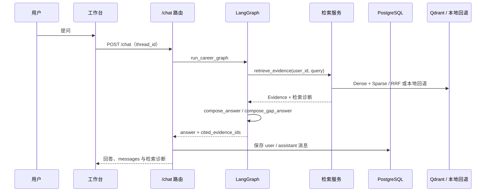

# 系统架构与设计取舍

CareerLens 是个人职业画像与求职决策应用，不是自主执行的“多智能体平台”。它把用户授权的内容转成可追溯 Evidence，再分别服务于画像、JD 匹配、报告和对话。这里描述的是[当前仓库](../README.md)的实现。

## 组件视图

| 层 | 职责 | 代码入口 |
| --- | --- | --- |
| Web | 演示导入、画像、岗位、报告、对话与评测 | [`frontend/app/workspace/page.tsx`](../frontend/app/workspace/page.tsx) |
| API | 请求校验、鉴权、响应与 HTTP 路由 | [`backend/app/api/`](../backend/app/api/) |
| Domain Services | Evidence、画像修正、岗位分析、报告、隐私操作 | [`backend/app/services/`](../backend/app/services/) |
| Agent | 按意图分流：证据问答、已保存的岗位缺口、画像修正提示 | [`backend/app/graph/career.py`](../backend/app/graph/career.py) |
| Retrieval | 用户范围内的 Dense + Sparse 检索与本地降级 | [`backend/app/retrieval/`](../backend/app/retrieval/) |
| Runtime | Run/Step/Event、Worker 租约、幂等、SSE 与索引补偿 | [`backend/app/runtime/`](../backend/app/runtime/)、[`backend/app/api/routes/runs.py`](../backend/app/api/routes/runs.py) |
| Persistence | SQLAlchemy 模型、Alembic 迁移、Qdrant 索引 | [`backend/app/models/`](../backend/app/models/)、[`backend/migrations/`](../backend/migrations/) |
| MCP | 共享业务服务的工具、资源和提示模板 | [`backend/app/mcp/server.py`](../backend/app/mcp/server.py) |
| Observability | `GET /metrics` 的请求计数、延迟直方图与并发数；OpenTelemetry 追踪按需启用 | [`backend/app/observability/prometheus.py`](../backend/app/observability/prometheus.py)、[`backend/app/observability/tracing.py`](../backend/app/observability/tracing.py) |

## 一次完整请求如何流转

### 请求 A：上传文档到导入结果卡

### 请求 B：Copilot 带引用回答

这里有意区分两条证据路径：**JD 分析**将要求与已有 `ProfileItem` 对照，再通过画像上的 `evidence_ids` 追溯来源；**Career Copilot**会为问题实时检索 Evidence。同步 JD 服务没有针对每项要求独立查询 Qdrant，也没有复杂规划器或多个自主 Agent；后台运行时的专业角色、顺序依赖与受控并行见[后台任务与恢复](phase-3-runtime.md)。检索与路由细节见[Agent、检索与模型](agent-and-retrieval.md)。

## 为什么 PostgreSQL 是真相源

Evidence 原文、来源、画像、分析、报告和审计数据都持久化在 PostgreSQL。Qdrant 只保存供搜索使用的向量/载荷投影，可以通过 `POST /api/v1/evidence/reindex/{user_id}` 从数据库重建。这样业务数据不会被向量库的索引状态定义，但两个存储并非单一原子事务：数据库提交后索引可能失败，服务会返回诊断并允许重建。`auto` 检索模式在 Qdrant 异常时可退回本地检索；这属于可用性降级，不等于索引同步完全成功。

## 状态、权限和模型边界

- 对话状态分两层：`ConversationMessage` 表持久化可回看的消息事实（多轮上下文与界面渲染的来源），LangGraph checkpoint 保存图的执行状态；Docker 模式使用 PostgreSQL，测试或轻量本地运行可用内存 checkpoint。会话线程另有用户归属记录。
- HTTP API 支持 `disabled`、`optional`、`required` 鉴权模式。MCP HTTP 对外使用 Bearer Token 与用户/Scope 校验；本地 stdio 由运行它的部署环境承担信任边界。
- Demo 模型是确定性回退，方便无密钥演示。生成模型与检索模型分开配置；接入 DeepSeek、本地 Qwen 或 OCR/ASR 后必须各自验收效果。
- 模型输出被结构化 schema 和允许引用的 Evidence ID 约束；这减少无依据引用，但不能保证每一句自然语言结论都语义正确。

## 设计取舍

普通助手追求"说得顺"，CareerLens 追求"说得有据"。四个关键取舍及其原因：

- **检索与生成解耦**：生成模型可切换 API 或本地服务；检索后端从 Qdrant 自动降级到本地混合检索，并在响应中报告实际使用的 backend、fusion、reranker。这样换模型不必重建索引，降级也不会被伪装成正常检索。
- **知识组织有版本**：Wiki 页版本只在用户可见内容变化时递增，乐观并发防止过期写入覆盖，回滚是一次普通编辑而非删除历史。改动可追溯，误改可恢复。
- **运行时以数据库为队列**：不引入 Redis，用租约、fencing 代次与提交边界保证"提交即终态"，取消与过期都能恢复。少一个中间组件，就要在一致性上把边界写清楚。
- **隐私默认收敛**：审计不含原文，向量删除有补偿，账号删除返回匿名回执。清理动作本身不成为新的数据泄露面。

这些取舍与 WeKnora、WorkBuddy 的对照见[Agent、检索与模型](agent-and-retrieval.md#与-weknora-和-workbuddy-的实现对照)。

## 实现边界

1. JD Requirement 提取与匹配主要依赖技能别名目录及规则；长尾技能和跨领域语义映射不属于默认规则的保证范围。
2. 默认 Hash Embedding 与词法 Reranker 重视可复现和易启动，不能替代真实语义检索质量评估。
3. 生产 Compose 覆盖必要的密钥与鉴权校验；对公网使用还需由部署方提供 HTTPS 反向代理、数据库/向量库网络隔离、备份恢复与告警。
4. 合成回归集证明的是代码基线稳定性，不代表招聘场景的真实准确率。见[评测与运维](evaluation-and-operations.md)。
