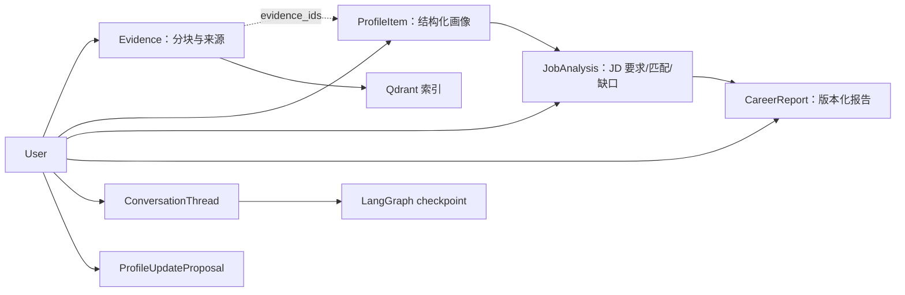

# 数据模型与证据生命周期

核心原则：职业结论不是一段独立生成的文字，而是能够回到用户授权来源的结构化记录。以下模型位于 [`backend/app/models/`](../backend/app/models/)，读者可以用 Evidence ID 从画像、岗位分析和报告追溯原始内容。

## 领域关系

这张图表达业务引用关系，不表示所有关联都由数据库外键直接约束。`evidence_ids` 和分析明细中存在 JSON 数据，因此调用方仍须校验引用是否属于当前用户、是否仍存在。

| 对象 | 主要内容 | 作用 |
| --- | --- | --- |
| `Evidence` | 用户、来源类型/名称/外部 ID、正文、元数据、时间 | 唯一原始证据单元；长内容会分块 |
| `ProfileItem` | 类别、名称、熟练度、置信度、`evidence_ids`、详情 | 可查询、可修正的长期画像；同一用户/类别/名称有唯一约束 |
| `JobAnalysis` | JD 文本、要求、匹配项、缺口、学习路径、报告 JSON | 一次岗位决策的结构化快照 |
| `CareerReport` | 版本、Markdown、结构化内容、诊断、`is_stale` | 独立报告版本，不覆盖旧报告 |
| `ProfileUpdateProposal` | 待批准的画像变更 | 将用户聊天中的纠正与长期资料写入分开 |
| `ConversationThread` | 对话线程与用户归属 | 限定 checkpoint 会话的访问边界 |
| `AccessToken` / `AuditEvent` | Token 哈希/Scope、操作审计 | 权限与隐私操作追踪；不存明文 Token |

## 写入与派生

1. 文本、文件、平台导出或多模态转录先在 [`ingestion/`](../backend/app/ingestion/) 中解析，再由 [`services/evidence.py`](../backend/app/services/evidence.py) 标准化、分块并写入 Evidence。只有用户主动提供或授权导出的内容才应进入系统。
2. Evidence 数据库提交后建立 Qdrant 索引。两者不是分布式事务；若向量写入失败，数据库记录仍可能存在，可检查导入诊断并调用 reindex 修复。
3. [`services/profile.py`](../backend/app/services/profile.py) 读取用户 Evidence 构建画像。默认规则提取适合可复现演示，配置真实生成模型后可抽取更丰富的类别；模型输出仍会过滤无效 Evidence ID。
4. [`services/jobs.py`](../backend/app/services/jobs.py) 从 JD 提取技能要求，并与当前画像对照。`strong / partial / gap` 是规则分级，不是统计意义的招聘成功概率；学习路径根据缺口优先级和每周时间给出估算。
5. [`services/reports.py`](../backend/app/services/reports.py) 将画像与指定 JD 分析固化为新版本报告。模型可在允许的证据边界内补充叙述，失败时仍有确定性报告。

## 用户纠正与陈旧数据

用户在对话中说“我现在更希望去做后端”时，不应把这句话自动当成确认事实。系统会先生成 `ProfileUpdateProposal`；批准后写入修正 Evidence 并更新画像，拒绝则不改变长期画像。画像重建会保留已经确认的更新项，但当前实现并不是通用的冲突消解或事实版本系统：如果原始资料仍支持旧条目，删除型修正后续仍需检查重建结果。

删除单条 Evidence 会尝试清理索引和画像引用，并将引用它的历史报告标为 `is_stale`；旧报告不会被静默重写。整账号清理覆盖关系数据、Token、向量和 checkpoint，并返回匿名回执。跨 PostgreSQL、Qdrant 和 checkpoint 的删除属于多步骤操作，生产环境还需定义备份中的保留/清理策略与失败补偿，不能将本地接口视为端到端合规保证。详见[接入、MCP 与安全](integrations-and-security.md)。

## 可复现性与检查点

- 数据库 schema 由 [Alembic 迁移](../backend/migrations/)管理；Docker 的独立 migration job 先于 API/MCP 启动。
- Qdrant 索引是派生状态；变更 Embedding 维度或模型后，应使用新 collection 或重建索引，避免混合不同向量空间。
- 想检查某项岗位结论，按 `JobAnalysis → ProfileItem → evidence_ids → Evidence` 路径验证。想检查对话答案，则直接展开回答中引用的 Evidence 并查看检索诊断。
