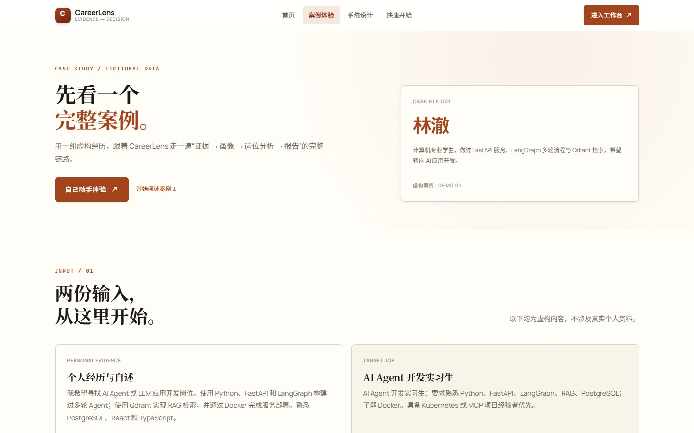
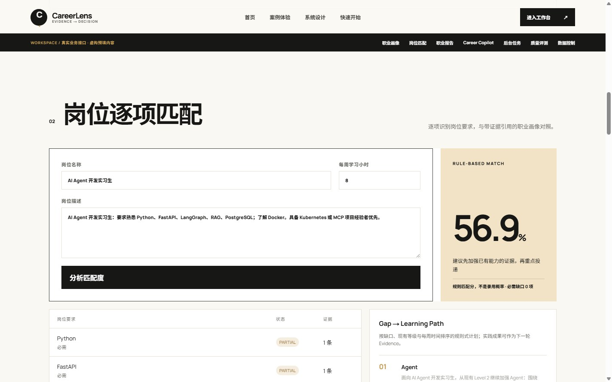
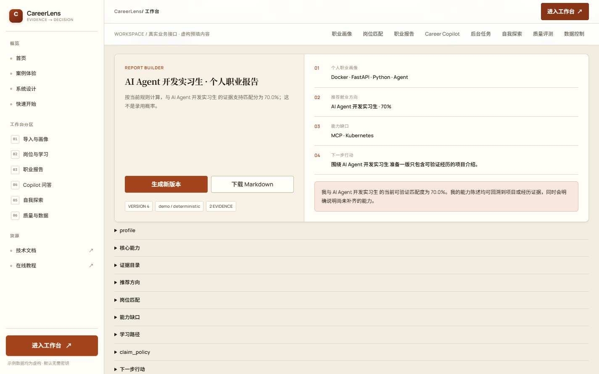

# CareerLens 界面展示

下面的页面截取自本地 Docker 运行的 CareerLens。案例中的人物、经历与岗位均为虚构内容；工作台结果使用默认确定性 Demo Provider，展示的是业务流程与证据链，不代表真实模型效果。返回[项目首页](../README.md)。

## 页面导航

| 页面 | 设计重点 | 本地地址 |
| --- | --- | --- |
| 产品首页 | 项目定位、能力亮点、端到端流程 | `http://localhost:3000/` |
| 案例体验 | 沿着一个虚构人物的经历理解完整链路 | `http://localhost:3000/demo` |
| 系统设计 | 分层、证据生命周期、Agent 与安全边界 | `http://localhost:3000/architecture` |
| 快速开始 | 启动命令、服务入口和模型切换说明 | `http://localhost:3000/start` |
| 交互工作台 | 实际调用 API 的画像、匹配、报告与 Copilot | `http://localhost:3000/workspace` |

## 1. 产品首页

首页用证据驱动的职业判断作为主线。标题下方是工作台的真实渲染截图，数据明确标注为虚构示例，不是已登录用户的资料。

## 2. 虚构案例体验

案例页从个人经历和目标 JD 开始，逐段展示结构化画像、逐项岗位要求、能力缺口与报告。它是帮助理解流程的静态内容；实际操作请进入工作台。

## 3. 系统设计

系统设计页说明 Web、API/MCP、业务服务、PostgreSQL 与 Qdrant 的职责，以及 JD 匹配与 Copilot 检索为何走不同路径。

## 4. 快速开始与工作台

快速开始页提供 Docker 启动、完整链路验收、各服务入口与三种生成模型模式。工作台保留真实业务接口，预填虚构内容，无需 API Key 即可走默认 Demo 模式。

## 5. 构建职业画像

导入虚构自述后，系统将其转为 Evidence，并提取结构化画像条目。技能用五格等级刻度表示抽取器给出的 L1–L5，可信度只分高/中/低三档，旁边是证据条数——单条自述通常只有 `L2 / 1 条证据 / 可信低`，界面不会把它画成“掌握度 100%”。四块内容分别是类别分布、证据覆盖度、技能矩阵和证据时间线，都提供文字表格降级。

## 6. 岗位逐项匹配

从 JD 识别要求，与当前画像逐项对照：有证据但只够部分支撑的标 `partial`，没有证据的标 `gap`，右栏按缺口、现有等级与每周可投入时间排出学习路径。同一模块的分数卡给出本轮规则模型的匹配分（本例 56.9%），**它不是录用概率**。

## 7. 版本化职业报告

画像与岗位分析可固化为独立报告版本，并下载 Markdown。截图显示由 Demo Provider 生成的确定性版本。

## 8. Career Copilot 与证据引用

对话区展示回答、实际检索后端与可展开的原始 Evidence。截图标注 `MODEL FALLBACK`，表示本次使用默认确定性回答，不应将其描述为真实大模型生成效果。

每条结果的实现边界见[架构说明](architecture.md)和[Agent、检索与模型](agent-and-retrieval.md)。
