# CareerLens 界面展示

下面的页面截取自本地 Docker 运行的 CareerLens。案例中的人物、经历与岗位均为虚构内容；工作台结果使用默认确定性 Demo Provider，展示的是业务流程与证据链，不代表真实模型效果。返回[项目首页](../README.md)。

## 页面导航

| 页面 | 设计重点 | 本地地址 |
| --- | --- | --- |
| 产品首页 | 项目定位、能力亮点、端到端流程 | `http://localhost:3000/` |
| 虚构案例 | 沿一份自述和 JD 理解完整链路 | `http://localhost:3000/demo` |
| 系统设计 | 分层、证据生命周期、Agent 与安全边界 | `http://localhost:3000/architecture` |
| 快速开始 | 启动命令、服务入口和模型模式 | `http://localhost:3000/start` |
| 工作台 · 导入与画像 | 文本/文件导入、Evidence、画像与能力证据卡 | `http://localhost:3000/workspace#profile` |
| 工作台 · 岗位匹配 | JD 分析、分数、缺口、课程与学习看板 | `http://localhost:3000/workspace#matching` |
| 工作台 · 报告 | 版本化八章报告与证据目录 | `http://localhost:3000/workspace#report` |
| 工作台 · Copilot | 多轮问答、检索诊断与引用回查 | `http://localhost:3000/workspace#copilot` |
| 工作台 · 自我探索 | 快测、三份自写量表、约束与自定义维度 | `http://localhost:3000/workspace#assessment` |
| 工作台 · 质量与数据控制 | 回归门禁、模型观测、导出/删除/审计 | `http://localhost:3000/workspace#quality`、`#privacy` |

## 1. 产品首页

首页用证据驱动的职业判断作为主线。标题下方内嵌工作台真实渲染截图，数据明确标注为虚构示例；它不是已登录用户的资料，完整交互看下一节。

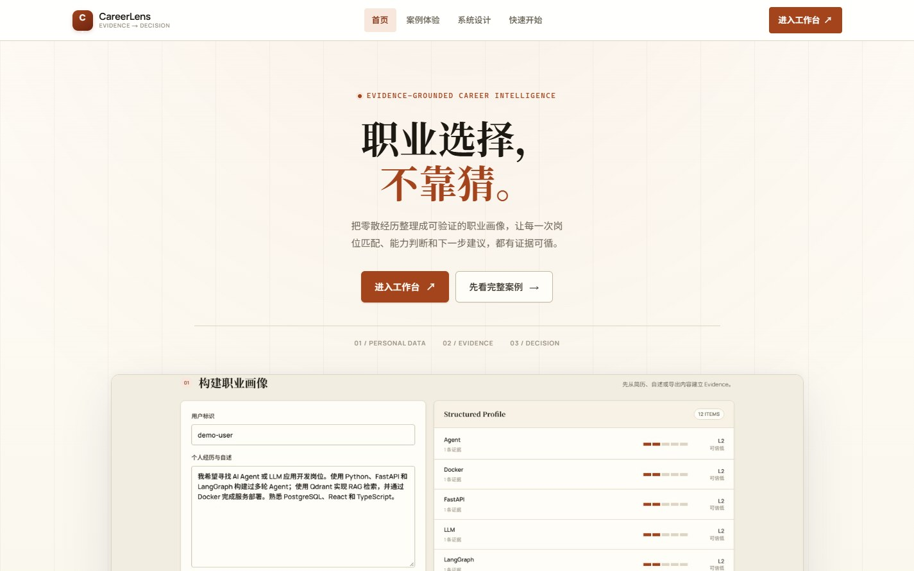

## 2. 虚构案例体验

案例页是帮助理解流程的静态内容。第一张截图只展示上半部的案例入口与两份虚构输入（自述 + 目标 JD）；逐项要求和缺口见第二张局部图。完整操作请进入工作台。

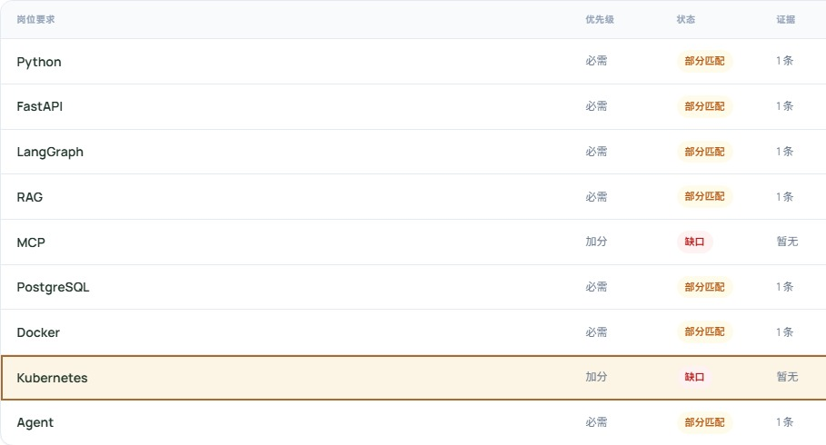

## 3. 系统设计

系统设计页顶部用四层概览说明交互层、服务层、决策层与数据层的职责；JD 匹配与 Copilot 检索两条请求链、Run/Worker 和权限边界见页面下半部及[架构文档](architecture.md)。

## 4. 快速开始与工作台

快速开始页顶部给出 Docker 启动与验收命令，服务入口与三种生成模型模式在下半页。工作台保留真实业务接口，预填虚构内容，无需 API Key 即可走默认 Demo 模式。

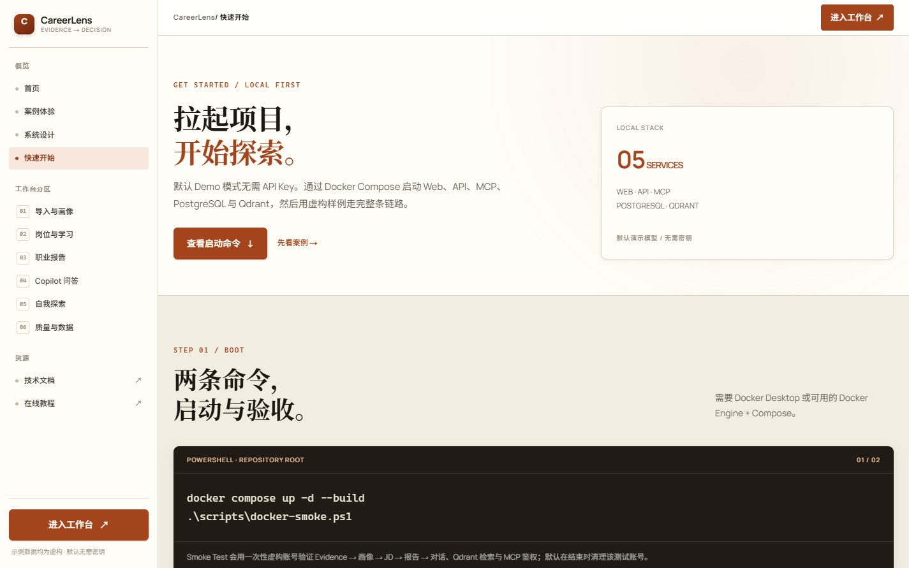

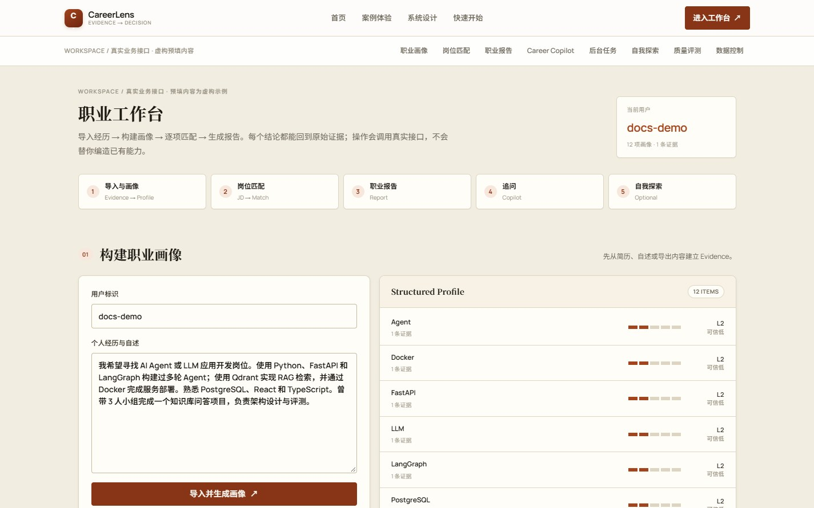

## 5. 导入结果卡与证据回查

上传用户另存的 HTML 后，后台任务中心显示“已完成”，打开结果即出现导入结果卡：可读证据 1、待 OCR 0、重复跳过 0、可定位条目 1。展开证据定位后可直接看到正文、来源文件名和 Evidence ID；脚本标签里的 Kubernetes 标记不会进入正文，这正是证据边界的示例。

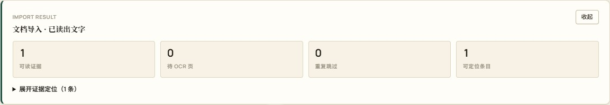

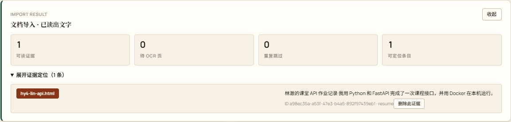

## 6. 构建职业画像

画像概览包含类别分布、证据覆盖度、L1–L5 技能矩阵与证据时间线。技能用五格刻度、可信度高/中/低和证据条数表示；单条自述通常只有 `L2 / 1 条证据 / 可信低`，不会画成“掌握度 100%”。能力证据卡把条目拆成动作、环境与证据 ID；画像模式只改展示和软排序，不改事实、证据或匹配分。

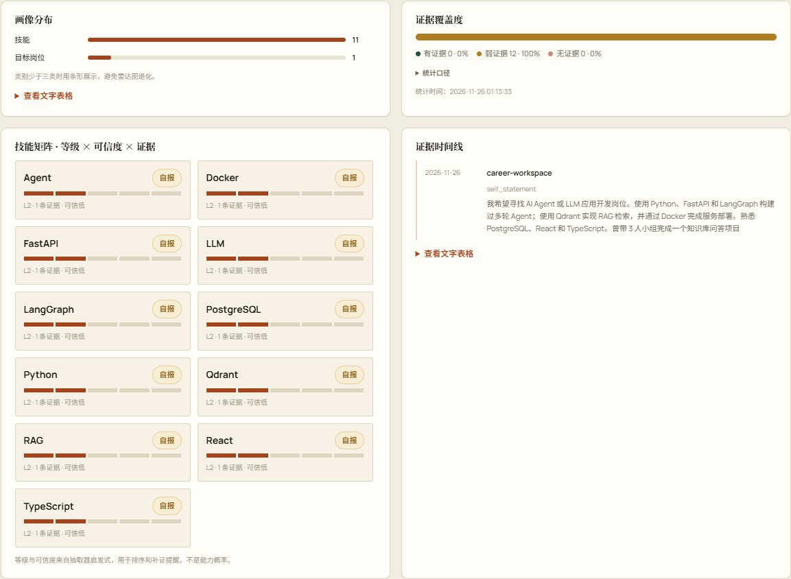

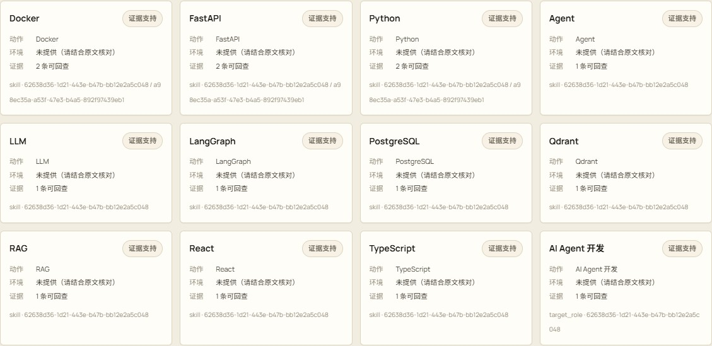

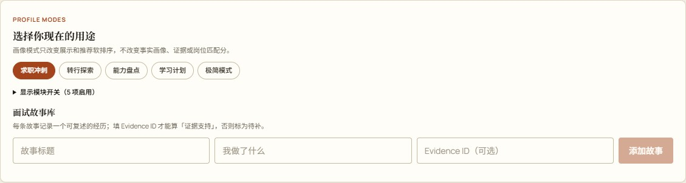

## 7. 岗位逐项匹配、课程与学习看板

分数卡给出本轮规则匹配分（本例 70%）和“不是录用概率”的提示；逐项表标出 `partial` / `gap` 与证据条数。学习计划按周排布，写回的状态有五种；课程目录展示技能、学时、先修、许可与验收方式，职业方向只按可回查技能覆盖排序，不使用人格测评结果。

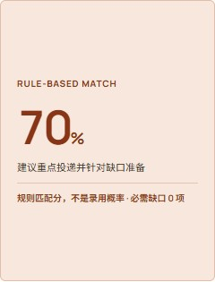

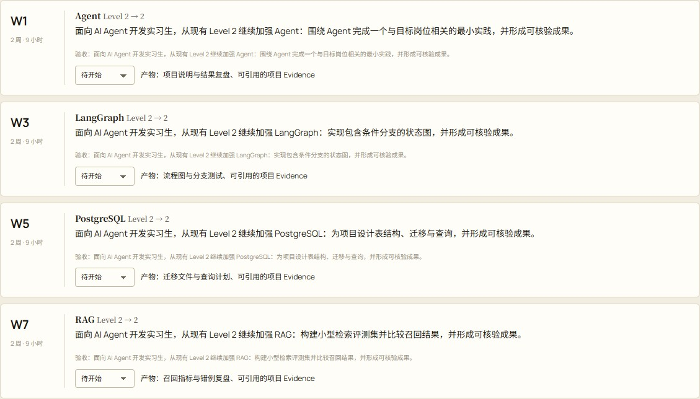

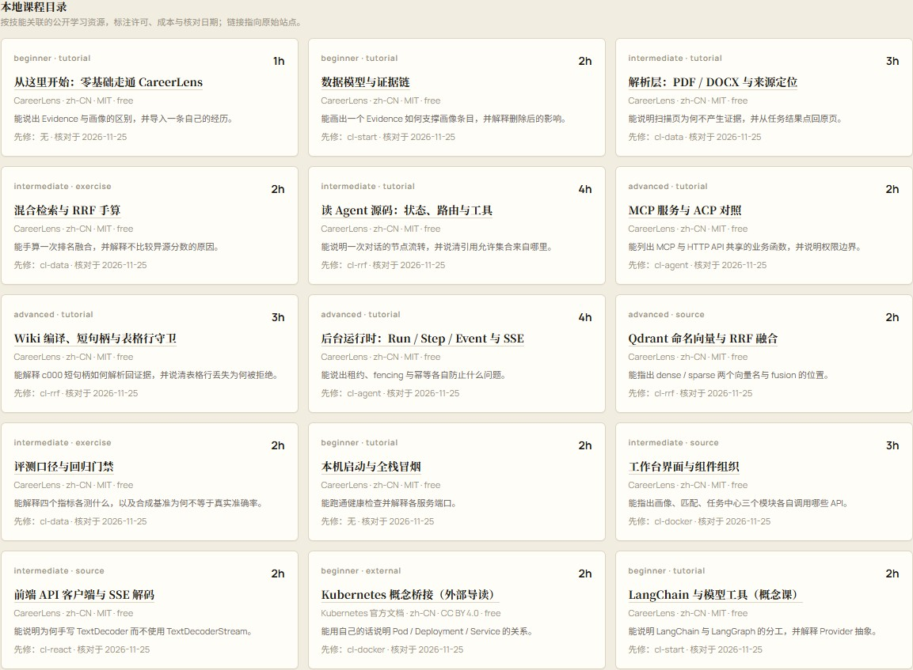

## 8. 版本化职业报告

报告以画像和岗位分析为输入，生成八个固定章节并保留历史版本。截图显示 `demo / deterministic`、1 条 Evidence；展开“证据目录”可直接看到引用的 Evidence ID 与来源，便于从报告回到原文。

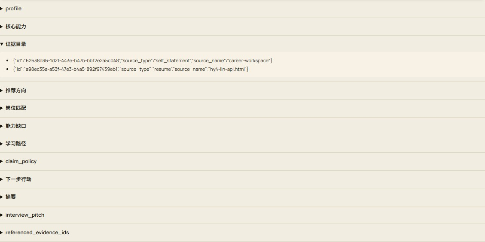

## 9. Career Copilot 与证据引用

对话区展示回答、引用来源 chip 与检索诊断（`local` / `retrieval fallback` / `model fallback`）；本次为确定性回答，不应描述为真实大模型生成效果。点开引用后显示原文与 Evidence ID，回答里的每个结论都能沿着这条链回查。

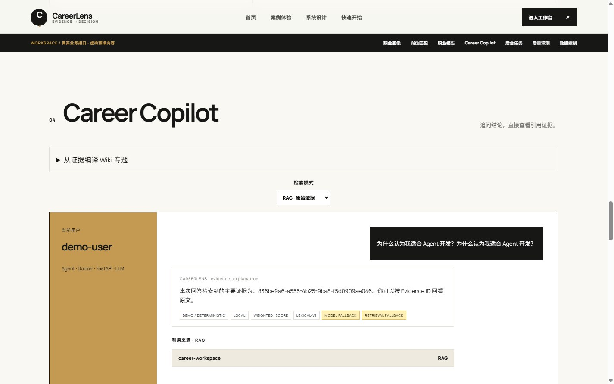

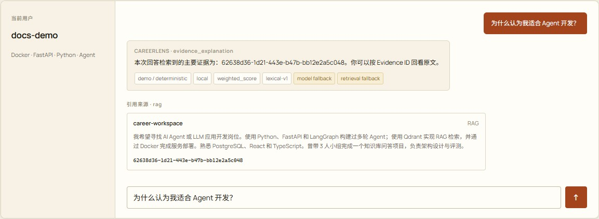

## 10. 自我探索与测评边界

工作台先问真实选择，再做可选测评。三份量表是项目自写的工作偏好、RIASEC 兴趣与大五 20 题：结果单独保存，标 `self_report`，不进入事实画像、不改匹配分。自填 MBTI 标签只作线索；项目**不复制 MBTI® 官方题目，也不声称官方类型**。许可比对和计分规则见[测评题库与许可](assessments.md)。

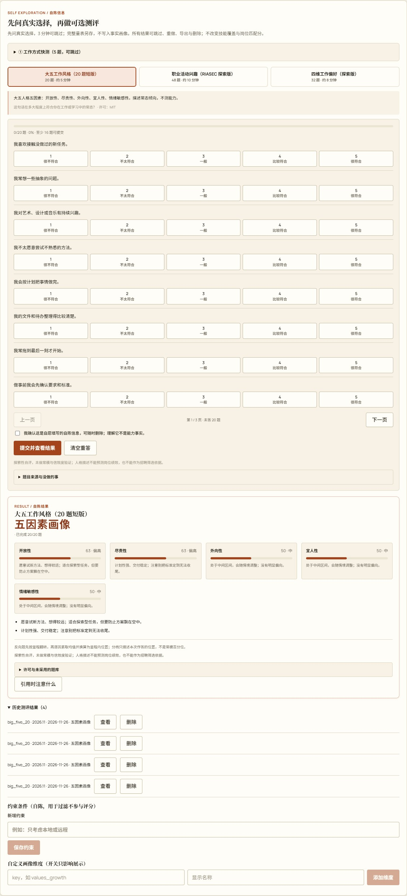

## 11. 质量评测与模型观测

回归门禁用合成开发基准衡量画像抽取、证据召回、支持结论率和岗位匹配，不让模型给自己打分；右侧展示请求数、成功率、延迟、Token 与估算成本。合成基准不等于真实用户准确率，真实模型效果需另行验收，详见[评测与运维](evaluation-and-operations.md)。

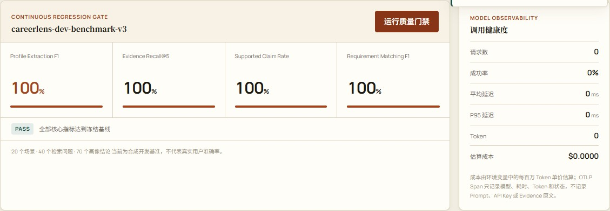

## 12. 隐私与数据控制

数据控制区提供 Owner Token 初始化、JSON 数据导出、单条 Evidence / 整账号删除和审计日志。审计只记录动作与资源，不含 Evidence 原文或 Token 哈希；截图里的 `user_data_exported` 是本次实拍产生的合成事件。详见[接入、MCP 与安全](integrations-and-security.md)。

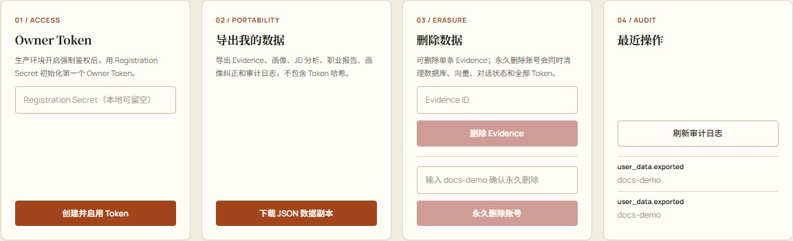

每条结果的实现边界见[架构说明](architecture.md)和[Agent、检索与模型](agent-and-retrieval.md)。
