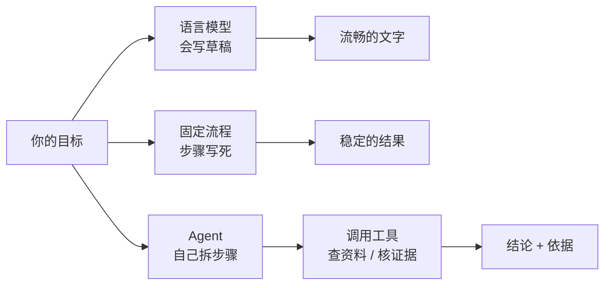

# 00-1 · Agent 到底是什么

**这一课你能做到**：分清「会写草稿的人」（语言模型）、「按固定步骤办事的流程」和「在范围内自己拆步骤办事的助理」（Agent），并且不迷信 Agent——它不总能规划正确，也不总做对。

**前置**：只有浏览器。不装软件、不登录、不用终端。

**用时**：约 15–20 分钟，动手约 5 分钟。

---

## 先想一个问题

你想应聘 AI 应用开发岗，想让电脑帮你整理「我适合什么岗位、还缺什么」。下面三种做法，你觉得哪种是 Agent？

- **A**：一个聊天框，你问「我适合什么岗位」，它写一段很流畅的建议。
- **B**：一个固定流程：先读入你的自述 → 抽出技能 → 查岗位表 → 按公式打分 → 输出结果。每一步写死。
- **C**：一个助理，接到同样的任务后自己决定：先找哪些材料、要不要核对证据、发现某个技能没证据就标记「证据不足」、最后把结论和缺口一起交给你。

先选一个，再想想谁决定下一步。

看答案和理由

**答案**：A 只是语言模型在接话；B 是固定流程；C 才接近 Agent。

## 用一句话记住三个角色

| 角色 | 人话 | 类比 |
| --- | --- | --- |
| 语言模型（LLM） | 根据上文预测下一个字，擅长组织语言，但不知道你的真实经历 | 一个很会写草稿、但对你本人一无所知的人 |
| 固定流程 | 人把步骤写死，机器照做，结果稳定但不会变通 | 一条自动流水线 |
| Agent | 在给定目标和工具范围内，自己决定先做什么、再做什么 | 一个被授权、在范围内办事的助理 |

一张图（文字版在下面）

**文字版**：你的目标可以交给三种角色。语言模型给出流畅文字；固定流程按写死步骤给出稳定结果；Agent 会自己拆步骤、调用工具查资料和核证据，最后交出结论和依据。

**关键区别**：Agent 的价值不在「说得顺」，而在**能用自己的判断把事办完，并交代依据**。但「自己判断」也可能判断错，所以后面整门课都在讲：怎么让它的每个结论都能被核对。

## 动手：给同一个问题画三步

拿你熟悉的一件事——「判断林澈适不适合某个 AI 岗位」。在纸上或心里画三步：

1. **查资料**：需要哪些材料？（自述、做过什么项目、岗位要求）
2. **核对证据**：哪些话有材料支持？哪些只是「他说了」？
3. **交付结论**：给出判断，并说明依据；没依据的地方怎么办？

然后圈出第 3 步里**需要人来确认**的动作。比如「把收藏教程当成掌握技能」这种判断，你愿意让程序自己定吗？

参考答案与常见误判

- 第 1 步的材料应该是**授权提供的真实自述和岗位描述**，不是网上随便找的话。
- 第 2 步要区分「他做过」和「他很熟练」，也要区分「岗位要求」和「他会」。
- 第 3 步里，凡是会改变长期结论的动作（比如确认某项技能、写入长期画像），都适合让人确认；程序不该悄悄替你定。
- **常见误判**：以为 Agent 总能自主规划、总做对。实际上它会出错，所以每一步都要留可核对的痕迹。

## 这一课的落点

CareerLens 就是一个**被范围约束的 Agent**：它能在你授权的证据范围内查资料、核证据、给结论，但不能凭空编经历，也不把推测写成事实。下一课讲：它凭什么说「有证据」。

## 下一步

继续 [00-2 · 提示词与证据](00-2-提示词与证据.md)。术语忘了查[术语表](../术语表.md)。
