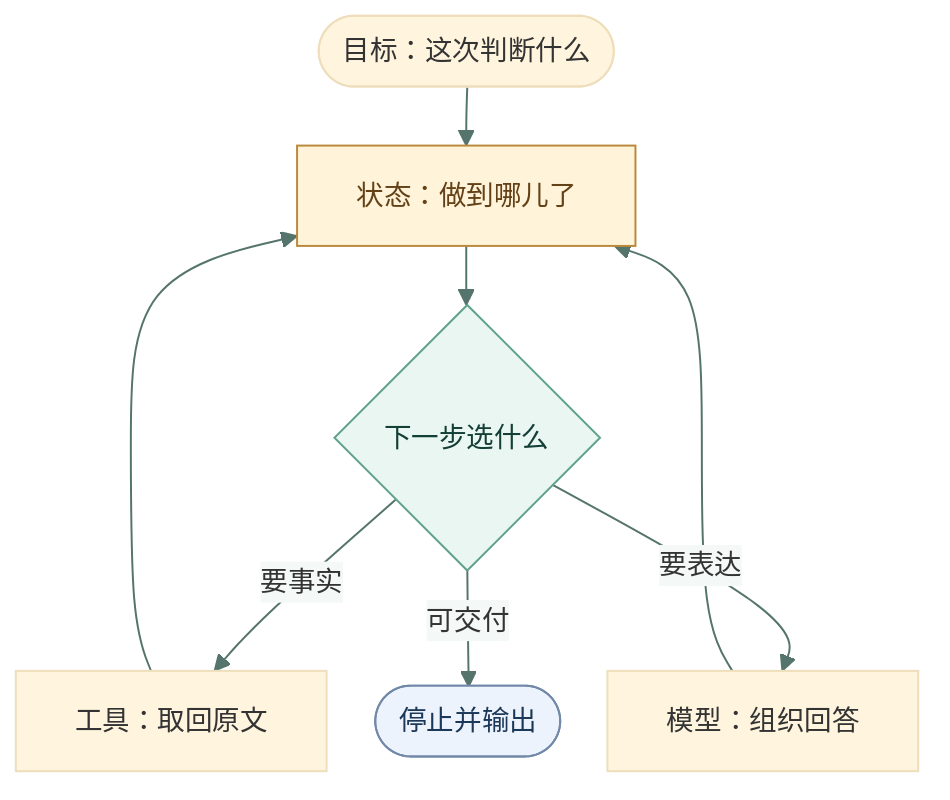
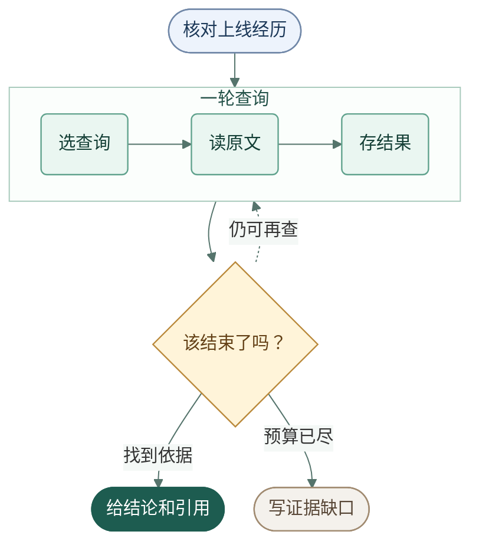

# 00-1 · Agent 到底是什么：谁决定下一步

**只用浏览器。** 阅读约 22–26 分钟，跟做约 12 分钟。学完你能在一张运行记录上指出：哪一步由人事先写定，哪一步由程序根据查到的材料选择，哪一步交给模型，系统为什么在该停的时候停——并且能说清状态、工具、停止条件这三件事为什么缺一不可。

## 先把学习的理由摆正

「Agent」是这两年最容易被用滥的词。有人说它是「更聪明的模型」，有人说它是「能自己干活的程序」，还有人把任何一个调用了大模型的应用都叫 Agent。这些说法都不能让你看懂一段真实代码。

这一章要给你的是一个**可操作的判断框架**：不看宣传，只看三件事——**谁决定下一步、工作做到哪儿了（状态）、什么情况下停**。学会这个框架，你再看任何 Agent 产品、读任何一段 Agent 源码，都能立刻拆开它。

CareerLens 就是一个很好的标本。它不大，但把「有限步骤的工作流」和「模型驱动的步骤」放在一起，还带着证据核对、人工确认、可回查这些真实产品才有的约束。我们用它当贯穿全章的例子。

先把一个容易踩的坑放在最前面，它会在后面反复出现。

## 从一个错误开始：搜到了词，不等于做到了事

林澈申请实习，岗位写「有 Kubernetes 上线经验者优先」。助手搜到一张写着「Kubernetes」的卡，当场给出「有上线经验」。你打开原文，那句完整的话是「收藏了 Kubernetes 教程」。

这不是模型文笔不好，而是**系统把「搜到了词」当成「做到了事」**。要修的不是换一个更会说话的模型，而是把工作拆成可核对的步骤：先查什么、拿到什么才算有依据、什么时候必须写「证据不足」。

先认识四个词，后面一直会用到：

- **Python**：写程序用的语言。
- **Kubernetes**：管理软件怎么运行、发布、扩容的一套系统。
- **上线 / 生产环境**：把软件发布到面向真实用户的环境。本机演示、练习集群演练都有价值，但不能直接等同于生产上线。
- **证据**：能打开、能核对的原文片段，通常带一个稳定编号。

这一组卡片会在阶段 0 反复出现，请把它们当作固定教材：

| 卡片 | 原文 | 能支持什么 | 不能支持什么 |
| --- | --- | --- | --- |
| A | 用 Python 做过课程项目。 | 做过 Python 项目 | 熟练程度、生产经验 |
| B | 收藏了 Kubernetes 教程。 | 有兴趣线索 | 不等于学过、部署过 |
| C | 课程项目只在本机演示。 | 明确限定了运行环境 | 不等于集群或生产 |
| D | 在练习集群把课程接口发布成功，保留了回滚截图。 | 有练习集群的发布记录 | 仍不是生产环境 |
| E | 生产集群变更单：执行人林澈，接口 v2，已发布。 | 支持一次具体的生产发布 | 一次发布≠独立运维能力 |

把这张表存进脑子。后面讲 Agent 的每一个部件，我们都用「系统该怎样处理 B 和 E」来演示。

## 一张地图：Agent 由哪些部件组成

先看全貌，再逐块拆。不要急着记名字，先记住「每块管什么」。

| 部件 | 解决什么问题 | 一句话类比 | CareerLens 里的对应 |
| --- | --- | --- | --- |
| 目标（Goal） | 这次到底要判断什么 | 任务单 | 用户的问题 + 意图 |
| 状态（State） | 工作做到哪儿，下一步还能读到什么 | 随身记事本 | `CareerState` |
| 下一步的选择 | 在允许的动作里选一个，或交付并停止 | 方向盘 | 节点函数 + 条件路由 |
| 工具（Tool） | 受控地查资料、做动作，不替应用下结论 | 手 | 检索节点、受控 API |
| 停止条件 | 什么情况算完成、什么情况写「证据不足」 | 终点线 | 每个答复分支连到 `END` |
| 模型（可选） | 需要语言能力时生成或选择 | 一位会说话的帮手 | `compose_answer` 里的模型调用 |

读图记住一条主线：**目标固定，状态累积，每一步在允许的动作里选一个，直到满足停止条件**。模型只是其中一种可选动作，不是 Agent 的本质。

## 第 1 块：Agent 不是一个更聪明的模型

给模型一段自述让它改写成职业简介，是一次**单轮调用**：人给齐输入，模型给输出。任务一旦变成「在几十份材料里核对上线经历」，就要决定先搜哪个词、搜到以后读哪条原文、什么时候停止。这时需要的不是一次回答，而是一套**带着当前进展的工作**。

可以把 Agent 理解成三件事的组合：

1. **目标**：这次要判断什么，例如「有没有生产 Kubernetes 上线记录」。
2. **状态**：工作做到哪儿了，例如已经查询过的词、找到的卡片、剩余次数。
3. **下一步的选择**：在允许的动作里选一个继续，或者交付结果并停止。

模型可以是选择下一步的那个部件，也可以只负责写最后一句话。程序用 `if` 写死的分支同样是在选择下一步。**是不是 Agent，关键不在有没有模型，而在下一步是否由当前状态和规则/模型共同决定。**

官方文档把 LangGraph 定义为「用于长时间运行、有状态 Agent 的低层编排框架与运行时」。它刻意不规定提示词或 Agent 架构，因为编排和模型是两件事。 [LangGraph 官方说明](https://docs.langchain.com/oss/python/langgraph/overview)

### 四种「谁选下一步」的做法

| 做法 | 谁选下一步 | 什么时候够用 | CareerLens 里的对应 |
| --- | --- | --- | --- |
| 单轮模型调用 | 人一次性给齐材料，模型写答复 | 改写一段自述、提要 | 可选模型增强报告叙述 |
| 固定条件工作流 | 程序写好的分支，按输入走不同路径 | 问题类型清楚、步骤可列举 | 对话图按意图走检索、缺口或确认指引 |
| 工具调用循环 | 模型可提议下一次查询，应用校验后执行 | 边查边改问法的调查任务 | 当前对话图不用这种自由循环；检索节点由程序调用 |
| 多角色分工 | 协调者给不同角色最小输入，收回候选 | 子任务确实不同、可独立验收 | 后台任务里的角色子图，不在基础对话图里 |

工作流也能分支、重试和回到上一步。「自主程度」主要取决于下一步是事先写好的规则，还是运行时从一组允许的动作里挑出来的。两种方式可以出现在同一个应用里：例如用规则限制最多查两次，把「这次换成哪个查询词」留给模型。

看一个新系统时，可以问两句。材料变了，下一步会怎样变？这一步是程序按预写规则选择的，还是模型从工具清单里提议的？把答案对回上面的四种做法，就能具体说出它在哪一步有自主选择。

## 第 2 块：状态——一次运行留下什么

**状态**是当前任务里保留、下一步还能读到的数据。LangGraph 把它描述为共享的、带类型的数据快照，节点读取它并返回部分更新；默认情况下，新值覆盖旧值，需要累积的字段可以定义合并规则。 [Graph API 官方说明](https://docs.langchain.com/oss/python/langgraph/graph-api)

给核对助手的第一版纸面设计只要四项状态：

| 状态字段 | 第一次查完后的样子 | 为什么需要它 |
| --- | --- | --- |
| 待核对的主张 | 林澈在生产 Kubernetes 集群发布过接口 | 固定判断目标，不被搜到的词带偏 |
| 试过的查询 | Kubernetes | 下一轮不要重复同一个词 |
| 已知证据 | B，收藏记录 | 记录「查到了什么」，便于带引用交付 |
| 剩余查询次数 | 1 | 让停止条件可计算 |

真实项目的 `CareerState` 也是同类字段：问题、用户、意图、检索候选、诊断、回答、岗位分析、模式等。它在 [`backend/app/graph/career.py`](../../backend/app/graph/career.py) 里以 `TypedDict` 声明。节点只返回变更的字段，例如 `understand_intent` 返回意图并清空上一轮的检索结果，而不是重造整个状态对象。

### 状态为什么必须「带类型」和「可回查」

零基础时容易把状态想成「随便塞点东西的抽屉」。但在真实系统里，状态设计决定三件事：

1. **节点之间能不能读懂彼此**：`retrieve_evidence` 写入的字段，`compose_answer` 必须知道叫什么、是什么类型。`TypedDict` 把这份约定写下来，写错字段名能在编辑器或测试里被抓到。
2. **上一轮会不会污染下一轮**：如果新一轮开始时没清空检索候选，用户换一个问题后，系统可能拿着上一轮的证据作答。`understand_intent` 主动清空这些字段，就是在防这件事。
3. **出问题能不能复盘**：状态是「当时系统知道什么」的记录。回答错了，先看当时的状态里有没有 D、E；没有，是检索的问题；有，是答复的问题。

这三点对应到 [00-4 数据模型](00-4-数据模型大白话.md) 你会更清楚：短期状态（`thread_id` 下的执行快照）、可见历史、长期画像是三种不同的记录，别当成一份数据。

## 第 3 块：工具——是手，不是判断

拿到 B 之后，人能看出「收藏」离「发布」还差很远。程序不能靠感觉，它要把查询换成行为词，例如「发布、部署、变更单」，再调用一次**工具**。工具在这门课里就是一个受控函数：接收查询，返回卡片编号和原文；它不替应用决定结论。

调用工具前还要问两件事：参数格式对不对，以及这个用户有没有权限查这些资料。已登记的工具只允许给定 `limit` 的整数值；`user_id` 应来自应用识别出的当前用户，不能信模型顺手编出来的编号。工具超时也要记成一次「查询失败」，不能合并进「没有找到」。

### 为什么「工具提议」不等于「工具执行」

很多框架允许模型提议一次工具调用。但模型给出的是**建议**，不是许可证。正确的顺序永远是：

1. 模型（或程序）提出：`search_evidence(query="部署记录", limit=3)`。
2. **应用校验**：工具名在登记清单里吗？`limit` 是 1–5 的整数吗？`user_id` 来自登录状态吗？
3. 应用执行检索，拿到结果。
4. 把结果作为受控输入交回，再生成结论。

CareerLens 的基础对话图由程序在检索节点调用查询工具。每一步的输入和返回值都能用固定材料复跑。等你读到工具装饰器，也可以回过头对照哪些入口由模型提议。 [00-6 的工具讲解](00-6-LangChain与模型工具.md) · [01-B 工具调用](../01-agent-design/01-B-工具调用.md)

## 第 4 块：停止条件——本身就是产品规则

「找到 E 那样的变更单」才能写一次生产发布；「查完两次仍只有 B、C、D」就交付一句范围清楚的话：「当前材料能确认练习集群发布，不能确认生产上线。」预算用完不是失败，失败是查过却把没查到写成没有。

停止条件要写进规则，而不是靠模型「自觉」。一个好的停止条件至少说清三件事：

| 要写清什么 | 例子 | 不写清会怎样 |
| --- | --- | --- |
| 什么算「找到依据」 | 有变更单，含执行人、环境、发布结果 | 把 B 当依据，把收藏说成上线 |
| 什么算「查够了」 | 最多两次查询，或已覆盖行为词 | 无限查下去，或第一次就草率收尾 |
| 够不着时怎么收尾 | 写「证据不足」，并列出要补什么材料 | 编一句模棱两可的话糊弄过去 |

用户如果说「把它写进我的长期画像」，应用不应借着对话悄悄改库。它先生成变更草案，让人在专门界面确认。这是**写入权限**的设计，跟「模型会不会说话」无关。CareerLens 的 `memory_guidance` 节点就是这条提示分支，真正的草案与确认走独立 API。 [00-2 会展开这条边界](00-2-提示词与证据.md)

## 一张运行记录：把六个部件摆在一起

上面那张图把一轮工作画成一个可重复的小框：选查询 → 读原文 → 存结果，框外是停止检查。

读这张图时，把「目标」想成问题，把「一轮查询」想成状态更新，把「该结束了吗」想成规则，把两种输出想成交付。六个部件就齐了。

## 先猜，再跟做：只改一个变量

问题固定为「有没有生产 Kubernetes 上线记录」。先在纸上预测每轮会留下哪些 ID、为什么结束，再到练习页核对。 [打开 Agent 练习](https://wenmo-yu.github.io/careerlens/foundations-lab.html?lesson=agent)

| 运行 | 唯一改动 | 先写下你的预测 |
| --- | --- | --- |
| 第一次 | 查询次数设为 1 | 能看到 D 吗？最后一句怎么收？ |
| 第二次 | 只把次数改成 2 | 多拿到哪张卡？结论变了吗？ |
| 第三次 | 保持 2 次，附上 E 号变更单 | 哪一条新材料让结论从「不足」变成「支持一次发布」？ |

核对三条运行记录

第一次查「Kubernetes」得到 B，预算用完，记录当前证据缺口。第二次追加「发布、部署、变更单」得到 D，可以写「做过练习集群发布」。两份材料合起来仍缺生产记录。第三次拿到 E，可以引用变更单，写「有一次接口 v2 的生产发布记录，执行人是林澈」。要判断他能否独立运维，还需要别的证据。

三次只改了预算或材料中的一项。说清是哪一项改变了结果，就把结论追到了一次具体行动。

**换一个任务再试。** 假设助手要从两份公司制度里判断一项费用能否报销。先写出允许的工具、预算和停止条件，再写一条「找到的附件只说明申请流程」时如何收尾。把设计交给另一人，看对方能否照它走出一样的过程。

## 到真实项目里认这些零件

CareerLens 的对话图有几条明确路线。问「为什么认为我会 Python」会进入检索和普通答复。说「记住我更希望做后端」会进入确认指引。问「还差什么」且已有岗位分析时，先经过检索，再进入读取分析结果的缺口答复。图的入口是 `understand_intent`，第一个条件路由是 `route_intent`。 [对话图源码](../../backend/app/graph/career.py) · [系统设计文档](../../docs/agent-and-retrieval.md)

| 这节课的词 | 在本项目里去看什么 |
| --- | --- |
| 目标 | 用户问题 + `intent` 字段，先判意图再决定路径 |
| 状态 | `CareerState` 的字段；`retrieve_evidence` 只返回候选与诊断两个字段 |
| 节点（下一步的选择） | 五个函数节点：理解意图、检索、普通答复、缺口答复、确认指引 |
| 条件边 | `route_intent` 选择确认指引或检索。`route_answer` 选择普通答复或岗位缺口答复 |
| 工具 | 检索节点由程序调用，不让模型自由提议工具名 |
| 停止 | 每个答复分支都连到 `END`；没有「无限再查一轮」 |
| 续跑 | `thread_id` 与 checkpointer 保存线程状态，详见 [00-5](00-5-LangGraph与工作流.md) |

checkpoint 保存图的执行状态，多轮对话的历史消息另存数据库。用户提出的画像修正要经过独立的草案确认。 [00-5 状态与续跑](00-5-LangGraph与工作流.md) · [01-B3 长期画像与确认](../01-agent-design/01-B3-长期画像与确认.md)

## 常见坑，提前绕开

- **把「调用了模型」当成 Agent。** 一个 `model.invoke()` 只是单轮调用。判断标准是下一步是否由状态决定。
- **把「搜到了」当成「做到了」。** 这正是 B 的错误。检索返回候选，不等于结论有依据。
- **把「有状态」当成「有记忆」。** 执行快照、可见历史、长期画像是三份数据。
- **把预算当成事实判断。** 查两次没找到，只能写「当前材料不足」，不能写「没有」。
- **让模型决定 `user_id`。** 身份来自登录状态；模型编的编号一律不认。
- **把人工确认塞进对话图偷偷写入。** 生成草案和确认写入要分开，用户可见、可拒绝。

## 外部产品的做法对照

- **编程助手**可以读文件、运行检查、按报错定位下一个文件。读架构时留意读文件和写文件是否分开授权。 [Claude Code 文档](https://code.claude.com/docs/en/overview)
- **研究助手**会分解问题、找来源、整理带引用的结果。遇到冲突材料时，哪个步骤负责把冲突显示出来？ [Gemini Deep Research](https://gemini.google/overview/deep-research/)
- **编排工具**可以把「读订单 → 判断售后条件 → 转人工」画成固定节点；LangGraph 和 Dify 都提供这类组织方式。 [Dify 文档](https://docs.dify.ai/en/home) · [LangGraph 概览](https://docs.langchain.com/oss/python/langgraph/overview)

## 下一步

带上第一次和第三次找到的材料，去 [00-2 提示词与证据](00-2-提示词与证据.md)看它们怎样进入模型请求、角色怎么标、以及编号正确之后还要检查什么。想先看「状态、节点、边」在代码里怎么落到一起，可以跳到 [00-5 LangGraph 与工作流](00-5-LangGraph与工作流.md)。
