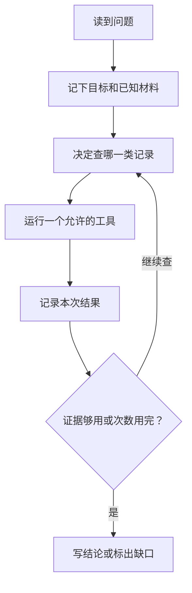

# 00-1 · Agent 到底是什么

**阅读约 6–8 分钟，练习约 6 分钟。** 只用浏览器。读完画出一条能停下来的办事流程。

林澈要申请一份实习。他手里有三张卡：A 写「用 Python 做过课程项目」，B 写「收藏了 Kubernetes 教程」，C 写「课程项目只在本机演示」。招聘方问了一个具体问题：**他做过哪些能拿出依据的事？**

如果把这三张卡一并交给聊天模型，它可以起草一段自述。现在再加个条件：卡片改成几十份文档，找到相关段落之前，你也不知道应该查什么。程序要决定下一步做什么，要记住查到了什么，还要知道什么时候可以结束。这时我们才需要讨论 Agent 的设计。

## 先想清楚谁决定下一步

| 做法 | 下一步由谁决定 | 在这个案例里会发生什么 |
| --- | --- | --- |
| 一次模型问答 | 调用方把材料和指令一次交给模型 | 模型根据已有三张卡写一段话 |
| 固定工作流 | 程序按预设条件走 | 总是先读材料，再查引用，最后出草稿 |
| 受约束的 Agent | 程序规定能做什么，模型可在授权的范围里选择行动，也可由程序用条件路由 | 先找 Python 项目。看到问题问「上线」时，继续查部署记录，查到足够依据或用完次数就结束 |

实际产品常把三种做法组合起来。例如固定流程负责查数据和留记录，模型只负责整理一段回答。先画清谁负责哪一步，后面再决定在哪里放模型。

沿图走一遍。提问给出**目标**。当前问题、已有资料和查了几次组成**状态**。选择查什么是**决策**，查资料是**行动**，查到的段落或报错是**反馈**。停止条件告诉程序何时作答，或何时交给人确认。

## 先写一份具体的设计

假设你只有「查证据」和「读原文」两个工具。工具可以是一个普通函数，也可以是调用其他服务的接口。给它一个明确的输入，它返回一份可检查的结果。

| 设计项 | 给林澈的助手怎么定 |
| --- | --- |
| 目标 | 分开回答「用过 Python 吗」和「有 Kubernetes 上线记录吗」 |
| 状态 | 两个待回答的问题、已找到的卡片、余下查找次数 |
| 可以做的事 | 搜索卡片、读取原文、起草结论 |
| 如何停止 | 两个问题都能给出判断，或查找次数用完。此时没依据的要求标「证据不足」 |
| 交给人的事 | 补充原材料，核对对外提交的内容 |

比如查「Python」得到 A。接着查「Kubernetes」得到 B。系统可以把 B 暂存在状态中，但想写「上线」还需要能支持上线的材料。查不到就标缺口。即使每一步都由规则决定，这个设计也值得画出来，因为你解释得出哪些动作发生了，以及为什么画面停在这里。

## 现在常见的技术放在哪一步

- **条件路由和状态图。** 流程只有少数几条可预期的路时，用节点表示步骤，用条件决定走哪条边。CareerLens 用 LangGraph 实现这类流程。开始看源码时，先找进入条件和出口。 [LangGraph 文档](https://docs.langchain.com/oss/python/langgraph/overview)
- **工具调用循环。** 在源码搜索、资料查找等任务中，模型可提出下一次工具调用。程序执行、返回结果，然后继续判断。这一类设计常见于 ReAct（根据观察继续行动）。在写代码前先定可用工具、次数和超时。 [OpenAI Agents SDK](https://openai.github.io/openai-agents-python/)
- **检索、状态保存和人工确认。** 问公司文档时，先检索再作答。任务可能跨刷新或等待时，把进度和输入保存下来。申请变更或写入长期资料时，先展示待确认的内容。后面我们会在 CareerLens 中分别找到这三个设计。
- **子 Agent。** 如果一个任务确实有两种职责，可以分给两个小角色。例如一位只看岗位描述并提取要求，另一位只收候选引用并检查它是否在本次允许的范围内。上层程序控制调用和提交。

## 常见的 Agent 产品、框架和协议

把下面几类放在同一张桌上看，有助于读别人的架构图。一个应用可同时使用框架和协议。

| 类别 | 代表例子 | 可以观察的动作 |
| --- | --- | --- |
| 编程应用 | Claude Code | 依次查文件、运行检查、提出代码修改。留意凭什么知道下一步要查哪个文件 |
| 应用搭建平台 | Dify | 把检索、模型和分支连成工作流。留意哪条连线由规则决定 |
| 代码框架 | LangGraph、OpenAI Agents SDK | 在代码里组织状态、工具与角色。留意出错或用完预算后怎么退出 |
| 接入协议 | MCP、Agent Client Protocol（ACP） | MCP 可以让应用发现并调用外部能力。ACP 定义客户端与 Agent 的会话和交互 |

编程之外，内部知识问答可以先查政策原文，客服助手可以先读订单再决定转人工，研究助手可以记录搜过的资料和缺口。判断这类应用值不值得引入 Agent，可以问同一个问题：**下一步是否需要根据刚拿到的结果改变？**

继续查阅产品与协议文档。 [Claude Code](https://code.claude.com/docs/en/overview) · [Dify](https://docs.dify.ai/en/home) · [MCP](https://modelcontextprotocol.io/docs/learn/architecture) · [ACP](https://agentclientprotocol.com/get-started/introduction)

## 练习：画出两条结束路线

拿一张纸，先写下林澈的问题。只给自己两次查找的机会，分别画下面两种结果。

1. 第一次查到 A，第二次查到 B。写下两句最终结论，每句注明依据。
2. 保持第一次结果不变，把第二次改为「在生产集群部署课程项目，并附部署记录」。哪一句可以更新？哪一句应该保持原样？
3. 加一项需要当事人确认的动作，例如把草稿写进长期画像。把确认节点放在动作前面。

核对你的路线

第一次找到 A 足以写「做过 Python 课程项目」。第二次只查到 B 时，写「当前材料不足以支持 Kubernetes 上线经验」。新记录要先核实是否确实用了 Kubernetes、能否找到部署证据，再决定提升结论。Python 结论继续沿用 A。写画像应先生成草案，再由用户核对并确认。

### 到 CareerLens 里会看到什么

CareerLens 的对话图预先写好了可走的路。问「为什么认为我会 Python」会进入检索，再组织回答。说「记住我更希望做后端」，它会给出提交和确认画像草案的指引。把这两句话留着，跑起应用后可在源码课对照两条路径。

## 下一步

带上这张流程草图，去 [00-2 提示词与证据](00-2-提示词与证据.md)写出模型真正收到的话，再给结论配证据。
