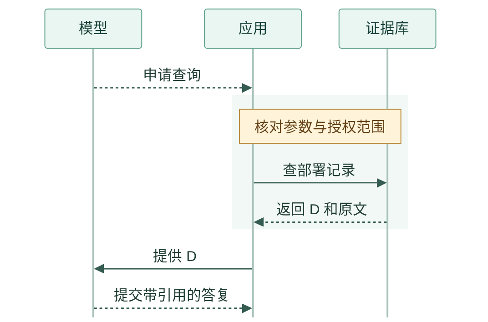

# 00-2 · 提示词与证据：怎样写出能核对的结论

**只用浏览器。** 阅读约 9–12 分钟，跟做约 10 分钟。接着用林澈的材料改一份报告，你会看见模型收到的规则、问题和原文，学会分开检查数据格式、引用范围和句子本身。

## 同一份材料，可以问出两种任务

如果只问「把林澈写得专业一点」，答复里的「熟练使用 Python，具备 Kubernetes 上线经验」听起来很顺。现在把它当成一份要给招聘方核对的报告，从「熟练」「上线」这两个词向后查。A 说用 Python 做过课程项目，B 说收藏，C 说明早先只在本机演示，D 说后来发布到了练习集群。报告里新增的程度和环境都需要依据。

先规定任务，再附材料。下面四部分可以由不同角色准备，合起来才是模型的这次输入。

| 部分 | 本次写法 | 帮我们解决什么 |
| --- | --- | --- |
| 系统规则 | 逐项判断证据支持到哪儿。每条肯定结论提供来源编号 | 说明报告怎么判断 |
| 用户问题 | 林澈有哪些 Python 实践？生产 Kubernetes 上线有依据吗？ | 明确这次要回答的两项 |
| 运行时上下文 | 求职者资料 A～D，以及岗位的要求 | 说明此刻能看哪些信息，区分人物经历和招聘条件 |
| 输出约定 | 每条输出结论、判定、引用和还缺的证据 | 方便程序显示、读者核对 |

模型的「上下文」是这一轮送进去的内容。第二次调用若只附 A、B，模型没有机会读到 D。用户追问「它部署在哪里」，程序还要提供能指明「它」的必要会话历史。调试时先看模型实际读到了什么，再决定该改提示词、补一次检索，还是改变结论。

常见的消息记录会标注角色。`system` 交代应用规则，`user` 带着读者这次的问题，`assistant` 是模型前一次给出的回应。`tool` 用于标记应用返回的工具结果，例如 D 的正文。岗位描述和引用文档都应保留资料身份，岗位要求「熟悉 Kubernetes」这行不能直接写进候选人的经历栏。

可以把规则写得具体些。试着从下面两条里挑一条你能实际检验的。

- 「尽量客观地描述候选人。」
- 「将‘用过’、‘熟练’和‘生产上线’分开判断。若材料只有收藏、学习笔记或本机演示，保留原文描述的范围。生产上线缺证据时，写清楚要补的记录。」

第二条可以用 B、C、D 逐条打分。拿 B 验证它会不会把收藏抬成技能，拿 D 验证它会不会把练习集群抬成生产环境。你可以把这些材料固定下来，每次改规则后都跑同一批反例。

## 跟随一次工具调用

上一课给了搜索工具。很多 Agent 允许模型先提出一次工具调用。下面是一个课堂用的请求格式。已登记的 `search_evidence` 接收文本查询和 1～5 的整数 `limit`。

```json
{
  "name": "search_evidence",
  "arguments": {
    "query": "部署记录",
    "limit": 3
  }
}
```



把 `limit` 写成 `"所有"`，参数类型就不符合约定，请求应该在应用里停住。用合法参数搜索后得到空列表，则说明查询执行过，当前没召回材料。两种情况分开记录，可以避免去修一个并不存在的检索错误。

再问一步：`user_id` 应该由谁提供？可信的用户身份来自应用的登录状态或受控请求。即使模型提出了另一个用户编号，也要按授权范围查询。拿到结果后，应用应把来源的原文和 ID 一起交给下一步。

## 一条结论要过三关

JSON 是程序可以拆开读取的文本格式。这里用一个练习约定保存结论。

```json
{
  "claim": "林澈用 Python 做过课程项目",
  "citation_ids": ["A"]
}
```

1. **格式。** 字段是否齐全，类型是否符合约定。上面用方括号写一个 ID 列表，适合一条结论引用多份材料。
2. **引用。** 当前请求只给了 A～D，引用的每个编号都要在这次允许的范围里，点击时还能找到原文。
3. **支持。** 打开原文，核对人物、动作、环境和时间。「D」能把说法支持到「在练习集群发布过接口」。

### 跟做：修一次，再检查还剩什么

先在脑中判每份输出最早会在哪一关失败，打开浏览器练习再核对。依次选择四份草稿，特别留意第三份。 [打开引用检查练习](https://wenmo-yu.github.io/careerlens/foundations-lab.html?lesson=evidence)

| 草稿 | 输出 |
| --- | --- |
| 甲 | 用 Python 做过课程项目，`citation_ids` 写成字符串 `"A"` |
| 乙 | 用 Python 做过课程项目，`citation_ids` 写成 `["Z"]` |
| 丙 | 在生产 Kubernetes 上线过，`citation_ids` 写成 `["B"]` |
| 丁 | 在练习集群发布过课程接口，`citation_ids` 写成 `["D"]` |

<details>
<summary>核对四份草稿</summary>

甲第一关失败，把 A 放进列表即可重查。乙格式正确，Z 不在允许的资料里，换成 A 后再打开原文。丙的格式和引用都能通过，打开 B 才发现它只能证明收藏。即使改用 D，也要把「生产 Kubernetes 上线」收窄到「练习集群发布」。丁按 D 的范围写了动作和环境，三关都能通过。

</details>

**再改一句完整答复。** 保留两个要求，用两句报告说明哪项有支持、哪项还需补。参考写法是「林澈用 Python 做过课程项目，依据 A。现有材料未确认生产 Kubernetes 上线经历，D 显示的是练习集群；可补包含执行人、环境、变更结果的上线记录。」第二句里的 D 用于交代当前证据的范围。

### 选做：看似冲突的两条原文

假设 C 的日期是 5 月 10 日，D 是 5 月 15 日。先给两条资料标上时间，再写「5 月 10 日课程项目在本机演示，5 月 15 日课程接口部署到了练习集群」。现在假设两份资料声称同一天、同一个版本、只有一种部署环境。此时应展示冲突，请读者核对版本和日志，暂缓给出唯一结论。

## CareerLens 的检查做到了哪里

CareerLens 的对话先由程序调用检索，再把候选与问题交给答复节点。开启模型时，真实输出字段叫 `answer` 和 `cited_evidence_ids`。答复正文里的未知 ID 会让校验报错并使用回退答复，单独的引用列表会保留已授权的 ID 并去重。最后一关的语义支持可以像刚才那样打开原文核对。 [答复节点](../../backend/app/graph/career.py) · [引用校验](../../backend/app/services/citations.py)

默认 Demo 的技能提取走词表。把 B 当普通自述导入可能得到 Kubernetes 技能项。通过浏览器采集时，`preference_signal` 标记给了系统「这只是兴趣信号」这一层信息，系统会跳过这种记录的技能提取。后面可以复现两个导入入口的差别。 [提取逻辑](../../backend/app/profile/extractor.py) · [08-1 的同卡实验](../08-advanced/08-1-真实模型.md)

## 下一步

把丙的编号和结论记下来。去 [00-3 RAG 与检索](00-3-RAG与检索.md)看看 B 为什么特别容易被找到，以及真正有助于判断的 D 怎样进候选。
