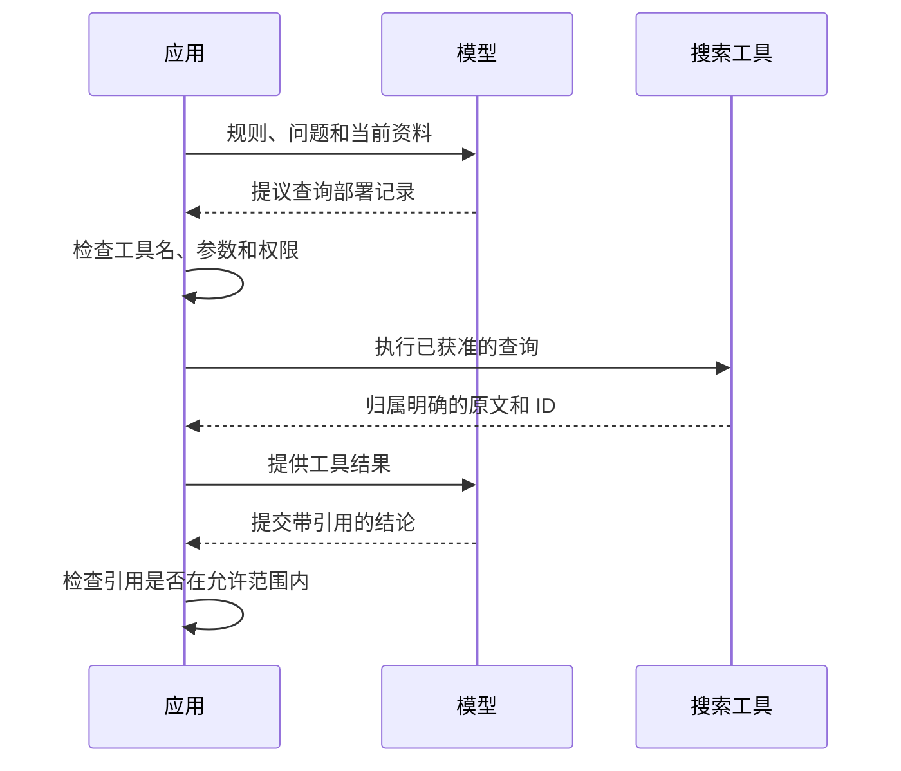

# 00-2 · 提示词与证据：说得顺不等于说得对

**阅读约 6–8 分钟，练习约 7 分钟。** 只用浏览器。准备上节课的三张卡，把两句求职结论改成可核对的结果。

接着上一节。你把「帮林澈写得专业一点」交给模型，收到了这么一句话：「他熟练使用 Python，有 Kubernetes 上线经验。」现在想象你需要在报告里签字。你会要求看哪一段原文？

## 模型这一轮看到了什么

一次请求可以有几部分。把它们分别写下来，就容易找到答案为什么跑偏。

| 放进去的信息 | 这次可以怎么写 |
| --- | --- |
| 任务规则 | 只根据当前的卡片判断。每句具体结论都带卡片编号。依据不足时说明缺什么 |
| 用户这次的问题 | 「林澈有哪些经历能支持 Python 和 Kubernetes 两项要求？」 |
| 系统带进来的资料 | A「用 Python 做过课程项目」，B「收藏了 Kubernetes 教程」，C「课程项目只在本机演示」 |
| 输出的格式 | 给每条结论列出判断、引用和理由 |

规则常在 `system` 消息中，问题和上下文常随 `user` 消息进入模型，多轮对话还会带上最近的消息。若使用工具，工具执行的结果也会送回模型，作为下一次判断的输入。消息角色记录文字是谁送来的。岗位描述说「要求 Kubernetes」时，保留它是岗位资料这一层身份。

### 证据够不够，要看你用了哪个动词

| 要写的话 | 能追到什么 | 你现在可以签字吗 |
| --- | --- | --- |
| 林澈用 Python 做过课程项目 | A 直接这样写 | 可以。保留「课程项目」这个范围 |
| 林澈熟练使用 Python | A 没给复杂度、独立完成程度或运用次数 | 暂时不能。向林澈要具体任务、代码或评审 |
| 林澈收藏过 Kubernetes 教程 | B 直接这样写 | 可以。措辞停在「收藏」 |
| 林澈有 Kubernetes 上线经验 | B 只记录收藏，C 只说明在本机演示 | 当前材料不足以确认。可以追加集群部署记录 |

申请岗位要求的是一件事，材料能确认的是另一件事。对比时把两种原文放在不同列，避免它们在同一段上下文里被混读。

## 模型怎么用工具

假设 Agent 有一个 `search_evidence` 工具，输入是一句查询。模型可提出请求，例如 `{"query":"Kubernetes 部署记录"}`。应用先检查这是不是注册过的能力、参数是否合规、请求者能读取哪份资料，再调用实际函数。函数把结果和出处交回；模型据此整理下一句。查不到时，可以继续查一次，也可以按上节设好的规则收尾。



图里的「提出请求」和「实际执行」是两个动作。CareerLens 对话这里更直接：代码先运行检索节点，把候选资料交给答复节点；稍后的工具源码课会带你看到这段函数调用。

## 一段结构化结果如何核对

JSON 是程序可直接拆开读的文本格式。下面是纸面练习的输出示意。`A` 对应我们手头的卡片，实际应用会用 Evidence ID。

```json
{
  "claim": "现有材料能确认林澈做过 Python 课程项目",
  "status": "supported",
  "citation_ids": ["A"]
}
```

核对时分三步。第一步看格式，字段齐全且类型正确。第二步看编号，`A` 要在本次允许的集合里。第三步打开 A，看「用过」有没有被写成「熟练」。格式、编号和含义可以各自出错。

真实实现里，开启模型后，[答复节点](../../backend/app/graph/career.py)要求返回 `answer` 和 `cited_evidence_ids`。[引用校验](../../backend/app/services/citations.py)会拦截正文里不在允许集合内的引用，列表中的有效 ID 会被提取和去重。有效 ID 对结论的支持力度仍要读原文。

## 练习：先判错，再改两条

先遮住答案。逐条给下面的输出找问题，然后改成你愿意签字的版本。

| 草稿 | 先检查什么 |
| --- | --- |
| 「林澈熟练使用 Python。[Evidence: A]」 | ID 存在，原文支持到哪一步？ |
| 「林澈有 Kubernetes 上线经验。[Evidence: E404]」 | 数据只有 A、B、C。能点开 E404 吗？ |
| 「Python：有实践。Kubernetes：见岗位要求。」 | 哪个引用来自候选人材料？第二句能给出什么判断？ |

把两条可交付结论写在纸上。第一条要带 A，第二条写明目前缺的材料。再写一条补充材料的请求，具体到你能拿来核对的东西。

<details>
<summary>核对改写</summary>

「林澈用 Python 做过课程项目，见 A。现有材料只有 Kubernetes 教程收藏和本机演示，无法确认有 Kubernetes 上线经验。可补一份注明环境、做过的部署步骤和结果的记录，再核对原文。」

第一行错在程度，第二行连引用都无法打开，第三行把招聘方的要求放进了经历判断。即使把 E404 改成 B，上线经历依然缺少支持。

</details>

## 在 Demo 里留意一个反例

默认 Demo 的技能提取会按词表匹配。把「收藏了 Kubernetes 教程」作为普通文本导入并重建画像时，可能看到 Kubernetes 技能项。通过浏览器采集携带的 `preference_signal` 标记能保留「兴趣」这个语境，资料类型和入口会影响提取。等跑通产品后，可用 [08-1 的同卡对照实验](../08-advanced/08-1-真实模型.md)比较两个入口。 [Demo 和可选模型的提取入口](../../backend/app/profile/llm_extractor.py)

## 下一步

当前材料只有三张，人工能扫完。去 [00-3 RAG 与检索](00-3-RAG与检索.md)把它扩大成一小叠材料，练习先找候选，再按这些规则看证据。
