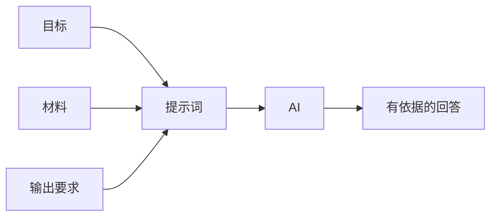

# 00-2 · 提示词与证据：说得顺不等于说得对

**这一课你能做到**：看懂一份提示词在交代什么；面对三张材料卡，能标出哪些结论有证据、哪些没有；发现没依据时写「证据不足」。

**前置**：只有浏览器。建议先做 [00-1](00-1-Agent是什么.md)，但不强制。

**用时**：约 20 分钟，动手约 5 分钟。

---

## 提示词在交代三件事

提示词（Prompt）就是你给 AI 的任务说明。写得清楚，通常包含三件事：

| 要素 | 意思 | 例子 |
| --- | --- | --- |
| 目标 | 要它做什么 | 「判断林澈是否符合岗位要求」 |
| 材料 | 让它依据什么 | 「只使用下面三张卡片的内容」 |
| 输出 | 要什么形式 | 「逐条给出：符合 / 部分符合 / 证据不足，并附依据」 |

一张图（文字版在下面）

**文字版**：目标、材料、输出要求一起组成提示词，交给 AI，换来一份有依据的回答。少给材料，它就会自己补——补出来的往往看着像真的，其实没依据。

## 动手：给两份回答找证据

虚构学习者**林澈**想应聘 AI Agent 开发岗。他的三张材料卡：

| 卡片 | 内容 |
| --- | --- |
| A | 「用 Python 做过课程项目」 |
| B | 「收藏了 Kubernetes 教程」 |
| C | 「课程项目只在本机演示」 |

岗位描述写着：**要求 Python 经验；有 Kubernetes 上线经验者优先。**

下面是两份回答。**先自己判断哪份更可靠，再看讲解。**

> **回答①**：林澈是一位经验丰富的 Python 工程师，熟练掌握了 Kubernetes，并在生产环境完成了多次上线部署，非常契合该岗位。
>
> **回答②**：材料显示林澈用过 Python（卡 A），但只有课程项目，不足以判断熟练程度（卡 C 补充了「只在本机演示」）。关于 Kubernetes，只有一张「收藏了教程」的卡（卡 B），这只能说明感兴趣，不能证明掌握或上线过——此项应记为「证据不足」。

参考答案与讲解

**回答②可靠，回答①不可靠。** 逐条看：

- ①说「经验丰富的 Python 工程师」——卡 A 只说做过课程项目，卡 C 说只在本机演示，都推不出「经验丰富」。这是把「做过」夸大成「熟练」。
- ①说「熟练掌握 Kubernetes」「生产环境上线」——材料里只有「收藏了教程」，而且是岗位描述**要求** Kubernetes，不是林澈**会**。这是两处典型误判：把收藏当掌握、把岗位要求当候选人经历。
- ②每条结论都回指具体卡片，无法支持的就写「证据不足」。这正是我们要的判断方式。

关键规矩：**流畅 ≠ 可靠**。一段话说得越顺，越要问一句「依据是哪张卡」。

## 三种最常见的误判

记牢这三条，后面所有练习都绕着它们转：

1. **收藏 ≠ 掌握**：点赞、收藏、关注只是兴趣线索。收藏了教程，不等于学过、会做。
2. **岗位要求 ≠ 候选人经历**：JD 里写「要求 Kubernetes」，是招聘方想要，不是应聘者已经有。
3. **做过 ≠ 熟练**：「做过课程项目」是事实，「熟练」是程度判断，需要更多、更强的证据。

> **说明**：
> 为什么反复讲「收藏」？因为 CareerLens 在真实系统里把「收藏」当作兴趣线索处理，不当技能。有一个有趣的例外留到进阶课讲：如果把「收藏了 Kubernetes 教程」当**普通文字**贴进自述，默认 Demo 会按关键词把它当成技能——那正是「说得顺不等于说得对」的真实演示。入门阶段你只要记住正确判断即可。

## 动手：给回答②补一句

回答②已经做得不错。试着再补一句关于「下一步」的话，要求：必须对应缺口，不能凭空安排。

参考补全

「针对 Kubernetes 上线经验的缺口，建议做一个可演示的部署练习并保存过程记录，作为新的证据；在此之前不应把它写成已有技能。」

要点：下一步对应的是「证据不足」的缺口，而不是凭空安排一门课。

## 这一课的落点

判断的本质是**让每条结论都能落回一张卡**。CareerLens 把这套规矩写进了系统：画像条目、岗位匹配、报告结论都带着证据编号，缺证据就报缺口。

## 下一步

继续 [00-3 · RAG 与检索大白话](00-3-RAG与检索.md)。术语忘了查[术语表](../术语表.md)。
