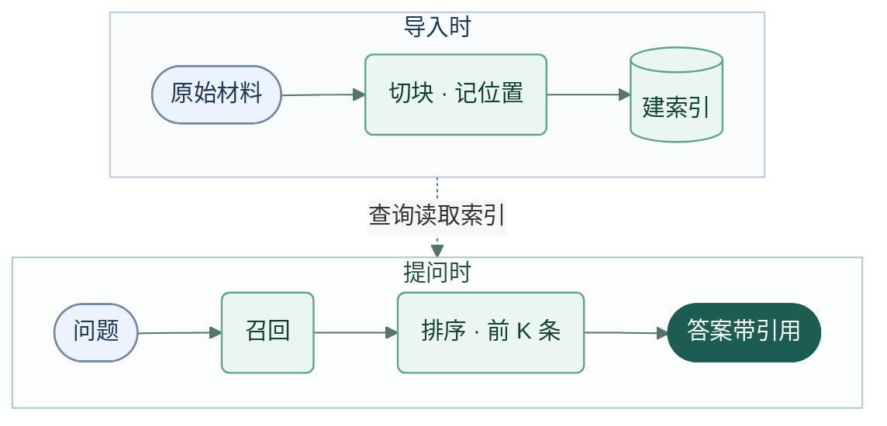

# 00-3 · RAG 与检索：先找到值得读的原文

**只用浏览器。** 阅读约 24–28 分钟，跟做约 14 分钟。学完你能画出「导入时」与「提问时」两条线，说清倒排、向量、切块、嵌入各解决什么问题，手算一张融合榜，并解释为什么「搜到了」「ID 合法」「原文支持结论」是三件完全不同的事。

## 先把学习的理由摆正

大模型有个先天限制：它只知道训练时见过的东西，不知道你电脑里那份作品说明，也不知道公司上周发的制度。直接问它「林澈有没有生产上线经历」，它只能猜。

RAG（检索增强生成）就是把「查资料」这一步接到模型前面：先从你的材料里找出相关原文，再把原文连同问题一起交给模型，让它基于材料回答。**模型负责表达，检索负责找事实**——这个分工一旦建立，你就理解了整章的骨架。

上一课的草稿丙误用了 B。问句里有 Kubernetes，B 原文也有，用词查找很容易把它排到前面。回头读 D，它没有写产品名，却记录了真实发生的练习集群发布；E 写着生产变更。检索要回答的是：**谁有机会被送到答复环节？**

## 一张地图：RAG 的两条线

RAG 最容易搞混的是「导入」和「提问」是两条独立的线，可能隔很多天，留下的记录也不同。

| 阶段 | 步骤 | 产生什么 | 类比 |
| --- | --- | --- | --- |
| 导入时 | 解析 → 切块 → 记位置 → 建索引 | 可检索的片段库 | 把书拆成卡片、编号、上书架 |
| 提问时 | 召回 → 排序 → 取前 K 条 → 送答复 | 带引用的上下文 | 按题目找卡片、排优先级、放桌面 |

读图记住：**导入时的质量决定提问时的上限。** 如果导入时把「部署成功」和「仅在练习集群」切到两个块里，提问时再怎么排序也可能只召回前者。

## 第 1 块：切块——决定一段话有没有机会完整出现

一份 PDF 里若连续写着「部署成功」和「仅在练习集群」，切得太小，第一句可能单独被召回而被误读；整份文档做成一条，又会把几十页无关内容送给模型。

**切块**（chunking）就是在两者之间取平衡：

- 按段落、标题、表格结构切，而不是机械地每 500 字一刀。
- 保留来源位置：文件、页号、段落编号。
- 让一个语义完整的结论留在同一个块里（例如动作 + 环境 + 结果）。

第 03 篇用两个 DOCX 观察这件事。 [03 解析层](../03-解析层.md)

### 切块和「正文指纹去重」的关系

同一句话可能出现在作品说明和课程总结两份文件里。搜索页可以只展示一次，核对时仍能展开两份出处。系统分别登记原文和出处位置，让两个块指向同一条证据。 [00-4 数据模型](00-4-数据模型大白话.md)

对检索来说，这意味着一条证据可能带着多个来源位置，召回时返回的是证据，而不是某一处具体的段落。

## 第 2 块：用词查找——从词到文档编号

本课仍用 A–E。题目固定为「林澈在哪些环境运行过课程项目？有 Kubernetes 生产上线记录吗？」

| 卡片 | 原文要点 |
| --- | --- |
| A | 用 Python 做过课程项目 |
| B | 收藏了 Kubernetes 教程 |
| C | 课程项目只在本机演示 |
| D | 在练习集群把课程接口发布成功，保留了回滚截图 |
| E | 生产集群变更单：执行人林澈，接口 v2，已发布 |

在纸上写 `Kubernetes → B、E`，`课程项目 → A、C`，`练习集群 → D`。这种从词到文档编号的映射叫**倒排索引**：不是「文档里有哪些词」，而是「这个词在哪些文档里」。查技术名、报错码、函数名时，从准确的词下手很有效。

用词频打分时还会考虑词常不常见：很多文档写「项目」，少量写「Kubernetes」，后者通常更有区分度。经典的 BM25 还会考虑词频增加带来的边际收益和文档长度。Qdrant 官方文档把 BM25 列为全文检索方式，要求作用在带全文索引的文本字段上；CareerLens 的稀疏路径**不是标准 BM25**，而是词哈希计数加 Qdrant 的 IDF 修正。 [Qdrant 混合查询文档](https://qdrant.tech/documentation/concepts/hybrid-queries/)

### 为什么「常见词」反而没用

设想一个检索系统只看词出现次数。问句里有「的」，而几乎所有文档都有很多「的」，它就会被当成强信号——结果谁都排不出来。**IDF（逆文档频率）** 就是给「在很多文档里都出现的词」降权：越稀有的词，命中时越能说明问题。B 的「Kubernetes」比 A 的「项目」更有区分度，就是这个道理。

这也解释了草稿丙为什么会错：用词查找精准地命中了 B，但「命中」不等于「支持」。检索这一步本来就只负责「谁值得读」，不负责「谁说的对」。

## 第 3 块：用向量找一版——语义相近，字面不同

问「在哪里运行过」时，人能看出 C、D、E 更应该优先读。语义检索把文本变成一组数字，也就是**嵌入向量**；用训练过的模型时，「部署到集群」和「把接口发布成功」有机会在向量空间里靠近，即使字面词不同。余弦相似度比较的是两个向量的方向：方向越接近，值越大。年份、权限和实际发生的事仍要打开原文核对。

### 用两个数字看懂「方向接近」

人工用两列记「提到集群」「提到发布动作」。问题和 D 都记成 `(1, 1)`，只提到集群的候选记成 `(1, 0)`。

余弦的分子把对应位置相乘再相加，分母乘两边长度。问题和 D 的分子是 `1×1 + 1×1 = 2`，分母是 `√2×√2 = 2`，相似度为 1。只碰到一个方向时是 `1/(√2×1) ≈ 0.71`。

实际向量通常有几百维。信息分布在多个维度上，通常无法从某个坐标直接读出年份、执行人或发布结果。用向量找到值得看的候选，再打开原文核对这些事实。

### hash-v1 不是「语义理解」

默认 Compose 的向量检索配置使用 `hash-v1`。它把词稳定映射到固定长度的向量分量，方便复现。选配 Qwen Embedding 后才使用训练得到的文本表示。第三、四章的独立练习固定走本地检索，直接计算词频、稀有词和短语得分。Demo 控制答复用哪个生成提供器，检索后端可以单独选择。 [向量提供器](../../backend/app/retrieval/providers.py) · [本地检索](../../backend/app/retrieval/hybrid.py)

这个区别很重要：hash-v1 能做的只是「把词分散映射到坐标上」，两个不同词即使意思相近，也可能离得很远。它是零安装演示的合理选择，但不能拿来代表线上语义检索的质量。

### 向量索引 HNSW 是什么，不是什么

检索库里的向量索引（常见实现如 HNSW）解决「怎样快速找到相近向量」，它不是打分公式，也不是 CareerLens 自己实现的步骤。项目把向量写进 Qdrant，由检索库负责近似近邻搜索；本地回退则直接在内存记录上算分。 [00-7](00-7-混合RAG与排名融合.md) 会展开 Dense 与 Sparse 两路和融合。

## 第 4 块：融合以后，前两条里放了什么

假设关键词榜是 **B、C、A**，向量榜是 **D、C、B**。这是固定课堂输入，人人都能复算。答复环节只允许读两条。哪一条会因为两榜都出现而排到前面？

用**倒数名次融合**（RRF）。练习从第 0 位记名次，某条在某榜贡献 `1 / (2 + 名次)`，缺席贡献 0，两榜相加。先自己算 B 和 C，再打开练习页核对。 [打开检索与融合练习](https://wenmo-yu.github.io/careerlens/foundations-lab.html?lesson=retrieval)

四个候选的计算过程

| 卡片 | 关键词贡献 | 向量贡献 | 合计 |
| --- | ---: | ---: | ---: |
| B | 1/2 | 1/4 | 0.750 |
| C | 1/3 | 1/3 | 0.667 |
| D | 0 | 1/2 | 0.500 |
| A | 1/4 | 0 | 0.250 |

融合后顺序是 B、C、D、A。B 两榜命中排第一；D 在向量榜第一，融合后掉到第三，只取前两条时进不了答复。这里公式中的 `2` 是课堂示例的 RRF 常数，不是「取前两条」的 K。

这题把「能说明实际运行环境」的卡定为 C、D、E。用手算结果核对覆盖：

1. 融合榜取前两条 B、C：只有 C 说明环境，覆盖 `1/3`。
2. 榜单不变，只把 K 从 2 改成 3：B、C、D 中 C、D 命中，覆盖 `2/3`。这就是本题的 `Recall@K`；K 是最终取几条，和 RRF 常数不是一回事。
3. 保持 K=2，改用向量榜：D、C 都进上下文，覆盖也是 `2/3`。这两条只支持练习集群与本机演示。要回答生产发布问题，需要改查询或扩大候选范围，实际查回 E 后才能确认那一次发布。

### 为什么 RRF 看名次，不看分数

关键词榜的分数可能没有上限，随查询和文档长度变化；余弦相似度有界。两类分数直接按比例相加，等于拿两把不同刻度的尺子量完再相加，结果会失真。RRF 的取巧之处是**只看每个候选在各自榜上的位置**，绕开分数尺度问题。完整的 RRF 公式、候选池和重排见 [00-7 混合 RAG 与排名融合](00-7-混合RAG与排名融合.md)。

## 第 5 块：三道门——搜到、合法、支持

**三件事分开检查**：搜到候选、ID 能打开、原文支持结论。B 在第一步赢，却在第三步输。以后回答出错，就沿这三层定位该调检索、校验引用还是改答复规则。

| 门 | 检查什么 | 失败时的症状 | 该调哪一层 |
| --- | --- | --- | --- |
| 1. 召回 | D、E 有没有进候选池 | 明明有证据，回答却没提到 | 查询表示、切块、候选池大小 |
| 2. 引用合法 | 回答里的 ID 是不是本次检索返回的 | 出现未知编号 Z | 引用校验、输出约定 |
| 3. 语义支持 | 打开原文，判断话是否说过头 | 用 B 说「上线过」 | 提示词规则、人的核对 |

这三道门和 [00-2 的三关](00-2-提示词与证据.md) 是同一套思路在不同层的叫法：那边的「格式/引用/支持」针对一条结论，这边的「召回/合法/支持」针对一次检索。合起来就是：**从材料到结论，每一跳都要能核对。**

## 这些能力在 CareerLens 里落在哪

| 你想找的能力 | 项目里对应什么 |
| --- | --- |
| 找词与找向量 | Qdrant 路径提交 Dense 与 Sparse 两路 `prefetch`，由服务端做 RRF 融合，并按 `user_id` 过滤 |
| 看排序怎么变 | 候选还会经过重排；默认 `lexical-v1` 按词集交并比打分，选配 CrossEncoder。重排只处理已召回的候选 |
| 没有 Qdrant 时 | 本地回退直接用数据库记录算 `0.45×词频余弦 + 0.55×稀有词得分 + 0.25×短语命中`，诊断里写 `backend=local`、`fallback=true`，机制与 Qdrant RRF 不同 |
| 找整理过的知识 | Wiki 模式检索已发布主题页；`hybrid` 把 RAG 与 Wiki 两路按名次交错，并给每条结果标 `source_kind` |

比较两种检索设置时，固定同一问题、同一批材料和同一个评判口径，一次只改一个变量。更细的融合公式、RRF 常数和 Qdrant 版本边界放在 [00-7 混合 RAG 与排名融合](00-7-混合RAG与排名融合.md)。 [系统设计与边界](../../docs/agent-and-retrieval.md)

## 常见坑，提前绕开

- **把「搜到了」当成「有依据」。** 检索只决定谁值得读，不判断谁说的对。
- **切块太小或太大。** 前者拆散完整结论，后者塞进无关内容。按结构切、留位置。
- **把 hash-v1 当成语义模型。** 它是可复现的确定性哈希，不是训练出来的理解。
- **把 RRF 常数当成 K。** 常数进分母，K 是最终取几条，两回事。
- **拿本地回退代表线上质量。** 本地加权打分和 Qdrant RRF 机制不同，诊断字段会如实标注。
- **只看召回率不看精度。** 把 B 排第一不是 bug，把 B 当成「上线过」才是错误。

## 下一步

留下 C、D、E 的原文。去 [00-4 数据模型](00-4-数据模型大白话.md)看 D 为什么会同时出现在两份文件里，报告里的一个引用 ID 又怎样带回两处位置；继续深入检索融合，读 [00-7 混合 RAG 与排名融合](00-7-混合RAG与排名融合.md)。
