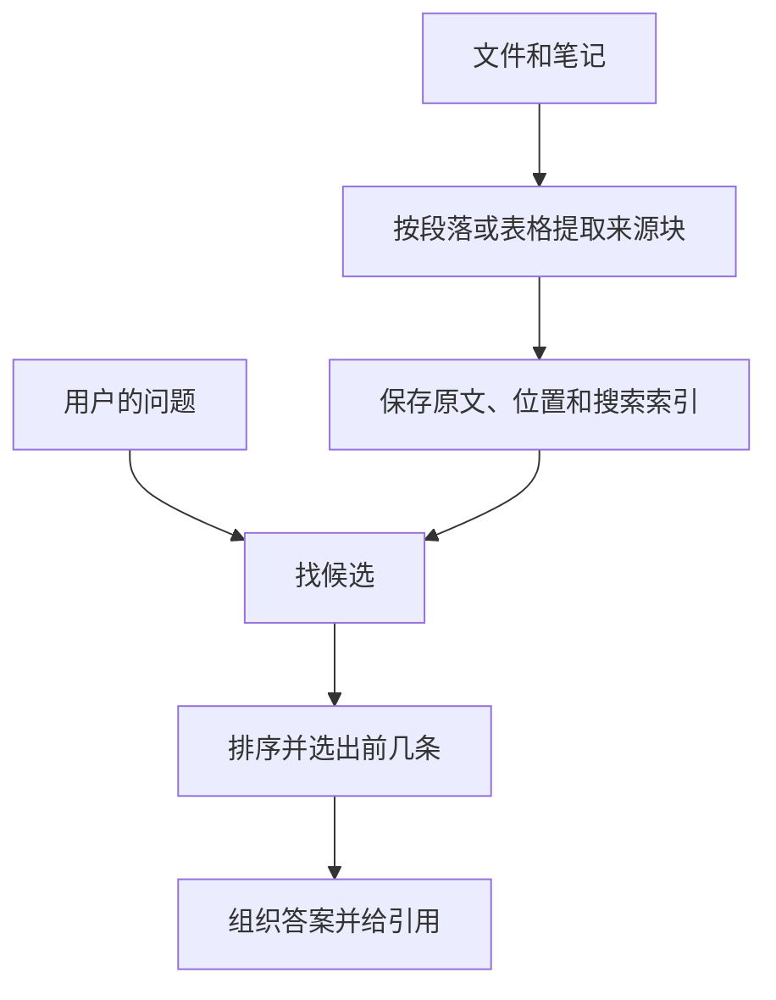

# 00-3 · RAG 与检索：怎么从一堆材料里找证据

**阅读约 7–9 分钟，练习约 8 分钟。** 只用浏览器。拿出上一课核对过的三张卡，今天用同一个问题试两种找法。

上节能逐条检查草稿，是因为材料只有三张。想象林澈又导入几十页笔记和附件，问题依然是「有没有 Kubernetes 上线经验」。应用得先把可能用得上的原文挑出来，再交给答复程序处理。

## 从一份材料到一次回答

RAG 全称是 Retrieval-Augmented Generation，意为检索增强生成。按发生时间可以分成两段。

1. **导入时**，系统读文件，把文档按段落或表格等结构提取成文本块，记录每块的位置。然后把可搜索的表示写进索引。索引像一本书的词目表，会记录到哪找，应用还要能按 ID 取回原文。
2. **提问时**，应用用问题检索出候选，对候选排序，挑前几条放进回答上下文。答复必须带着可核对的来源。材料无法确认的时候，要给出缺口。

以一本十页的项目笔记为例。整本一块会把很多无关内容带进答复。切得太碎也有代价，比如上一句写「部署成功」，下一句「仅用于本地演示」留在了另一个块里。保留段落边界和位置，有利于回看前后文。

## 两条线索各会找到什么

**关键词检索**从问题里取词。例如查 `Kubernetes`，关键字恰好出现在资料中的 B 就很容易被找到。查技术名、报错码、函数名时，词本身提供了很强的线索。常见算法 BM25 也考虑词在文档里的出现次数、词在语料里是否常见和文档长短。

**向量检索**先把问题和文本映射到一组数字，再比较它们在向量空间中的接近程度。余弦相似度比较的是方向。用训练过的嵌入模型时，「部署」和「把服务发布到集群」有机会靠在一起。具体能否找到要看模型、切块和语料。

两条榜可以合在一起。按各榜名次融合，避开直接相加两种量纲不同的分数。先理解「哪些条目因此进入前两名」就够了，第 04 篇会手算常用的倒数排名融合（RRF）。

## 练习：同一个问题，换一种查法

桌上仍有 A、B、C。加一张专供本节练习的 D。

| 卡片 | 原文 |
| --- | --- |
| A | 用 Python 做过课程项目 |
| B | 收藏了 Kubernetes 教程 |
| C | 课程项目只在本机演示 |
| D | 在练习集群把课程接口发布成功，保留了回滚截图 |

先按最简单的关键词规则，只找包含「Kubernetes」的卡，把符合项抄下来。再做一次按意思找的人工模拟，把注意力放到「集群里发布服务」，记录你会把哪张加到候选。最后试着回答这两个问题。

1. 如果只取第一名，而且第一名是 B，回答应写到哪一步？
2. 如果 D 进入候选，哪一部分知识更新了？还有什么得先问清，才能确认「在生产环境用 Kubernetes 上线」？

核对两份候选和最终措辞

按关键词规则只能找到 B。按意思判断则会把 D 加进来，C 也可以作为有帮助的范围说明。如果只看到 B，能确认的仍是收藏。D 支持「在练习集群发布过接口」，其中没写平台名称，环境也写的是练习。要判断原问题，先确认用的是不是 Kubernetes、目标岗位把什么算作上线，并查看部署记录。

这一次你做了三个独立判断：候选和问法是否相关，引用能否查回原文，原文能支持到哪一步。调排名能改善第一项。第二和第三项要另外检查。

## 回到 CareerLens 看默认实现

CareerLens 的 RAG 也会找词和向量候选。默认的 `hash-v1` 把切出来的词用稳定哈希分配到向量分量里，然后归一化。它容易本地复现，词是否相近主要取决于你用了哪些词。要观察训练过的嵌入，可以用同一问题、同一资料对照选配的 Qwen 嵌入。做这个对照时，两边要各自用对应的表示方法给文档建索引，再用同一种表示查询。 [向量提供器的源码](../../backend/app/retrieval/providers.py) · [04 检索与引用](../04-检索Agent.md)

除了搜原始材料，系统还可以搜已经整理好的 Wiki 页。例如把「做过什么」「在哪运行」「还缺什么」整理进一页，供以后从主题入口查阅。Wiki 页要带回到证据的引用。导入材料和编译 Wiki 分别产生产物，查询时可以选 RAG、Wiki 或两者。 [知识检索入口](../../backend/app/services/knowledge.py) · [05 Wiki 知识组织](../05-Wiki知识组织.md)

## 下一步

留住这句话：「D 说的是练习集群」。去 [00-4 数据模型](00-4-数据模型大白话.md)看看系统要保存哪些编号和位置，才能从结论回到这句话。
