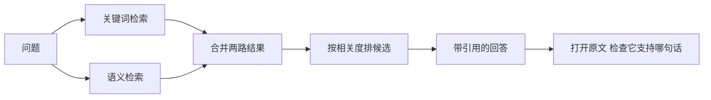

# 00-3 · RAG 与检索：怎么从一堆材料里找证据

**这一课你能做到**：用大白话解释向量检索在做什么；分清「关键词相同」和「意思接近」两条线索；明白「检索到了」也不等于「能支持结论」。

**前置**：只有浏览器。建议先读 [00-2](00-2-提示词与证据.md)。

**用时**：约 20 分钟，动手约 5 分钟。

---

## 检索像在档案柜里选资料

想象你有一个档案柜，里面全是你的材料卡。有人问「我适合 AI 岗位吗」，你不会把整个柜子都塞给他，而是先挑出相关的几张。这就是**检索**。

RAG（检索增强生成）就是：**先检索出相关材料，再让 AI 基于这些材料回答**。这样回答就有依据，而不是凭空编。

一张图（文字版在下面）

**文字版**：问题先触发检索，从材料堆里挑出相关证据卡，AI 只基于这些卡回答，于是答案带依据。

## 两条找材料的线索

从档案柜里找卡片，有两种完全不同的方式：

| 线索 | 怎么找 | 优点 | 盲点 |
| --- | --- | --- | --- |
| 关键词匹配 | 字面对上就算命中 | 精确、可控 | 换个说法就找不到 |
| 意思接近（向量检索） | 把文字变成一组数字（坐标），意思接近的坐标也接近 | 能找到换过说法的材料 | 可能找来「看着相关、其实不支持」的卡 |

**向量**就是把一段文字变成一组数字。你可以把它想成给文字拍一张「意义坐标」：意思相近的话坐标挨得近，于是可以按距离找资料，而不必字面一模一样。

## 动手：手工比较两种找法

还是林澈的三张卡：

| 卡片 | 内容 |
| --- | --- |
| A | 「用 Python 做过课程项目」 |
| B | 「收藏了 Kubernetes 教程」 |
| C | 「课程项目只在本机演示」 |

现在的问题是：**「有没有做过编程相关的实践？」**

**只用关键词**：问题里有「编程」，三张卡都没有「编程」二字——一张都找不到。这就是关键词的盲点。

**按意思接近**：

1. 哪张卡和「编程实践」意思最接近？（提示：Python 是一种编程语言）
2. 检索系统可能会把哪张卡也捞进来，但其实不支持结论？（提示： Kubernetes 也是技术名词，容易被误当成相关）

参考答案

- 最相关的是 **A**（用 Python 做过课程项目）——它直接支持「做过编程实践」。
- 容易被误捞的是 **B**（收藏 Kubernetes 教程）：它含有技术名词，字面上「像」相关，但收藏不等于做过实践，**不能支持结论**。
- C（只在本机演示）能提供补充信息：实践范围有限，不能据此说「部署上线经验」。

如果系统找到了 B，并且引用能点开，接下来请读原文里的动词。「收藏」能说明林澈关注这个主题。要写「做过上线」，需要另一份能看出他做了什么、在哪种环境做的材料。CareerLens 会检查引用编号是否有效。结论能写到哪一步，需要结合原文判断。

## 两种线索合起来用

只看关键词会漏，只看意思会误捞。实际系统通常两路都做，再合并：

一张图（文字版在下面）

**文字版**：合并候选后还可以调整次序。读者拿到带引用的回答，再用原文核对具体说法。

项目用 Qdrant 查原始材料时，会用 RRF 合并两张排名再重排。本地回退有另一条计分路径。到了[第 04 篇](../04-检索Agent.md)，你可以手算榜单，然后在返回的诊断字段里看这次请求实际走了哪条路。

> **说明**：
> 本课全部是**纸面模拟**：卡片和判断都写在教程里，不涉及在线推理。真实的模式切换练习放到 [01](../01-第一次跑起来.md) 的选做和 [04](../04-检索Agent.md)。

## 这一课的落点

检索回答了「去哪儿找证据」，但材料还是散的。下一课看系统怎么把散落证据串成画像、岗位匹配和报告。

## 下一步

继续 [00-4 · 用大白话看懂数据模型](00-4-数据模型大白话.md)。术语忘了查[术语表](../术语表.md)。
