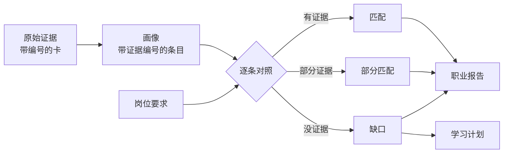

# 00-4 · 用大白话看懂数据模型：从证据到报告

**这一课你能做到**：用「档案袋」这个比喻，说清证据、画像、岗位要求、匹配结果、学习计划是怎么串起来的；能从一份报告的示意编号找回原始材料，并指出哪一格应该是缺口。

**前置**：只有浏览器。建议先读 [00-2](00-2-prompt-and-evidence.md) 和 [00-3](00-3-rag-and-vector.md)。

**用时**：约 20 分钟，动手约 5 分钟。

---

## 把系统想成一个档案袋

想象你在整理一份求职档案袋，里面按顺序放着几类东西：

| 顺序 | 是什么 | 人话 |
| --- | --- | --- |
| 1 | 原始证据（Evidence） | 一张张材料卡，每张有编号和来源。这是底稿，不能改。 |
| 2 | 画像（Profile） | 从卡片里整理出的条目，如「技能：Python」，每张条目都记着「我是从哪几张卡来的」。 |
| 3 | 岗位要求（Requirement） | 招聘方列的条件，如「要求 Python」「Kubernetes 优先」。这是**对方要的**，不是你有的。 |
| 4 | 匹配结果（Match） | 把第 2 格和第 3 格逐条对照：有证据支持算匹配，只有部分证据算部分匹配，没有算缺口。 |
| 5 | 学习计划（Learning Path） | 针对第 4 格的「缺口」，安排下一步做什么。 |

一张图（文字版在下面）

**文字版**：原始证据整理成带证据编号的画像；画像和岗位要求逐条对照，得出匹配、部分匹配或缺口；缺口变成学习计划；三者一起进职业报告。

**两个关键约定**：

1. 第 2 格的每条画像都记着它来自第 1 格的哪几张卡——所以能一路回查到原文。
2. 第 4 格「没证据」就写缺口，**不会**因为第 3 格写了就假设你有。这正是 [00-2](00-2-prompt-and-evidence.md) 讲的「岗位要求 ≠ 候选人经历」。

## 动手：把打乱的卡片排成数据流

下面七项被打乱了。请先自己排序，再看答案。

1. 职业报告 v1
2. 「用 Python 做过课程项目」
3. 针对 Kubernetes 缺口的学习计划
4. 岗位要求：要求 Python，Kubernetes 优先
5. 画像条目：技能 Python（来自卡片 2）
6. 匹配结果：Python 部分匹配 / Kubernetes 缺口
7. 卡片编号 EV-0001

参考答案

正确的数据流顺序：

**卡片原文（2）→ 给卡片编号（7，EV-0001）→ 画像条目（5，记着来自 EV-0001）→ 岗位要求（4）→ 匹配结果（6）→ 学习计划（3）→ 职业报告（1）**

要点：

- 编号是在证据这一层就定好的，后面所有环节都复用它。
- 画像条目里的「来自 EV-0001」就是能一路回查的线。
- 学习计划对应的是「缺口」（Kubernetes），不是已经匹配的 Python。

## 动手：从报告编号找回原文

下面是一份报告的片段（**示意**，编号是虚构的，不代表系统真实输出）：

> 匹配结论：Python —— 部分匹配（证据 EV-0001）
> 缺口：Kubernetes 上线经验 —— 证据不足

请回答：

1. EV-0001 指向哪张卡？
2. 为什么 Python 是「部分匹配」而不是「完全匹配」？
3. 哪一格应该是缺口？它对应的下一步是什么？

参考答案与常见误判

1. EV-0001 指向「用 Python 做过课程项目」这张卡（结合 [00-3](00-3-rag-and-vector.md) 里 C 卡的信息，只是课程项目、只在本机演示）。
2. 因为材料只支持「做过」，支持不了「熟练」——所以是部分匹配，不是完全匹配。**误判**：把部分匹配写成完全胜任。
3. 缺口是「Kubernetes 上线经验」，材料里只有「收藏了教程」，证据不足。下一步应是针对这个缺口做一个可演示的部署练习并留下证据，而不是把它写成已有技能。

## 这一课的落点

你已经有了一张完整地图：**证据 → 画像 → 岗位匹配 → 缺口 → 学习计划 → 报告**。后面所有篇章，都是把这张图里的某一格拆开来讲它怎么实现、怎么保证不出错。

> [!NOTE]
> [01](../01-quickstart.md) 会用工作台预填的虚构学习者「林澈」走一遍这条链，那时你会看到**真实的证据编号**由系统生成，而本课用的是示意编号。两者结构相同，编号来源不同。

## 下一步

阶段 0 四篇完成。你可以：

- 回到[开始页](../START-HERE.md)做本机准备，进入 [01](../01-quickstart.md) 亲手跑通；
- 或设备受限时走[静态观察路线](../observe-only.md)；
- 或先翻[术语表](../GLOSSARY.md)巩固名词。
