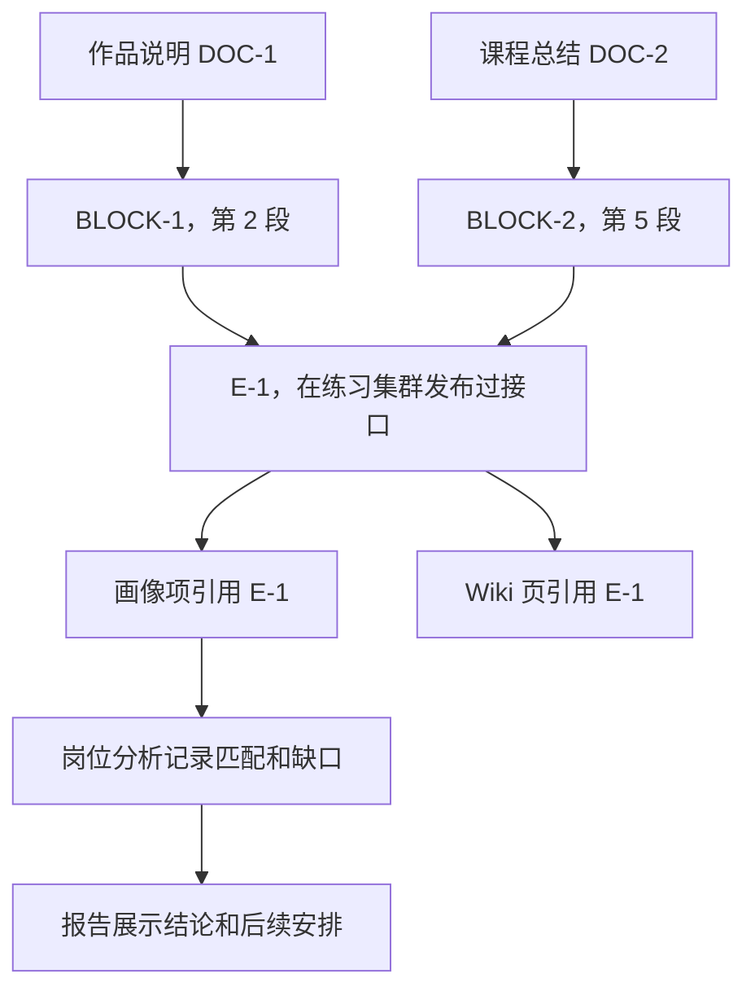

# 00-4 · 用大白话看懂数据模型：从证据到报告

**阅读约 7–9 分钟，练习约 7 分钟。** 只用浏览器。学完试着从报告里的一句话，追回林澈的两份原始材料。

上一课看到 D 写「在练习集群把课程接口发布成功」。如果作品说明和课程总结都写了完全相同的一段话，你愿意在搜索结果里看到两次吗？如果删除第一份文件，你还能找到另一份里的原文吗？

这里需要把**正文是什么**和**正文出现在哪**分别记录。数据模型规定程序怎样保存这些信息，以及它们怎样互相指向。

## 先用纸牌模拟三张表

给两份文件分别编 `DOC-1`、`DOC-2`，然后在每份文件里标出正文的位置。下表的短编号用于练习，实际程序会生成自己的 ID。

| 存在系统里的一条记录 | 例子 | 它回答的问题 |
| --- | --- | --- |
| 来源文档 `SourceDocument` | `DOC-1` 是作品说明，`DOC-2` 是课程总结 | 这份文件叫什么？同样的文件字节上传过吗？ |
| 来源块 `ParsedBlock` | `BLOCK-1` 指向 `DOC-1` 第 2 段，`BLOCK-2` 指向 `DOC-2` 第 5 段 | 在哪个文件的什么位置读到这段话？ |
| 证据 `Evidence` | 两个块指向 `E-1`，它存同一段正文 | 搜索、画像和引用应使用哪个稳定编号？ |

文件和段落各有自己的编号。只要留着 `BLOCK-1`、`BLOCK-2`，就知道同一段正文有两个位置。第 03 篇会上传两份合成 DOCX，实际看到「匹配正文的 Evidence ID 一样，来源的位置保留两条」。

## 画像、岗位分析、报告各记什么

一条原文可以被用在几个地方，使用者各自保存所需的信息。

| 记录 | 这次会保存什么 |
| --- | --- |
| 画像项 `ProfileItem` | 一项归纳出的能力（如「做过接口发布练习」），以及支持它的 `evidence_ids` |
| 岗位分析 `JobAnalysis` | 当时的岗位要求、匹配情况、缺口和 `learning_path`。学习计划保存在这份分析里 |
| 职业报告 `CareerReport` | 从一次岗位分析得到的可阅读报告，有自己的 ID 和版本 |
| Wiki 页 | 按主题整理的文字，例如「部署练习经历」。它保存来源和页版本，一个主题页可以供多个问题检索 |

如果岗位明天加了「生产 Kubernetes」，要针对新的岗位要求重新分析。文件和证据能继续使用。报告可以记下「目前有练习集群发布记录」，分析可以标出「生产经验待补」。从报告回去时，先找到对应的分析，看哪条匹配用了 `E-1`，再沿证据查两个来源块。这种查回原文的能力也叫可追溯性。

前面用「做过接口发布练习」演示了理想的归纳。CareerLens 的 Demo 按词表提取画像，实际画像名称取决于词表与材料。这份练习用短编号演示表之间的关系。

## 后台还会记下执行过程

点击「编译 Wiki」后，页面可以先显示排队，再显示完成。为了让用户关掉页面之后还能回来查进度，系统还要保存三类记录。

- `Run` 记录一次请求及其最终状态，例如一次 Wiki 编译的任务 ID。
- `Step` 记录执行步骤，例如 Wiki 整理或引用核验。
- `Event` 记录按序发生的进度变化，断线后可以接着读。

在 Wiki 内容出炉前你就可以看到 Run ID。打开结果时再拿这个 Run 的结果找到 Wiki 的页 ID。两条 ID 的用途不同，第 06 篇会让你刷新页面观察这个过程。

## 练习：用一条编号查两处原文

假设报告写「林澈有练习集群发布经验」，引用 `E-1`。另外岗位表要求「独立维护生产 Kubernetes 集群」。在纸上写下你要点开的记录，然后回答三件事。

1. 跟着 `E-1`，要看哪两份文件的什么位置？
2. 有两条来源位置，能证明林澈发布了两次吗？还能从这组材料得出什么？
3. 如果刚点击「重新生成报告」，页面显示 `RUN-2`，它能替代引用里的 `E-1` 吗？这次报告什么时候才拿得到？

核对追查路径

从 `E-1` 查到 `BLOCK-1` 的作品说明第 2 段，和 `BLOCK-2` 的课程总结第 5 段。两段文字一致，足以说明同一叙述出现在两个位置。现在能确认的范围是练习集群，独立维护生产集群仍需补材料。`RUN-2` 是执行请求的编号，等它成功后可打开持久化的报告。报告里继续用 `E-1` 查原文。

可提前看实际的模型文件。 [来源文档](../../backend/app/models/source_document.py) · [来源块](../../backend/app/models/parsed_block.py) · [岗位分析](../../backend/app/models/job_analysis.py) · [报告](../../backend/app/models/career_report.py) · [后台记录](../../backend/app/models/run.py)

## 下一步

到 [01 第一次跑起来](../01-第一次跑起来.md)，在工作台点开一次岗位分析结果，亲手追回一条原文。设备无法安装 Docker 时，可以边看截图边走 [静态观察路线](../静态观察路线.md)，再去 Agent 源码课对照路径。
