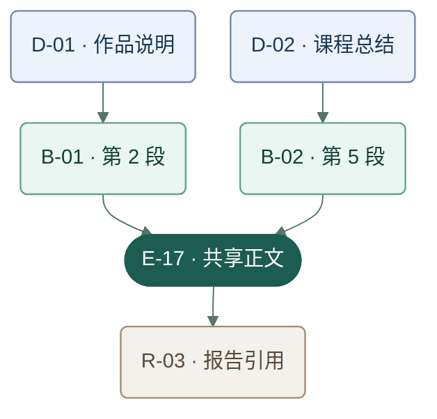

# 00-4 · 数据模型：怎么从报告查回两份原文

**只用浏览器。** 阅读约 13–15 分钟，跟做约 9 分钟。学完你能分清文件、文本块、证据、画像、岗位分析、报告和任务记录各自的 ID，并从一条报告引用回查原文件路径。

林澈把 D 号笔记里的同一句「在练习集群把课程接口发布成功，保留了回滚截图」写进作品说明和课程总结。搜索页只需要给他看一次这句话。等到报告需要核对时，两份出处都值得保留——否则你不知道这句话是写在哪份材料里的。

## 先分开登记正文和出处

数据模型说明程序有哪些记录、各存什么字段、靠哪个字段找到下一条。下表先只看导入阶段的三层，短编号是课堂用的，真实 ID 由程序生成。

| 记录 | 回答什么问题 | 课堂例子 | 项目模型 |
| --- | --- | --- | --- |
| 来源文档 | 是哪份文件？同样字节的文件传过吗？ | `D-01` 作品说明、`D-02` 课程总结 | `SourceDocument` |
| 来源块 | 文件里哪段写了这句话？ | `B-01` 作品说明第 2 段，`B-02` 课程总结第 5 段 | `ParsedBlock` |
| 证据 | 检索和引用时用哪条正文、哪个编号？ | 两个块都指向 `E-17` | `Evidence` |



顺着图向下是导入和使用；核对时从报告向上走。程序给 `B-01` 存了 `doc_id=D-01` 和 `evidence_id=E-17`，给 `B-02` 存了 `doc_id=D-02` 和同一个 `evidence_id`。所以搜索可以只返回一条证据，而来源区仍能打开两个位置。 [导入服务源码](../../backend/app/services/source_ingestion.py) · [证据模型](../../backend/app/models/evidence.py)

真实接口里打开一条证据，`id` 和 `content` 是当前证据的编号和正文；`source_metadata.sources` 列出各个来源，可以继续看 `doc_id` 和段落位置。课堂用短编号演示层级：

```json
{
  "id": "E-17",
  "content": "在练习集群把课程接口发布成功，保留了回滚截图。",
  "source_metadata": {
    "source_count": 2,
    "sources": [
      {"doc_id": "D-01", "source_name": "作品说明.docx"},
      {"doc_id": "D-02", "source_name": "课程总结.docx"}
    ]
  }
}
```

界面显示「一条证据、两个来源」时，看的就是这两层。

### 为什么有两种去重

文件用原始字节的指纹判断；标题改一个字，通常就是另一份文档。文本块也计算正文指纹，做基础换行和首尾空白规范化后再比较。共同正文不变且属于同一用户时，两份文档可以共享一条 Evidence。两级判断都包含用户，另一账号会有自己的记录。

一起预测三次上传：先传作品说明；再传课程总结；最后把作品说明原文件原样重传。分别数文件数、这句正文的来源块数、正文证据数。

<details>
<summary>核对三次上传后的记录数</summary>

| 操作后 | 文件数 | 共同正文的来源块数 | 共同正文的证据数 |
| --- | ---: | ---: | ---: |
| 第一次上传作品说明 | 1 | 1 | 1 |
| 上传课程总结 | 2 | 2 | 1 |
| 原样重传作品说明 | 2 | 2 | 1 |

若第二份写成「在生产集群发布」，正文变了，会得到不同的证据 ID。时间、用词近似或含义是否一致，是更进一步的判断。第 03 篇的 DOCX 夹具提供两个不同标题、共同正文相同的文件；比较时要先定位共同正文，上传结果的第一项通常是各自的标题。 [DOCX 去重实验](../03-解析层.md)

</details>

## 一条正文会被谁使用

原文固定以后，多个下游记录可以引用同一个 `evidence_id`：

| 下游记录 | 保存什么 | 变化时要读哪儿 |
| --- | --- | --- |
| 画像项 `ProfileItem` | 从证据归纳出的能力，带 `evidence_ids` | 新增证据后重建画像，看哪一项采用了它 |
| Wiki 页 `WikiPage` | 按主题整理的内容、版本、source_refs 与 chunk_refs | 重新编译后看版本和引用路径 |
| 岗位分析 `JobAnalysis` | 当时的要求、匹配、缺口和 `learning_path` | 新岗位或新证据出现后重做分析，别覆盖旧结果 |
| 职业报告 `CareerReport` | 来自一次分析的可读报告，有自己的 ID 和版本 | 比较两次报告的版本、关联分析 ID 与引用 |
| 后台任务 `Run` | 一次长任务的请求、状态、步骤和事件 | 状态成功后才去读结果中的报告 ID |

E-17 可以支持报告写「曾在练习集群发布接口」；`E-生产` 才能支持「一次生产发布」。岗位若要求独立运维生产集群，分析要重新核对，学习计划也可能换一个缺口。**证据编号用来打开原文，改报告措辞不能给原文补内容。** [岗位分析模型](../../backend/app/models/job_analysis.py) · [报告模型](../../backend/app/models/career_report.py)

### 一眼分清这些 ID

| ID | 回答什么问题 | 别和谁混 |
| --- | --- | --- |
| `evidence_id` | 这条原文的稳定编号 | 不是文件 ID，也不是块 ID |
| `doc_id` / `block_id` | 原文来自哪份文件、哪一段 | 一个 evidence 可对应多个来源位置 |
| `page_id` / `slug` | Wiki 主题页的稳定标识 | Wiki 命中不是 Evidence 命中，但仍能回到 Evidence |
| `job_analysis_id` | 哪一次岗位分析的结果 | 同一岗位重算会得到新结果 |
| `report_id` | 哪一版报告 | 一份分析可以生成多版报告 |
| `run_id` | 哪一次后台执行 | 它指向结果，不等于结果本身 |
| `thread_id` | 哪一段对话状态 | 不是用户账号，也不保存长期画像 |

## 跟做：从报告走两次反向查找

报告 `R-03` 写着「林澈在练习集群发布过接口」，引用 `E-17`。先在纸上写编号，再到练习页核对。 [打开来源追踪练习](https://wenmo-yu.github.io/careerlens/foundations-lab.html?lesson=data)

1. 找到 `E-17`，列出它指向的两处来源位置。想一想两处能否说明发生了两次发布。
2. 换成「比较上传返回的第一项」，看看为什么得到的是两个标题的 ID，而不是共同正文的 ID。
3. 改一个条件：后一份文件保留同一句正文，只改标题。你预期两个 `doc_id`、两个 `block_id` 与正文 `evidence_id` 哪些相同？

<details>
<summary>核对反查路径与 ID</summary>

报告的引用是 `E-17`。沿它打开作品说明第 2 段和课程总结第 5 段。两处记录同一个叙述，不能据此断定发生了两次发布；要找不同的时间或变更单。

两份文件的标题各自是一条证据，所以比较第一项会看到两个 ID。正确比较对象是共同正文：两个 `doc_id` 不同，两个块 ID 也不同，共用的是正文的 `evidence_id`。

</details>

## 任务记录是第三种时间线

点击「生成报告」后，先拿到任务编号 `RUN-8`。查询它看到的是执行情况；等状态成功，任务结果字段再给出报告 ID。刷新页面时，保留 `RUN-8` 和最后的事件序号就能接着看进度。

- **Run**：一次请求与当前状态，例如排队、运行中、成功。
- **Step**：正在进行哪一步，例如稿件生成或引用核验。
- **Event**：按顺序到达的进度变化；断线后可从上次序号续看。

`R-03` 用来查报告，`E-17` 用来查原文，`RUN-8` 用来查执行过程。三个编号回答三个不同问题。对话里的 `thread_id` 又属于另一条线：它让多轮问答能接上状态，却不负责保存长期画像。 [任务模型](../../backend/app/models/run.py) · [对话图](../../backend/app/graph/career.py)

## 下一步

概念部分到这里已经覆盖：Agent 怎么选下一步、提示词怎么约束结论、检索如何找原文、数据如何回查。接下来先在浏览器里看 LangGraph 怎样把这些步骤写成图：[00-5 LangGraph 与工作流](00-5-LangGraph与工作流.md)。想跳过概念直接跑产品，去 [01 第一次跑起来](../01-第一次跑起来.md)；设备受限时用[静态观察路线](../静态观察路线.md)看同一条回查路径。
