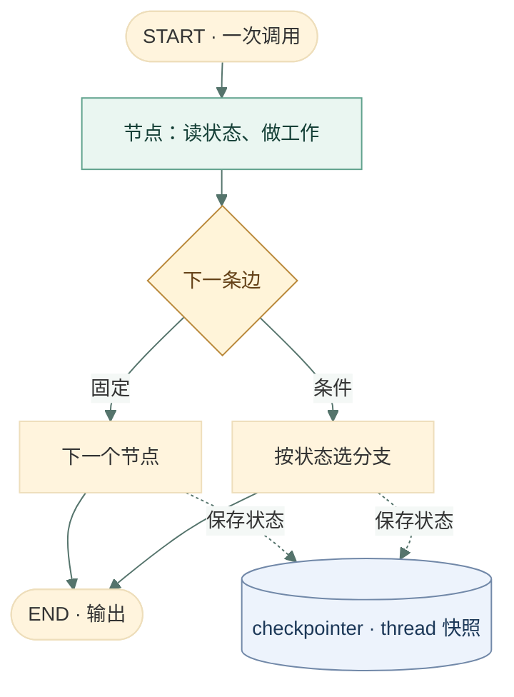
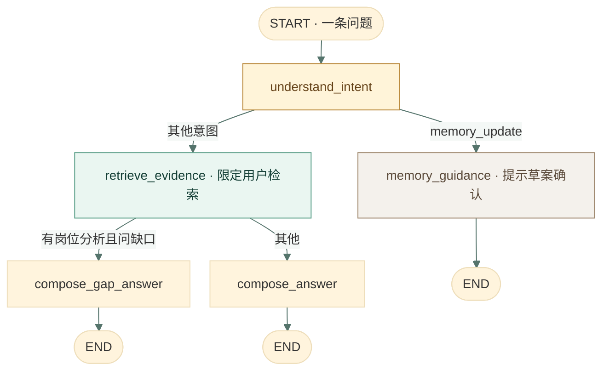

# 00-5 · LangGraph 与工作流：把「下一步」画成一张图

**只用浏览器。** 阅读约 24–28 分钟，跟做约 12 分钟。学完你能从一次提问里指出状态、节点、条件边、停止点和续跑机制，说清 checkpointer 和消息历史不是同一回事，并判断什么时候值得用图、什么时候一个函数就够。

## 先把学习的理由摆正

00-1 给了你「谁决定下一步」的框架，00-2 到 00-4 讲了材料、提示词和数据结构。这一章回答一个具体问题：**这些步骤在代码里怎么组织，才能既按规则走、又能在需要时停下来、还能断线续跑？**

函数里的 `if` 已经能表达分支。流程拉长后，暂停等人、失败重试和跨请求续接还需要各自的状态。LangGraph 用一张图描述这些步骤。你定义状态、节点和边，运行时沿图执行。接入 checkpointer 后，图还可以保存并恢复执行状态。

CareerLens 的对话图是绝佳标本：它不大（五个节点），却把「按意图分支」「检索后按结果再分支」「不偷偷写库」都放进图里。学完这章，你能读懂这张图，也能自己画一张。

## 一张地图：一张图由什么组成

| 零件 | 官方定义 | 课堂里的说法 | CareerLens 里去看什么 |
| --- | --- | --- | --- |
| State（状态） | 应用状态的共享快照，通常是带类型的 schema | 当前任务带着走的记事本 | `CareerState`，见 `backend/app/graph/career.py` |
| Node（节点） | 读取状态、做工作、返回更新的函数 | 一个明确的工作步骤 | `understand_intent`、`retrieve_evidence` 等五个节点 |
| Edge（边） | 固定或条件的转移，决定下一个节点 | 下一步走哪条路 | `START` 入口、`route_intent`、`route_answer`、`END` |
| Checkpointer | 按 thread 保存图执行状态的组件 | 负责存档的组件 | `InMemorySaver` / `AsyncPostgresSaver` |
| Thread | 用一个编号串起的一组执行与快照 | 带固定编号的存档 | `thread_id` |

读图记住：**节点是工作，边是路由，状态是记事本，checkpointer 是存档。** 图要先**编译**再运行；编译时可以挂上 checkpointer 等运行选项。文档特别指出，节点是检查点和重试边界——这解释了为什么「要不要单独做一个节点」要看它是否会改变后续路径，而不是看它代码长不长。 [Graph API 说明](https://docs.langchain.com/oss/python/langgraph/graph-api)

## 第 1 块：同一句话，为什么会走两条完全不同的路

对 CareerLens 说「为什么认为我会 Python？」，系统会检索证据再组织回答。说「记住我更希望做后端」，它不会偷偷改长期画像，而是提示你去专门的草案确认界面。两句话都进了同一个聊天框，处理路径却不同。

差别不是模型突然更懂事，而是应用在运行前就写好了一个判断：**先看问题意图，再决定去哪儿。** 这类「共享状态 + 节点 + 边」的编排，就是 LangGraph 解决的事。官方文档称它是「用于长时间运行、有状态 Agent 的低层编排框架与运行时」，强调可在同一张图里混用确定性步骤和模型驱动步骤。 [LangGraph 概览](https://docs.langchain.com/oss/python/langgraph/overview)

CareerLens 的对话图长这样：

图里的每个箭头都有触发条件。`route_intent` 只看意图是不是 `memory_update`；`route_answer` 只在「技能缺口问题 + 已有岗位分析」同时成立时走缺口答复。其余都走普通答复。**有限分支**让路径可以在浏览器练习里被一条条点出来，也是它和「模型自己决定调哪个工具」的循环最大的区别。

## 第 2 块：状态怎么被改写

CareerLens 的 `CareerState` 声明了问题、用户、历史、意图、画像、证据、检索诊断、答复、模型诊断、岗位分析、模式等字段。节点只返回自己改的部分：

- `understand_intent` 返回意图，并把检索结果和诊断清空，避免上一轮残留混进这一轮。
- `retrieve_evidence` 返回 `retrieved_evidence` 和 `retrieval_diagnostics`，不改答复字段。
- `compose_answer` 返回答复与模型诊断；失败时 `fallback: true` 并记下原因。

沿前后相接的节点执行时，后一次写入会覆盖同一字段。需要累积的字段可以定义 reducer，例如把多次工具结果追加成列表。如果两个并行节点在同一步都写同一个字段，也需要定义怎么合并，否则会报并发更新错误。CareerLens 的这条聊天路径按顺序前进，各节点只交回自己改动的字段。 [状态与 reducer 官方说明](https://docs.langchain.com/oss/python/langgraph/graph-api)

### 为什么「节点只返回部分更新」是个好设计

把状态想成一张共享表格。如果每个节点都返回整张表，两个节点之间的改动很容易互相覆盖——A 节点刚写入的证据，被 B 节点用旧版本的表盖掉。只返回自己改的字段，等于说「我只动这几格」，LangGraph 负责把改动合并进去。

这对调试也友好：看一个节点的返回，就知道它负责哪几格，不用读完整个状态对象。 CareerLens 的 `retrieve_evidence` 只返回候选与诊断两个字段，就是这个文件级别的清晰边界。

### 节点里的模型步骤也有护栏

`compose_answer` 先准备一份确定性回答。只有配置了真实模型，才把问题、意图、画像、检索证据和最近 12 条历史打包成结构化输入。输出必须是 JSON，且只能引用本次检索返回的 ID；超时、非法 JSON 或未知引用都会回退。 [回复节点源码](../../backend/app/graph/career.py) · [00-2 的三关检查](00-2-提示词与证据.md)

这说明 LangGraph 不负责「让模型变诚实」。它负责让步骤可执行、可观察、可停止；证据边界仍由应用自己的提示词、校验和回退规则实现。

## 第 3 块：续跑靠什么——checkpointer 与 thread

官方文档把持久化分两类：**checkpointer** 保存某个 thread 的图状态快照，用于对话连续、人工介入、时间旅行和故障恢复；**store** 保存跨 thread 的应用数据，例如长期偏好。调用图时传 `thread_id`，就知道恢复到哪份状态。 [持久化官方说明](https://docs.langchain.com/oss/python/langgraph/persistence)

上面的 Checkpointer 是框架可选能力。CareerLens 的聊天图在 `build_career_graph()` 中以 `checkpointer=False` 编译，每轮用 SQL 读出的近期消息重新装配上下文。较旧的版本曾把图状态写到 PostgreSQL。当前 Worker 会在用户删除数据时清理对应旧快照。 [聊天图工厂](../../backend/app/graph/career.py) · [旧快照清理](../../backend/app/graph/checkpoint.py)

### 容易混淆的三样东西

| 名字 | 保存什么 | 作用域 |
| --- | --- | --- |
| checkpoint | 一次图执行到某节点的状态快照 | 一个 `thread_id` |
| 消息表 `ConversationMessage` | 用户在聊天框里看到的历史消息 | 一个会话，可回看、可组装上下文 |
| 长期画像 `ProfileItem` | 从证据抽取的能力条目，也会保存用户确认后的画像变更 | 一个用户，跨会话 |

它们不是同一份数据。对话续接主要靠消息表提供上下文；checkpoint 管图的运行状态；画像的长期修改走「草案 → 确认」接口，不由图在聊天里自动提交。 [系统设计文档](../../docs/agent-and-retrieval.md)

### 人工介入不一定是图的 interrupt

LangGraph 官方的人类介入机制是在节点里调用 `interrupt()` 暂停，由 checkpointer 保存状态，调用方用同一个 `thread_id` 和 `Command(resume=...)` 恢复；可用于审批、审阅编辑和工具调用确认。 [人类介入官方说明](https://docs.langchain.com/oss/python/langgraph/interrupts)

CareerLens 当前**没有在对话图里用 `interrupt()` 暂停**。它用的是独立 API：先生成画像变更草案，用户在界面上确认或拒绝。效果同样是「机器不替人写入」，但实现在不同层。不要看到「确认」就以为图里一定有 interrupt。

## 第 4 块：节点到底该切多细

这是画图时最实用的判断。文档说节点是检查点和重试边界，把它翻译成可操作的规则：

| 该单独做节点的情况 | 不该单独做的情况 |
| --- | --- |
| 会改变后续走哪条边 | 只是一行格式化 |
| 需要失败后单独重试 | 和上一个节点永远一起成功或失败 |
| 需要在这里暂停等人 | 纯计算、无副作用 |
| 需要独立观察耗时/结果 | 只是把字段改个名字 |

CareerLens 把「理解意图」单独做节点，因为它产出的意图会改变下一步。检索单独做节点，便于观测候选和诊断。检索后的分支仍由意图与现有岗位分析决定。拼接 JSON 输入这类只给答复节点使用的工作留在 `compose_answer` 内部。

### 条件边 vs 固定边

- **固定边**：`START` 固定进入 `understand_intent`。三个答复出口也各有一条固定边通向 `END`。
- **条件边**：`route_intent` 根据 `intent` 值选 `memory_guidance` 或其他；`route_answer` 根据「是否缺口问题 + 是否已有分析」选缺口答复或普通答复。

条件边是「图」区别于「流水线」的关键：同一张图能处理不同类型的输入，而每条输入只走其中一条路径。写条件边时，把判断逻辑写成**纯函数**（只看状态、返回分支名），最容易测试和复用。

## 跟做：在纸上追三条路径

不用安装任何东西。回答下面三问，再用源码或练习页核对。

| 输入 | 先写路径 | 再写出该节点返回的状态字段 |
| --- | --- | --- |
| 「为什么认为我会 Python？」 | START → ? → ? → ? → END | 意图、检索候选、诊断、答复 |
| 「还差什么？」且已有岗位分析 | 哪一步开始和上一题不同？ | 答复来自已存分析还是模型 |
| 「记住我更希望做后端」 | 为什么没有检索就结束？ | 会写入长期画像吗？ |

核对路径

第一题走 `understand_intent → retrieve_evidence → compose_answer → END`，意图是 `evidence_explanation`，检索带诊断，回答校验引用。第二题在 `route_answer` 改道到 `compose_gap_answer`，读取已有的 `JobAnalysis`，不重新让模型编岗位结论。第三题在 `route_intent` 改道到 `memory_guidance`，只提示去草案确认界面，不写长期画像。

三题都没出现循环。CareerLens 的对话图是有限状态工作流，不是「想查几轮就查几轮」的自主研究 Agent。

**换一题。** 设想一个报销助手：读票据、查制度、缺附件时请人补、最后写结论。先画出节点和条件边，再指出哪个节点应该成为检查点。你会发现关键不是节点数，而是哪里需要停下来等人和哪里失败后要重来。

## 什么时候值得用 LangGraph

- 同一个流程里有固定规则步骤和模型步骤，且要混着走。
- 下一步依赖上一步状态，需要分支、循环或等待人工确认。
- 运行可能跨请求、需要续接或失败恢复。

如果只做一次「把自述改专业」的调用，一个函数就够。LangGraph 也不会自动带来证据校验、权限隔离或正确的提示词——那些仍是应用代码的责任。 [LangChain 产品分层说明](https://docs.langchain.com/oss/python/concepts/products) · [00-6 的 LCEL 对照](00-6-LangChain与模型工具.md)

## 常见坑，提前绕开

- **把节点切得太碎。** 一行格式化也建节点，只会增加检查点和调试负担。
- **节点返回整个状态。** 容易互相覆盖；只返回改动的字段。
- **把 checkpoint 当消息历史。** 前者是执行快照，后者是可见对话。
- **看到「确认」就以为用了 interrupt。** 也可能是独立 API 的草案确认。
- **以为用了图就自动可核对。** 证据校验、权限隔离仍要自己写。
- **忽略 `thread_id`。** 传错或漏传，续接和隔离都会出问题。

## 这些概念在 CareerLens 里落在哪

| 这节课的词 | 项目里的对应 | 为什么这样选 |
| --- | --- | --- |
| State | `CareerState`（`TypedDict`） | 字段有类型，节点返回值可检查 |
| Node | 五个函数节点 | 按「是否改变路径 / 是否需重试」切分 |
| 条件边 | `route_intent`、`route_answer` | 纯函数判断，路径可复现 |
| 停止 | 每个答复分支连到 `END` | 无无限循环，成本可控 |
| Checkpointer | 独立框架示例使用 `InMemorySaver` | CareerLens 当前用 SQL 消息续接 |
| 人工确认 | 独立草案 API，不用 `interrupt()` | 用户在专门界面可见、可拒绝 |
| 护栏 | 模型输出校验 + 回退 | 图管流程，校验管诚实 |

## 下一步

你已经能用「状态 / 节点 / 边 / 续跑」描述一张图。接下来补一块基础知识：去 [00-6 LangChain 入门](00-6-LangChain与模型工具.md)系统认识模型、消息、提示词模板、结构化输出、链、工具、Agent、记忆与检索组件，并看清它们和 LangGraph、和本项目的关系。想继续深入检索，读 [00-7 混合 RAG 与排名融合](00-7-混合RAG与排名融合.md)。
