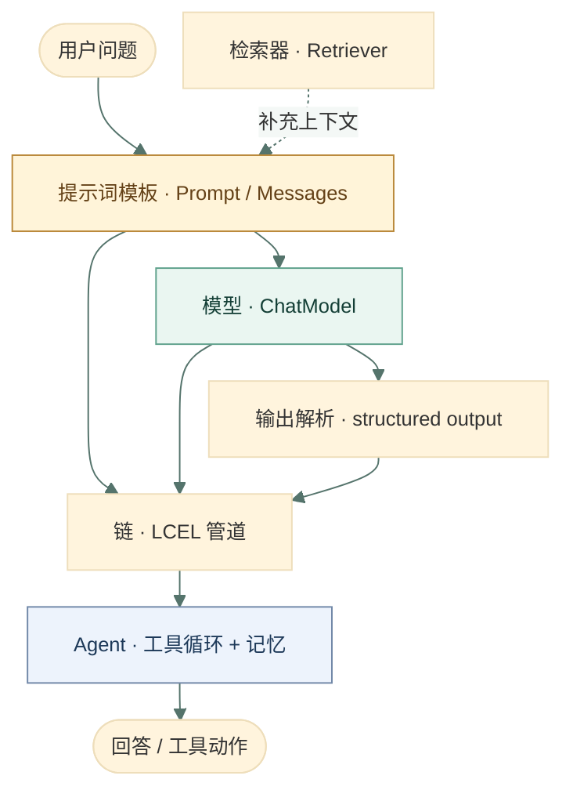

# 00-6 · LangChain 入门：模型、消息、提示词、链与 Agent

**只用浏览器就能读懂；代码标记为「选做」，需要 Python。** 阅读约 20–24 分钟，跟做约 12 分钟。学完你能画出 LangChain 的组件地图，逐个说清模型、消息、提示词模板、结构化输出、链、工具、Agent、记忆、检索组件各解决什么问题，并能解释它们和 CareerLens 的关系。

## 先把学习的理由摆正

LangChain 是这一层最流行的开源框架之一。学会它，你会得到一套**通用词汇**：以后读官方文档、看别人的 Agent 代码、甚至换一个框架，都能认出「哦，这是模型层，这是提示词模板，这是工具调用」。对零基础的人，这套词汇比某个具体 API 更值钱。

先把一个事实讲清楚，免得后面猜：按 [项目依赖清单](../../backend/pyproject.toml)，CareerLens 当前安装的是 `langgraph` 和 `langgraph-checkpoint-postgres`，**没有安装 `langchain`**。这不是缺点，也不是疏漏，而是一个取舍——项目把编排交给 LangGraph，把模型调用和检索写成自己的薄层。

但「项目没装 LangChain」和「你不需要学 LangChain」是两回事：

- LangChain 定义的**概念**（模型、消息、提示词、输出解析、链、工具、Agent、记忆、检索器）是行业通用语，CareerLens 里几乎每一个都能找到对应物。
- 官方文档里 LangChain 与 LangGraph 经常**一起出现**，读源码和文档时混着讲是常态。分不清就容易被绕晕。
- 等你以后要接十家模型、几十个工具，或想把演示代码升级成正式产品时，LangChain 的集成层很可能派上用场。提前认识它，是为将来省时间。

所以这一章的定位是**打基础**：把 LangChain 的核心积木逐个拆开，讲清「它是什么 / 解决什么问题 / 最小怎么用 / 在 CareerLens 里对应什么」。最后的对照表会告诉你项目的真实选择，但学习重点是前面的概念本身。

## 一张地图：LangChain 由哪些积木组成

先看全貌，再逐块展开。别急着记住名字，先记住「哪一层管什么事」。

| 层 | 代表组件 | 解决什么问题 | 一句话类比 |
| --- | --- | --- | --- |
| 模型层 | `ChatModel`、`init_chat_model` | 统一接不同厂商的模型 API | 发电机，提供动力 |
| 消息层 | `SystemMessage` / `HumanMessage` / `AIMessage` | 把对话结构化成有角色的输入 | 给动力规定方向盘 |
| 提示层 | `PromptTemplate`、`ChatPromptTemplate` | 用变量拼出可复用的提示词 | 可填写的表格模板 |
| 输出层 | `with_structured_output`、`OutputParser` | 让模型返回程序能读的结构 | 把话翻译成数据 |
| 编排层 | LCEL、`Runnable`、`\|` 管道 | 把上面的积木串成一条流水线 | 传送带 |
| 工具与 Agent | `@tool`、`create_agent` | 让模型能提议调用外部函数 | 给 Agent 装上可动的手 |
| 记忆层 | checkpointer、`thread_id` | 让多轮对话接得上 | 记事本 |
| 检索层 | Loader、Splitter、Embedding、VectorStore、Retriever | 把外部资料变成可查的上下文 | 图书馆与索引 |
| 可观测 | Callbacks、LangSmith | 记录每一步发生了什么 | 行车记录仪 |



读图记住一条主线：**提示词进模型，模型出结果，链把它们连起来，Agent 再加上工具和记忆，检索器负责给提示词补材料。**

## 第 1 块：模型 Model —— 统一接住的「发电机」

### ChatModel 和老的 LLM 有什么区别

LangChain 官方文档把模型称为「Agent 的推理引擎」。它有两种接口：

| 接口 | 输入 | 返回 | 现在该用哪个 |
| --- | --- | --- | --- |
| ChatModel（聊天模型） | 一组带角色的消息 | 一条 `AIMessage` | ✅ 聊天、Agent、工具调用都用它 |
| 旧式文本补全 LLM | 一段字符串 | 一个字符串 | 仅维护老代码时用 |

一个判断小技巧：如果你调用后拿到的是**字符串**，多半用的是旧式 LLM；拿到的是 `AIMessage` 对象（能读 `.text`、`.tool_calls`），才是现在的聊天模型。ChatModel 的实现类通常以 `Chat` 开头，如 `ChatOpenAI`、`ChatAnthropic`、`ChatGoogleGenerativeAI`。

### 最省事的入口：init_chat_model

不用记每个厂商的类名，官方提供统一入口：

```python
# 选做：需要 Python 与 langchain
from langchain.chat_models import init_chat_model

model = init_chat_model("openai:gpt-4o-mini")          # 厂商:模型
# model = init_chat_model("anthropic:claude-...")      # 换厂商只改这一行
```

`"厂商:模型"` 这种写法让迁移成本很低：业务逻辑不动，换一个字符串就换了模型。 CareerLens 的自建 provider 解决的是同一类问题——把「用哪家模型」和「怎么用模型」分开。

### 三种调用方式：invoke / stream / batch

| 方法 | 一次返回什么 | 什么时候用 |
| --- | --- | --- |
| `invoke()` | 一条完整的 `AIMessage` | 最常见，要完整答案 |
| `stream()` | 一串 `AIMessageChunk`，逐块到达 | 打字机效果、长回答先出一半 |
| `batch()` | 一组答案（并行请求） | 批量处理多条独立输入 |

```python
# 选做
answer = model.invoke("用一句话解释什么是 token")
for chunk in model.stream("讲一个关于检索的故事"):
    print(chunk.text, end="", flush=True)
answers = model.batch(["问题一", "问题二", "问题三"])
```

注意 `batch()` 是**客户端并行发多个请求**，和厂商自己提供的「批量 API」（更便宜但有延迟）不是一回事，别混用。

### 常用参数：小白也该懂的 temperature

```python
# 选做
model = init_chat_model(
    "openai:gpt-4o-mini",
    temperature=0.2,     # 随机性：越低越稳定，越高越有创意
    max_tokens=1000,     # 最多生成多少 token
    timeout=30,          # 等待上限（秒）
    max_retries=6,       # 网络/限流失败时重试次数
)
```

**token** 是模型读写文本的基本单位，可以粗略理解成「词或词片段」。它不是字也不是词：中文一字可能是一两个 token，英文一个长词可能拆成几个。模型按 token 计费，也有「一次最多能看多少 token」的上限，也就是**上下文窗口**。`max_tokens` 管的是输出长度，上下文窗口管的是输入加输出的总容量。

**temperature** 控制选词的随机性。趋近 0 时，模型总选概率最高的词， answers 稳定、可复现；调高后会更愿意选次优词，更有创意但也更容易跑偏。CareerLens 这类「要核对证据、不能乱说」的应用，就该把它调低，甚至用确定性回退兜底。

> 更多参数如 `model_provider`、`base_url`（接 OpenAI-compatible 接口）、`reasoning_effort`、`rate_limiter`，官方文档都列在模型页。用到时再查即可。 [模型官方文档](https://docs.langchain.com/oss/python/langchain/models)

## 第 2 块：消息 Messages —— 角色是给模型的「方向盘」

模型看到的不是一段散文，而是**带角色的一组消息**。官方支持三类常用角色，也有对应对象：

| 角色 | 对象 | 放什么 | 类比 |
| --- | --- | --- | --- |
| `system` | `SystemMessage` | 应用规则、身份、边界 | 上岗手册 |
| `user` | `HumanMessage` | 这次的问题 | 客户提问 |
| `assistant` | `AIMessage` | 模型之前的回答 | 之前的对话记录 |
| `tool` | `ToolMessage` | 工具查回来的结果 | 查到的资料 |

```python
# 选做
from langchain.messages import SystemMessage, HumanMessage, AIMessage

conversation = [
    SystemMessage("只依据给定资料回答；资料不足就写证据不足。"),
    HumanMessage("林澈有生产 Kubernetes 上线记录吗？"),
    AIMessage("资料里只有收藏教程，不能确认上线。"),   # 历史回答
    HumanMessage("那他做过什么？"),                    # “他”要靠历史理解
]
model.invoke(conversation)
```

为什么角色这么重要？回到 [00-2](00-2-提示词与证据.md) 那个坑：岗位描述里写「熟悉 Kubernetes」，那是**岗位要求**；候选人自述里写「收藏了 Kubernetes 教程」，那是**候选人经历**。如果两者都塞进 `user` 消息、不标身份，模型很容易把要求当成候选人已经会的东西。给原文标上 `tool`、给规则标上 `system`，就是给它方向盘。

CareerLens 在调用模型时，把规则写进 `system_prompt`，把问题、意图、画像、证据和历史打包成结构化的用户输入——用的是同一套角色思想。 [答复节点源码](../../backend/app/graph/career.py)

## 第 3 块：提示词模板 —— 可复用的「填空表格」

### 为什么不用字符串硬拼

如果你每次都写 `f"请判断：{question}，参考：{context}"`，很快会遇到三个麻烦：改一句话要改好几处；忘了给变量做转义；想加几个示例就得复制粘贴。**提示词模板**把这些变量抽成占位符，统一管理。

```python
# 选做
from langchain_core.prompts import PromptTemplate, ChatPromptTemplate

pt = PromptTemplate.from_template(
    "只依据资料回答，不足就写证据不足。\n资料：{context}\n问题：{question}"
)
filled = pt.format(context="D：练习集群发布成功", question="他发布过吗？")

chat_pt = ChatPromptTemplate.from_messages([
    ("system", "你是严谨的证据核对助手。"),
    ("human", "资料：{context}\n问题：{question}"),
])
```

`{context}`、`{question}` 就是占位符；调用 `format()` 或把变量交给模型时再填入。改成列表式消息（`(角色, 内容)` 元组），就是 `ChatPromptTemplate`——你在 00-2 见过的四部分请求，本质就是它填出来的。

### few-shot：给几个例子比讲一堆规则管用

**少样本提示**（few-shot）是在提示词里放几条「输入 → 输出」样例，让模型照着做。比如教它区分「收藏」和「上线」：

```text
资料：收藏了 Kubernetes 教程 → 结论：兴趣线索，不是技能
资料：在练习集群发布成功 → 结论：练习环境发布，不是生产上线
资料：{新资料} → 结论：
```

模型会从样例里学到「要保留原文的环境范围」。CareerLens 把这类规则直接写进 system 规则 + 三关校验，走的是「明确规则 + 程序校验」而非纯 few-shot，但你现在知道 few-shot 是另一种可用手段了。

> 官方文档把提示词模板列为 LangChain 的核心组件之一。 [LangChain 概览](https://docs.langchain.com/oss/python/langchain/overview)

## 第 4 块：结构化输出 —— 让模型说「程序能读」的话

模型默认吐出的是自然语言。程序要拿它做判断，就得解析。让模型每次都「用 JSON 回答，别加解释」并不牢靠——它可能加前后缀、漏字段、写错类型。

LangChain 的 `with_structured_output()` 把这件事做成一层：你给一个 schema，它约束模型按 schema 输出，并帮你解析。

```python
# 选做
from pydantic import BaseModel, Field

class Answer(BaseModel):
    answer: str = Field(description="基于资料的结论")
    citation_ids: list[str] = Field(description="引用的证据编号")

structured = model.with_structured_output(Answer)
result = structured.invoke("他发布过吗？")
# result 是 Answer 对象，result.answer / result.citation_ids 可直接读
```

三点要记牢：

1. **schema 可以用三种写法**：Pydantic `BaseModel`、`TypedDict`、JSON Schema。Pydantic 会自动校验类型，另两种要自己校验。
2. **`method` 决定实现方式**：`json_schema`（厂商原生）、`function_calling`（伪装成工具调用）、`json_mode`（只保证合法 JSON，schema 写在提示词里）。不同模型支持的不一样。
3. **拒绝与原始消息**：模型可能拒绝输出；用 `include_raw=True` 能同时拿到原始消息和解析结果，便于排查。

这和 CareerLens 的做法几乎一一对应：项目要求模型返回含 `answer` 与 `cited_evidence_ids` 的 JSON，解析后还要过 [00-2 的三关](00-2-提示词与证据.md)——格式、引用范围、原文支持。区别只在项目自己写了这层约束和校验，而没有用 `with_structured_output()`。概念是通的。 [模型官方文档 · 结构化输出](https://docs.langchain.com/oss/python/langchain/models)

## 第 5 块：链与 LCEL —— 用管道把积木串成流水线

前面每一块都能单独用。真正有用的是把它们**串起来**：提示词 → 模型 → 输出解析。LangChain 提供一套叫 **LCEL**（LangChain Expression Language）的组合方式，核心是两个东西：

- **`Runnable`**：所有组件遵守的统一接口，都有 `invoke` / `stream` / `batch`。
- **`|` 管道符**：把上一个组件的输出接到下一个的输入。

```python
# 选做
from langchain_core.output_parsers import StrOutputParser

chain = chat_pt | model | StrOutputParser()
chain.invoke({"context": "D：练习集群发布成功", "question": "他发布过吗？"})
# 变量先填进提示词模板 → 交给模型 → 输出被解析成字符串
```

这一行的厉害之处在于：`chain` 自己也是 `Runnable`，所以照样能 `chain.stream(...)`、`chain.batch(...)`，异常处理、回调、并行也都统一了。你不用为每种组合重写一套调用逻辑。

**CareerLens 里没有直接用 LCEL**，它的流水线是用 LangGraph 的节点和边显式写出来的（`understand_intent → retrieve_evidence → compose_answer`）。但思路一致：都是把小步骤组合成一条可控的链。LCEL 更像「一行拼装」，LangGraph 更像「画流程图」，后者在你需要在中途分支、暂停、续跑时更有优势。 [Graph API 官方说明](https://docs.langchain.com/oss/python/langgraph/graph-api)

## 第 6 块：工具 Tools —— 模型能提议，应用来执行

工具就是一个函数，加上描述让模型知道「什么时候用它」。官方用 `@tool` 装饰器：

```python
# 选做
from langchain.tools import tool

@tool
def search_evidence(query: str, limit: int) -> str:
    """按关键词检索证据卡，返回编号与原文。limit 取 1 到 5。"""
    ...   # 真正去查资料
```

**函数的名字、文档字符串、参数名都会进入模型的提示词。** 所以工具描述写得好不好，直接决定模型会不会用、会不会用对。这一点 CareerLens 和 LangChain 完全一致：工具说明要写清楚边界。

更关键的一条：**模型提出调用 ≠ 应用立即执行**。LangChain 里模型返回的是「工具调用建议」，真正执行前应用要校验参数、`user_id` 必须来自登录状态而不是模型编的编号、读写权限要分开。这正是 [00-2 跟随一次工具调用](00-2-提示词与证据.md) 和 [01-B 工具调用](../01-agent-design/01-B-工具调用.md) 反复强调的边界。 CareerLens 当前基础对话图甚至不让模型自由提议工具，检索节点由程序直接调用，把自主性压到最低、可验收性提到最高。

## 第 7 块：Agent —— 把模型、工具、提示、记忆装到一起

有了模型和工具，就可以组装一个真正会「自己决定下一步」的 Agent。官方现在的入口是：

```python
# 选做
from langchain.agents import create_agent
from langgraph.checkpoint.memory import InMemorySaver

agent = create_agent(
    model=model,
    tools=[search_evidence],
    system_prompt="只依据工具查回的资料回答，不足就写证据不足。",
    checkpointer=InMemorySaver(),
)
result = agent.invoke(
    {"messages": [{"role": "user", "content": "林澈发布过接口吗？"}]},
    config={"configurable": {"thread_id": "linche-01"}},
)
```

`create_agent` 把四样东西装进一个标准循环：**模型 + 工具 + 系统提示 + 记忆**。它内部大致是这样转的：


这里有一个必须建立的直觉：**Agent 的「自主」是有限的**。它在你给的工具和规则里挑下一步，不是想干什么就干什么。停止条件（最多几轮、什么时候必须交答案）也是你设计的。CareerLens 的对话图把这种「挑下一步」收敛成几条固定条件边——见 [00-5 LangGraph 与工作流](00-5-LangGraph与工作流.md)——本质仍然是「根据状态决定路径」。

官方还提供 `create_deep_agent`（`deepagents` 包），预置了计划、文件系统工具、子 Agent 等能力；需要精细控制用 `create_agent`，想要开箱即用的复杂能力用 deep agent。 [快速上手文档](https://docs.langchain.com/oss/python/langchain/quickstart)

## 第 8 块：记忆 Memory —— checkpointer 与 thread_id

单个 Agent 跑完就忘。要让它记住上一轮说过什么，靠两样东西：

- **checkpointer**：负责把每一步的状态存下来。演示用 `InMemorySaver()`（进程重启就没了），正式用持久化的 saver（写到数据库）。
- **`thread_id`**：给一段对话起个编号，Agent 据此找回对应的状态。不同编号互不干扰。

```python
# 选做：同一个 thread_id 才接得上上文
agent.invoke({"messages": [{"role": "user", "content": "我叫林澈"}]},
             config={"configurable": {"thread_id": "session-1"}})
agent.invoke({"messages": [{"role": "user", "content": "我叫什么？"}]},
             config={"configurable": {"thread_id": "session-1"}})
```

把这段和 [00-5 的三样东西](00-5-LangGraph与工作流.md) 对照：checkpointer 存的是「图/ Agent 的执行状态快照」，消息表存的是「界面上看到的历史消息」，长期画像是「一个人跨会话的稳定信息」。它们不是同一份数据。CareerLens 默认用内存 saver，配置持久化后端后换成数据库 saver；真正改长期画像还要走「草案 → 确认」的独立接口。

## 第 9 块：检索组件 —— 把外部资料变成上下文

最后一组积木服务于 RAG，LangChain 把流程拆成四个标准角色：

| 组件 | 干什么 | 对应 00-3 / 00-7 里的哪一步 |
| --- | --- | --- |
| Document Loader | 从 PDF、网页、Word 读出文本 | 「导入时」的解析 |
| Text Splitter | 把长文切成带位置的块 | 「切块 · 记位置」 |
| Embedding | 把文本变成向量 | 「用向量找」的坐标 |
| VectorStore + Retriever | 存向量、按问题取回候选 | 「召回 → 排序 → 前 K 条」 |

Retriever 是这一组的门面：你调用 `retriever.invoke("问题")`，它内部完成向量化、检索、返回文档。CareerLens 用的是同一套流程，只是把 Loader/Splitter/Embedding/VectorStore 换成了自己的解析服务、`hash-v1` 或 Qwen Embedding、以及 Qdrant（或本地回退）；检索时还叠了 Dense + Sparse 两路和 RRF 融合。概念框架一样，实现更精细。 [00-3 RAG 与检索](00-3-RAG与检索.md) · [00-7 混合 RAG 与排名融合](00-7-混合RAG与排名融合.md)

## 可观测：知道每一步发生了什么

Agent 跑起来后，「它为什么这么答」很难靠猜。LangChain 提供 Callbacks 机制，在模型开始/结束、工具调用、链执行等节点发事件；LangSmith 则把这些记录成可视化的轨迹。CareerLens 用 `model_diagnostics`、`retrieval_diagnostics` 和 Run/Step/Event 做类似的事——自己实现，但目的一样：**让过程可观察，出问题能定位到具体一步**。 [00-4 的任务记录](00-4-数据模型大白话.md)

## 跟做：把概念落成自己的话

不用装软件也能做第一部分。先写预测，再展开核对。

| 练习 | 先写下你的答案 | 核对点 |
| --- | --- | --- |
| 「模型层」和「编排层」各管什么？ | | ChatModel 接 API；LCEL/图决定步骤 |
| 为什么岗位要求要标 `system` 或单独标注来源，而不是混进用户问题？ | | 防止把要求当成候选人经历 |
| temperature 调高，对「核对证据」任务是好是坏？ | | 更随机 → 更容易跑偏 |
| 模型返回了工具调用建议，应用下一步应先做什么？ | | 校验参数与 user_id 授权 |
| checkpointer 和消息表是不是一回事？ | | 执行状态 vs 可见历史 |

<details>
<summary>核对要点</summary>

1. 模型层只管生成内容，编排层决定先做什么后做什么、什么时候停。分清这两层，才知道错误该去哪一层找。
2. 角色/来源标注是为了防止信息串味——把岗位要求误当候选人经历，正是 00-1 的起点错误。
3. 对证据核对类任务，temperature 越低越稳；CareerLens 甚至用确定性回退兜底。
4. 提议不等于执行；先校验参数、用户归属、读写权限，再真正调用工具。
5. 不是。checkpointer 存图的执行状态（用于续跑），消息表存界面历史（用于组装上下文），长期画像另有一套。

</details>

**选做（需要 Python）。** 按官方快速上手，最小可运行只需四步：`init_chat_model` → `@tool` 定义函数 → `create_agent` 组装 → `agent.invoke(...)`。把你自己的一个查询函数包成工具，观察模型什么时候提议调用它。没有模型密钥时，用 CareerLens 的 Demo 思路——先写一个确定性回答兜底，理解「流程」比「模型多聪明」更重要。 [官方快速上手](https://docs.langchain.com/oss/python/langchain/quickstart)

## 常见坑，提前绕开

- **把 LangChain 和 LangGraph 当二选一。** 官方文档把它们分为 framework（框架）与 runtime（运行时）：一个偏「快速搭标准 Agent」，一个偏「有状态、可暂停的低层编排」。它们能一起用，不是敌人。 [产品分层说明](https://docs.langchain.com/oss/python/concepts/products)
- **以为 `batch()` 是厂商批量 API。** 前者客户端并行，后者厂商折扣批处理，名字像但不是一回事。
- **把字符串输出当成结构化输出。** 判断返回值类型：`str` 多半是旧式 LLM，`AIMessage` 才是聊天模型；要结构就用 `with_structured_output`。
- **相信模型编的 ID。** 任何 `user_id`、证据编号都要回到应用自己的授权范围和允许清单校验。
- **把「记不住」都归咎于记忆模块。** 上下文窗口溢出、切块不当、检索没召回，都会表现为「它忘了」，先定位是哪一层。

## 这些积木在 CareerLens 里落在哪

最后回到项目。学会上面的概念后，这张对照表应该一眼就懂——它不是「项目用没用什么」的辩解，而是「同一类问题，这里为什么这样选」的答案。

| LangChain 概念 | CareerLens 的对应 | 为什么这样选 |
| --- | --- | --- |
| ChatModel / 模型层 | 自建 `LLMProvider`：`DemoProvider` 与 `OpenAICompatibleProvider` | Demo 无密钥、可复现；按角色绑定不同模型；记录延迟与成本 |
| 消息与角色 | `system_prompt` + 结构化的用户输入 JSON | 明确规则、防止岗位要求与候选人经历串味 |
| 结构化输出 | 要求 JSON（含 `answer` / `cited_evidence_ids`）+ 三关校验 | 自己做校验和回退，边界更可控 |
| LCEL 链 | LangGraph 的节点与条件边 | 需要分支、暂停、续跑，流程图比管道更合适 |
| 工具 `@tool` | 应用内受控函数与 API；检索由程序调用 | 降低模型自主性，提高可验收性 |
| Agent `create_agent` | 有限状态的对话图 + 后台角色子图 | 流程固定、结论要能核对 |
| checkpointer / thread | `InMemorySaver` → `AsyncPostgresSaver`；`thread_id` | 与消息表、长期画像分层管理 |
| Retriever / RAG | Qdrant 混合检索（Dense + Sparse + RRF）或本地回退 | 精确词与语义都要，且要能回查原文 |

一句话总结这一章：**LangChain 给你一套积木的通用名字，LangGraph 给你一种把它们排成可暂停流程图的方法，CareerLens 在这个基础上把模型、检索和业务规则写成自己的薄层，以保证每一步都能核对。** 三句话讲的是同一件事的不同侧面，不冲突。

## 下一步

概念部分到这里就齐了。想先动手跑一遍，去 [01 第一次跑起来](../01-第一次跑起来.md)；想继续深入检索，回到 [00-7 混合 RAG 与排名融合](00-7-混合RAG与排名融合.md)；想看整理过的知识页怎样参与检索，读 [00-8 Wiki 知识组织](00-8-Wiki知识组织.md)。术语不确定时随时查 [术语表](../术语表.md)。
