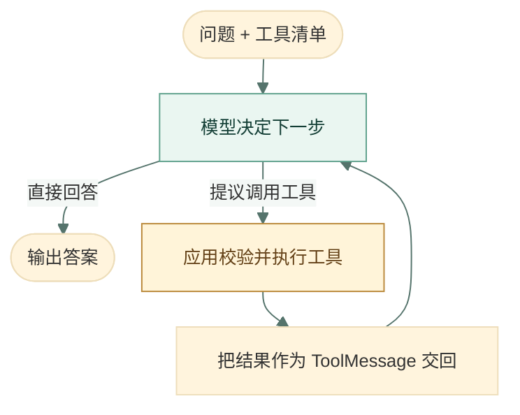

# 00-6 · LangChain 入门：模型、消息、提示词、链与 Agent

**只用浏览器就能读懂；代码标记为「选做」，需要 Python。** 阅读约 20–24 分钟，跟做约 12 分钟。学完你能画出 LangChain 的组件地图，逐个说清模型、消息、提示词模板、结构化输出、链、工具、Agent、记忆、检索组件各解决什么问题，并能解释它们和 CareerLens 的关系。

## 先把学习的理由摆正

LangChain 是用来接模型、组织消息和调用工具的开源框架。学会它，你会得到一套**通用词汇**：以后读官方文档、看别人的 Agent 代码、甚至换一个框架，都能认出「这是模型层，这是提示词模板，这是工具调用」。

CareerLens 用 `langgraph` 编排对话图，用 `langgraph-checkpoint-postgres` 支持数据库检查点，对话模型则通过项目自己的 Provider 调用。第 3 章的 MCP 跟做还会用到 `langchain-core` 的 `@tool`。本页涉及的 `init_chat_model` 和 `create_agent` 来自完整的 `langchain` 包，选做时单独安装。 [项目依赖](../../backend/pyproject.toml) · [项目的模型 Provider](../../backend/app/llm/provider.py) · [MCP 工具调用练习](../01-agent-design/lab/mcp_tool_check.py)

这几组积木在后面的源码课里都用得上。

- LangChain 定义的**概念**（模型、消息、提示词、输出解析、链、工具、Agent、记忆、检索器）是行业通用语，CareerLens 里几乎每一个都能找到对应物。
- 官方文档里 LangChain 与 LangGraph 经常**一起出现**，读源码和文档时混着讲是常态。分不清就容易被绕晕。
- 等你以后要接十家模型、几十个工具，或想把演示代码升级成正式产品时，LangChain 的集成层很可能派上用场。提前认识它，是为将来省时间。

所以这一章的定位是**打基础**：把 LangChain 的核心积木逐个拆开，讲清「它是什么 / 解决什么问题 / 最小怎么用 / 在 CareerLens 里对应什么」。最后的对照表会告诉你项目的真实选择，但学习重点是前面的概念本身。

## 一张地图：LangChain 由哪些积木组成

先看全貌，再逐块展开。别急着记住名字，先记住「哪一层管什么事」。

| 层 | 代表组件 | 解决什么问题 | 一句话类比 |
| --- | --- | --- | --- |
| 模型层 | `ChatModel`、`init_chat_model` | 统一接不同厂商的模型 API | 发电机，提供动力 |
| 消息层 | `SystemMessage` / `HumanMessage` / `AIMessage` | 把对话结构化成有角色的输入 | 给动力规定方向盘 |
| 提示层 | `PromptTemplate`、`ChatPromptTemplate` | 用变量拼出可复用的提示词 | 可填写的表格模板 |
| 输出层 | `with_structured_output`、`OutputParser` | 让模型返回程序能读的结构 | 把话翻译成数据 |
| 编排层 | LCEL、`Runnable`、`\|` 管道 | 把上面的积木串成一条流水线 | 传送带 |
| 工具与 Agent | `@tool`、`create_agent` | 让模型能提议调用外部函数 | 给 Agent 装上可动的手 |
| 记忆层 | checkpointer、`thread_id` | 让多轮对话接得上 | 记事本 |
| 检索层 | Loader、Splitter、Embedding、VectorStore、Retriever | 把外部资料变成可查的上下文 | 图书馆与索引 |
| 可观测 | Callbacks、LangSmith | 记录每一步发生了什么 | 行车记录仪 |


读图时，先沿着「提示词 → 模型 → 输出解析」走一遍。这是一条顺序固定的链。放到 Agent 里，模型的一次输出可能是工具请求，应用把结果交回后，模型才接着回答。记忆、检索器可以按应用需要接入。

## 准备选做环境

只读正文可以直接跳到下一节。要运行模型示例，先在自己的练习文件夹打开终端，准备 Python 3.11+。下面两组命令按系统选一组。 [Python 安装步骤](../setup/Python准备.md)

```powershell
# Windows PowerShell
py -3 -m venv .venv-langchain
.\.venv-langchain\Scripts\python.exe -m pip install "langchain[openai]>=1,<2"
```

```bash
# macOS / Linux
python3 -m venv .venv-langchain
./.venv-langchain/bin/python -m pip install 'langchain[openai]>=1,<2'
```

在同一文件夹新建 `langchain_lab.py`。按本页的顺序追加想试的 Python 代码。含 `model`、`chat_pt` 或 `search_evidence` 的片段会复用前面定义的对象。运行时，在上面对应的 Python 路径后接 `langchain_lab.py`，例如 Windows 输入 `.\.venv-langchain\Scripts\python.exe langchain_lab.py`。调用 OpenAI 的片段需要该账户可用的 API 密钥和模型权限。只想离线试工具，可以把第 6 块的代码单独放进这个文件运行。

## 第 1 块：模型 Model —— 统一接住的「发电机」

### ChatModel 和老的 LLM 有什么区别

LangChain 官方文档把模型称为「Agent 的推理引擎」。它有两种接口：

| 接口 | 输入 | 返回 | 现在该用哪个 |
| --- | --- | --- | --- |
| ChatModel（聊天模型） | 一组带角色的消息 | 一条 `AIMessage` | 聊天、Agent 和工具调用 |
| 旧式文本补全 LLM | 一段字符串 | 一个字符串 | 仅维护老代码时用 |

直接调用模型时，可以用返回值辨认接口。聊天模型返回 `AIMessage` 对象，可以读 `.text` 和 `.tool_calls`。文本补全接口返回字符串。经过第 5 块的输出解析器之后，聊天模型的回答也会变成字符串。聊天模型的实现类通常以 `Chat` 开头，如 `ChatOpenAI`、`ChatAnthropic`、`ChatGoogleGenerativeAI`。

### 最省事的入口：init_chat_model

不用记每个厂商的类名，官方提供统一入口：

```python
# 选做：基础模型配置，后面的模型示例复用这个变量
import os
from getpass import getpass

from langchain.chat_models import init_chat_model

if not os.environ.get("OPENAI_API_KEY"):
    os.environ["OPENAI_API_KEY"] = getpass("OpenAI API key: ")

model = init_chat_model("openai:gpt-4o-mini")  # 厂商:模型
```

`getpass` 会在终端读取密钥，输入过程不回显。`"厂商:模型"` 让调用代码可以沿用 `invoke()` 等方法。换厂商时还要安装对应的集成包、设置该厂商的凭证，并确认模型支持后面用到的工具调用与结构化输出。CareerLens 也把「选哪家模型」和「如何使用模型」分开。 [LangChain 模型接入](https://docs.langchain.com/oss/python/langchain/models) · [CareerLens 模型配置](../01-agent-design/模型配置.md)

### 三种调用方式：invoke / stream / batch

| 方法 | 一次返回什么 | 什么时候用 |
| --- | --- | --- |
| `invoke()` | 一条完整的 `AIMessage` | 最常见，要完整答案 |
| `stream()` | 一串 `AIMessageChunk`，逐块到达 | 打字机效果、长回答先出一半 |
| `batch()` | 一组答案（并行请求） | 批量处理多条独立输入 |

```python
# 选做
answer = model.invoke("用一句话解释什么是 token")
print(answer.text)
for chunk in model.stream("讲一个关于检索的故事"):
    print(chunk.text, end="", flush=True)
print()
answers = model.batch(["问题一", "问题二", "问题三"])
```

聊天模型的 `batch()` 默认在客户端并发处理多条输入。厂商的批处理服务另有提交方式、计价和完成时间。

### 常用参数：小白也该懂的 temperature

```python
# 选做
model = init_chat_model(
    "openai:gpt-4o-mini",
    temperature=0.2,     # 随机性：越低越稳定，越高越有创意
    max_tokens=1000,     # 最多生成多少 token
    timeout=30,          # 等待上限（秒）
    max_retries=6,       # 网络/限流失败时重试次数
)
```

**token** 是模型读写文本的基本单位，可以粗略理解成「词或词片段」。它不是字也不是词：中文一字可能是一两个 token，英文一个长词可能拆成几个。模型按 token 计费，也有「一次最多能看多少 token」的上限，也就是**上下文窗口**。`max_tokens` 管的是输出长度，上下文窗口管的是输入加输出的总容量。

**temperature** 会调整模型如何从候选 token 中采样。调低时，模型通常更偏向概率高的选项，回答往往更稳定，同样的请求仍可能得到不同文字。对证据核对任务，分别观察「回答是否稳定」和「原文是否支持结论」。CareerLens 的 Demo 回退由规则和输入决定，与真实模型的采样参数分开。

> 更多参数如 `model_provider`、`base_url`（接 OpenAI-compatible 接口）、`reasoning_effort`、`rate_limiter`，官方文档都列在模型页。用到时再查即可。 [模型官方文档](https://docs.langchain.com/oss/python/langchain/models)

## 第 2 块：消息 Messages —— 角色是给模型的「方向盘」

聊天模型的输入通常是一组带角色的消息。这里先认四种角色和对应对象。

| 角色 | 对象 | 放什么 | 类比 |
| --- | --- | --- | --- |
| `system` | `SystemMessage` | 应用规则、身份、边界 | 上岗手册 |
| `user` | `HumanMessage` | 这次的问题 | 客户提问 |
| `assistant` | `AIMessage` | 模型之前的回答 | 之前的对话记录 |
| `tool` | `ToolMessage` | 工具查回来的结果 | 查到的资料 |

```python
# 选做
from langchain.messages import SystemMessage, HumanMessage, AIMessage

conversation = [
    SystemMessage("只依据给定资料回答；资料不足就写证据不足。"),
    HumanMessage("林澈有生产 Kubernetes 上线记录吗？"),
    AIMessage("资料里只有收藏教程，不能确认上线。"),   # 历史回答
    HumanMessage("那他做过什么？"),                    # “他”要靠历史理解
]
model.invoke(conversation)
```

回到 Kubernetes 的例子，在同一条用户消息里也可以分开写「岗位要求」和「候选人原文」。应用自己的判断规则才放进 `system`。如果原文来自一次实际工具调用，可以交给 `ToolMessage`，用 `tool_call_id` 对应模型刚提出的那次调用。 [00-2 提示词与证据](00-2-提示词与证据.md) · [LangChain 消息文档](https://docs.langchain.com/oss/python/langchain/messages)

CareerLens 在调用模型时，把规则写进 `system_prompt`，把问题、意图、画像、证据和历史打包成结构化的用户输入——用的是同一套角色思想。 [答复节点源码](../../backend/app/graph/career.py)

## 第 3 块：提示词模板 —— 可复用的「填空表格」

### 为什么不用字符串硬拼

如果每个调用点都用 `f"请判断：{question}，参考：{context}"` 重写一份提示词，改规则或加示例时就要逐处更新。**提示词模板**把常驻规则集中到一处，用占位符接收每次变化的问题和原文。模板只负责填值，应用仍须标清资料来源。

```python
# 选做
from langchain_core.prompts import PromptTemplate, ChatPromptTemplate

pt = PromptTemplate.from_template(
    "只依据资料回答，不足就写证据不足。\n资料：{context}\n问题：{question}"
)
filled = pt.format(context="D：练习集群发布成功", question="他发布过吗？")

chat_pt = ChatPromptTemplate.from_messages([
    ("system", "你是严谨的证据核对助手。"),
    ("human", "资料：{context}\n问题：{question}"),
])
```

`{context}`、`{question}` 是占位符。`pt.format(...)` 返回一段填好的字符串。`ChatPromptTemplate` 用 `(角色, 内容)` 元组表达同一类填空，得到带角色的多条消息。试着 `print(filled)`，确认资料和问题出现在各自的标签后面。CareerLens 的实际请求里，规则与资料由 Provider 按角色打包。 [模型请求源码](../../backend/app/llm/provider.py)

### few-shot：给几个例子比讲一堆规则管用

**少样本提示**（few-shot）是在提示词里放几条「输入 → 输出」样例，让模型照着做。比如教它区分「收藏」和「上线」：

```text
资料：收藏了 Kubernetes 教程 → 结论：兴趣线索，不是技能
资料：在练习集群发布成功 → 结论：练习环境发布，不是生产上线
资料：{新资料} → 结论：
```

例子让模型看到要保留原文的环境范围。CareerLens 把规则写进 `system_prompt`，再在应用里检查输出格式和引用。学完这里，可以往第一条样例加上「只收藏、未参与部署」的原文，看看输出是否依旧保留动作的边界。

> 官方文档把提示词模板列为 LangChain 的核心组件之一。 [LangChain 概览](https://docs.langchain.com/oss/python/langchain/overview)

## 第 4 块：结构化输出 —— 让模型说「程序能读」的话

模型默认吐出的是自然语言。程序要拿它做判断，就得解析。让模型每次都「用 JSON 回答，别加解释」并不牢靠——它可能加前后缀、漏字段、写错类型。

LangChain 的 `with_structured_output()` 把这件事做成一层：你给一个 schema，它约束模型按 schema 输出，并帮你解析。

```python
# 选做
from pydantic import BaseModel, Field

class Answer(BaseModel):
    answer: str = Field(description="基于资料的结论")
    citation_ids: list[str] = Field(description="引用的证据编号")

structured = model.with_structured_output(Answer)
result = structured.invoke(
    "资料 D：林澈在练习集群发布了课程接口。"
    "只依据这条资料回答：他在哪里发布过接口？请附资料编号。"
)
# result 是 Answer 对象，result.answer / result.citation_ids 可直接读
print(result.answer, result.citation_ids)
```

三点要记牢：

1. **schema 可以用三种写法**。Pydantic `BaseModel` 返回经 Pydantic 解析的对象。`TypedDict` 和 JSON Schema 通常返回字典，还可按业务规则再验证。
2. **`method` 决定实现方式**。常见实现包括厂商原生 `json_schema`、借工具调用传回字段的 `function_calling`，以及只约束为合法 JSON 的 `json_mode`。具体支持看模型和集成包。
3. **拒绝与原始消息**：模型可能拒绝输出；用 `include_raw=True` 能同时拿到原始消息和解析结果，便于排查。

CareerLens 的 Provider 自己请求含 `answer` 与 `cited_evidence_ids` 的 JSON。应用解析回答，再检查引用是否来自本轮候选。比如上面的 `citation_ids` 即使确实是字符串列表，你仍要打开 D 看它能否证明「在哪个环境发布」。 [00-2 的三关](00-2-提示词与证据.md) · [LangChain 结构化输出](https://docs.langchain.com/oss/python/langchain/models#structured-output)

## 第 5 块：链与 LCEL —— 用管道把积木串成流水线

前面每一块都能单独用。真正有用的是把它们**串起来**：提示词 → 模型 → 输出解析。LangChain 提供一套叫 **LCEL**（LangChain Expression Language）的组合方式，核心是两个东西：

- **`Runnable`** 是可组合组件遵守的调用接口，例如本例的消息模板、聊天模型和输出解析器。它们都有 `invoke`、`stream` 和 `batch`。
- **`|` 管道符**：把上一个组件的输出接到下一个的输入。

```python
# 选做：需要已定义的 chat_pt 与 model
from langchain_core.output_parsers import StrOutputParser

chain = chat_pt | model | StrOutputParser()
chain.invoke({"context": "D：练习集群发布成功", "question": "他发布过吗？"})
# 变量先填进提示词模板 → 交给模型 → 输出被解析成字符串
```

这一行的厉害之处在于：`chain` 自己也是 `Runnable`，所以照样能 `chain.stream(...)`、`chain.batch(...)`，异常处理、回调、并行也都统一了。你不用为每种组合重写一套调用逻辑。

**CareerLens 里没有直接用 LCEL**，它的流水线是用 LangGraph 的节点和边显式写出来的（`understand_intent → retrieve_evidence → compose_answer`）。但思路一致：都是把小步骤组合成一条可控的链。LCEL 更像「一行拼装」，LangGraph 更像「画流程图」，后者在你需要在中途分支、暂停、续跑时更有优势。 [Graph API 官方说明](https://docs.langchain.com/oss/python/langgraph/graph-api)

## 第 6 块：工具 Tools —— 模型能提议，应用来执行

工具就是一个函数，加上描述让模型知道「什么时候用它」。官方用 `@tool` 装饰器：

```python
# 选做：这一段可以单独运行，不需要模型或 API 密钥
from langchain_core.tools import tool

CARDS = {"D": "林澈在练习集群把课程接口发布成功，保留了回滚截图。"}

@tool
def search_evidence(query: str, limit: int) -> str:
    """按关键词检索证据卡，返回编号与原文。limit 取 1 到 5。"""
    keyword = query.strip()
    if not keyword or not 1 <= limit <= 5:
        return "请提供关键词，limit 取 1 到 5。"
    matches = [f"{key}：{text}" for key, text in CARDS.items() if keyword in text]
    return "\n".join(matches[:limit]) or "没有找到含这个关键词的证据。"

print(search_evidence.invoke({"query": "发布", "limit": 1}))
print(search_evidence.invoke({"query": "生产", "limit": 1}))
```

第一行输出以 `D：` 开头，第二行找不到含「生产」的卡片。`@tool` 把普通函数包装成可绑定给模型的工具。模型能收到工具的名称、描述和参数 schema，例如 `query` 是字符串、`limit` 是整数。这里只写「1 到 5」的描述，还需要函数里的范围检查。

手动调用 `search_evidence.invoke(...)` 可以单独验证工具这一层。接上 Agent 后，模型可以返回一份调用请求，应用负责选择并执行已注册的函数。接真实资料时，需要校验参数和读写权限，用户范围从已校验的请求上下文取得。CareerLens 对话图的检索节点由程序按意图和资料模式直接调用。 [00-2 跟随一次工具调用](00-2-提示词与证据.md) · [01-B 检索节点](../01-agent-design/01-B-工具调用.md) · [01-B0 MCP 与 @tool](../01-agent-design/01-B0-注册与调用MCP工具.md)

## 第 7 块：Agent —— 把模型、工具、提示、记忆装到一起

有了模型和工具，就可以组装一个真正会「自己决定下一步」的 Agent。官方现在的入口是：

```python
# 选做：需要前面定义的 model 与 search_evidence
from langchain.agents import create_agent
from langgraph.checkpoint.memory import InMemorySaver

agent = create_agent(
    model=model,
    tools=[search_evidence],
    system_prompt="只依据工具查回的资料回答，不足就写证据不足。",
    checkpointer=InMemorySaver(),
)
result = agent.invoke(
    {"messages": [{"role": "user", "content": "请用关键词「发布」查卡片，再回答林澈发布过接口吗？"}]},
    config={"configurable": {"thread_id": "linche-01"}},
)
for message in result["messages"]:
    print(message.type, getattr(message, "tool_calls", []), message.text)
```

这个 `create_agent` 示例把模型、工具、系统提示和可选的检查点接在一起。查看打印出来的消息，如果看到 `ai` 消息里有 `tool_calls`，再往下找 `tool` 消息和最终的 `ai` 答复。前一条记录请求，后一条记录函数回传的原文。工具搜不到时，可以查看模型选了哪个关键词，再手动试一次 `search_evidence.invoke(...)`。



工具清单限定了这一轮有哪些动作。生产应用还要为循环设置停止条件，例如模型给出最终答复或流程达到预算。CareerLens 的对话图把下一步写成固定条件边，路由函数根据当前状态选其中一条。 [00-5 LangGraph 与工作流](00-5-LangGraph与工作流.md)

`deepagents` 包的 `create_deep_agent` 还预置了计划、文件系统工具和子 Agent。这里的单工具循环只需 `create_agent`。要对照 CareerLens 如何给子任务分派输入、限制预算，可以继续读 01-C。 [Deep Agents 概览](https://docs.langchain.com/oss/python/deepagents/overview) · [01-C Coordinator 与子 Agent](../01-agent-design/01-C-子Agent.md)

## 第 8 块：记忆 Memory —— checkpointer 与 thread_id

单个 Agent 跑完就忘。要让它记住上一轮说过什么，靠两样东西：

- **checkpointer**：负责把每一步的状态存下来。演示用 `InMemorySaver()`（进程重启就没了），正式用持久化的 saver（写到数据库）。
- **`thread_id`** 给一段对话编号，Agent 据此找回对应的状态。示例里的两个编号对应两份检查点。真实应用还需要校验会话归属。

```python
# 选做：复用 model，单独创建一个读会话历史的 Agent
memory_agent = create_agent(
    model=model,
    tools=[],
    system_prompt="根据当前会话回答我的名字；没有提过名字时回答未知。",
    checkpointer=InMemorySaver(),
)
same = {"configurable": {"thread_id": "session-1"}}
other = {"configurable": {"thread_id": "session-2"}}
memory_agent.invoke({"messages": [{"role": "user", "content": "我叫林澈"}]}, config=same)
question = {"messages": [{"role": "user", "content": "我叫什么？"}]}
for config in (same, other):
    result = memory_agent.invoke(question, config=config)
    print(config["configurable"]["thread_id"], result["messages"][-1].text)
```

预期 `session-1` 的回答能提到「林澈」，`session-2` 的回答表示未知。这个实验请放在同一次脚本运行内。CareerLens 的 checkpointer 保留图的执行快照，消息表提供界面历史，长期画像用单独的草案与确认接口更新。项目默认用内存 saver，配置持久化后端后使用数据库 saver。 [00-5 的三份数据](00-5-LangGraph与工作流.md) · [检查点源码](../../backend/app/graph/checkpoint.py)

## 第 9 块：检索组件 —— 把外部资料变成上下文

最后一组积木服务于 RAG，LangChain 把流程拆成四个标准角色：

| 组件 | 干什么 | 对应 00-3 / 00-7 里的哪一步 |
| --- | --- | --- |
| Document Loader | 从 PDF、网页、Word 读出文本 | 「导入时」的解析 |
| Text Splitter | 把长文切成带位置的块 | 「切块 · 记位置」 |
| Embedding | 把文本变成向量 | 「用向量找」的坐标 |
| VectorStore + Retriever | 存向量、按问题取回候选 | 「召回 → 排序 → 前 K 条」 |

Retriever 是这一组的门面：你调用 `retriever.invoke("问题")`，它内部完成向量化、检索、返回文档。CareerLens 用的是同一套流程，只是把 Loader/Splitter/Embedding/VectorStore 换成了自己的解析服务、`hash-v1` 或 Qwen Embedding、以及 Qdrant（或本地回退）；检索时还叠了 Dense + Sparse 两路和 RRF 融合。概念框架一样，实现更精细。 [00-3 RAG 与检索](00-3-RAG与检索.md) · [00-7 混合 RAG 与排名融合](00-7-混合RAG与排名融合.md)

## 可观测：知道每一步发生了什么

Agent 跑起来后，「它为什么这么答」很难靠猜。LangChain 提供 Callbacks 机制，在模型开始/结束、工具调用、链执行等节点发事件；LangSmith 则把这些记录成可视化的轨迹。CareerLens 用 `model_diagnostics`、`retrieval_diagnostics` 和 Run/Step/Event 做类似的事——自己实现，但目的一样：**让过程可观察，出问题能定位到具体一步**。 [00-4 的任务记录](00-4-数据模型大白话.md)

## 跟做：把概念落成自己的话

不用装软件也能做第一部分。先写预测，再展开核对。

| 练习 | 先写下你的答案 | 核对点 |
| --- | --- | --- |
| 「模型层」和「编排层」各管什么？ | | ChatModel 接 API；LCEL/图决定步骤 |
| 岗位要求、候选人自述、应用规则分别放在哪？ | | 前两项标注资料来源，应用规则用 `system` |
| temperature 调高，对「核对证据」任务是好是坏？ | | 更随机 → 更容易跑偏 |
| 模型返回了工具调用建议，应用下一步应先做什么？ | | 校验参数与 user_id 授权 |
| checkpointer 和消息表是不是一回事？ | | 执行状态 vs 可见历史 |

<details>
<summary>核对要点</summary>

1. 模型层只管生成内容，编排层决定先做什么后做什么、什么时候停。分清这两层，才知道错误该去哪一层找。
2. 分开标注岗位要求和候选人原文，可以回查是哪份资料支撑了结论。`system` 用于应用自己设定的任务规则。
3. 较低的 temperature 通常让措辞更稳定。某句话能否成立，仍要打开证据核对。
4. 提议不等于执行；先校验参数、用户归属、读写权限，再真正调用工具。
5. 不是。checkpointer 存图的执行状态（用于续跑），消息表存界面历史（用于组装上下文），长期画像另有一套。

</details>

**选做（需要 Python）。** 先跑工具的离线例子，把查询依次改成「回滚」「生产」和空字符串，记录有结果、没召回和参数不合法三种返回。有模型密钥时，把第一块的模型配置、第六块的工具和第七块的 Agent 组装到一起，观察模型用了哪个查询词，工具结果能否支持最终答复。 [LangChain 快速上手](https://docs.langchain.com/oss/python/langchain/quickstart)

## 常见坑，提前绕开

- **把 LangChain 和 LangGraph 当二选一。** 官方文档把它们分为 framework（框架）与 runtime（运行时）：一个偏「快速搭标准 Agent」，一个偏「有状态、可暂停的低层编排」。它们能一起用，不是敌人。 [产品分层说明](https://docs.langchain.com/oss/python/concepts/products)
- **以为 `batch()` 是厂商批量 API。** 前者客户端并行，后者厂商折扣批处理，名字像但不是一回事。
- **忘记输出经过了哪一层。** `AIMessage` 来自聊天模型，`StrOutputParser` 抽出字符串，`with_structured_output(Answer)` 把结果解析成 `Answer`。先看自己调用的是哪一层。
- **相信模型编的 ID。** 任何 `user_id`、证据编号都要回到应用自己的授权范围和允许清单校验。
- **把「记不住」都归咎于记忆模块。** 上下文窗口溢出、切块不当、检索没召回，都会表现为「它忘了」，先定位是哪一层。

## 这些积木在 CareerLens 里落在哪

最后回到项目。学会上面的概念后，这张对照表应该一眼就懂——它不是「项目用没用什么」的辩解，而是「同一类问题，这里为什么这样选」的答案。

| LangChain 概念 | CareerLens 的对应 | 为什么这样选 |
| --- | --- | --- |
| ChatModel / 模型层 | 自建 `LLMProvider`：`DemoProvider` 与 `OpenAICompatibleProvider` | Demo 无密钥、可复现；按角色绑定不同模型；记录延迟与成本 |
| 消息与角色 | `system_prompt` + 结构化的用户输入 JSON | 明确规则、防止岗位要求与候选人经历串味 |
| 结构化输出 | 要求 JSON（含 `answer` / `cited_evidence_ids`），应用检查格式和引用 | 校验失败有回退，读者沿证据查语义 |
| LCEL 链 | LangGraph 的节点与条件边 | 需要分支、暂停、续跑，流程图比管道更合适 |
| 工具 `@tool` | MCP 跟做用 `langchain_core.tools.tool`，对话图调用应用内检索函数 | 对照客户端登记和后端检索的调用方式 |
| Agent `create_agent` | 有限状态的对话图 + 后台角色子图 | 流程固定、结论要能核对 |
| checkpointer / thread | `InMemorySaver` → `AsyncPostgresSaver`；`thread_id` | 与消息表、长期画像分层管理 |
| Retriever / RAG | Qdrant 混合检索（Dense + Sparse + RRF）或本地回退 | 精确词与语义都要，且要能回查原文 |

一句话总结这一章：**LangChain 给你一套积木的通用名字，LangGraph 给你一种把它们排成可暂停流程图的方法，CareerLens 在这个基础上把模型、检索和业务规则写成自己的薄层，以保证每一步都能核对。** 三句话讲的是同一件事的不同侧面，不冲突。

## 下一步

接着读 [00-7 混合 RAG 与排名融合](00-7-混合RAG与排名融合.md)，看检索器怎样选出给模型的资料；再到 [00-8 Wiki 知识组织](00-8-Wiki知识组织.md)追一次知识页的原文引用。想先打开工作台，走 [01 第一次跑起来](../01-第一次跑起来.md)。术语不确定时随时查 [术语表](../术语表.md)。
