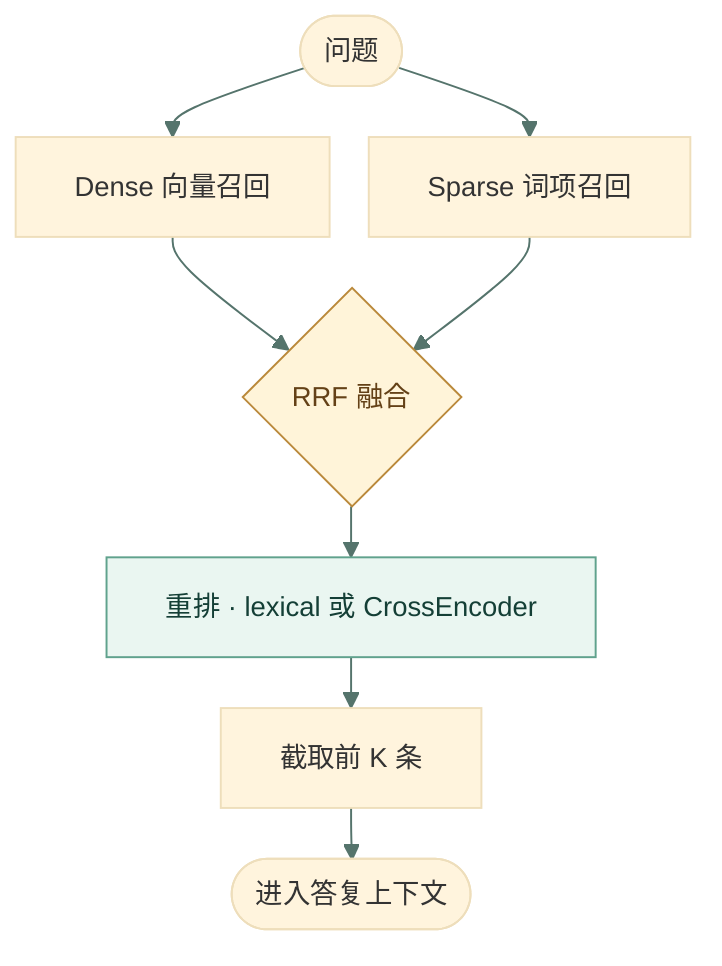

# 00-7 · 混合 RAG 与排名融合：两张榜怎样合成一张

**只用浏览器，离线脚本标为选做。** 阅读约 24–28 分钟，跟做约 14 分钟。学完你能解释 Dense 与 Sparse 各捞什么、RRF 为什么看名次不看分数、候选池和重排各管哪一段，并区分 Qdrant 路径与本地回退的机制差异。

## 先把学习的理由摆正

00-3 已经带你手算过一张融合榜：B 同时出现在两张榜，融合后排第一；D 在向量榜第一，却掉到第三。「两张榜」不是比喻——CareerLens 的 Qdrant 路径真的同时发起两路查询，再让检索库把结果融合。

为什么非要两路？因为**两种找法各有盲区**：用词查找精准但不懂同义，向量检索懂语义但可能放过精确的技术名和报错码。混合检索就是把两条路一起走，让彼此补盲。这一章把这些步骤拆开，讲清每一层的职责和边界。

## 一张地图：从两路查询到最终答案

| 层 | 做什么 | 关键概念 | 在CareerLens 里 |
| --- | --- | --- | --- |
| 召回 | 两路各取一批候选 | Dense 向量 / Sparse 向量 / BM25 | 两条 `prefetch` |
| 融合 | 把两张榜合成一张 | RRF，看名次不看分数 | 服务端 `Fusion.RRF` |
| 重排 | 对已召回候选再打分 | `lexical-v1` / CrossEncoder | 默认交并比，选配模型 |
| 截取 | 取前 K 条进上下文 | `limit`、`prefetch_limit` | 候选池 ≥ limit×4 |
| 回退 | Qdrant 不可用时降级 | 加权打分，机制不同 | 诊断标 `fallback=true` |



读图记住一个顺序：**先召回（两路）→ 再融合（RRF）→ 再重排 → 最后截取**。每一步只处理上一步留下来的候选，前面漏掉的，后面救不回来。

## 第 1 块：两路各看什么

Qdrant 官方文档把混合查询描述为：对同一份数据用多种方式检索，通过 `prefetch` 先跑子查询，再把主查询应用到候选上。常见组合是 Dense 向量负责语义、Sparse 向量或 BM25 负责精确词项。 [Qdrant 混合查询文档](https://qdrant.tech/documentation/concepts/hybrid-queries/)

| 表示 | 课堂里的说法 | 擅长 | 在项目里 |
| --- | --- | --- | --- |
| Dense 向量 | 把整句话变成一组坐标，按方向找邻居 | 换一种说法仍能找到相关材料 | 默认 `hash-v1` 是确定性哈希向量；选配 Qwen3 Embedding 才是学习出来的表示 |
| Sparse 向量 | 只记录出现过的词和权重 | 技术名、报错码、精确词项 | 词哈希计数 + Qdrant IDF 修正，不是标准 BM25 |
| BM25 | 经典全文检索打分，考虑词频与文档长度 | 关键词匹配 | Qdrant 支持，但 CareerLens 当前稀疏路径不按完整 BM25 实现 |
| HNSW | 高维向量的近邻索引结构 | 快速找候选 | 由 Qdrant 管理；应用里没有自己写索引算法 |

### Dense 和 Sparse 为什么要一起用

设想三种查询：

- 「在哪里运行过这个项目」——语义问题，措辞自由，Dense 更擅长，因为「部署」「发布」「跑起来」在向量空间里可能靠近。
- 「报错码 EKS-4032」——精确词项，Sparse 更擅长，因为错一个字符就不对了，语义相近没用。
- 「Kubernetes 生产发布变更单」——既有技术名又有语义，两路都该上。

只用一路，总有一类查询吃亏。混合检索的代价是复杂度上升，收益是覆盖面更稳。

### 为什么分数不能直接相加

Dense 的余弦相似度有界（大致 -1 到 1）；Sparse 的词项分数可能无界，而且会随查询和文档长度变化。直接按固定比例相加，等于把摄氏度和美元加在一起——数值能算，意义没有。RRF 的取巧之处是**只看每个候选在各自榜单中的位置**，绕开了分数尺度问题。

## 第 2 块：RRF——名次贡献相加

Qdrant 文档给出的默认 RRF 形式是：

```text
score(d) = Σ  1 / (k + rank(d))
          每个 d 出现的榜单
```

- `rank` 从 0 开始，第一名是 0。
- `k` 默认 2；Qdrant v1.16.0 起可显式配置，权重融合在更新版本提供。
- 缺席某张榜的候选在那一项贡献 0。
- 同一候选在多张榜靠前，分数会累加。

CareerLens 在 Qdrant 里提交两条 `prefetch`：一条用 Dense 向量，一条用 Sparse 向量；主查询声明 `Fusion.RRF`，并用 `user_id` 过滤器限定范围。代码**没有自己写 RRF，也没有传 `k` 或 `k=60`**。仓库固定 Qdrant 1.15.4，因此按服务端默认行为理解，不把课堂示例的常数当成项目显式配置。 [检索源码](../../backend/app/retrieval/qdrant_store.py) · [文档设计与版本边界](../../docs/agent-and-retrieval.md)

### 手算一遍：只改名次

沿用两张固定榜，从 0 记名次，取 `k=2`：

| 卡片 | 关键词榜名次 | 向量榜名次 | RRF 贡献 | 合计 |
| --- | ---: | ---: | --- | ---: |
| A | 2 | 缺席 | 1/(2+2) | 0.25 |
| B | 0 | 2 | 1/2 + 1/4 | 0.75 |
| C | 1 | 1 | 1/3 + 1/3 | 0.667 |
| D | 缺席 | 0 | 1/2 | 0.50 |

顺序是 B、C、D、A。现在只改一个变量：把 `k` 从 2 改成 10，所有分母都变大，而且靠前名次的相对优势会缩小。再移除 B 在关键词榜的命中，B 只剩向量榜的 1/4，顺序随之改变。想实际跑，可以用离线脚本 [lesson-05-rrf](../../examples/tutorials/lesson-05-rrf/)（需要 Python，标准库即可）。 [04 篇的四环节实验](../04-检索Agent.md)

### k 到底影响什么

`k` 在分母里，作用是**压缩名次的差异**。k 很小（如 2）时，第 1 名（1/2）和第 2 名（1/3）差距明显；k 很大（如 60）时，1/61 和 1/62 几乎一样，名次的重要性被抹平。所以：

- 想让「两路都靠前」的候选明显领先 → 用较小的 k。
- 想让更多候选分数接近、减少单一路径的支配 → 用较大的 k。

课堂用 k=2 是为了手算方便，不代表项目配置。项目按 Qdrant 默认（文档记载为 2）理解，但没有显式传参——这个细节在 [00-3](00-3-RAG与检索.md) 也强调过。

### 别把「名次融合」和「交错」混起来

Qdrant 内部把 Dense 与 Sparse 用 RRF 合成一条 Evidence 榜；`hybrid` 模式把 Evidence 榜和 Wiki 页榜按名次一条隔一条取，只是交错，不打分数。 [知识检索源码](../../backend/app/services/knowledge.py) · [00-8 Wiki 知识组织](00-8-Wiki知识组织.md)

## 第 3 块：候选池和重排各管一段

Qdrant 查询先取一批候选（`prefetch_limit`，默认 20，且不小于 `limit×4`），融合后再重排、截取返回条数。官方文档提醒：主查询只作用于 prefetch 返回的结果；如果候选池太小，后面再强的重排也救不回一开始没召回的材料。

### 为什么候选池要大于最终取数

假设最终只要 3 条（limit=3），但候选池也只取 3 条。那么重排没有任何选择空间——只能在已取的 3 条里换个顺序，真正相关的第 4 条根本没进来。候选池取 `limit×4`（即 12 条）给重排留下挑拣余地。这是一条通用经验：**召回宁可宽，排序再收窄。**

CareerLens 默认重排是 `lexical-v1`：把问句词集与候选词集的交集除以并集。可选 CrossEncoder 会按模型打分，级联两阶段默认是关闭的。诊断字段会如实报出 `backend`、`fusion`、`reranker`、`fallback` 和原因。 [providers.py](../../backend/app/retrieval/providers.py)

### 重排的角色：精排已召回的候选

重排（rerank）是在融合榜之上再打一轮分。它比召回更「贵」（通常要逐条计算或调用模型），所以只用在少量候选上。职责分工是：

- 召回：从全库里快速捞出可能相关的（宽、快、粗）。
- 融合：把两路结果按名次合并。
- 重排：对这十几条做精细判断（窄、慢、准）。
- 截取：取前 K 条送进上下文。

## 第 4 块：没有 Qdrant 时，机制不一样

`RETRIEVAL_BACKEND=auto` 优先走 Qdrant；服务不可用、或已有记录但索引为空时，会回退到数据库记录上的本地混合检索：

```text
score = 0.45 × 词频余弦
      + 0.55 × 稀有词加权分
      + 0.25 × 问句完整出现在正文的加分
```

这**不是** RRF，也不是标准 BM25。诊断里会出现 `backend=local`、`fusion=weighted_score`、`fallback=true`。把本地回退结果说成「和线上 Qdrant 一样的检索质量」是不准确的；索引缺失应走重建索引流程，而不是长期依赖回退。

| 看到这个诊断 | 说明什么 | 下一步 |
| --- | --- | --- |
| `backend=qdrant`, `fusion=rrf`, `fallback=false` | 走服务端两路召回与 RRF | 按名次融合解释结果 |
| `backend=local`, `fallback=true`, `reason=qdrant_empty` | Qdrant 可达但没有候选 | 重建索引，不要改提示词硬救 |
| `backend=local`, `fallback=true`, `reason=连接错误类型` | 服务不可用 | 检查服务；本地结果仅作降级观察 |
| `knowledge_fusion=rank_interleave` | 打开了 Rag + Wiki 交错 | 看 `source_kind` 区分两类命中 |

### 诊断字段是排错的第一站

检索结果出错时，先看诊断，别急着改提示词。诊断告诉你：

- 走的哪条路径（qdrant / local）？
- 用了什么融合（rrf / weighted_score）？
- 有没有回退（fallback），为什么？
- 用了什么重排（reranker）？

不同路径的机制不同，对策也不同。本地回退的加权分数不能拿 RRF 的直觉去解释；索引为空要重建，而不是调提示词。

## 第 5 块：三道门仍在——候选、合法、支持

RRF 排序解决的是「谁先进门」，不是「谁说的对」：

1. **召回**：D 或 E 有没有进入候选池？没有的话，调查询表示、切块或候选池大小。
2. **引用合法**：回答里的 ID 是否来自本次检索？未知 ID 会被 `validated_citations` 拒绝并回退。
3. **语义支持**：打开 E 的原文，它只支持那一次 v2 接口发布；单独的运维能力仍需别的证据。系统不替你做这一步。

这三层分别对应检索层、校验层和人的核对。把 B 排第一并不是 bug；把 B 当成「上线过」才是判断错误。这和 [00-2 的三关](00-2-提示词与证据.md)、[00-3 的三道门](00-3-RAG与检索.md) 是同一套思路在检索层的具体化。

## 跟做：一次只改一个变量

在纸上完成三组预测，再用 [离线 RRF 脚本](../../examples/tutorials/lesson-05-rrf/)核对（这一步需要 Python；只学概念时看答案即可）。

| 运行 | 唯一改动 | 预期观察 |
| --- | --- | --- |
| 默认 | 原始两榜，k=2 | B 第一，A/C 各 0.5 |
| 改 k | 只把 k 改成 10 | 名次贡献缩小，B 的相对优势变化 |
| 移除命中 | 只移除 B 在榜 A 的命中 | B 掉到 1/3，A/C 并列第一 |

<details>
<summary>核对与边界</summary>

默认入口还有「名次交错」和「榜首判错」两个环节，用来说明融合、交错、语义支持不是一回事。变体入口不会撞上写死的初始断言；直接读源码或输出，不要只改一个数字就断言 templates 不变。

课堂用的是简化榜单，数值和真实用户数据无关。真实检索还受切块、索引、用户过滤、候选池和重排影响，不能把 `1/(k+rank)` 当作线上分数。

</details>

**选做（需要 Python）。** 离线脚本 [lesson-05-rrf](../../examples/tutorials/lesson-05-rrf/) 提供默认、`--k 10`、`--drop-b`、`--rankings` 多个入口。先只改一个变量，记录融合榜怎么变；再试着解释为什么「两路都靠前」的候选会被 RRF 抬高。

## 常见坑，提前绕开

- **把 Dense/Sparse 分数直接相加。** 尺度不同，要用名次融合。
- **把 RRF 常数当 K。** 常数进分母，K 是最终取几条。
- **候选池等于 limit。** 重排没有挑拣空间，召回质量决定上限。
- **把本地回退说成线上质量。** 机制不同，诊断会标 `fallback`。
- **把名次交错当第二种 RRF。** 一个是融合打分，一个是轮流取。
- **只看排序不看诊断。** 先确认走哪条路，再解释结果。
- **以为排第一就正确。** B 排第一是排序逻辑，不是事实判断。

## 这些概念在 CareerLens 里落在哪

| 这节课的词 | 项目里的对应 | 为什么这样选 |
| --- | --- | --- |
| Dense / Sparse | 两条 `prefetch`，分别向量与词项 | 语义与精确词互补 |
| RRF | 服务端 `Fusion.RRF`，未显式传 k | 按 Qdrant 默认，绕开分数尺度 |
| 候选池 | `prefetch_limit` ≥ limit×4 | 给重排留选择空间 |
| 重排 | `lexical-v1`，选配 CrossEncoder | 精细排序已召回候选 |
| 本地回退 | 0.45/0.55/0.25 加权打分 | 降级可用，但机制不同、要标诊断 |
| 知识交错 | `hybrid` 模式按名次交错 | 主题页与原文各取所长 |
| 三道门 | 召回 / 引用校验 / 语义支持 | 分层定位问题 |

## 下一步

到 [00-8 Wiki 知识组织](00-8-Wiki知识组织.md)看另一类候选从哪来：系统怎样把多条证据编译成一页带引用的主题页，又怎样防止编译过程悄悄丢掉表格行。之后进入 [01 第一次跑起来](../01-第一次跑起来.md)把这条链跑一遍。
