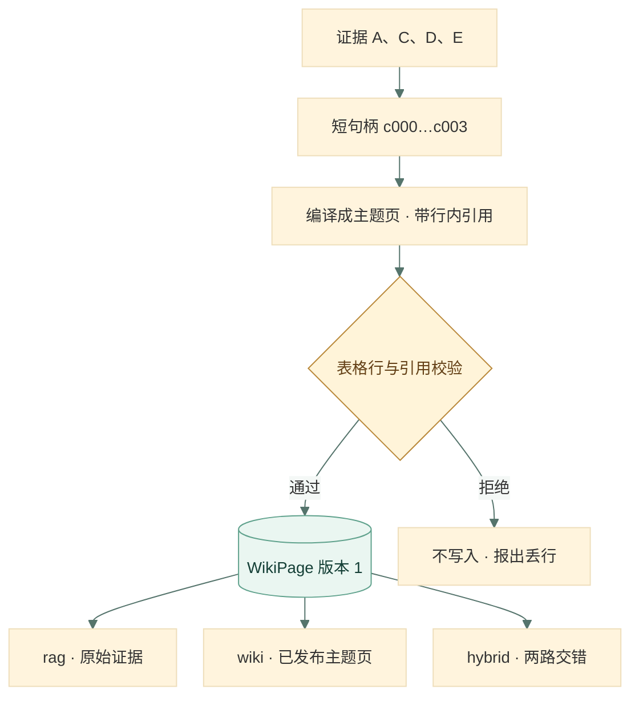

# 00-8 · Wiki 知识组织：把多条证据编译成一页可引用的知识

**只用浏览器。** 阅读约 24–28 分钟，跟做约 12 分钟。学完你能说清 Wiki 页和原始 Evidence 的区别，理解短句柄、表格行守卫、版本不变量为什么存在，能读懂 `rag / wiki / hybrid` 三种模式，并知道「编译成功」和「内容正确」是两件事。

## 先把学习的理由摆正

前面几篇讲了一条完整链路：证据被检索出来，带进答复。但有个问题一直没解决——**同一件事散在多份材料里，每次提问都从零找原文，既慢又容易漏。**

Wiki 页就是对这个问题的回答：系统在「构建时」就把若干条证据整理成一页带引用的主题说明，提问时可以直接查这页。它不是「更权威的证据」，而是**对已有证据的一种组织结果**——仍然保留回到原文的路。

CareerLens 用短句柄让模型引用原文，用表格行守卫发现丢行，用版本条件防止旧稿覆盖新稿。后面会分别推演三种情况，看生成草稿之后，哪些内容可以交给程序检查，哪些还需要读原文。

## 一张地图：从证据到主题页再到查询

| 环节 | 做什么 | 关键设计 | 为什么需要 |
| --- | --- | --- | --- |
| 登记句柄 | 给选中的证据发临时短名 `c000`… | 短句柄表 | 省 token，减少模型编 ID |
| 编译 | 模型生成标题/摘要/正文/引用 | 确定性回退 | 无模型时也能产出可核对的页 |
| 守卫 | 检查表格行、引用是否丢失 | 表格行多重集比对 | 防止静默丢内容 |
| 写入 | 带版本保存 WikiPage | `base_version` 条件更新 | 防止旧稿覆盖新稿 |
| 查询 | `rag` / `wiki` / `hybrid` | `source_kind` 标识 | 主题概览与原文细节各取所需 |

读图记住两条线：**构建时**把证据编译成页（左半边），**查询时**从页或原文取候选（右半边）。两件事可以都做，但互不强制——你完全可以只用 RAG 不编译 Wiki。

## 第 1 块：为什么搜到原文还不够

林澈的材料散在自述、作品说明、课程总结和变更单里。每次提问都从零找原文，会遇到两个麻烦：同一件事要读好几段；不同材料之间怎样组织，由谁决定？

Wiki 页是**构建时就整理好的主题页**：它把若干条 Evidence 编成一页带引用的说明，仍然保留回到原文的路。它不是另一份「更权威的证据」，而是对已有证据的一种组织结果。 [05 Wiki 知识库](../05-Wiki知识组织.md)

把两件事分开看：

- **构建时**：导入 Evidence 建立检索索引；编译 Wiki 生成主题页。两件事都可以做，但互不强制。
- **查询时**：调用方自由选择 `rag`（只搜证据）、`wiki`（只搜已发布页）或 `hybrid`（两路交错），不需要临时重建索引。 [知识检索源码](../../backend/app/services/knowledge.py)

### Wiki 页解决的是什么，不解决什么

| 解决 | 不解决 |
| --- | --- |
| 把散落的证据聚成一页主题说明 | 让证据变得「更真」——真相仍在原文 |
| 提问时直接命中整理好的主题 | 自动保证每句话都有证据支持 |
| 保留回查路径，便于追溯 | 替代人的语义核对 |

最后一行是关键：**编译成功只说明结构守卫通过，页里的每句话是否由原文支持，仍要沿引用打开原文判断。** 它和 [00-2 的第三关](00-2-提示词与证据.md) 是同一个道理——机器能挡住结构错误，挡不住语义夸大。

## 第 2 块：编译一页时发生了什么

CareerLens 的编译流程可以从 [`wiki/compiler.py`](../../backend/app/wiki/compiler.py) 一路读下来：

1. 给这次选中的证据登记短句柄 `c000`、`c001`。句柄只在本次调用有效。
2. 把证据正文连同句柄渲染成模型输入，要求输出标题、摘要、Markdown 正文和引用列表。没有配置模型时，走确定性回退：把原文拼起来并标注全部来源。
3. 编译器从模型的 `citations` 数组还原证据 ID，再清掉正文里的 `[c000]` 标记。落库时，`source_refs` 记本次选入的材料，`chunk_refs` 记编译后留下的引用。
4. 表格行守卫检查有没有静默丢行。
5. 写入带版本的 WikiPage；写入前再比对 `base_version`，防止覆盖更新的版本。

### 为什么要「确定性回退」

和 00-2 的 Demo 模式同理：默认无密钥时，系统不调用远程模型，而是把原文拼起来、标注全部来源，生成一页朴素但可核对的 Wiki。这让整个流程零门槛可跑，也让测试可复现。配置模型后，才换成模型生成的流畅版本——但后面的守卫、版本、回查机制完全不变。

**回退不是「降级成假功能」，而是「用确定性方式完成同样的结构」。** 这个设计思想在 00-2、00-6、这一篇反复出现，是 CareerLens 的一条主线。

## 第 3 块：为什么给模型看 c000 而不是长 ID

真实 Evidence ID 是长字符串。短句柄省 token，也减少模型凭空编 ID 的机会。落库前，系统用 `HandleTable` 把 `c000` 解析回稳定 ID；认不出的句柄直接丢弃，绝不因为「看起来像 ID」就信任它。 [handles.py](../../backend/app/wiki/handles.py)

### 短句柄和「一句结论的引用」有什么不同

这两件事容易混：

- [00-2 的引用](00-2-提示词与证据.md)：模型在回答里写 `citation_ids`，引用的是本次检索允许的证据 ID，程序校验它是否在允许范围。
- 这里的短句柄：编译 Wiki 时，模型可以在正文标 `[c000]`，同时还要在 `citations` 里列出引用。程序用数组中的短句柄还原证据 ID，忽略未知值。正文标记用于生成阶段，保存前会清掉。

相同点是「不让模型自由编 ID」；不同点是句柄只活一次编译，落库后就被替换成稳定 ID。句柄是**临时工作记号**。页面上给人看的、报告里能回查的，仍是 `evidence_id`、`page_id` 与 `slug`。不要在校对时拿 `c000` 当永久编号。

## 第 4 块：表格行守卫防的是什么

参考实现记录过一类真实故障：模型重写一页时，把 100 行的表格压成 30 行，却没有报错，看起来像一次正常完成。对一份法律或财务文档，丢掉的 70 行可能正是最关键的数据，而用户毫无察觉。

CareerLens 的守卫按「每行第一个非空单元格」做身份比对，格式、大小写、全角空格变化不算丢行；丢掉的比例超过阈值就拒绝写入。 [tables.py](../../backend/app/wiki/tables.py)

### 为什么用「多重集」而不是「集合」

固定实验的原表有 3 行数据，另有表头与分隔线。删掉 1 行后，分母仍取原本的 3 行数据，损失是 `1/3`。即使两行首格同为 Docker，删一行也少了一条记录。 [05-B 的固定表实验](../04-knowledge-base/05-B-表格行保护.md)

| 做法 | 相同行被删一条 | 严格程度 |
| --- | --- | --- |
| 集合比对 | 看不出来（还有一条相同的） | 松 |
| 多重集比对 | 算作丢失一次 | 严 |

用多重集是因为：两条相同的表格行往往对应两条独立记录，丢一条就是丢了一条信息，不能因为「还有一条长得一样」就放过。

### 守卫挡得住什么，挡不住什么

- 挡得住：行数骤减、整行消失、格式没变但内容被压缩。
- 挡不住：某一行里的数字被悄悄改掉、某句话的意思被扭曲。

所以守卫之后仍需人读内容。这和 [00-7 的三道门](00-7-混合RAG与排名融合.md) 里「排第一不等于正确」是同一种诚实——**自动检查只覆盖它能形式化的那部分。**

## 第 5 块：版本不是计数器装饰

WikiPage 有 `version` 和一串 WikiRevision 快照。规则来自项目的写入层：

- 只有用户可见内容或引用发生变化才递增版本；链接簿记变化不递增。
- 每个被替换的版本留一份快照。快照的 `edit_source` 记录旧版是由流水线、后台 Agent、手动提交还是回滚写入。
- 写入时带 `base_version`；如果不匹配，抛 `StaleWikiWriteError`，不让旧稿覆盖新稿。
- 回滚是一次携带旧内容的普通编辑，不是删除历史。
- 机器修订按较少的条数保留，人工/回滚修订保留更久。

[wiki_pages.py](../../backend/app/services/wiki_pages.py) · [模型定义](../../backend/app/models/wiki.py)

### `base_version` 防的是什么

设想两个人同时编辑一页，都读到版本 1。A 先提交，变成版本 2。B 拿着基于版本 1 的内容提交——如果没有保护，B 会静默覆盖 A 的改动。带 `base_version=1` 提交时，系统发现当前已是版本 2，抛 `StaleWikiWriteError`，要求 B 重新读取再改。

这和后台任务的 fencing 代次解决的是不同问题：Wiki 版本保护的是**内容写入**，fencing 保护的是**哪个 Worker 有权提交结果**。别把它们混成一个 generation。 [00-4 的三种时间线](00-4-数据模型大白话.md) · [06 后台运行时](../06-后台运行时.md)

### 快照的 `edit_source` 为什么记「被替换版本的作者」

假设版本 1 是流水线编译的，版本 2 是手动提交的。历史快照里的版本 1 记录 `edit_source=pipeline`，当前版本 2 记录 `last_edit_source=user`。字段记录写入来源类别，能帮助你区分两次修改是怎么发生的。 [05-C 的版本实验](../04-knowledge-base/05-C-Wiki版本与回滚.md)

## 第 6 块：查询时三种模式怎么选

`search_knowledge()` 暴露三种模式，诊断里会写 `mode`、`rag_count`、`wiki_count` 和 `source_kinds`：

| 模式 | 去哪儿找 | 结果标识 | 适合什么 |
| --- | --- | --- | --- |
| `rag` | 原始 Evidence 索引 | `evidence_id` | 要核一句原文、找具体经历 |
| `wiki` | 已发布的 WikiPage 正文 | `page_id`、`slug`，并带 `source_refs` | 要看整理过的主题解释 |
| `hybrid` | 两路都查，再按名次一条隔一条取 | 每条标 `source_kind` | 既要主题概览，又要原文细节 |

Wiki 检索对当前用户已发布页面的标题和正文做本地混合打分。命中后用 `slug` 打开页面，从 `chunk_refs` 看本页保留的引用，从 `source_refs` 看编译时选了哪些原文。两者都存稳定的 Evidence ID。 [wiki/search.py](../../backend/app/wiki/search.py) · [05-D 查询与溯源](../04-knowledge-base/05-D-Wiki查询与综合验收.md)

### `hybrid` 的交错不是第二种 RRF

00-7 讲的是 Qdrant 内部把 Dense 与 Sparse 两榜用 RRF 融合；这里是已经得到的 Evidence 榜与 Wiki 榜按名次轮流取。两层都在「合并结果」，但位置和规则不同：

| 层 | 合并什么 | 规则 |
| --- | --- | --- |
| Qdrant 内 | Dense 榜 + Sparse 榜 | RRF 名次贡献相加 |
| `hybrid` 模式 | Evidence 榜 + Wiki 榜 | 按名次一条隔一条交错，不打新分数 |

`source_kind` 字段告诉你每条命中来自 `rag` 还是 `wiki`，方便界面和诊断区分。如果 Wiki 还没编译，`hybrid` 可能只返回 `rag` 结果——这不是 bug。

## 跟做：一次编译，两个预测

只用浏览器可以先作预测，再到第四章的三个实验看参考结果。 [表格行保护](../04-knowledge-base/05-B-表格行保护.md) · [冲突与回滚](../04-knowledge-base/05-C-Wiki版本与回滚.md) · [模式查询](../04-knowledge-base/05-D-Wiki查询与综合验收.md)

| 改动 | 先预测 | 看哪个结果 |
| --- | --- | --- |
| 原表 3 条数据删掉 1 条再编译 | 写入成功还是拒绝？ | 是否出现丢行比例 1/3 |
| 你看到的是版本 1，另一个人已写到版本 2；你仍带 `base_version=1` 提交 | 会发生什么？ | `StaleWikiWriteError` 而不是静默覆盖 |
| 从 `wiki` 切到 `hybrid`，问句不变 | `source_kinds` 会有什么变化？ | 是否同时出现 `rag` 与 `wiki` 两类命中 |

核对与边界

第一题会被默认阈值为 0 的守卫拒绝。第二题因为旧版本不再匹配，需要重新读当前页。第三题要看最后返回了哪些候选。两路都有命中且至少取两条时，`source_kinds` 会包含两类。Wiki 还没编译时，可能只查到 `rag`。

编译成功只说明结构守卫通过。页里的每句话是否由原文支持，仍要沿引用打开原文判断。短句柄解析只挡未知 ID，不负责语义核验。

**换一题。** 假设你要把一批产品说明书编译成主题页，里面有大量参数表格。先设计你的行守卫规则：用什么当行的身份？格式变化算不算丢？丢多少比例该拒绝？再想想：如果一个参数值被悄悄改了但行数没变，你的守卫能不能发现？

## 常见坑，提前绕开

- **把 Wiki 页当成更权威的证据。** 它只是组织结果，真相在原文。
- **拿 `c000` 当永久编号。** 句柄只在本次编译有效，落库后是稳定 ID。
- **以为编译成功就等于内容正确。** 守卫只管结构，语义仍要人核对。
- **用集合而非多重集比对表格行。** 相同行被删一条也算丢失。
- **忽略 `base_version`。** 不加条件更新，旧稿会静默覆盖新稿。
- **把 `hybrid` 交错当 RRF。** 一个是轮流取，一个是名次贡献相加。
- **以为 `wiki` 模式要临时编译。** 查的是已发布页，不重建索引。

## 这些概念在 CareerLens 里落在哪

| 这节课的词 | 项目里的对应 | 为什么这样选 |
| --- | --- | --- |
| Wiki 页 | `WikiPage` + `WikiRevision` | 组织证据、保留回查、带版本 |
| 短句柄 | `HandleTable`（`c000`…） | 省 token、减少模型编 ID |
| 确定性回退 | 无模型时拼原文并标来源 | 零安装可跑、可复现 |
| 表格行守卫 | 多重集身份比对 | 防止静默丢行 |
| 版本不变量 | `base_version` 条件更新 | 防止旧稿覆盖新稿 |
| 三种模式 | `rag` / `wiki` / `hybrid` + `source_kind` | 主题概览与原文细节各取所需 |
| 与 fencing 的区别 | Wiki 版本管内容，fencing 管 Worker 权限 | 两种不同的「代次」 |

## 阶段 0 收尾：把几个词放回一条链

至此概念篇覆盖了整条链：Agent 选下一步（00-1）→ 提示词给出可检验规则（00-2）→ 检索找候选（00-3、00-7）→ 数据模型保存出处（00-4）→ LangGraph 编排步骤（00-5）→ LangChain 的积木地图（00-6）→ Wiki 组织主题页（本篇）。

用一句话复述，卡住就回对应篇章查：

> 用户的一句话先被 LangGraph 判意图；需要事实时按模式查 Evidence 或 Wiki 页；候选带来源 ID 进入答复；引用校验只挡越界 ID；最后仍由人打开原文判断支持到哪儿。

## 下一步

概念读完后，去 [01 第一次跑起来](../01-第一次跑起来.md)在本机跑一次工作台：导入合成材料，生成画像，做一次岗位分析，生成报告，再到 Copilot 追问。设备装不了软件时走[静态观察路线](../静态观察路线.md)，用预录截图完成同样的回查。
