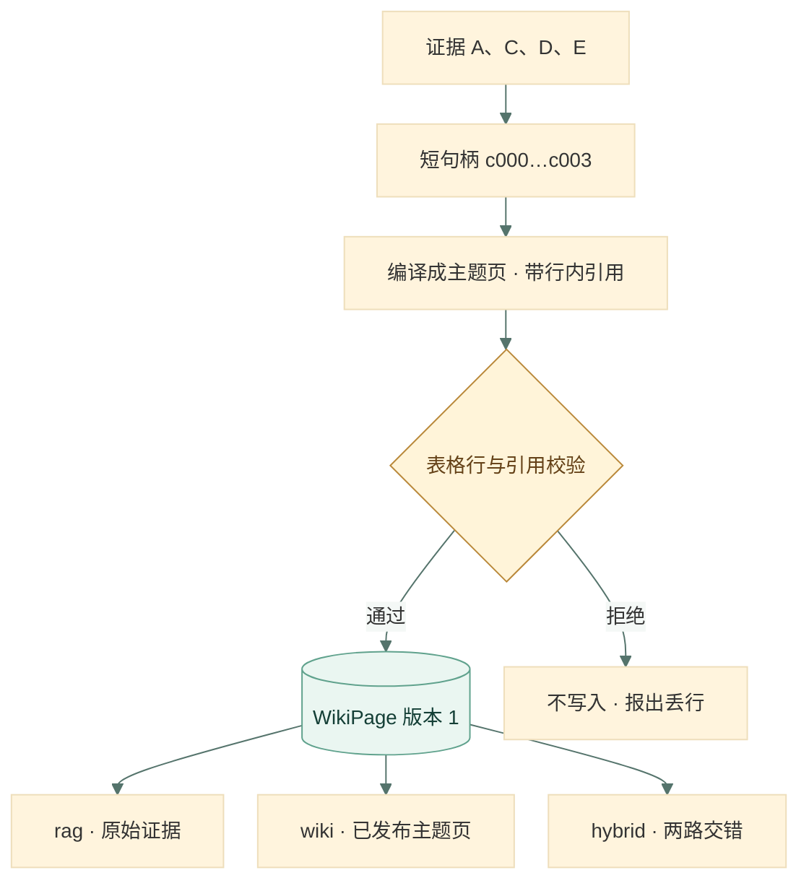

# 00-8 · Wiki 知识组织：把多条证据编译成一页可引用的知识

**只用浏览器。** 阅读约 14–16 分钟，跟做约 9 分钟。学完你能说清 Wiki 页和原始 Evidence 的区别，理解短句柄、版本与表格行守卫为什么存在，并能读懂 `rag / wiki / hybrid` 三种模式。

## 为什么搜到原文还不够

林澈的材料散在自述、作品说明、课程总结和变更单里。每次提问都从零找原文，会遇到两个麻烦：同一件事要读好几段；不同材料之间怎样组织，由谁决定？

Wiki 页是**构建时就整理好的主题页**：它把若干条 Evidence 编成一页带引用的说明，仍然保留回到原文的路。它不是另一份「更权威的证据」，而是对已有证据的一种组织结果。 [05 Wiki 知识库](../05-Wiki知识组织.md)

把两件事分开看：

- **构建时**：导入 Evidence 建立检索索引；编译 Wiki 生成主题页。两件事都可以做，但互不强制。
- **查询时**：调用方自由选择 `rag`（只搜证据）、`wiki`（只搜已发布页）或 `hybrid`（两路交错），不需要临时重建索引。 [知识检索源码](../../backend/app/services/knowledge.py)

## 编译一页时发生了什么

CareerLens 的编译流程可以从 [`wiki/compiler.py`](../../backend/app/wiki/compiler.py) 一路读下来：

1. 给这次选中的证据登记短句柄 `c000`、`c001`。句柄只在本次调用有效。
2. 把证据正文连同句柄渲染成模型输入，要求输出标题、摘要、Markdown 正文和引用列表。没有配置模型时，走确定性回退：把原文拼起来并标注全部来源。
3. 模型正文里的 `[c000]` 标记会被剥离；保存下来的是稳定 ID 列表 `source_refs` / `chunk_refs`，不是临时句柄。
4. 表格行守卫检查有没有静默丢行。
5. 写入带版本的 WikiPage；写入前再比对 `base_version`，防止覆盖更新的版本。

### 为什么给模型看 c000 而不是长 ID

真实 Evidence ID 是长字符串。短句柄省 token，也减少模型凭空编 ID 的机会。落库前，系统用 `HandleTable` 把 `c000` 解析回稳定 ID；认不出的句柄直接丢弃，绝不因为「看起来像 ID」就信任它。 [handles.py](../../backend/app/wiki/handles.py)

句柄是**临时工作记号**。页面上给人看的、报告里能回查的，仍是 `evidence_id`、`page_id` 与 `slug`。不要在校对时拿 `c000` 当永久编号。

### 表格行守卫防的是什么

参考实现记录过一类真实故障：模型重写一页时，把 100 行的表格压成 30 行，却没有报错，看起来像一次正常完成。CareerLens 的守卫按「每行第一个非空单元格」做身份比对，格式、大小写、全角空格变化不算丢行；丢掉的比例超过阈值就拒绝写入。

固定实验里，一张有 4 行的表被删掉一行，损失是 `1/3`（表头和分隔行不计入数据行）。项目用多重集分母，所以删掉两条相同行中的一条也算损失，比上游更严格。 [tables.py](../../backend/app/wiki/tables.py) · [05 的固定表实验](../05-Wiki知识组织.md)

## 版本不是计数器装饰

WikiPage 有 `version` 和一串 WikiRevision 快照。规则来自项目的写入层：

- 只有用户可见内容或引用发生变化才递增版本；链接簿记变化不递增。
- 每个被替换的版本留一份快照，快照的 `edit_source` 记录的是**被替换版本的作者**，不是这次写入的人。
- 写入时带 `base_version`；如果不匹配，抛 `StaleWikiWriteError`，不让旧稿覆盖新稿。
- 回滚是一次携带旧内容的普通编辑，不是删除历史。
- 机器修订按较少的条数保留，人工/回滚修订保留更久。

[wiki_pages.py](../../backend/app/services/wiki_pages.py) · [模型定义](../../backend/app/models/wiki.py)

这和后台任务的 fencing 代次解决的是不同问题：Wiki 版本保护的是**内容写入**，fencing 保护的是**哪个 Worker 有权提交结果**。别把它们混成一个 generation。 [00-4 的三种时间线](00-4-数据模型大白话.md) · [06 后台运行时](../06-后台运行时.md)

## 查询时三种模式怎么选

`search_knowledge()` 暴露三种模式，诊断里会写 `mode`、`rag_count`、`wiki_count` 和 `source_kinds`：

| 模式 | 去哪儿找 | 结果标识 | 适合什么 |
| --- | --- | --- | --- |
| `rag` | 原始 Evidence 索引 | `evidence_id` | 要核一句原文、找具体经历 |
| `wiki` | 已发布的 WikiPage 正文 | `page_id`、`slug`，并带 `source_refs` | 要看整理过的主题解释 |
| `hybrid` | 两路都查，再按名次一条隔一条取 | 每条标 `source_kind` | 既要主题概览，又要原文细节 |

Wiki 检索复用了本地混合打分函数，但只作用在 `status=published` 的页面上；项目没有为 Wiki 再建一套 Qdrant 集合。命中结果能顺着 `source_refs` 打开原 Evidence。 [wiki/search.py](../../backend/app/wiki/search.py)

`hybrid` 的「交错」不是第二种 RRF：00-7 讲的是 Qdrant 内部把 Dense 与 Sparse 两榜用 RRF 融合；这里是已经得到的 Evidence 榜与 Wiki 榜按名次轮流取。两层都在「合并结果」，但位置和规则不同。

## 跟做：一次编译，两个预测

不用装软件。先写下预测，再打开 [05 的固定实验](../05-Wiki知识组织.md)核对。

| 改动 | 先预测 | 看哪个结果 |
| --- | --- | --- |
| 4 行表里删掉 1 行再编译 | 写入成功还是拒绝？ | 是否出现丢行比例 1/3 |
| 你看到的是版本 1，另一个人已写到版本 2；你仍带 `base_version=1` 提交 | 会发生什么？ | `StaleWikiWriteError` 而不是静默覆盖 |
| 从 `wiki` 切到 `hybrid`，问句不变 | `source_kinds` 会有什么变化？ | 是否同时出现 `rag` 与 `wiki` 两类命中 |

核对与边界

第一题：守卫拒绝写入，因为丢了一行且没有 tolerable loss；这不是模型「写得不顺」的问题。第二题：版本条件更新失败，要求重新读取当前页再提交。第三题：若两边都有候选，`source_kinds` 会同时包含两类；若 Wiki 还没编译，可能只有 `rag`，这不是 bug。

编译成功只说明结构守卫通过。页里的每句话是否由原文支持，仍要沿引用打开原文判断。短句柄解析只挡未知 ID，不负责语义核验。

## 阶段 0 收尾：把几个词放回一条链

至此概念篇覆盖了整条链：Agent 选下一步（00-1）→ 提示词给出可检验规则（00-2）→ 检索找候选（00-3、00-7）→ 数据模型保存出处（00-4）→ LangGraph 编排步骤（00-5）→ LangChain 的积木地图（00-6）→ Wiki 组织主题页（本篇）。

用一句话复述，卡住就回对应篇章查：

> 用户的一句话先被 LangGraph 判意图；需要事实时按模式查 Evidence 或 Wiki 页；候选带来源 ID 进入答复；引用校验只挡越界 ID；最后仍由人打开原文判断支持到哪儿。

## 下一步

概念读完后，去 [01 第一次跑起来](../01-第一次跑起来.md)在本机跑一次工作台：导入合成材料，生成画像，做一次岗位分析，生成报告，再到 Copilot 追问。设备装不了软件时走[静态观察路线](../静态观察路线.md)，用预录截图完成同样的回查。
