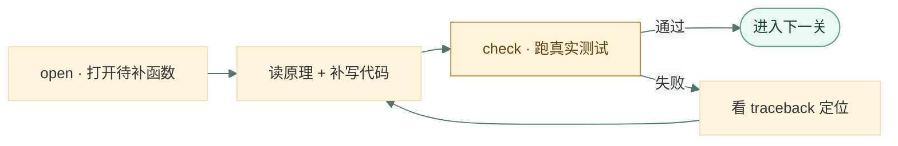
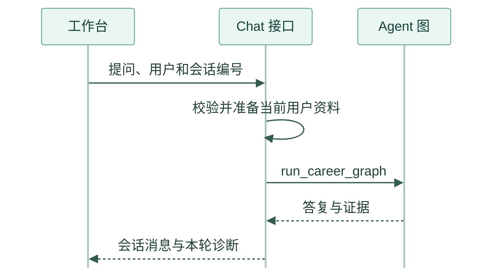

# 01-A · 从真实项目开始，搭一份可以敲的练习副本

**这一段做的是 CareerLens 的 Agent 核心。** 从工作台的「为什么认为我会 Python？」出发，依次写出状态和路由、检索工具、MCP 工具、带引用的答复、会话保存和后台子 Agent。每完成一关，就运行仓库里负责查验那段代码的测试。各关沿用同一份练习副本，已完成的代码会带到下一关。 [课程目录](./README.md)

阅读约 20–24 分钟，准备环境约 15 分钟。学完你能说清一句话怎样从网页到后端、为什么用独立练习副本、以及每一关的 `open` / `check` 到底做了什么。

## 先把这段课的位置摆正

前面「学概念」讲的是**是什么和为什么**：Agent、状态、检索、LangGraph、LangChain、Wiki。这一段讲的是**代码里怎么兑现**：你会亲手把 CareerLens 最核心的十几个函数重新敲一遍，每敲完一个就用项目自己的测试验收。

第一次打开真实源码，可以先追一个能在页面上看到的值。下面就沿着你刚输入的那句话走，看到它在哪一层改了名字、在哪一层变成图的状态。之后每关用同样的读法。

- **保留真实的数据库模型、测试和周边函数**，不给你一套空壳玩具。
- **每次只把你这一关要写的函数变成待补状态**，其余代码原样保留。
- **用 pytest 验收**。多数关卡沿用项目已有的回归测试，MCP 工具课还有一项专门测试。通过后，回头讲一遍测试覆盖了哪个输入和结果。 [练习关卡与测试清单](lab/practice.py)

所以在动手之前，先记住这条主线：**读哪个文件 → 补哪个函数 → 跑哪个测试 → 从测试失败定位到代码**。每一关都是这个循环的重复。



## 第 1 块：先把 HTTP、API 和 JSON 讲清楚

在工作台输入「为什么认为我会 Python？」并发送，网页要把这句话交给运行在另一处的 Python 程序。三个词先摆正：

| 词 | 在这段课里指什么 | 类比 |
| --- | --- | --- |
| **HTTP** | 浏览器和后端之间约定的请求/响应格式：怎么发、怎么回 | 快递的寄送规则 |
| **API** | 后端开放出来的调用约定，例如 `POST /api/v1/chat` 表示向这条路径提交一轮对话 | 前台窗口的业务清单 |
| **JSON** | 请求体和响应体采用的文本格式，用「字段名: 值」描述数据 | 填写的表格 |

`{"message":"为什么认为我会 Python？"}` 里，左边是字段名，右边是这次输入的值。实际请求还带 `user_id`（谁在问）、`thread_id`（接着哪段对话）等字段。

### HTTP 方法、路径和状态码

一个 HTTP 请求有三样最值得先认的东西：

- **方法**：`POST` 表示提交新数据（发一条消息、建一个任务），`GET` 表示读取已有数据（查一条证据、查任务状态）。
- **路径**：`/api/v1/chat` 里的 `/api/v1` 是后端统一加的前缀，`/chat` 由路由登记加上。两段拼起来才是完整地址。
- **状态码**：响应第一行会给一个数。`200` 成功返回，`201` 创建成功，`202` 表示后台任务已受理（还没做完），`422` 表示请求格式或内容不合法，`403` / `404` 表示权限或资源问题。

这一段后面你会亲手看到 `422` 的两种不同来源、`202` 之后怎样继续查任务。先把「状态码是结果的第一行摘要」这个直觉建立起来，排错时就不会只盯着正文。

### 为什么是 JSON，而不是一句话

如果请求体只是「为什么认为我会 Python？」一串文字，后端得自己猜哪部分是问题、哪部分是用户、哪部分是模式。JSON 把每个值都挂在明确的字段名下：`message` 一定是问题，`mode` 一定是检索模式。字段名就是约定，双方都按它读写，互不猜谜。这也解释了为什么后面请求校验会检查字段是否存在、类型对不对——字段名错了，约定就破了。

## 第 2 块：从发送按钮追到 Python

表里的路径都从 **CareerLens 仓库根目录**算起。按顺序打开文件，每次在当前文件里搜索右边那个名字。用 GitHub 或教程站阅读时，可以点对应的源码链接。

| 打开哪个文件 | 在文件里找什么 | 这一跳发生了什么 |
| --- | --- | --- |
| `frontend/app/workspace/page.tsx` | `onSubmit={handleChat}`。[工作台表单](../../frontend/app/workspace/page.tsx#L275) | 点发送时，React 会执行表单绑定的 `handleChat` |
| `frontend/lib/use-workspace.ts` | `handleChat`。它把输入框的 `chatInput` 交给 `sendChat`。[提交处理函数](../../frontend/lib/use-workspace.ts#L262-L269) | 工作台把这一轮输入交给请求函数 |
| `frontend/lib/api.ts` | `sendChat`。将参数 `message` 装进 JSON，请求 `/chat`，公共请求函数会带上 API 基础地址。[网页请求代码](../../frontend/lib/api.ts#L921-L935) | 文字被装进请求体，加上前缀发出 |
| `backend/app/api/routes/chat.py` | `chat`。FastAPI 将请求体转换成 `ChatRequest`，函数通过 `payload.message` 取回问题，再交给 `run_career_graph`。[接口接收与调用](../../backend/app/api/routes/chat.py#L38-L99) | 后端校验请求，取出问题，交给图 |
| `backend/app/graph/career.py` | `run_career_graph`。将同一个 `message` 放入图的初始状态，开始执行第一个节点。[图的执行入口](../../backend/app/graph/career.py#L239-L254) | 问题成为图状态的一个字段 |

`useWorkspace` 是一个 React Hook。工作台用它保存输入框、会话和接口响应等状态，也从中取出 `handleChat` 这样的操作函数。下面一行摘自 `handleChat`。`await` 等接口返回后才取得 `result`，`setChat(result)` 再更新网页上显示的答复。

```typescript
const result = await sendChat(userId, chatInput, chat?.thread_id, analysis?.id, knowledgeMode);
```

`chatInput` 在调用中是第二个参数，对应 `sendChat` 的 `message`。把这三个名字按出现顺序连起来，`chatInput → message → payload.message`，你就追完了同一句话从网页到后端的交接。路径里的 `/api/v1` 来自后端配置，`/chat` 由路由登记加上。 [路由登记](../../backend/app/api/router.py#L28) · [应用加载路由](../../backend/app/main.py#L53-L65)



### 一个值得追问的细节：为什么每跳都要改名

同一个值，在四个文件里叫四个名字：`chatInput` → `message` → `payload.message` → `state["message"]`。这不是故意绕人，而是每一层都有自己的职责边界：

- 网页层叫 `chatInput`，因为它绑定的是输入框的状态。
- API 函数参数叫 `message`，因为它描述「这条请求携带的问题」。
- 请求模型解析后是 `payload.message`，`payload` 是校验过的对象。
- 图里是 `state["message"]`，因为它是共享状态里的一个字段。

读代码时不要指望一个名字走天下。看到值换了名字，先问「这一层的职责是什么」，就能理解为什么要换。

## 第 3 块：看懂练习里最常用的四种写法

零基础也能敲这套课，前提是认得四种写法。先用一小段把四种凑在一起读：

```python
state = {"message": "为什么认为我会 Python？", "intent": "evidence_explanation"}

def read_intent(state):
    if state["intent"] == "evidence_explanation":
        return "retrieve_evidence"
    return "memory_guidance"
```

### 字典：一份带标签的数据

`state` 是一份「字段名: 值」组成的**字典**。花括号 `{...}` 包起来，每项写成 `"键": 值`，用逗号隔开。`state["intent"]` 取其中 `intent` 这个键的值。JSON 是网络上传递的文本格式，字典是 Python 运行时拿来读写的数据。前面的接口收到 JSON 后，FastAPI 和 Pydantic 会把它解析成程序可读取的对象。

### 函数：给一段程序起名字

`def read_intent(state):` 把几行程序变成一个叫 `read_intent` 的**函数**。括号里的 `state` 是调用时要传进来的东西，叫参数。下面缩进的几行是函数体，调用时才执行。`return` 把结果交回调用者。

### 条件：按情况走不同分支

`if` 后面跟一个判断，成立才执行缩进的一组语句；`elif` 是「否则如果」，`else` 是「以上都不成立时」。上面这份状态的 `intent` 是 `evidence_explanation`，所以进入 `if`，返回 `retrieve_evidence`。改成一个别的值，就会走到 `return "memory_guidance"`。

### 异步：等别的活干完

`await` 在后面的项目代码里出现。它前面通常有个 `async def`（异步函数）。读成「等被调用的异步操作把结果交回来」，例如等数据库读完、等模型返回。为什么需要它？因为查数据库、发网络请求这些活很慢，如果程序干等着，服务器就没法同时接待别人。`async` / `await` 让程序在等待时把时间让出去服务别的请求。你敲的很多函数都是 `async def`，调用它们时也要写 `await`。

> 记不住没关系。练习文件里函数签名、装饰器、`async` 都已备好，你只补函数体。写错了 Python 会报错，测试会指出来。

上面这一小段用于练习读法。下面开始打开项目实际用到的文件。

## 第 4 块：为什么用独立练习副本，而不是直接改项目

这是这段课最容易被忽略、却最值得讲清的设计。

新手最直接的学法似乎是：「直接打开 `backend/app/graph/career.py`，把函数删掉重写」。但这么做有三个麻烦：

1. **改坏了没法回头**。真实项目和其他章节共用，改坏一个函数可能影响别的练习。
2. **分不清「原来的」和「我写的」**。没有对照，写错了也不知道差在哪。
3. **测试污染**。你在原项目上跑测试，测的是你改过的版本，还是原来的版本，容易混乱。

练习副本解决这三点：

- 启动器把 `backend/app/`、`backend/tests/`、`backend/pyproject.toml` 和 MCP 练习测试复制到 `.cache/agent-practice/`。复制时跳过原项目的环境文件和数据库文件。
- 每关 `open` 时，启动器用 Python 的 `ast`（语法树）精确定位到那一个函数，只把它的函数体换成注释提示 + `raise NotImplementedError("TODO ...")`。**其余代码一行不动**。
- `check` 在副本目录运行这一关选定的测试。测试通过，说明你的代码做对了这些用例。

所以你始终有两份代码可以对照：原项目 `backend/app/graph/career.py` 看标准答案，练习副本 `.cache/agent-practice/backend/app/graph/career.py` 敲自己的版本。

### 想看练习机制本身

[练习启动器](lab/practice.py) 不长，值得读一遍。里面有几个常量直接对应你后面敲的关：

| 常量 | 作用 |
| --- | --- |
| `LESSONS` | 每关要补哪些文件的哪些函数、跑哪些测试 |
| `FUNCTION_HINTS` | `open` 时塞进函数体的分步提示，就是你在练习里看到的那几条 `#` 注释 |
| `practice_environment` | 默认用 Demo 和本地检索。`check` 用 SQLite 内存库，`serve` 与 `worker` 共用练习副本中的 SQLite 文件 |

`new` 时它还会检查副本不在原项目目录里（`workspace.is_relative_to(BACKEND)`），避免你一不小心覆盖了原代码。这是一道安全护栏。

## 第 5 块：准备 Python 和练习副本

想从网页读源码时，现在就可以进入下一课。要亲手敲，在电脑上准备 **Python 3.11 或更新版本**。已经下载仓库的读者沿用原目录。第一次下载时，可以在 GitHub 仓库首页点 **Code → Download ZIP**，解压后打开含有 `backend`、`frontend`、`tutorials` 的目录，这就是项目根。在这个目录打开终端。 [Python 安装步骤](../setup/Python准备.md) · [CareerLens 仓库](https://github.com/wenmo-yu/careerlens)

有可用的后端开发虚拟环境时，使用其中的 Python。虚拟环境是这个练习独用的一套 Python 包，`pip install -e "./backend[dev]"` 会安装后端和包含 pytest 在内的开发依赖。第一次准备可以按系统在项目根运行下面的命令。

**Windows PowerShell**

```powershell
python -m venv .cache/agent-venv
.\.cache\agent-venv\Scripts\Activate.ps1
python -m pip install -e "./backend[dev]"
```

如果 Windows 上只有 `py` 命令可用，将创建虚拟环境的第一行改为 `py -3 -m venv .cache/agent-venv`。激活后继续使用 `python`。如果 PowerShell 无法执行激活脚本，使用 `.\.cache\agent-venv\Scripts\python.exe` 代替安装依赖和后续命令开头的 `python`。

**macOS 或 Linux**

```bash
python3 -m venv .cache/agent-venv
source .cache/agent-venv/bin/activate
python -m pip install -e "./backend[dev]"
```

这三行分别做：建一个独立 Python 环境 → 激活它 → 把后端以「可编辑」模式装上（`-e` 表示改源码不用重装）。装完在同一终端检查 `python -m pytest --version`，能看到 pytest 版本就对了。

在同一终端创建练习副本并验证初始环境。

```bash
python tutorials/01-agent-design/lab/practice.py new
```

```bash
python tutorials/01-agent-design/lab/practice.py check state
```

`new` 回显练习的绝对地址。教程之后会同时提到两个位置。读原始实现，打开仓库中的 `backend/app/graph/career.py`。编辑练习，打开同一仓库下的 `.cache/agent-practice/backend/app/graph/career.py`。终端里的 `python tutorials/...` 命令从原项目根运行。编辑器可以另开一个窗口专门放练习文件。

初始的 `check state` 应出现 `1 passed`。`new` 先带来能运行的代码，所以这里检查的是环境。到下一课执行 `open state` 后，指定的函数体才变成待完成状态。测试用 SQLite 内存库、合成资料和 Demo，做关卡无需启动 Docker 或填写模型密钥。想接入自己的模型时，课程会在写答复节点前带你[配置模型](模型配置.md)。

## 第 6 块：每一关都按这个顺序做

1. 运行本课的 `open`，按终端打印的路径在编辑器打开文件。函数签名和已有的装饰器都已准备好。函数里按顺序有几条 `#` 注释，以及一行故意抛错的 `raise NotImplementedError("TODO ...")`。
2. 先跑一次本课的 `check`。测试执行到待补函数时会显示 `TODO` 和函数名。读本课的小例子，按注释逐段补写，最后用真实的返回值或分支替换占位的 `raise`。改完保存文件，再跑一次。
3. 遇到新报错，先看 traceback，也就是终端里从调用到报错的路径。**回到第一处指向自己练习文件的位置**，核对传入的值、条件顺序或返回字段。需要对照时再展开完整源码。测试通过后进入下一关。

### 五个子命令分别干什么

| 命令 | 作用 | 什么时候用 |
| --- | --- | --- |
| `new` | 复制一份全新的练习副本 | 只做一次 |
| `open <关卡>` | 把该关函数体换成 TODO + 提示 | 每关开始 |
| `check <关卡>` | 在副本里跑对应真实测试 | 写完想验收时，可反复跑 |
| `serve` | 用副本启动 API（8030 端口） | 综合课做端到端请求 |
| `worker` | 用副本启动后台 Worker | 综合课跑岗位分析任务 |

同一关第二次 `open` 会显示 `Already opened. Your work is ready to continue.`，然后列出的练习文件可以接着写。第一次打开前就改了目标函数时，脚本会报 `has local edits. Its body was kept.`，提示先确认改的是哪份代码。要另外开始一套副本，在启动器文件名后、子命令前加 `--workspace .cache/agent-practice-2`。后续的 `open`、`check`、`serve` 和 `worker` 都沿用这个写法。

### traceback 怎么读

测试失败时终端会打印一长串调用路径，从最外层一路指到出错行。它看着吓人，其实只要看两头：

- **最底下那一行**是错误类型和消息，例如 `NotImplementedError: TODO state: run_career_graph`——告诉你哪个函数还没写。
- **从最底部往上找最近的一处练习文件路径**。先看出错函数和它收到的值。若末尾是 `AssertionError`，回到对应的测试断言，比较「测试想看到什么」和「函数实际返回什么」。

先改最底下指出的那个函数，再跑一次。多数错误会这样一层层消掉。

## 常见坑，提前绕开

- **在原项目上改代码。** 一定在 `.cache/agent-practice/` 副本里敲，改坏了 `new` 一份新的即可。
- **从错误的目录运行命令。** `python tutorials/...` 要从项目根运行；`check` 内部会自己切到副本目录。
- **`check` 通过就以为全懂了。** 测试只验行为。合上答案，能讲清每个字段为什么在，才算真会。
- **只看 traceback 最后一行。** 同时找到它上面离报错最近的练习文件。终端再长，先围绕这个函数查。
- **改了函数签名或装饰器。** 练习只让你补函数体。改了签名，`open` 的定位逻辑可能认不出你的函数。
- **急着配真实模型。** 主线全程 Demo + 合成数据，先把流程跑通，再考虑[配置模型](模型配置.md)。

## 这一段学与不学的区别

只用浏览器读源码，你能追完四跳、看懂每个函数，也能跟上后面每一关的原理。动手敲一遍，你还会得到：

- 一份自己写的 agent-practice 副本，十几个核心函数都是你补出来的。
- 对「字段从哪来、到哪去」的手感——这是读代码读不出来的。
- 用真实测试验收的习惯：先预测、再跑、从失败定位。

两条路在每一关都会同时给出「原理讲解」和「真实实现」，随时可以切换。

## 下一步

在 [01-A1 请求与状态](01-A1-请求与状态.md) 打开第一个关卡。先敲出 `run_career_graph()`，让真实 Chat 测试从问句走到可查看的证据。
