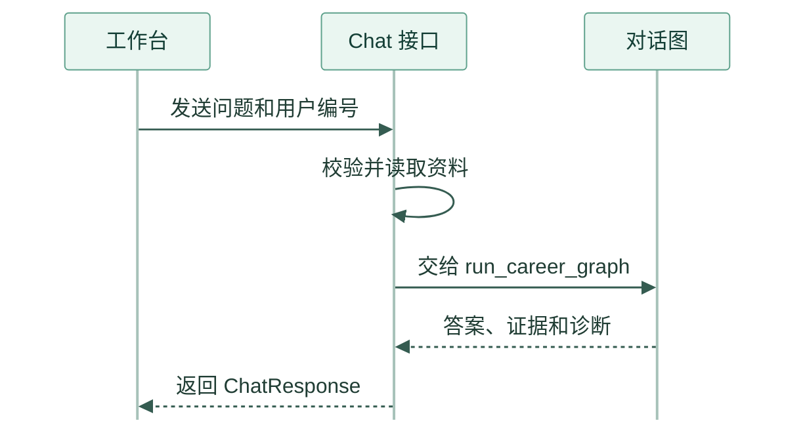

# 01-A · Agent 工作流：从问答界面找到第一行代码

先记住一个问题 **「为什么认为我会 Python？」**。接下来的八节课会跟着这句话走，直到你能解释一份回答到底读了什么、为什么走这条分支、哪一部分能查回原文。

在浏览器里打开仓库源码就可以做本课。第 01 篇跑通工作台的读者可以同时提问，尚未启动工作台时可以读下文从 Demo 摘出的响应。 [先跑一次工作台](../01-第一次跑起来.md) · [八节课的顺序](./README.md)

## 从界面上一条回答开始

林澈上传了一句合成自述。

> 我用 Python 和 FastAPI 做过课程接口，用 Docker 在本机运行。

连上工作台的 Career Copilot，建好画像后问那句 Python 问题。先找出这三样东西。

| 你手上的东西 | 先看哪里 |
| --- | --- |
| 一句答复 | 打开 Copilot 的文字回答 |
| 原文依据 | 展开证据，确认原文提到了 Python 课程接口 |
| 这次走的路 | 稍后用接口返回的 `intent`、`retrieval`、`model` 判断 |

不用操作工作台时，下面是同一类请求在隔离 Demo 里的输出节选。练习里把证据的长编号写成 `E`。

```json
{
  "intent": "evidence_explanation",
  "answer": "本次回答检索到的主要证据为：E。你可以按 Evidence ID 回看原文。",
  "evidence": [{"evidence_id": "E", "source_kind": "rag"}],
  "retrieval": {"mode": "rag", "rag_count": 1},
  "model": {"provider": "demo"}
}
```

可以从回答里的「查到了 E」问出第二个问题。**是谁决定要先查材料，E 又是从哪里来的？** 这就是读源码的起点。



## 学会读这六个 Python 符号

把下面这段看成一个带名字的步骤。这里用简短的课堂示例练习读法。真实项目还会细分好几种意图。

```python
def choose_route(state):
    if state["intent"] == "memory_update":
        return "memory_guidance"
    return "retrieve_evidence"


state = {"message": "记住我更希望做后端", "intent": "memory_update"}
print(choose_route(state))
```

| 看到的写法 | 可以念成什么 |
| --- | --- |
| `def choose_route(state)` | 定义一个叫 `choose_route` 的函数，调用时带一份 `state` |
| `{"intent": "memory_update"}` | 一份字段表。左边是字段名，右边是值。Python 里叫字典 |
| `state["intent"]` | 从这份状态里取出 `intent` 字段 |
| `if ... == ...` | 比较两个值，相同才执行缩进在下面的语句 |
| `return` | 把值交回调用者，这次函数到此结束 |
| `await` | 等一个异步操作的结果，例如等数据库查询返回 |

先用手指走一次。初始的 `intent` 是 `memory_update`，所以第一条 `return` 会交回 `memory_guidance`。若只改成 `evidence_explanation`，就会沿最后一行返回 `retrieve_evidence`。装过 Python 的读者可以把它存成 `first_route.py`，运行 `python first_route.py` 检查。两次各只改一个值。

## 用名字找源码

打开后端的对话入口，搜 `run_career_graph(`。遇到参数多时，先圈出「这句话从哪里传进去」和「这个函数把什么送回来」。下面摘出源码里调用图的整段。

```python
result = await run_career_graph(
    user_id=payload.user_id,
    message=payload.message,
    profile=profile,
    evidence=evidence,
    job_analysis=analysis,
    thread_id=payload.thread_id,
    history=history,
    session=session,
    mode=payload.mode,
)
```

按名字读，`payload.message` 是当前的问题，`profile` 和 `evidence` 是接口先读出的资料，`result` 是这个调用的结果。冒号后面的类型提示会告诉你大致数据形状，先沿两个变量往下找足够完成本课。下一节再看这些数据为什么能进入状态。 [Chat 入口与调用](../../backend/app/api/routes/chat.py#L38) · [图执行入口](../../backend/app/graph/career.py#L239)

最后在同一个接口文件里搜 `return ChatResponse`，会发现对外返回的 `evidence` 对应内部的 `retrieved_evidence`。同一个值换了名字很常见。给自己留一行记录 **「返回字段 evidence ← 图里的 retrieved_evidence」**，读后面的检索节点时会用到它。 [ChatResponse 返回处](../../backend/app/api/routes/chat.py#L119)

### 用两分钟检查自己能不能找入口

如果你只是想找「问句从哪里进入后端」，在下列三个名字里先点哪一个？然后给另外两个各写一句用途。

- `POST /api/v1/chat`
- `ChatResponse`
- `retrieve_evidence`

<details>
<summary>核对你选的入口</summary>

`POST /api/v1/chat` 是应用接收这次问答的位置。 `ChatResponse` 描述服务发回什么字段。 `retrieve_evidence` 是图里的检索步骤，打开它能看到查询怎么跑，却跳过了接口前面的校验和上下文准备。

</details>

## 下一步

在 [01-A1 请求与状态](01-A1-请求与状态.md) 中，拆开一份真的请求，弄清同一句话是怎么带上用户、画像和岗位资料进入图的。
