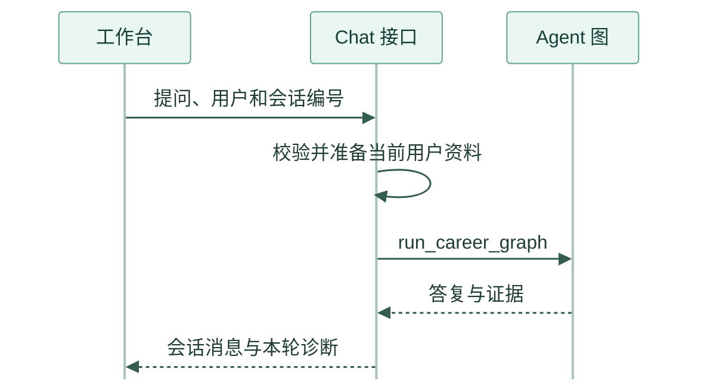

# 01-A · 从真实项目开始，搭一份可以敲的练习副本

这段课程做的是 CareerLens 的 Agent 核心。从工作台的「为什么认为我会 Python？」出发，依次写出状态和路由、检索工具、MCP 工具、带引用的答复、会话保存和后台子 Agent。每完成一关，就运行仓库里负责查验那段代码的测试。各关沿用同一份练习副本，已完成的代码会带到下一关。 [课程目录](./README.md)

练习副本保留项目的依赖、数据库模型、测试夹具和周边业务函数。每一关只把你要实现的函数暂时变成待补状态。你会在项目模块里写回实际实现；数据解析、前端和部署等周边内容可以接着其他章节做。

## 找到你平时用的那条请求

1. 打开工作台，找到 Career Copilot。准备好的 Demo 里可以输入「为什么认为我会 Python？」。
2. 在源码里找 `sendChat`。网页把输入和当前用户编号发到 `POST /api/v1/chat`。
3. 后端 `chat()` 从对应用户准备资料，调用 `run_career_graph()`，把答案、证据和会话返回给网页。

想试读源码，先用页面搜索找到这两处。每次只追一个变量，例如 `message`，看它在哪交给下一个函数。 [网页请求](../../frontend/lib/api.ts#L475) · [后端入口](../../backend/app/api/routes/chat.py#L38)



## 看懂练习里最常用的四种写法

```python
state = {"message": "为什么认为我会 Python？", "intent": "evidence_explanation"}

def read_intent(state):
    if state["intent"] == "evidence_explanation":
        return "retrieve_evidence"
    return "memory_guidance"
```

- `state` 是一份字段和值组成的字典。 `state["intent"]` 取其中的意图。
- `def` 把几行程序变成一个有名字的函数。括号内是调用时要传来的东西。
- `if` 成立才执行缩进的一组语句。上面这份状态会返回 `retrieve_evidence`。
- `await` 在后面的项目代码里出现。读成「等被调用的异步操作把结果交回来」，例如等数据库读完。

上面这一小段用于练习读法。下面开始打开项目实际用到的文件。

## 准备 Python 和练习副本

想从网页读源码时，现在就可以进入下一课。要亲手敲，在电脑上准备 **Python 3.11 或更新版本**，并下载或克隆仓库。把终端切到含有 `backend`、`frontend`、`tutorials` 的项目根。 [Python 安装步骤](../setup/Python准备.md)

有可用的后端开发虚拟环境时，使用其中的 Python。第一次准备可以按系统在项目根运行下面的命令。

**Windows PowerShell**

```powershell
python -m venv .cache/agent-venv
.\.cache\agent-venv\Scripts\Activate.ps1
python -m pip install -e "./backend[dev]"
```

如果 PowerShell 无法执行激活脚本，使用 `.\.cache\agent-venv\Scripts\python.exe` 代替后续命令开头的 `python` 即可。

**macOS 或 Linux**

```bash
python3 -m venv .cache/agent-venv
source .cache/agent-venv/bin/activate
python -m pip install -e "./backend[dev]"
```

在同一终端检查 `python -m pytest --version`。能看到 pytest 版本后，创建练习副本并验证初始环境。

```bash
python tutorials/01-agent-design/lab/practice.py new
```

```bash
python tutorials/01-agent-design/lab/practice.py check state
```

`new` 回显练习的绝对地址。默认是项目下的 `.cache/agent-practice/backend`。在编辑器打开这个目录，从这里找 `app/graph/career.py`。后面的命令仍从原项目根运行。初始的 `check state` 应出现 `1 passed`，说明当前 Python、项目依赖和测试都能工作。测试用 SQLite 内存库、合成资料和 Demo，就能测完整对话，无需启动 Docker 或填写模型密钥。 [练习启动器](lab/practice.py)

## 每一关都按这个顺序做

1. 本节给定一个关卡名。用 `open` 找到要补的函数，练习副本里会出现 `TODO`。
2. 先跑一次 `check`，找到失败处带出的函数名。接着按正文的步骤把实现一段段写回编辑器。
3. 同一个 `check` 跑绿之后继续下一课。完整实现折叠在正文里，供你对照输入、分支与返回值。

同一关第二次 `open` 会显示当前文件位置，保留已经写好的内容。要另外开始一套副本，可以在命令里把 `--workspace .cache/agent-practice-2` 放在 `new`、`open` 或 `check` 前。这个路径在三种命令里保持一致。

## 下一步

在 [01-A1 请求与状态](01-A1-请求与状态.md) 打开第一个关卡。先敲出 `run_career_graph()`，让真实 Chat 测试从问句走到可查看的证据。
