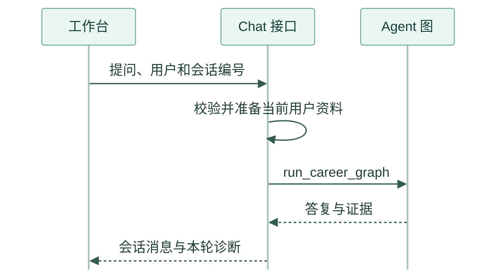

# 01-A · 从真实项目开始，搭一份可以敲的练习副本

这段课程做的是 CareerLens 的 Agent 核心。从工作台的「为什么认为我会 Python？」出发，依次写出状态和路由、检索工具、MCP 工具、带引用的答复、会话保存和后台子 Agent。每完成一关，就运行仓库里负责查验那段代码的测试。各关沿用同一份练习副本，已完成的代码会带到下一关。 [课程目录](./README.md)

练习副本保留项目的依赖、数据库模型、测试夹具和周边业务函数。每一关只把你要实现的函数暂时变成待补状态。你会在项目模块里写回实际实现；数据解析、前端和部署等周边内容可以接着其他章节做。

## 先认识 HTTP、API 和 JSON

在工作台输入「为什么认为我会 Python？」并发送，网页要把这句话交给运行在另一处的 Python 程序。**HTTP** 规定了这条请求怎样发、响应怎样回。**API** 是后端开放出来的调用约定，例如 `POST /api/v1/chat` 表示向这条路径提交一轮对话。**JSON** 是请求体采用的文本格式。`{"message":"为什么认为我会 Python？"}` 里，左边是字段名，右边是这次输入的值。实际请求还带用户编号等字段。

## 从发送按钮追到 Python

表里的路径都从 **CareerLens 仓库根目录**算起。按顺序打开文件，每次在当前文件里搜索右边那个名字。用 GitHub 或教程站阅读时，可以点对应的源码链接。

| 打开哪个文件 | 在文件里找什么 |
| --- | --- |
| `frontend/app/workspace/page.tsx` | `handleChat`。表单提交后，将输入框的 `chatInput` 传给 `sendChat`。[工作台提交代码](../../frontend/app/workspace/page.tsx#L172-L179) |
| `frontend/lib/api.ts` | `sendChat`。将参数 `message` 装进 JSON，请求 `/chat`，公共请求函数会带上 API 基础地址。[网页请求代码](../../frontend/lib/api.ts#L475-L489) |
| `backend/app/api/routes/chat.py` | `chat`。FastAPI 将请求体转换成 `ChatRequest`，函数通过 `payload.message` 取回问题，再交给 `run_career_graph`。[接口接收与调用](../../backend/app/api/routes/chat.py#L38-L91) |
| `backend/app/graph/career.py` | `run_career_graph`。将同一个 `message` 放入图的初始状态，开始执行第一个节点。[图的执行入口](../../backend/app/graph/career.py#L239-L254) |

下面一行摘自第一处。`await` 表示等调用结束才取得 `result`，随后页上的 `setChat(result)` 用这个响应更新显示。

```typescript
const result = await sendChat(userId, chatInput, chat?.thread_id, analysis?.id, knowledgeMode);
```

`chatInput` 在调用中是第二个参数，对应 `sendChat` 的 `message`。把这三个名字按出现顺序连起来，`chatInput → message → payload.message`，你就追完了同一句话从网页到后端的交接。路径里的 `/api/v1` 来自后端配置，`/chat` 由路由登记加上。 [路由登记](../../backend/app/api/router.py#L18-L23) · [应用加载路由](../../backend/app/main.py#L53-L65)



## 看懂练习里最常用的四种写法

```python
state = {"message": "为什么认为我会 Python？", "intent": "evidence_explanation"}

def read_intent(state):
    if state["intent"] == "evidence_explanation":
        return "retrieve_evidence"
    return "memory_guidance"
```

- `state` 是一份字段和值组成的字典。 `state["intent"]` 取其中的意图。
- `def` 把几行程序变成一个有名字的函数。括号内是调用时要传来的东西。
- `if` 成立才执行缩进的一组语句。上面这份状态会返回 `retrieve_evidence`。
- `await` 在后面的项目代码里出现。读成「等被调用的异步操作把结果交回来」，例如等数据库读完。

上面这一小段用于练习读法。下面开始打开项目实际用到的文件。

## 准备 Python 和练习副本

想从网页读源码时，现在就可以进入下一课。要亲手敲，在电脑上准备 **Python 3.11 或更新版本**。已经下载仓库的读者沿用原目录。第一次下载时，可以在 GitHub 仓库首页点 **Code → Download ZIP**，解压后打开含有 `backend`、`frontend`、`tutorials` 的目录，这就是项目根。在这个目录打开终端。 [Python 安装步骤](../setup/Python准备.md) · [CareerLens 仓库](https://github.com/wenmo-yu/careerlens)

有可用的后端开发虚拟环境时，使用其中的 Python。虚拟环境是这个练习独用的一套 Python 包，`pip install -e "./backend[dev]"` 会安装后端和包含 pytest 在内的开发依赖。第一次准备可以按系统在项目根运行下面的命令。

**Windows PowerShell**

```powershell
python -m venv .cache/agent-venv
.\.cache\agent-venv\Scripts\Activate.ps1
python -m pip install -e "./backend[dev]"
```

如果 Windows 上只有 `py` 命令可用，将创建虚拟环境的第一行改为 `py -3 -m venv .cache/agent-venv`。激活后继续使用 `python`。如果 PowerShell 无法执行激活脚本，使用 `.\.cache\agent-venv\Scripts\python.exe` 代替安装依赖和后续命令开头的 `python`。

**macOS 或 Linux**

```bash
python3 -m venv .cache/agent-venv
source .cache/agent-venv/bin/activate
python -m pip install -e "./backend[dev]"
```

在同一终端检查 `python -m pytest --version`。能看到 pytest 版本后，创建练习副本并验证初始环境。

```bash
python tutorials/01-agent-design/lab/practice.py new
```

```bash
python tutorials/01-agent-design/lab/practice.py check state
```

`new` 回显练习的绝对地址。教程之后会同时提到两个位置。读原始实现，打开仓库中的 `backend/app/graph/career.py`。编辑练习，打开同一仓库下的 `.cache/agent-practice/backend/app/graph/career.py`。终端里的 `python tutorials/...` 命令从原项目根运行。编辑器可以另开一个窗口专门放练习文件。 [练习启动器](lab/practice.py)

初始的 `check state` 应出现 `1 passed`。`new` 先带来能运行的代码，所以这里检查的是环境。到下一课执行 `open state` 后，指定的函数体才变成待完成状态。测试用 SQLite 内存库、合成资料和 Demo，做关卡无需启动 Docker 或填写模型密钥。想接入自己的模型时，课程会在写答复节点前带你[配置模型](模型配置.md)。

## 每一关都按这个顺序做

1. 运行本课的 `open`，按终端打印的路径在编辑器打开文件。函数签名和已有的装饰器都已准备好。函数里按顺序有几条 `#` 注释，以及一行故意抛错的 `raise NotImplementedError("TODO ...")`。
2. 先跑一次本课的 `check`。测试执行到待补函数时会显示 `TODO` 和函数名。读本课的小例子，按注释逐段补写，最后用真实的返回值或分支替换占位的 `raise`。改完保存文件，再跑一次。
3. 遇到新报错，先看 traceback，也就是终端里从调用到报错的路径。回到第一处指向自己练习文件的位置，核对传入的值、条件顺序或返回字段。需要对照时再展开完整源码。测试通过后进入下一关。

同一关第二次 `open` 会显示当前文件位置，保留已经写好的内容。要另外开始一套副本，在启动器文件名后、子命令前加 `--workspace .cache/agent-practice-2`。后续的 `open`、`check`、`serve` 和 `worker` 都沿用这个写法。

## 下一步

在 [01-A1 请求与状态](01-A1-请求与状态.md) 打开第一个关卡。先敲出 `run_career_graph()`，让真实 Chat 测试从问句走到可查看的证据。
