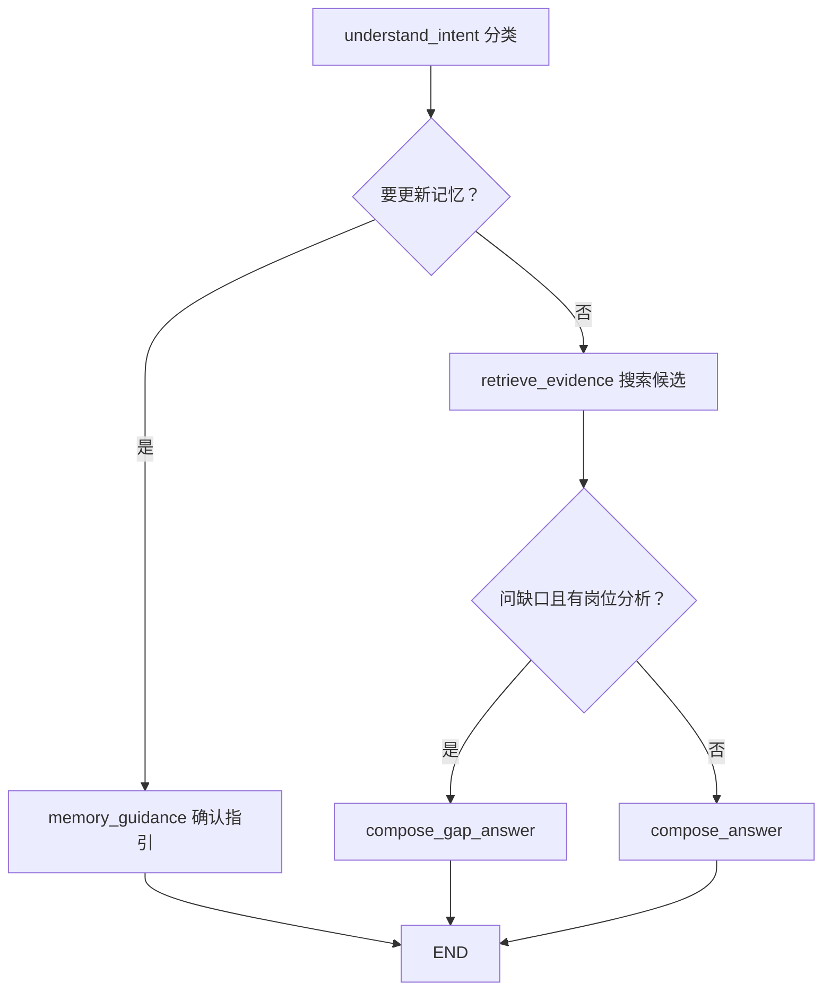

# 01-A · Agent 工作流：把问答画成几条路线

**阅读约 8–10 分钟，练习约 10 分钟。** 先跑过[第 01 篇](../01-第一次跑起来.md)或看过[静态观察路线](../静态观察路线.md)。下方的路径表可以在浏览器完成。有 Python 时，可运行一段独立脚本观察条件变化。

在 Career Copilot 里问「为什么认为我会 Python？」，下方能展开依据。紧接着输入「记住我更希望做后端」，应用却让你走确认流程。这两次请求进了同一个接口，为什么接下来做的事不同？

## 从请求到状态

打开工作台时，浏览器会把问题送到 `POST /api/v1/chat`。接口确认用户有读取权限，取出这个用户的画像和证据，按需要加载已保存的岗位分析与对话历史。应用把这些交给 `run_career_graph()`。如果还没有构建画像，接口会返回 422，可以先回工作台点「重建画像」。 [对话接口](../../backend/app/api/routes/chat.py)

先在纸上写一个状态。状态就是这一次处理问题时，各节点拿来读写的一包数据。

| 状态里的字段 | 什么时候用 |
| --- | --- |
| `message` 与 `user_id` | 开始时提供问题和数据归属 |
| `profile` 与 `job_analysis` | 答方向或解释分析缺口时使用。岗位分析也可以为空 |
| `intent` | 分类节点填入，后面用它选一条路线 |
| `retrieved_evidence` | 检索节点填入，答复节点用它组织依据 |
| `answer` | 最后由一个答复节点写入，接口读取它 |

`CareerState` 在 Python 里用 `TypedDict` 表达这些字段。每个 LangGraph 节点可以只返回它负责更新的字段，例如 `understand_intent()` 返回分类和清空后的候选字段。上游提供的问题会继续留在状态里。 [CareerState 和图定义](../../backend/app/graph/career.py)

## 用输入走一遍图



这里的分类函数按关键词顺序判断。含「记住」先走 `memory_update`。含「为什么」「证据」而未命中前面分支，进入 `evidence_explanation`。只有落到缺口分支，而且有可用的已保存分析，才走专用缺口答复。记忆分支会生成提示，也会留下普通聊天消息，写入长期画像仍需提交草案并确认。

读图时，先找源码里的 `builder.add_edge(START, "understand_intent")`。再查两次 `add_conditional_edges`，顺着看 `route_intent()` 和 `route_answer()`。最后找各个 `END`。这段图的分支和出口由代码列定，模型可进入普通答复节点生成文字。

### 练习：做一个可运行的路径表

先在纸上写三条路径。想验证的话，把下面这段缩小版保存成 `career_routes.py`，运行 `python career_routes.py`。只用 Python 标准功能。它复刻这三类问法的分支次序，省略了数据库、检索和生成。

```python
def trace(message, has_saved_analysis):
    nodes = ["understand_intent"]
    if "记住" in message or "更希望" in message:
        return nodes + ["memory_guidance", "END"]

    nodes.append("retrieve_evidence")
    explains_evidence = "为什么" in message or "证据" in message
    asks_about_gap = "还差" in message or "缺口" in message
    if asks_about_gap and not explains_evidence and has_saved_analysis:
        nodes.append("compose_gap_answer")
    else:
        nodes.append("compose_answer")
    return nodes + ["END"]


for question in ("为什么认为我会 Python？", "我还差什么？", "记住我更希望做后端"):
    print(question, " -> ".join(trace(question, has_saved_analysis=True)))
```

预期三行分别在 `compose_answer`、`compose_gap_answer`、`memory_guidance` 处给出答复，然后到 `END`。把 `has_saved_analysis=True` 改成 `False`，先预测哪一行会变，再执行。第二行应改用 `compose_answer`。

最后加一句「为什么我还差 Kubernetes？」。两类词都出现了，证据分类先检查，因此它会走普通答复。读真实的 `understand_intent()` 时，找一条小脚本没有覆盖的关键词，想一想该为它加什么测试。

### 对照真实应用

有运行中的 Demo 时，先确认已建画像，再用工作台试证据问法和记忆问法。记下返回的 `intent` 和有没有证据列表。安装过[后端开发依赖](../../CONTRIBUTING.md)时，也可以在仓库根运行现有测试。

```bash
cd backend
python -m pytest -q tests/test_job_intelligence.py::test_copilot_uses_saved_job_analysis_and_keeps_memory_update_confirmed
```

测试先建立画像和岗位分析，再用分析 ID 提问，验证 `skill_gap` 和 `model.provider=job_analysis`。随后提交改变偏好的问法，确认回答要求用户确认，而且画像里没有直接新增那条偏好。

## 下一步

你已经知道图走到哪个节点。去 [01-B 工具调用](01-B-工具调用.md)，拆开 `retrieve_evidence`，看看程序取了什么、又交回了什么。
