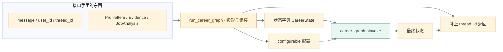

# 01-A1 · 请求和状态：写出 Agent 图的真实入口

本关敲 `backend/app/graph/career.py` 的 `run_career_graph()`。把界面给的问句、后端读出的证据、上一次对话和现有岗位分析装成图能用的状态。敲完能用真实对话测试拿到原文 ID。 [准备练习副本](01-A-Agent工作流.md)

阅读约 18–22 分钟，动手约 20 分钟。学完你能说清 `ChatRequest` 和 `CareerState` 的分工、为什么要「投影」、以及 `ainvoke` 的两个参数各装什么。

## 先把这一关放在整条链里看

上一关你已经能从工作台追到 `run_career_graph`。它是**接口和图之间的转换器**：接口手里是数据库对象（`ProfileItem`、`Evidence`、`JobAnalysis`）和 HTTP 请求字段；图手里是一个扁平的、带类型的字典 `CareerState`。`run_career_graph` 就是把前者翻译成后者，然后调用图，最后把结果交回接口。

为什么需要这一层转换，而不是让接口直接把数据库对象丢给图？三个理由：

1. **图不该认识 ORM 对象**。数据库模型带着会话、关系、时间戳等一堆图用不上的东西。图只想要「画像的名字和证据 ID」这种干净数据。
2. **有些东西不能放进状态，得放进配置**。数据库会话（`session`）是这次请求的资源，不是图要传递的业务数据。放进 `configurable`，节点按需取用，不会被当成状态到处传。
3. **返回要给接口一个完整交代**。图跑完的状态里没有 `thread_id`（那是在这一层生成的），要由这一层补上再返回。



## 第 1 块：请求校验——FastAPI 与 Pydantic

`backend/app/schemas/chat.py` 的 `ChatRequest` 是**请求模型**。FastAPI 先用 Pydantic 检查 JSON 的字段，再把结果叫作 `payload` 交给 `backend/app/api/routes/chat.py` 的 `chat`。能写 `payload.message`，是因为这里已把文字读成有属性的 Python 对象，而不是一个裸字典。 [请求模型](../../backend/app/schemas/chat.py#L6-L11) · [接口入口](../../backend/app/api/routes/chat.py#L38-L50)

`backend/app/graph/career.py` 的 `CareerState` 是图的**状态**。它是一份会在不同步骤间传递的字典。开始时有问题、画像和证据，运行之后逐渐多出意图、候选和答复。`TypedDict` 为字典的键和值提供类型提示，`total=False` 表示有些键可以在后续步骤才出现。 [状态字段](../../backend/app/graph/career.py#L17-L29)

### 两种「类型」别混

| | `ChatRequest` | `CareerState` |
| --- | --- | --- |
| 基础 | Pydantic `BaseModel` | `TypedDict` |
| 作用 | **运行时校验**外部请求 | **静态提示**内部字典长什么样 |
| 校验时机 | 请求进来时真的会拒绝非法值 | 只给编辑器/类型检查器看，运行时不拦截 |
| 非法值后果 | 返回 422 | 不会自动报错，靠节点自己读写 |

这个区别很实用：外部输入必须运行时校验（因为不可信），内部状态靠约定和类型提示（因为是自己代码写的）。看到 `Field(min_length=...)` 就知道这是真会执行的检查；看到 `TypedDict` 就知道这是给开发者的提示。

下面是本机 Demo 会接收的请求。它从 `POST /api/v1/chat` 进入。无会话编号时可以省略 `thread_id`。`mode` 用来选择知识来源。

```json
{
  "user_id": "agent-lesson",
  "message": "为什么认为我会 Python？",
  "mode": "rag"
}
```

先打开实际的 `ChatRequest`。右边的 `Field` 给出长度和允许的值，FastAPI 收到请求时会检查它。

```python
class ChatRequest(BaseModel):
    user_id: str = Field(min_length=1, max_length=128)
    message: str = Field(min_length=1, max_length=5000)
    thread_id: str | None = Field(default=None, max_length=128)
    job_analysis_id: str | None = None
    mode: str = Field(default="rag", pattern="^(rag|wiki|hybrid)$")
```

例如 `mode="paper"` 会在请求体检查时报 422，`detail[0].loc` 指向 `["body","mode"]`。合法请求进入接口后，代码会做授权、读画像和证据。若这个用户还没重建画像，另一条 422 的 `detail` 是 `Build the user profile before chatting`。学到后面的会话关再亲手实现这两道检查。 [真实请求类型](../../backend/app/schemas/chat.py#L6-L11) · [调用者 chat](../../backend/app/api/routes/chat.py#L38)

### 两种 422，来源完全不同

这是本章反复出现的一个对照点，先记住：

- 带 `detail[0].loc` 的 422 → 请求**格式/取值**不合法，来自 Pydantic 校验，发生在进接口之前。
- 一句文字 `Build the user profile before chatting` 的 422 → 请求格式合法，但**业务前提**不满足（没画像），来自 `chat()` 里的 `raise HTTPException`。

以后看到 422，先看有没有 `loc`：有，去查请求字段；没有，去查业务条件。这个判断能省掉大量瞎猜。

## 第 2 块：投影——把数据库对象削成图要的字段

假设查询得到一个 `ProfileItem`，`item.name` 为 `"Python"`，`item.evidence_ids` 为 `["E1"]`。`run_career_graph` 里的列表推导式 `[{...} for item in profile]` 会对每条画像执行一次字段选择。先读其中这两项。

```python
projected = {
    "name": item.name,
    "evidence_ids": item.evidence_ids,
}
```

得到的这一项里有 `"name": "Python"` 和 `"evidence_ids": ["E1"]`。这种选择叫**投影**：只带下游需要的字段，同时保留通往原文的 ID。画像没有查出时，空列表自然得到 `[]`。岗位分析只有一个，缺失时用 `None`，后面的路由据此决定能否读分析。 [画像投影与分析准备](../../backend/app/graph/career.py#L251-L285)

### 为什么投影要保留 evidence_ids

看一眼完整实现里的画像投影，它留了四个字段：`category`、`name`、`confidence`、`evidence_ids`。前三个用于回答「 linche 会什么、有多确定」，最后一个 `evidence_ids` 是**通往原文的钩子**。

答复节点生成一句话后，会校验引用 ID 是否来自本轮允许集合。画像里的证据 ID 和检索到的证据 ID 一起，构成这个可核对的世界。如果投影时把 `evidence_ids` 丢掉，画像结论就没法追回原文——这正好违背整个项目「证据先于结论」的原则。所以投影不是随便挑字段，而是挑「下游既要用、又能核对」的字段。

### 列表推导式读法

`[{...} for item in profile]` 是 Python 的列表推导式，读成「对 `profile` 里的每一项 `item`，算出花括号里的字典，把所有结果收集成一个列表」。它等价于：

```python
result = []
for item in profile:
    result.append({...})
```

画像有 3 条，就得到 3 个字典。空列表则得到空列表——这就是为什么「没画像」不需要特判，投影自己就处理了。

## 第 3 块：`ainvoke` 的两个参数

按练习文件里的提示搭两份字典之前，先把 `career_graph.ainvoke(状态, 配置)` 的两个参数讲透。这是本关最容易写错的地方。

```bash
python tutorials/01-agent-design/lab/practice.py open state
```

打开回显的 `.cache/agent-practice/backend/app/graph/career.py`，定位 `run_career_graph`。先试着写出会话编号和 `message`、`user_id`、`history` 三个状态键，再用上面的投影方法补画像和证据。若用了自己的练习目录，以 `open` 打印的路径为准。

| 要准备哪一包数据 | 原项目如何处理 | 放状态还是配置 |
| --- | --- | --- |
| 会话编号 | 使用传来的 `thread_id`。刚开始聊天就生成一个 UUID，转成字符串 | 返回值 + 配置 |
| 初始问题 | `message`，本轮用户问题 | 状态 |
| 用户 | `user_id`，用于隔离检索 | 状态 |
| 历史 | `history` 或 `[]`，此前对话 | 状态 |
| 知识模式 | `mode`，rag/wiki/hybrid | 状态 + 配置 |
| 画像 | 投影成字典，留类别、名称、置信度、证据 ID | 状态 |
| 证据记录 | 保留 ID、来源类型、来源名、正文 | 状态 |
| 岗位分析 | 有就投影标题、匹配、缺口、学习计划，没有写 `None` | 状态 |
| 数据库会话 | `session`，节点查库用 | **配置** |
| 原始证据对象 | `evidence`（ORM 对象），供检索节点用 | **配置** |

### 为什么 session 和原始证据放配置，不放状态

这是这一关的核心设计点。状态是**会在节点之间传递、会被 checkpoint 保存**的数据。数据库会话是一个活的连接，不能序列化保存；原始 ORM 对象绑着会话，也不适合塞进要持久化状态。所以它们走 `configurable`——好比「这次执行的临时工具箱」，节点要用就去取，但不进快照。

一句话记法：**「要传下去、要存档的」进状态；「这次执行临时借用的」进配置。**

### 先手算 selected_thread

传进来的 `thread_id` 是 `"T1"` 时，`or` 左侧已经有值，选 `"T1"`，不生成新编号。传 `None` 时才运行 `str(uuid.uuid4())` 生成一个。这就是 `selected_thread = thread_id or str(uuid.uuid4())` 的全部逻辑——`or` 会返回第一个「真值」。空字符串 `""` 也会触发生成（因为它是假值），这点可以顺手记下。

接着为 `career_graph.ainvoke` 准备两个参数：状态字典给节点判断本轮问题；配置里的 `configurable` 提供本次执行用的数据库会话、证据对象和会话键。最后用 `**state` 把图返回的字段展开，与 `thread_id` 放进同一个返回字典。

### 跟敲真实实现

先按表搭出两份字典和返回值。卡住时展开，回到相应部分核对。签名上的 `*` 表示下面这些参数按名字传，例如 `message=payload.message`。导入和图定义已经在练习文件里。

<details>
<summary>展开 run_career_graph 的原项目完整实现</summary>

```python
async def run_career_graph(
    *,
    user_id: str,
    message: str,
    profile: list[ProfileItem],
    evidence: list[Evidence],
    job_analysis: JobAnalysis | None,
    thread_id: str | None,
    history: list[dict] | None = None,
    session=None,
    mode: str = "rag",
) -> dict:
    selected_thread = thread_id or str(uuid.uuid4())
    state = await career_graph.ainvoke(
        {
            "message": message,
            "user_id": user_id,
            "history": history or [],
            "mode": mode,
            "profile": [
                {
                    "category": item.category,
                    "name": item.name,
                    "confidence": item.confidence,
                    "evidence_ids": item.evidence_ids,
                }
                for item in profile
            ],
            "evidence_records": [
                {
                    "id": item.id,
                    "source_type": item.source_type,
                    "source_name": item.source_name,
                    "content": item.content,
                }
                for item in evidence
            ],
            "job_analysis": (
                {
                    "id": job_analysis.id,
                    "title": job_analysis.title,
                    "score": job_analysis.score,
                    "matches": job_analysis.matches,
                    "gaps": job_analysis.gaps,
                    "learning_path": job_analysis.learning_path,
                }
                if job_analysis
                else None
            ),
        },
        {
            "configurable": {
                "thread_id": selected_thread,
                "session": session,
                "evidence": evidence,
                "mode": mode,
            }
        },
    )
    return {"thread_id": selected_thread, **state}
```

</details>

对照时先核对两个参数的括号和层级。`history` 在状态字典，`session` 在第二个参数的 `configurable` 里。下游检索节点会从这里取连接。 [真实图执行入口](../../backend/app/graph/career.py#L239-L298)

### 逐块拆解这段实现

写完照这四块自查，比逐行读更清楚：

1. **选会话号**：`selected_thread = thread_id or str(uuid.uuid4())`——有就用，没有就生成。
2. **组状态**：一个字典，9 个键。前四个（message/user_id/history/mode）直接来自参数；后面三个（profile/evidence_records/job_analysis）是投影。注意 `history or []`——空值兜底，节点不用处理 `None`。
3. **组配置**：一个字典，只有 `configurable` 一个键，里面四个键（thread_id/session/evidence/mode）。`mode` 同时在状态和配置里——状态给 `understand_intent` 看，配置给检索节点看。
4. **返回**：`{"thread_id": selected_thread, **state}`。`**state` 把图结果的所有键展开到新字典里，再单独加一个 `thread_id`。图的最终状态没有会话号，这一行补上。

## 第 4 块：让测试告诉你有没有接上

```bash
python tutorials/01-agent-design/lab/practice.py check state
```

没实现时会看到待补函数名。实现后应看到 `1 passed`。这个测试用真实的 Chat 接口导入资料、建画像、问证据，断言 `intent="evidence_explanation"` 且候选存在。若失败，先看状态里有没有带进 `message` 和 `evidence_records`，接着看配置是否传了 `evidence`。 [对话回归](../../backend/tests/test_profile_jobs_chat.py#L93)

### 从失败反推哪一步漏了

| 测试现象 | 最可能漏了什么 |
| --- | --- |
| 还是 `NotImplementedError` | TODO 没替换掉 |
| `intent` 不是 `evidence_explanation` | `message` 没进状态，分类节点看不到问题 |
| 候选为空 | `evidence_records` 没投影，或配置的 `evidence` 没传 |
| `thread_id` 对不上 | 返回值漏了 `thread_id`，或 `or` 的兜底写错 |
| 报 `None` 相关错误 | `history` 没写 `or []`，节点拿到 `None` |

再手算一个改动。把 `thread_id` 从空换成第二轮带回的 ID。取证流程可以继续执行，`selected_thread` 会用收到的 ID。后面会话课会让你核对同一个编号下的两问两答。

## 常见坑，提前绕开

- **把 session 塞进状态。** 它是活连接，不进快照；走 `configurable`。
- **投影时丢掉 `evidence_ids`。** 画像结论就再也追不回原文。
- **`history` 不兜底。** 写 `history or []`，别让节点收到 `None`。
- **漏掉 `mode` 的其中一处。** 状态和配置都要有，各自服务不同节点。
- **返回时忘了 `thread_id`。** 图的最终状态里没有它，必须这一层补。
- **改了函数签名。** 参数按名字传（`*` 之后），改名会让调用方对不上。
- **误以为 `TypedDict` 会校验。** 它只做静态提示，运行时不拦你。

## 这些代码在真实项目里落在哪

| 这节课的词 | 项目位置 | 为什么这样设计 |
| --- | --- | --- |
| 请求校验 | `backend/app/schemas/chat.py` 的 `ChatRequest` | 外部输入运行时校验，非法即 422 |
| 图状态 | `backend/app/graph/career.py` 的 `CareerState` | 带类型的字典，节点读写共享快照 |
| 投影 | `run_career_graph` 里的列表推导式 | 只带下游需要、且可核对的字段 |
| 配置 | `ainvoke` 第二个参数的 `configurable` | 放会话、原始证据等临时资源 |
| 会话编号 | `thread_id or uuid4()` | 有就接续，没有就新建 |
| 返回值 | `{"thread_id": ..., **state}` | 把图的输出和会话号一起交回接口 |

## 下一步

[01-A2 状态图与路由](01-A2-路由与结束条件.md) 会在刚才的 `career.py` 里继续工作。你将亲手决定问句进入哪条分支。
