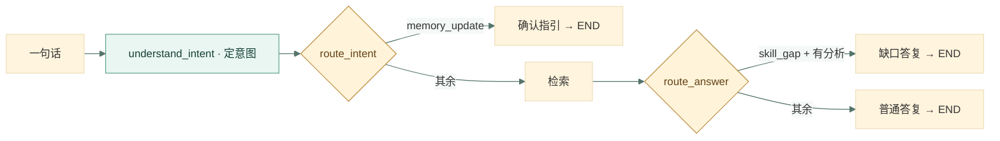

# 01-A2 · 状态图与路由：写出三个分支函数

上一步已经能调用图。本关补 `understand_intent()`、`route_intent()`、`route_answer()`。这三个函数决定看到一句问题之后到哪一步，以及什么时候可以结束。 [准备练习副本](01-A-Agent工作流.md)

阅读约 18–22 分钟，动手约 20 分钟。学完你能说清节点、边、条件边的分工，为什么分类要按关键词优先级排，以及「有岗位分析」这个条件怎样改变答复路径。

## 先把这一关放在整条链里看

`run_career_graph` 已经把干净的 `CareerState` 交给图。图接下来要回答三个问题：

1. **这句话想干什么？**（`understand_intent`：分类，写 `intent`）
2. **要不要查资料？**（`route_intent`：只看意图，决定检索还是确认指引）
3. **查完之后用哪种答复？**（`route_answer`：看意图 + 有没有岗位分析）

这三个函数把「一句自然语言问题」变成「图上一条确定的路径」。它们都不调用模型、不查库，是纯规则——这正是 CareerLens 把关键路由握在程序手里、而不是交给模型自由发挥的体现。



## 第 1 块：节点、边、路由这三个词

LangGraph 里的**节点**是执行一步工作的函数。节点可返回它负责更新的状态字段，例如分类节点写 `intent`。**边**决定下一步。固定边总去同一个地方，条件边先运行路由函数，再按它返回的名字走。`START` 和 `END` 用来标出一次执行的起点和终点。可以先用浏览器回顾 [00-5 LangGraph 与工作流](../00-foundations/00-5-LangGraph与工作流.md)。

### 为什么路由要单独做函数

你可能想问：分类函数直接返回下一个节点名不就行了，为什么要拆出 `route_intent` / `route_answer`？

因为**「当前状态是什么」和「下一步去哪」是两件事**。分类函数负责写状态（`intent`），路由函数负责读状态、返回节点名。这样拆开有三个好处：

- 同一份 `intent` 可以被多个路由用不同的规则解释。这里 `route_intent` 只看 `memory_update`，`route_answer` 看 `skill_gap` 和分析是否存在。
- 路由是纯函数，输入状态、输出字符串，特别好测。你不需要启动模型或数据库就能验路径。
- 状态是「发生了什么」，路由是「据此怎么做」。分开后，改路由规则不用动分类。

打开原项目的 `backend/app/graph/career.py`，从 `builder = StateGraph(CareerState)` 往下看。登记部分在练习里已经备好。先沿实际代码把五个节点连到纸上。 [节点与边的登记](../../backend/app/graph/career.py#L219-L231)

```python
builder = StateGraph(CareerState)
builder.add_node("understand_intent", understand_intent)
builder.add_node("retrieve_evidence", retrieve_evidence)
builder.add_node("compose_answer", compose_answer)
builder.add_node("compose_gap_answer", compose_gap_answer)
builder.add_node("memory_guidance", compose_memory_guidance)
builder.add_edge(START, "understand_intent")
builder.add_conditional_edges("understand_intent", route_intent)
builder.add_conditional_edges("retrieve_evidence", route_answer)
builder.add_edge("compose_answer", END)
builder.add_edge("compose_gap_answer", END)
builder.add_edge("memory_guidance", END)
```

`add_node("memory_guidance", compose_memory_guidance)` 给函数登记了图上的名字。因此路由返回 `"memory_guidance"` 时，运行的是 `compose_memory_guidance`。跟到 `add_edge("memory_guidance", END)`，可以预测这条请求给出确认指引后就结束。

### 登记名 ≠ 函数名

注意 `add_node` 的第一个参数和第二个参数：前者是**图上登记的名字**（字符串），后者是**真正的函数**。路由返回的是登记名，不是函数名。这里大部分同名，但 `memory_guidance`（登记名）对应 `compose_memory_guidance`（函数名）——这正是故意设置的例子，让你养成「路由返回登记名」的习惯。返回错名字，LangGraph 会找不到节点而报错。


## 第 2 块：分类函数——按优先级排关键词

```bash
python tutorials/01-agent-design/lab/practice.py open routing
```

在练习的 `.cache/agent-practice/backend/app/graph/career.py` 打开三个待补函数。先用 `"记住我更希望做后端"` 写出最小的一条分类，再补其他类别。下面这句可以放进 `understand_intent` 对照。「记住」出现在 `message` 里，生成式会产生至少一个 `True`，`any` 因此返回 `True`。

```python
if any(word in message for word in ("不再考虑", "更希望", "修改偏好", "更新画像", "记住")):
    intent = "memory_update"
```

### `any` 和生成式读法

`any(word in message for word in (...))` 拆开是：对括号里每个 `word`，算一次 `word in message`（这个词在不在这句话里），得到一个 True/False 序列。`any` 看到任意一个 True 就返回 True。

`for word in (...)` 这种写在括号里、嵌在 `any()` 内的形式叫**生成器表达式**。它不一次性造出完整列表，而是逐个产出一个个 True/False，`any` 一碰到 True 就短路停止——对短句子无所谓，但这是个好习惯：不用把中间结果全存下来。

### 为什么顺序是「画像 → 依据 → 缺口 → 方向」

分类函数是一串 `if/elif`，**第一个成立的就执行，后面的全跳过**。所以顺序就是优先级。这里的顺序是设计出来的：

- **画像修改最优先**：一句「记住我更希望做后端，依据是什么？」同时含「记住」和「依据」。先判画像，把它归到确认指引，避免一边说改画像一边真的去改——写入必须走人确认，这条规则不能让别的意图盖过。
- **依据次之**。「为什么」「证据」「依据」会走核对来由的路径。
- **再看缺口**。「缺口」「还差」「学习」会走缺口路径。把问句改成「我还差 Kubernetes，这是为什么？」依然会命中 `evidence_explanation`，因为代码优先检查「为什么」所在的条件，关键词在句子里的位置不影响规则顺序。
- **再看方向**。「适合」「方向」「岗位」会归到方向类。
- **默认画像问题**：都不命中时的兜底。

用「我还差什么？」手工走一遍：没有画像关键词，没有「为什么/证据/依据」，命中「还差」，写出 `skill_gap` 后跳过后面的分支。再把问句缩成「适合什么方向？」验证它走到 `career_direction`。

### 分类结束要清空本轮候选

分类函数的返回值里有个容易被忽略的动作：`"retrieved_evidence": [], "retrieval_diagnostics": {}`。为什么分类时要清空？

同一个会话可以继续使用上一轮检查点里的状态。如果这一轮是「记住我更希望做后端」，图会直接给出确认指引。分类时会把 `retrieved_evidence` 重置为 `[]`，把 `retrieval_diagnostics` 重置为 `{}`，这样响应里只会出现本轮重新填入的检索结果。

1. 分类函数先取小写问句（`state["message"].lower()`）。中文不受大小写影响，但英文关键词（若以后加）需要。用 `if/elif` 从高到低检查四类关键词，默认走画像问题。
2. 分类结束时把本轮的检索结果和诊断设为空。
3. 第一个路由只看 `intent`。命中修改画像时返回图上登记的 `memory_guidance`，其余返回 `retrieve_evidence`。
4. 第二个路由在检索后执行。只有 `skill_gap` 且存在 `job_analysis` 才用 `compose_gap_answer`，否则用普通答复。`state.get(...)` 在字段不存在时可以拿到空值——比 `state["job_analysis"]` 安全，后者在键不存在时会抛 `KeyError`。

<details>
<summary>展开三个真实函数，把路径和自己的写法对照</summary>

```python
def understand_intent(state: CareerState) -> dict:
    message = state["message"].lower()
    if any(word in message for word in ("不再考虑", "更希望", "修改偏好", "更新画像", "记住")):
        intent = "memory_update"
    elif any(word in message for word in ("为什么", "证据", "依据")):
        intent = "evidence_explanation"
    elif any(word in message for word in ("缺口", "还差", "学习")):
        intent = "skill_gap"
    elif any(word in message for word in ("适合", "方向", "岗位")):
        intent = "career_direction"
    else:
        intent = "profile_question"
    return {"intent": intent, "retrieved_evidence": [], "retrieval_diagnostics": {}}


def route_intent(state: CareerState) -> str:
    return "memory_guidance" if state["intent"] == "memory_update" else "retrieve_evidence"


def route_answer(state: CareerState) -> str:
    if state["intent"] == "skill_gap" and state.get("job_analysis"):
        return "compose_gap_answer"
    return "compose_answer"
```

</details>

### 第二个路由为什么要求「两个条件同时成立」

`route_answer` 里的 `and` 是关键。问「还差什么」但**没有**岗位分析时，系统没有依据说你缺什么——它不能凭空编一份缺口。所以即使意图是 `skill_gap`，也要有 `job_analysis` 才走 `compose_gap_answer`（那个节点读取已保存的分析）。否则退回普通答复，请用户先提交岗位描述。

这是一种常见的产品规则：**数据不够时，宁可走保守路径，也不要让模型编造业务数据。** 把条件写成 `and`，就是把这个规则固化在代码里。

## 第 3 块：让真实用例验证两个出口

```bash
python tutorials/01-agent-design/lab/practice.py check routing
```

预期 `2 passed`。一个用例问证据并检查返回，另一个先保存岗位分析，然后问缺口，最后在同一会话提出画像更新。遇到不同结果，先写下请求命中的第一个关键词，再比对函数返回的节点名字。 [关键词分类](../../backend/app/graph/career.py#L32-L44) · [第二处路由](../../backend/app/graph/career.py#L51-L54) · [缺口与确认的测试](../../backend/tests/test_job_intelligence.py#L180)

| 输入 | 今天要对照的结果 |
| --- | --- |
| 为什么认为我会 Python？ | `evidence_explanation`，先检索，再普通答复 |
| 我还差什么？有有效岗位分析 | `skill_gap`，先检索，再读已保存分析 |
| 我还差什么？尚无岗位分析 | `skill_gap`，还是会检索，最后走普通答复 |
| 记住我更希望做后端，依据是什么？ | `memory_update`，直接进入指引 |
| 为什么我还差 Kubernetes？ | `evidence_explanation`（「为什么」优先于「还差」） |
| 我不考虑这个方向了 | `memory_update`（命中「不再考虑」的近义「不考虑」需看具体关键词表） |

最后一行留个提醒：关键词分类只认列出来的词。「不考虑」和「不再考虑」是不同字符串，`"不再考虑" in "我不考虑这个方向了"` 是 False。这类边界正是关键词方案的短板——它简单可预测，但不理解同义。真要更聪明，得引入模型分类，那就是另一个取舍了。

### 从失败反推

| 测试现象 | 最可能的原因 |
| --- | --- |
| 意图对，但走了错的节点 | 路由返回的不是登记名（比如写了函数名） |
| 「还差什么」走了缺口答复但没分析 | `route_answer` 少了 `and state.get("job_analysis")` |
| 画像更新后还检索了 | `route_intent` 的条件写反或漏了 `memory_update` |
| 本轮响应里有上轮证据 | 分类函数忘了清空 `retrieved_evidence` |
| `KeyError: job_analysis` | 用了 `state["job_analysis"]` 而非 `state.get(...)` |

想往设计走一步，可以在纸上加一个「查看已保存学习计划」节点。先列清缺少分析时怎么退出、与「记住」同时出现时哪项优先。接下来实际敲的是检索节点。

## 常见坑，提前绕开

- **忽略 `if/elif` 顺序。** 第一个命中就短路，顺序就是优先级。
- **路由返回函数名而非登记名。** `memory_guidance` 对应的是 `compose_memory_guidance`。
- **分类时不清空检索字段。** 上一轮证据会残留到本轮。
- **用 `state[...]` 读可能缺的键。** 用 `state.get(...)`。
- **以为关键词方案懂同义。** 它只认列出来的字符串。
- **把「缺口 + 无分析」也走缺口答复。** 没有分析就没有缺口依据，要退回普通答复。

## 这些代码在真实项目里落在哪

| 这节课的词 | 项目位置 | 为什么这样设计 |
| --- | --- | --- |
| 分类 | `understand_intent` | 关键词规则，可预测、可测试、不花钱 |
| 优先级 | `if/elif` 顺序 | 画像写入最优先，不能被别的意图盖过 |
| 状态重置 | 返回空候选和诊断 | 一轮开始清干净，避免跨轮残留 |
| 第一路由 | `route_intent` | 只看意图，决定检索还是指引 |
| 第二路由 | `route_answer` | 意图 + 业务数据共同决定答复类型 |
| 安全兜底 | `state.get("job_analysis")` | 缺键时给空值，不抛异常 |
| 图登记 | `add_node` / `add_conditional_edges` | 登记名是路由的返回值 |

## 下一步

到 [01-B 聊天图里的检索工具](01-B-工具调用.md) 写出参数、调用与返回值。你也会看见为什么工具结果是一份原文列表和一份诊断。
