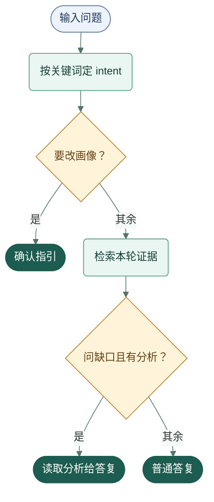

# 01-A2 · 状态图与路由：写出三个分支函数

上一步已经能调用图。本关补 `understand_intent()`、`route_intent()`、`route_answer()`。这三个函数决定看到一句问题之后到哪一步，以及什么时候可以结束。

```bash
python tutorials/01-agent-design/lab/practice.py open routing
```

## 顺着图的登记找函数

打开副本 `app/graph/career.py` 底部的 `builder`。这一段已经备好，先沿实际代码把五个节点连到纸上。

```python
builder = StateGraph(CareerState)
builder.add_node("understand_intent", understand_intent)
builder.add_node("retrieve_evidence", retrieve_evidence)
builder.add_node("compose_answer", compose_answer)
builder.add_node("compose_gap_answer", compose_gap_answer)
builder.add_node("memory_guidance", compose_memory_guidance)
builder.add_edge(START, "understand_intent")
builder.add_conditional_edges("understand_intent", route_intent)
builder.add_conditional_edges("retrieve_evidence", route_answer)
builder.add_edge("compose_answer", END)
builder.add_edge("compose_gap_answer", END)
builder.add_edge("memory_guidance", END)
```

`add_node` 把名字和函数配对。 `add_edge` 是固定的下一步。 `add_conditional_edges` 会执行后面给定的函数，再按返回的名字走。这样读懂了 `builder`，就知道自己要补哪几个选择。 [图的真实登记](../../backend/app/graph/career.py#L219-L231)



## 一步一步写代码

1. 分类函数先取小写问句。用 `if/elif` 从高到低检查「是否改画像」「是否问依据」「是否问缺口」「是否问方向」。默认走画像问题。 `any(word in message for word in (...))` 就是逐个查看这些关键词有没有出现。
2. 分类结束时把本轮的检索结果和诊断设为空。之后如果跳过检索，上一轮的候选不会出现在本轮响应里。
3. 第一个路由只看 `intent`。命中修改画像时返回图上登记的 `memory_guidance`，其余返回 `retrieve_evidence`。
4. 第二个路由在检索后执行。只有 `skill_gap` 且存在 `job_analysis` 才用 `compose_gap_answer`，否则用普通答复。 `state.get(...)` 在字段不存在时可以拿到空值。

先实现，再用「为什么我还差 Kubernetes？」手工走一遍代码。这个问题命中两组词。哪条判断先运行，决定了得到的 `intent`。

<details>
<summary>展开三个真实函数，把路径和自己的写法对照</summary>

```python
def understand_intent(state: CareerState) -> dict:
    message = state["message"].lower()
    if any(word in message for word in ("不再考虑", "更希望", "修改偏好", "更新画像", "记住")):
        intent = "memory_update"
    elif any(word in message for word in ("为什么", "证据", "依据")):
        intent = "evidence_explanation"
    elif any(word in message for word in ("缺口", "还差", "学习")):
        intent = "skill_gap"
    elif any(word in message for word in ("适合", "方向", "岗位")):
        intent = "career_direction"
    else:
        intent = "profile_question"
    return {"intent": intent, "retrieved_evidence": [], "retrieval_diagnostics": {}}


def route_intent(state: CareerState) -> str:
    return "memory_guidance" if state["intent"] == "memory_update" else "retrieve_evidence"


def route_answer(state: CareerState) -> str:
    if state["intent"] == "skill_gap" and state.get("job_analysis"):
        return "compose_gap_answer"
    return "compose_answer"
```

</details>

## 让真实用例验证两个出口

```bash
python tutorials/01-agent-design/lab/practice.py check routing
```

预期 `2 passed`。一个用例问证据并检查返回，另一个先保存岗位分析，然后问缺口，最后在同一会话提出画像更新。遇到不同结果，先写下请求命中的第一个关键词，再比对函数返回的节点名字。 [关键词分类](../../backend/app/graph/career.py#L32-L44) · [第二处路由](../../backend/app/graph/career.py#L51-L54) · [缺口与确认的测试](../../backend/tests/test_job_intelligence.py#L180)

| 输入 | 今天要对照的结果 |
| --- | --- |
| 为什么认为我会 Python？ | `evidence_explanation`，先检索，再普通答复 |
| 我还差什么？有有效岗位分析 | `skill_gap`，先检索，再读已保存分析 |
| 我还差什么？尚无岗位分析 | `skill_gap`，还是会检索，最后走普通答复 |
| 记住我更希望做后端，依据是什么？ | `memory_update`，直接进入指引 |

想往设计走一步，可以在纸上加一个「查看已保存学习计划」节点。先列清缺少分析时怎么退出、与「记住」同时出现时哪项优先。接下来实际敲的是检索节点。 

## 下一步

到 [01-B 聊天图里的检索工具](01-B-工具调用.md) 写出参数、调用与返回值。你也会看见为什么工具结果是一份原文列表和一份诊断。
