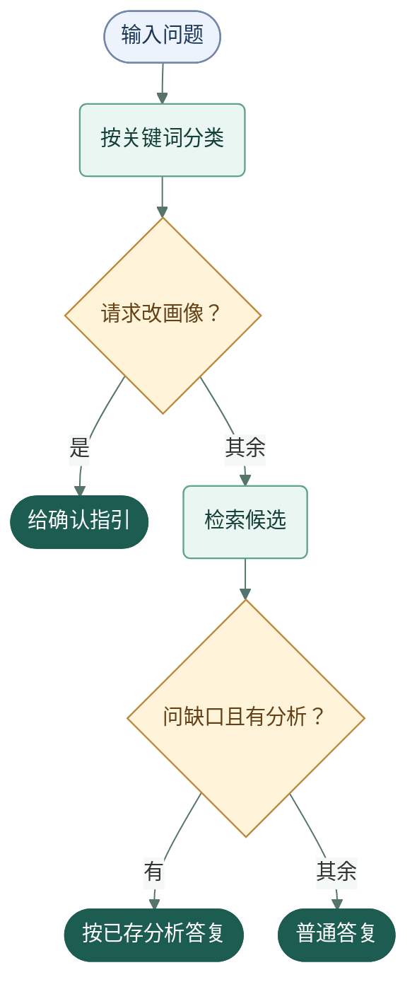

# 01-A2 · 路由与结束条件：谁决定下一步

本课把代码里的状态、节点与连线对应起来。动手时改动一个词或一份已经保存的岗位分析，预测同一个图会走到哪。只用浏览器可以跟着练。 [请求与状态](01-A1-请求与状态.md)

## 节点是一小步，边告诉程序下一步去哪

一个**状态图**由多步工作组成。这里用 LangGraph 来登记这些步骤。读代码先找 `START`，跟着连线到 `END`，再去读每个节点做什么。

```python
builder = StateGraph(CareerState)
builder.add_node("understand_intent", understand_intent)
builder.add_node("retrieve_evidence", retrieve_evidence)
builder.add_node("compose_answer", compose_answer)
builder.add_node("compose_gap_answer", compose_gap_answer)
builder.add_node("memory_guidance", compose_memory_guidance)
builder.add_edge(START, "understand_intent")
builder.add_conditional_edges("understand_intent", route_intent)
builder.add_conditional_edges("retrieve_evidence", route_answer)
builder.add_edge("compose_answer", END)
builder.add_edge("compose_gap_answer", END)
builder.add_edge("memory_guidance", END)
```

- `add_node` 登记「用哪个名字找到哪个函数」。 `memory_guidance` 是图里的名字，对应的 Python 函数是 `compose_memory_guidance`。
- `add_edge` 连上两步，下一步的名字已经写定。
- `add_conditional_edges` 把选择权交给一个路由函数。本例中的两个路由函数从已有状态返回下一步的名字。
- 后面用 `compile` 得到可执行的图，接口用 `await ...ainvoke(...)` 运行它。

在两个条件函数里，可以直接对照每条线的取值。 [图的登记](../../backend/app/graph/career.py#L219) · [两条路由](../../backend/app/graph/career.py#L47)



## 同一句话可能碰到两组词

看 `understand_intent` 的先后顺序。 `any(...)` 可以念成「这些词里任意一个出现就算命中」。下面逐行引用真实的分类逻辑。

```python
message = state["message"].lower()
if any(word in message for word in ("不再考虑", "更希望", "修改偏好", "更新画像", "记住")):
    intent = "memory_update"
elif any(word in message for word in ("为什么", "证据", "依据")):
    intent = "evidence_explanation"
elif any(word in message for word in ("缺口", "还差", "学习")):
    intent = "skill_gap"
elif any(word in message for word in ("适合", "方向", "岗位")):
    intent = "career_direction"
else:
    intent = "profile_question"
return {"intent": intent, "retrieved_evidence": [], "retrieval_diagnostics": {}}
```

`elif` 只有在前面的判断都没成立时才会检查。看到「为什么我还差 Kubernetes？」，先碰到「为什么」就定为 `evidence_explanation`。最后一行还把本轮的候选和检索诊断从空开始。相同会话上一次已经搜过材料时，这一步能让本次跳过检索的分支保持空结果。 [分类和状态更新](../../backend/app/graph/career.py#L32)

## 第二个分支要多看一个字段

第一处分支看 `intent`。记忆更新走 `memory_guidance`，其余走检索。等检索完成后，才运行 `route_answer`。

```python
def route_answer(state: CareerState) -> str:
    if state["intent"] == "skill_gap" and state.get("job_analysis"):
        return "compose_gap_answer"
    return "compose_answer"
```

`and` 要求两项都成立。用 `state.get(...)` 时，字段没有填可以得到空值。即使问题的文字一样，已保存且可用的岗位分析会改变路径。专用缺口答复读取快照里的 `gaps`、`matches` 和 `learning_path`，能从里面给出第一个行动。三个答复节点都连到 `END`。一次调用在选中的出口结束。

### 跟做：为四个输入填路径

每行写三项 **分类 → 中间节点 → 出口**。先遮住答案。已经跑通 Demo 时，用综合课的同一份岗位分析验证其中的缺口问法。

| 问句 | 这次附带条件 |
| --- | --- |
| 为什么认为我会 Python？ | 画像已建 |
| 我还差什么？ | 有一份可用的岗位分析 |
| 我还差什么？ | 这个用户还没有保存任何分析 |
| 记住我更希望做后端，依据是什么？ | 上一轮已经检索过资料 |

<details>
<summary>核对四条路径</summary>

1. `evidence_explanation → retrieve_evidence → compose_answer`。
2. `skill_gap → retrieve_evidence → compose_gap_answer`。
3. `skill_gap → retrieve_evidence → compose_answer`。Demo 会提示先提交目标岗位描述。
4. `memory_update → memory_guidance → END`。它命中了优先检查的记忆规则，候选和检索诊断为空。

再试一个只改问法的变化。把第二行改成「为什么我还差 Kubernetes？」。由于「为什么」优先，它会走第一类的普通答复路线。这次变化来自规则顺序。你可以把这个输入写进需求里，团队要调整时就知道应当确认哪条行为。

</details>

在已经安装后端开发依赖的终端中，仓库也有一条用合成数据走缺口和确认指引的测试。命令从仓库根开始。 [开发环境](../../CONTRIBUTING.md)

```bash
cd backend
python -m pytest -q tests/test_job_intelligence.py::test_copilot_uses_saved_job_analysis_and_keeps_memory_update_confirmed
```

### 选做：给图补一条只读路线

假设要新增「查看已保存的学习计划」。先在纸上写出节点读什么、返回什么、何时结束。试着照顾两类输入：有分析时读取 `learning_path`，缺分析时告诉读者先提交岗位描述。再列一个会撞到现有分支的问法，例如「记住我想换岗位，学习计划也改一下」，明确哪条规则要先处理。

这个设计可以用三条测试验收：已有分析时给出现有计划，无分析时给准备指引，需要改长期画像时仍到确认指引。先把期望输出写清楚，再决定新增节点要挂在哪条边上。

## 下一步

你已经能指出检索节点何时执行。到 [01-B 工具调用](01-B-工具调用.md)，把节点拆成输入、执行和结果，看看一条原文怎样真正进到答复里。
