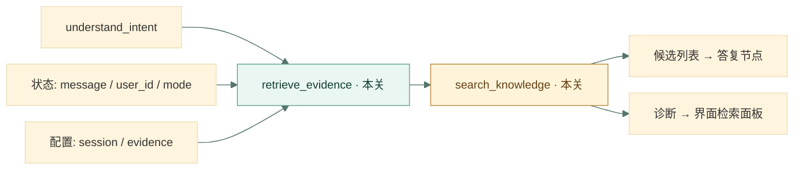

# 01-B · 聊天里的工具调用：写出检索节点

本关实现两个真实函数。`retrieve_evidence()` 是图上调用工具的一步，`search_knowledge()` 决定搜原始证据、搜 Wiki 或把两边的候选合起来。下一关会单独敲 `@mcp.tool()` 注册并用真正的 MCP 客户端调用。 [准备练习副本](01-A-Agent工作流.md)

阅读约 20–24 分钟，动手约 25 分钟。学完你能说清一个「工具节点」怎样从状态和配置取参数、为什么返回「候选 + 诊断」两份数据、以及 hybrid 的交错到底怎么排。

## 先把这一关放在整条链里看

上一关的 `route_intent` 把大部分问题都送到 `retrieve_evidence`。这一关要写的就是这个节点，以及它背后的检索服务。

它处在「分类」和「答复」之间，负责**拿本轮问题去查资料，把候选和诊断交给答复节点**。查找过程中可以用嵌入模型或重排器给资料排序，写出答案则是接下来 `compose_answer` 的工作。 [01-B1 答复与引用](01-B1-模型答复与引用.md)



## 第 1 块：函数式工具、RAG 和 Wiki

给「查证据」这件事定义好参数和返回值，它就能被对话图当作一个可重复调用的工具。这里由代码定下调用时机和输入。`backend/app/graph/career.py` 的 `retrieve_evidence` 收到状态与配置，调用 `backend/app/services/knowledge.py` 的 `search_knowledge`。当问题是「为什么认为我会 Python？」时，`query` 来自状态里的 `message`。 [图里的调用](../../backend/app/graph/career.py#L96-L127) · [工具签名](../../backend/app/services/knowledge.py#L35-L44)

**RAG** 会在生成前拿回原始证据，供答复引用。**Wiki** 会查询整理过的主题页，主题页携带源证据引用。**hybrid** 同时查这两路，再交错合并。假设原文中有「我用 Python 和 FastAPI 做过课程接口」，它可以经 `rag` 找到。同一个人尚未整理 Wiki 时，用 `wiki` 查这一句可能返回空。 [项目的 RAG 概念课](../00-foundations/00-3-RAG与检索.md) · [Wiki 概念课](../00-foundations/00-8-Wiki知识组织.md)

### 三种模式怎么选，不是节点的事

注意 `retrieve_evidence` 自己**不决定**用哪种模式。它从状态和配置里读出 `mode`，照着调用。模式是接口层根据用户在界面上的选择传进来的。这个分层让节点保持纯粹：给它什么模式就查什么，不掺杂业务判断。

| 模式 | 查什么 | 命中结果的 ID 字段 | 什么时候用 |
| --- | --- | --- | --- |
| `rag` | 原始 Evidence 索引 | `evidence_id` | 核一句原文、找具体经历 |
| `wiki` | 已发布的主题页 | `page_id` / `slug` | 看整理过的主题解释 |
| `hybrid` | 两路都查，交错 | 每条带 `source_kind` | 既要概览又要细节 |

## 第 2 块：先敲从图到工具的交接

```bash
python tutorials/01-agent-design/lab/practice.py open retrieval
```

打开练习的 `.cache/agent-practice/backend/app/graph/career.py`。对照下面这一段想清参数来源，接着按表实现 `retrieve_evidence` 的读取、分支和返回。这里展示的是数据库会话存在时的调用。

```python
results, diagnostics = await search_knowledge(
    session,
    user_id=state["user_id"],
    query=state["message"],
    mode=mode,
    evidence=configurable.get("evidence", []),
    limit=5,
)
```

星号后面的参数使用 `名字=值` 传入，每项的来源可以沿状态和配置找到。左边的两个变量按顺序接收函数返回的二元组。`results` 供答复读原文，`diagnostics` 供界面显示查了哪一类资料和命中数。空结果也能配一份有内容的诊断。 [双返回值出处](../../backend/app/services/knowledge.py#L64-L83)

### 为什么返回「候选 + 诊断」两份

只返回候选列表不够。想想这些场景：

- 用户选了 `wiki`，结果为空。是「没查到」还是「根本没执行查询」？光看空列表分不清。
- 看到 `backend=local` 和 `fallback=true` 时，接着看 `reason`。`configured_local` 表示练习启动时就选了本地检索。`qdrant_empty` 表示向量检索没有给出可用候选，也可能看到连接异常的类型。 [检索诊断源码](../../backend/app/retrieval/service.py#L45-L82)
- hybrid 两路各命中几条？`rag_count` / `wiki_count` 会说明。

诊断就是这些「过程信息」的载体。它让界面能显示「查了什么、命中多少、走的哪条路」，也让开发者排错时有据可依。**空候选 + 有诊断**是一个合法且常见的结果——表示查询执行了，只是没命中。

| 位置 | 应写出的行为 | 读哪一段 |
| --- | --- | --- |
| 读取配置 | `(config or {}).get("configurable", {})`。调用方省略配置时也能读到一个空字典 | 函数第一行 |
| 取检索模式 | 先查 `state` 再查配置，最后用 `rag` | `state.get("mode") or configurable.get("mode") or "rag"` |
| 有数据库会话 | 传给 `search_knowledge`，包括当前问题、用户、模式和最多 5 条候选 | `if session is not None` 分支 |
| 单独运行图节点 | 若会话为空，用状态里的 `evidence_records` 调证据检索 | `else` 分支 |
| 交回图 | `results` 写到 `retrieved_evidence`，诊断写到 `retrieval_diagnostics` | 返回值 |

### 为什么要有「无会话」的回退分支

`retrieve_evidence` 可能在两种场景被调用：完整接口请求（有数据库会话），以及测试里单独 `ainvoke` 这个节点（没有会话）。如果不处理后者，测试节点时就得先架一个数据库，很麻烦。

所以代码留了一条回退：`session is None` 时，用状态里已经投影好的 `evidence_records`（01-A1 放进来的）直接调 `search_evidence`，不走 knowledge 服务。这样节点可以**独立运行和测试**。这是一种常见的可测试性设计：让单元能在最小依赖下跑起来。

<details>
<summary>对照检索节点完整实现</summary>

```python
async def retrieve_evidence(state: CareerState, config=None) -> dict:
    """Retrieve under the query-time mode, preserving multi-source refs.

    ``session`` and ``mode`` arrive via LangGraph config. When absent (e.g. a
    direct graph invocation in tests), fall back to evidence-only retrieval so
    the node stays independently callable.
    """
    configurable = (config or {}).get("configurable", {})
    session = configurable.get("session")
    mode = state.get("mode") or configurable.get("mode") or "rag"

    if session is None:
        # Direct graph invocation without a DB session: evidence-only fallback.
        results, diagnostics = await search_evidence(
            user_id=state["user_id"],
            query=state["message"],
            evidence=state.get("evidence_records", []),
            limit=5,
        )
    else:
        results, diagnostics = await search_knowledge(
            session,
            user_id=state["user_id"],
            query=state["message"],
            mode=mode,
            evidence=configurable.get("evidence", []),
            limit=5,
        )
    return {
        "retrieved_evidence": results,
        "retrieval_diagnostics": diagnostics,
    }
```

</details>

## 第 3 块：实现三种知识模式

在副本打开 `.cache/agent-practice/backend/app/services/knowledge.py`。按注释先写 `rag`，再接上 `wiki` 和 `hybrid`。先检查传入模式，然后准备两个候选列表。RAG 的结果经过已备好的 `_rag_hits()`，给命中加上 `source_kind`。Wiki 返回带页编号和源证据引用的结果。要读原始证据就用 `evidence_id`，要继续读主题页就看 `slug` 或 `page_id`。

### 先校验模式，再分派

函数开头 `if mode not in VALID_MODES: raise ValueError(...)` 是一道护栏。模式来自外部请求，虽然 `ChatRequest` 已经用 `pattern` 校验过一次（`rag|wiki|hybrid`），但服务层不该假设调用方都做过校验。自己再查一遍，能防止被别的调用路径传入非法值。这种「每层都自查边界」的习惯，在真实服务里很常见。

### hybrid 的交错，手算一遍

动手写 `hybrid` 时可以拿小榜单先跑一遍。RAG 为 R1、R2、R3，Wiki 为 W1。`zip_longest` 一轮配 R1、W1，接下来配 R2 与空值，再配 R3 与空值。扔掉空值，结果是 R1、W1、R2、R3，再截取前 `limit` 条。返回的 `knowledge_fusion` 写 `rank_interleave`。这是对知识来源的交错，RAG 内部还有自己的候选融合。 [真实检索诊断](../04-检索Agent.md)

```text
zip_longest([R1,R2,R3], [W1]) =
    (R1, W1) (R2, None) (R3, None)
去空 + 拉平 = R1, W1, R2, R3
```

`zip_longest` 和普通的 `zip` 区别就在这里：`zip` 遇到短的列表就停（`zip([R1,R2,R3],[W1])` 只给 `(R1,W1)`，R2、R3 丢了），`zip_longest` 会用 `None` 补齐短的那边，让长列表的剩余项也能出来。这就是为什么 hybrid 要用它。

### 诊断为什么要合并两路

返回前有一行 `diagnostics = {**rag_diag, **diagnostics}`。RAG 检索自己会产生一份诊断（`backend`、`fusion`、`reranker` 等），knowledge 层又产生一份（`mode`、两路计数、`source_kind`）。这行把两份合成一份：`**` 是字典展开，后面的字典覆盖前面的同名键。这样界面一次就能看到「底层检索怎么走的 + 上层怎么合并的」，不用查两个地方。

<details>
<summary>对照 search_knowledge 的完整实现</summary>

```python
async def search_knowledge(
    session: AsyncSession,
    *,
    user_id: str,
    query: str,
    mode: str,
    evidence: list[Evidence],
    limit: int = 5,
) -> tuple[list[dict], dict[str, Any]]:
    if mode not in VALID_MODES:
        raise ValueError(f"invalid knowledge mode: {mode}")

    rag_hits: list[dict] = []
    wiki_hits: list[dict] = []
    rag_diag: dict[str, Any] = {}

    if mode in ("rag", "hybrid"):
        rag_results, rag_diag = await search_evidence(
            user_id=user_id, query=query, evidence=evidence, limit=limit
        )
        rag_hits = _rag_hits(rag_results)

    if mode in ("wiki", "hybrid"):
        wiki_hits = await search_wiki_pages(
            session, user_id=user_id, query=query, limit=limit
        )

    if mode == "rag":
        hits = rag_hits
    elif mode == "wiki":
        hits = wiki_hits
    else:
        hits = [
            hit for pair in zip_longest(rag_hits, wiki_hits) for hit in pair if hit is not None
        ][:limit]

    diagnostics: dict[str, Any] = {
        "mode": mode,
        "rag_count": len(rag_hits),
        "wiki_count": len(wiki_hits),
        "source_kinds": sorted({h["source_kind"] for h in hits}),
    }
    # Preserve the underlying RAG diagnostics (backend/fusion/reranker/...) so
    # existing consumers — and the chat retrieval panel — keep working.
    if mode == "hybrid":
        diagnostics["knowledge_fusion"] = "rank_interleave"
    if rag_diag:
        diagnostics = {**rag_diag, **diagnostics}
    return hits, diagnostics
```

</details>

打开这两个源文件时，分别圈出一个输入、实际执行的调用，以及给下一步的返回值。 [检索节点](../../backend/app/graph/career.py#L96-L127) · [运行知识检索](../../backend/app/services/knowledge.py#L35-L83)

### `source_kind` 为什么重要

`hybrid` 返回的每条结果都带 `source_kind`（`rag` 或 `wiki`）。界面据此区分原文和已编译页面。原文用 `evidence_id` 找，Wiki 结果里可以用 `slug` 找主题页，再沿页内引用找原文。答复节点组装允许集合时，实际从候选上取 `evidence_id` 或 `page_id`。 [查找引用的答复节点](../../backend/app/graph/career.py#L185-L205)

## 第 4 块：对照真实空结果，别只看数组

```bash
python tutorials/01-agent-design/lab/practice.py check retrieval
```

这个测试文件会实际创建证据和 Wiki，检查各模式的来源类型、是否保留引用和删除来源后的行为。读者可以再用本章综合课的合成账号做对照。

| 发出的请求 | 回来什么 | 可以定位到哪 |
| --- | --- | --- |
| 问 Python 依据，`rag` | `retrieval.mode="rag"`，有 `evidence_id` | 运行了检索，可以打开证据原文 |
| 同问句改为 `wiki`，账号还没建 Wiki | `retrieval.mode="wiki"`、`wiki_count=0`、`evidence=[]` | 运行了 Wiki 查询，当前没有命中 |
| 说「我更希望做后端开发」 | `retrieval={}`、`evidence=[]` | 图走了确认指引，跳过了检索 |

第三种最容易被误读：空的 `retrieval` 不是「检索失败」，而是**根本没进检索节点**——`route_intent` 把它分流到确认指引了。判断依据是看 `intent`，而不是看候选数组。这和 01-A2 的路由规则连起来了。

### 删除来源后的行为

若某个 RAG 结果的索引条目没赶上数据库删除，证据检索还会用实际存在的记录 ID 过滤。可以在 `search_evidence()` 找到它取回当前正文的步骤。这一步能让后续答案读到正确版本的原文。 [证据检索服务](../../backend/app/retrieval/service.py#L43)

例如索引还留有 E1，这次接口提供的数据库记录里只有 E2，E1 会在组装候选时被丢掉。再看一眼随响应返回的 `evidence`，它能告诉你答复前实际递过去的资料。

## 常见坑，提前绕开

- **把检索当判断。** 节点只挑候选，不写结论；「搜到了」≠「有依据」。
- **只看候选不看诊断。** 空结果到底是没查到还是没执行，诊断会说明。
- **漏掉无会话回退分支。** 单独测节点时会因为没有 session 而失败。
- **用 `zip` 而非 `zip_longest` 做 hybrid。** 短的列表会把长列表的尾部丢掉。
- **hybrid 结果不分 `source_kind`。** 下游无法判断打开哪种 ID。
- **只校验一次 mode。** 服务层要自己再查，不假设调用方校验过。
- **把空 `retrieval` 当检索失败。** 它可能是走了确认指引、根本没检索。

## 这些代码在真实项目里落在哪

| 这节课的词 | 项目位置 | 为什么这样设计 |
| --- | --- | --- |
| 工具节点 | `graph/career.py::retrieve_evidence` | 单一职责：取参数、查资料、交回候选和诊断 |
| 参数来源 | 状态取问题/用户/模式，配置取会话/证据 | 临时资源不进状态快照 |
| 无会话回退 | `session is None` 分支 | 节点可独立测试 |
| 知识服务 | `services/knowledge.py::search_knowledge` | 统一分派 rag/wiki/hybrid |
| hybrid 交错 | `zip_longest` + 去空 + 截断 | 两路候选轮流取，保留长列表尾部 |
| 诊断合并 | `{**rag_diag, **diagnostics}` | 底层和上层过程信息一次看全 |
| 来源标识 | `source_kind` | 区分原文命中与主题页命中 |

## 下一步

去 [01-B0 用 @mcp.tool 注册工具](01-B0-注册与调用MCP工具.md)。如果调用方是另一个应用，它如何知道 CareerLens 能做什么、该传哪些参数？下一课先解释 MCP 怎样约定这两件事，再动手读取原文。
