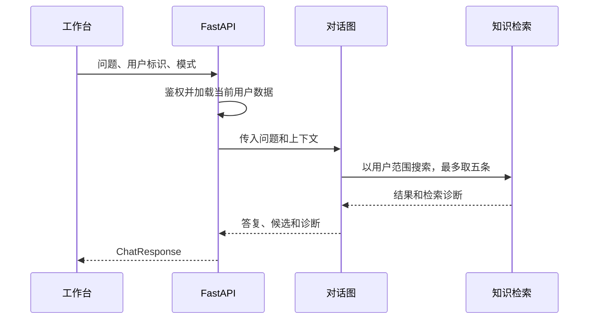

# 01-B · 工具调用：从一次搜索追到原文

**阅读约 8–10 分钟，练习约 10 分钟。** 上一课的路径表已经足够开始。可以用纸面里的字段做练习，也可以在第 01 篇运行的本地 Demo 里做同样的对照。

「为什么认为我会 Python？」进了检索节点。这个节点拿着什么输入，又把什么交给答复节点？读工具调用时，先把调用者、实际运行的函数和返回值找出来。

## 给工具画出输入和输出

可以把检索当成一个有明确用途的工具。它收到**查询、用户归属和候选数上限**，返回候选和诊断。把两类输出分开看，候选是答复可以阅读的内容，诊断是读者检查搜索行为的窗口。

| 你要找的东西 | CareerLens 实际用的字段 |
| --- | --- |
| 我在查什么 | 状态中的 `message` |
| 可以查到谁的材料 | 经过接口授权的 `user_id` |
| 查哪些库 | `mode` 可选 `rag`、`wiki`、`hybrid` |
| 找到了什么 | 响应的 `evidence` 列表。RAG 命中带 `evidence_id` |
| 实际走哪条检索链 | 响应的 `retrieval`，包含模式、计数和适用的后端诊断 |

在实际的 `retrieve_evidence()` 里，带数据库会话时走 `search_knowledge()`。下面截取了调用和返回部分。

```python
results, diagnostics = await search_knowledge(
    session,
    user_id=state["user_id"],
    query=state["message"],
    mode=mode,
    evidence=configurable.get("evidence", []),
    limit=5,
)
return {
    "retrieved_evidence": results,
    "retrieval_diagnostics": diagnostics,
}
```

这种写法把函数调用放在图里。由代码决定何时搜索，答复节点看到的是选出的结果。常见的模型工具调用还有一种做法：模型先返回结构化请求，应用查工具列表、验证参数、确认权限，再运行相应函数。两者都值得学，判断是哪一种时，看谁生成了函数名和参数。CareerLens 另外开放了可供外部客户端调用的 MCP 工具，见[独立的 MCP 一课](../07-A-MCP服务与ACP对照.md)。 [检索节点](../../backend/app/graph/career.py) · [检索模式](../../backend/app/services/knowledge.py)



## 跟做：对比「查到了」和「没进入检索」

1. 有工作台时，先在默认 Demo 导入第 01 篇的自述并重建画像。到 [本机 Swagger](http://localhost:8000/docs) 打开 `POST /api/v1/chat`，点 **Try it out**。用你刚重建画像的用户标识替换下面的 `learner`。如果在工作台测试，同样可以从对话下方展开诊断。
2. 发送第一个问题，记下 `intent` 和一条命中的 `evidence_id`。用 `GET /api/v1/evidence/{evidence_id}`，同样带上 `user_id` 参数，核对 `content`。看这段原文只能证明「做过项目」，还是能证明更强的结论。
3. 将 `message` 改为「记住我更希望做后端」，重复一次。预测这次的 `intent` 和 `evidence`。

```json
{
  "user_id": "learner",
  "message": "为什么认为我会 Python？",
  "mode": "rag"
}
```

| 对照 | 预期 |
| --- | --- |
| 证据问法 | `intent=evidence_explanation`，有材料时看 `evidence` 和 `retrieval`，打开 ID 核对原文 |
| 更新问法 | `intent=memory_update`、`evidence=[]`。查看答复里的草案和确认指引 |
| 证据问法改用 `wiki`，而当前用户尚无 Wiki 页 | 仍走检索分支，`retrieval.mode=wiki`，没有命中时 `wiki_count=0` |

后两行都可能得到空列表。看 `intent` 和 `retrieval`，就能区分「路线跳过了检索」和「执行了检索但候选为零」。如果第一行返回 422，先确认请求用的标识和已经重建画像的是同一个。

只用浏览器阅读时，可以用上表做同样的推演。装过[后端开发依赖](../../CONTRIBUTING.md)的话，也可以运行现有自动测试。它建出一份合成画像，发送证据问法，检查 `evidence` 非空和检索诊断。

```bash
cd backend
python -m pytest -q tests/test_profile_jobs_chat.py::test_career_chat_returns_traceable_evidence
```

## 搜索结果怎样进入答复

默认 Demo 用确定性模板组织答复。选配模型时，`compose_answer()` 会把问题、画像、这次检索的候选和最近的对话传给模型，再检查它返回的引用。候选列表决定了模型能看到什么，所以先检查「检索有没有找到它」，再看「写进答复后有没有把意思扩大」。 [答复节点](../../backend/app/graph/career.py) · [引用检查](../../backend/app/services/citations.py)

> 下一次读工具实现时，先记下调用者、参数来源、权限检查点和返回值。由这四处通常能判断「结果为空」发生在哪个步骤。

## 下一步

[01-C 子 Agent](01-C-子Agent.md)会把一次后台岗位分析拆成两个角色。沿着调用栈看它们各自收到哪些信息，以及最后谁写入分析结果。
