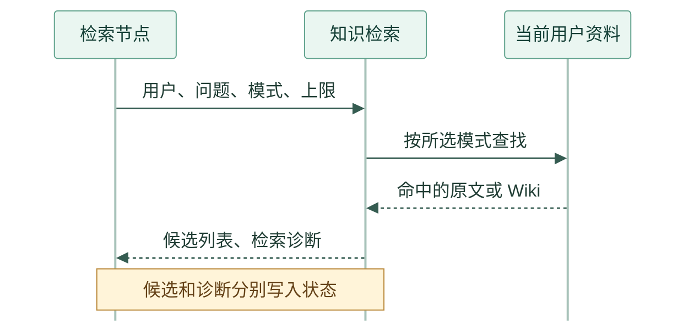

# 01-B · 工具调用：把问题交给能查资料的函数

上一课用代码决定了要走 `retrieve_evidence`。我们现在追它接到的参数、执行的搜索，以及交给下一步的原文。目标是看到空结果时，能分清它是查过了还是根本没有去查。 [先读分支图](01-A2-路由与结束条件.md)

## 给这次工具调用写一张收据

「工具」可以是读文件、执行计算或查资料的程序。它和普通函数一样收参数、交结果。在这条 CareerLens 对话里，**图里的 Python 节点发起搜索**。它先拿用户标识和问题，再决定查哪个资料库。你可以把输入输出写成下面这张收据。

| 你关心什么 | 代码从哪取 |
| --- | --- |
| 查什么 | `state["message"]`，例如「为什么认为我会 Python？」 |
| 查谁的资料 | 接口检查过的 `state["user_id"]` |
| 查哪种内容 | `mode`，可选证据、Wiki、两种一起 |
| 最多交回几条 | 节点传入 `limit=5` |
| 找到了什么 | `results`，里面有原文片段和编号 |
| 经过哪条检索链 | `diagnostics`，用于查看模式、命中数、检索后端等信息 |

下面保留了真实的 HTTP 路径调用和节点返回值。直接在开发测试里运行这个节点时，若没有传数据库会话，前面还有一条仅检索证据的路径。 [检索节点](../../backend/app/graph/career.py#L96)

```python
results, diagnostics = await search_knowledge(
    session,
    user_id=state["user_id"],
    query=state["message"],
    mode=mode,
    evidence=configurable.get("evidence", []),
    limit=5,
)
```

程序可以一次接住两个返回值，这里把候选放进 `results`，把诊断放进 `diagnostics`。同一个节点结束时，交给图的是一份字典，图会更新这两个字段。

```python
return {
    "retrieved_evidence": results,
    "retrieval_diagnostics": diagnostics,
}
```



有些 Agent 会让模型提出工具名和参数。程序仍应从已登记的工具里找到它，检查参数和权限，再执行。读 CareerLens 时看上面这段调用，函数名和参数由节点代码写明。以后在 MCP 课再看外部客户端怎样使用项目对外登记的工具。 [MCP 接入](../07-A-MCP服务与ACP对照.md)

## 选的是资料库，也会改变你看到的编号

`search_knowledge()` 在查询时选模式。先理解下面三个动作，后面再读每个检索算法。

| 模式 | 查什么 | 拿哪个编号回查 |
| --- | --- | --- |
| `rag` | 原始证据 | 结果带 `source_kind="rag"`，用 `evidence_id` 读证据内容 |
| `wiki` | 已发布的 Wiki 主题页 | 结果带 `source_kind="wiki"`，用 `slug` 或 `page_id` 找页，再顺着引用打开证据 |
| `hybrid` | 两边都查，交错取候选 | 先看 `source_kind`，再按这条的类型打开 |

假设 RAG 返回 `R1、R2、R3`，Wiki 返回 `W1、W2`。交错得到 `R1、W1、R2、W2、R3`，再按上限截取。这里的交错和 RAG 内部融合稀疏、稠密榜单发生在不同位置。后续第 04 篇会带你手算后一种融合。 [模式实现](../../backend/app/services/knowledge.py#L35) · [两层检索的细节](../04-检索Agent.md)

再追一步。在 Qdrant 检索路径，程序会用本次数据库里查到的证据 ID 核对索引命中，并取回当前正文。如果索引中仍有一个已删除证据的 ID，这一步会把它过滤掉。这一层解决的是「资料还在不在」，再往后仍要读原文判断它是否支持结论。 [证据检索及回退](../../backend/app/retrieval/service.py#L43)

## 跟做：两份空列表，有两种原因

以下三组来自同一份合成资料的核对。该教学用户已建画像，只有证据，尚未编译 Wiki。先用表格推演。动手时可按综合课先建同样的资料，在 Swagger 改问句或 `mode`。每次只改一个条件。 [按第 01 篇准备合成资料](../01-第一次跑起来.md)

| 请求 | 看见的字段 | 解释 |
| --- | --- | --- |
| 「为什么认为我会 Python？」用 `rag` | `intent="evidence_explanation"`，`retrieval.rag_count=1` | 查到了合成证据，打开 `evidence[0].evidence_id` 就能追到原文 |
| 同一句话改用 `wiki` | `retrieval.mode="wiki"`、`wiki_count=0`、`evidence=[]` | 已经查过 Wiki，该用户没有匹配的已发布页 |
| 用 `rag` 说「我更希望做后端开发」 | `intent="memory_update"`、`retrieval={}`、`evidence=[]` | 走确认指引，图跳过了搜索 |

**把第一行追到底。** 用命中的 `evidence_id` 打开 `GET /api/v1/evidence/{evidence_id}`，同时填和对话相同的 `user_id`。结果里的 `content` 会给出林澈原来的句子。圈出它能支持的动作与环境。 [证据入口](../../backend/app/api/routes/evidence.py#L193)

```text
看到的响应字段  evidence
图里的字段      retrieved_evidence
其中一个编号    evidence_id
接口中的原文    content
```

<details>
<summary>练习答案：相似问题需要多强的证据</summary>

原句可以支持「用 Python 和 FastAPI 做过课程接口」及「用 Docker 在本机运行」。若问题问的是在生产环境维护 Kubernetes，当前原文仍只能支持前一句。拿到候选以后要读出动作、环境和强度，再决定如何答复。

有资料却返回空时，可以按「是否走了检索 → 模式是否选对 → 同一账号下是否有相关证据或 Wiki 页」直查三处。选 `wiki` 遇到空结果时，先检查该账号是否已有已发布页。

</details>

## 下一步

带着这次取回的原文去 [01-B1 模型答复与引用](01-B1-模型答复与引用.md)。在那里会看到哪些资料送给模型、代码怎么拦住编出来的编号。
