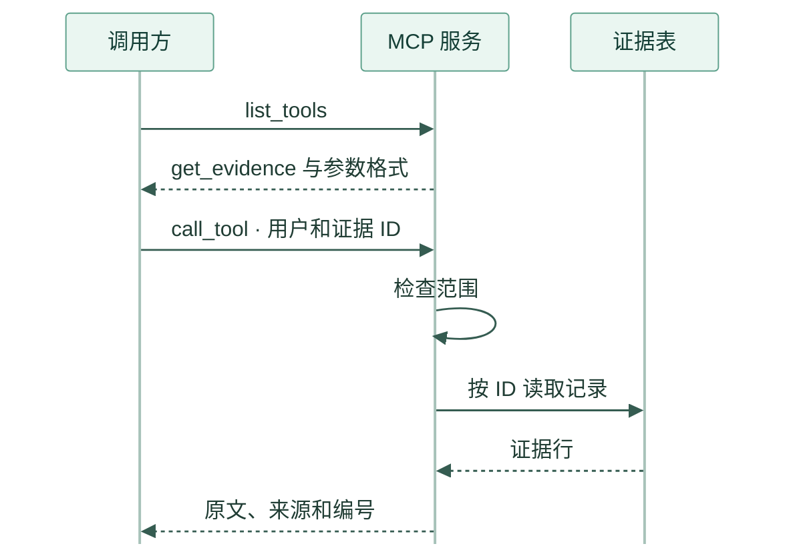

# 01-B0 · 用 @mcp.tool 注册工具，再用 @tool 调同一条证据

这一关补 CareerLens 真实的 `get_evidence`。你会用 MCP 客户端发现它、给它送参数，再从 SQLite 读回一条原文。最后写一个 LangChain 的 `@tool` 适配器，调用同一个真实工具。练习只用合成数据，在本机进程中执行。

## 先认识 MCP 为什么出现在这里

上一课里，聊天图和检索函数都在 CareerLens 后端。节点拿着这次请求的数据库会话，直接执行 `search_knowledge(...)`。如果另一个应用也想读 CareerLens 的证据，它首先需要知道工具叫什么、参数怎么填、执行失败会收到什么。**MCP** 的全称是 **Model Context Protocol（模型上下文协议）**，它为这类连接约定统一的消息和操作。原文仍由 CareerLens 查询。 [MCP 架构](https://modelcontextprotocol.io/docs/learn/architecture) · [图内检索](../../backend/app/graph/career.py#L96-L127)

| 角色 | 在读取证据时做什么 |
| --- | --- |
| Host（宿主应用） | 例如集成了 CareerLens 的桌面应用，负责管理连接和工具怎样呈现给用户。本课由小测试程序主动发起调用 |
| Client（客户端） | 维持一条与服务的会话，发出发现工具、调用工具的请求。本课使用 `lab/mcp_tool_check.py` 里创建的 `Client` |
| Server（服务端） | 公布能力、接收调用并执行逻辑。CareerLens 的入口是 `backend/app/mcp/server.py` 中的 `build_mcp_server` 和 `mcp` |

MCP 中，**工具**用于执行带参数的操作，例如按 ID 查原文。**资源**用于按 URI 读取内容，例如 `evidence://{user_id}/{evidence_id}`。**提示词**是可以由宿主请求的模板，例如 `explain_profile_claim`。本节只动手写工具。你可以在 `backend/app/mcp/server.py` 的 `@mcp.resource(...)` 和 `@mcp.prompt()` 后面找到另外两种。 [证据资源](../../backend/app/mcp/server.py#L406-L413) · [提问模板](../../backend/app/mcp/server.py#L426-L433)

真实接入可以用 **stdio**，让客户端通过子进程的标准输入和输出交换消息，也可以用 **Streamable HTTP**，让客户端请求服务的 HTTP 地址。练习用 `Client(server.mcp)` 在同一个进程里连接真实服务对象，发现和调用都经过 MCP，单独启动服务可留到接入课。 [CareerLens 的传输入口](../../backend/app/mcp/server.py#L455-L481) · [后续接入课](../07-A-MCP服务与ACP对照.md)

## 看懂 @mcp.tool() 和 @tool 分别登记什么

打开原项目的 `backend/app/mcp/server.py`，往上追 `mcp` 来自哪里。`build_mcp_server` 先创建服务对象，`@mcp.tool()` 把下面的函数登记到这个服务上。Python 里这种写在 `def` 上方、接收函数并可为它增加行为的写法叫**装饰器**。这里 SDK 会利用函数名、类型注解和说明文字生成工具描述和输入格式。 [服务对象的创建](../../backend/app/mcp/server.py#L52-L85) · [真实注册位置](../../backend/app/mcp/server.py#L186-L201)

`list_tools()` 对应发现工具。客户端会看到 `get_evidence` 和它的输入格式，例如属性名 `user_id` 和 `evidence_id`，类型为字符串。此时数据库还没有执行这次读取。接着 `call_tool("get_evidence", {"user_id": "agent-lesson", "evidence_id": item.id})` 明确指定工具和实参。函数签名中的 `ctx: Context` 由 SDK 注入，框架可借它取得本次调用的信息，因此输入格式里没有 `ctx`。参数格式只约束数据长什么样，读取时仍要检查归属和权限。 [客户端实验](lab/mcp_tool_check.py)

稍后还会遇到 `from langchain_core.tools import tool`。这个库的 `@tool` 将 Python 函数包装成 **LangChain 工具对象**，调用方式为 `ainvoke`。本课用它把「读取原文」包装成只要 `evidence_id` 的工具，其中再用 `call_tool` 访问前面登记的 MCP 工具。两种装饰器各自服务于不同的调用方，都能在下面的例子看到实际效果。 [00-6 LangChain 入门](../00-foundations/00-6-LangChain与模型工具.md)



## 亲手敲出 get_evidence

```bash
python tutorials/01-agent-design/lab/practice.py open tools
```

打开练习的 `.cache/agent-practice/backend/app/mcp/server.py`，找到 `@mcp.tool()` 和下面的 `async def get_evidence`。装饰器和函数签名已经备好。按注释先写权限和查询，再试着写记录检查。假设从库里查出的 `item.user_id` 是 `"agent-other"`，即使编号有效，下面这条条件也会挡住读取。

```python
if item is None or item.user_id != user_id:
    raise ToolError("Evidence not found for this user")
```

`or` 会从左向右判断。查不到时左边先成立，安全地跳进错误分支。若查到了，才读取对象上的 `user_id`。用同一类错误处理这两种情况，调用方只需要知道该编号对当前用户不可读。再补齐剩下的步骤。

| 第几步 | 写什么 | 为什么放在这里 |
| --- | --- | --- |
| 1 | `_authorized_principal(user_id, "read")` | 读取操作使用对应的权限。开启鉴权时，检查令牌归属和 Scope |
| 2 | `async with SessionFactory() as session` | 为这次调用取得数据库会话，结束时关闭 |
| 3 | `await session.get(Evidence, evidence_id)` | 按主键拿一条记录，取不到返回空 |
| 4 | 判断记录存在并核对 `item.user_id` | 当前教学账号只能读本账号的证据 |
| 5 | 用 `_commit_audit` 记下 `evidence.read` | 成功读取时能查到一次审计动作，实际存的名字带 `mcp.` |
| 6 | `return _evidence_payload(item)` | 把数据库对象整理为含 `content`、`source_name`、`evidence_id` 的结果 |

<details>
<summary>对照 get_evidence 完整实现</summary>

```python
@mcp.tool()
async def get_evidence(user_id: str, evidence_id: str, ctx: Context) -> dict:
    """Read one Evidence record by ID. Requires read scope."""
    principal = _authorized_principal(user_id, "read")
    async with SessionFactory() as session:
        item = await session.get(Evidence, evidence_id)
        if item is None or item.user_id != user_id:
            raise ToolError("Evidence not found for this user")
        await _commit_audit(
            session,
            principal=principal,
            action="evidence.read",
            resource_type="evidence",
            resource_id=item.id,
        )
        return _evidence_payload(item)
```

</details>

[get_evidence 原函数](../../backend/app/mcp/server.py#L186-L201) · [授权边界](../../backend/app/mcp/server.py#L88-L98) · [证据返回字段](../../backend/app/mcp/server.py#L101-L111)

## 跟着真实客户端调用一次

测试会先把林澈的课程接口自述写进内存库，拿到 `item.id`。下面是测试中的调用部分。 `client.list_tools()` 回来的 Python 对象字段用 `input_schema`。先预测其中会有哪些可填参数，然后用测试核对。

```python
async with Client(server.mcp) as client:
    discovered = await client.list_tools()
    registered = next(
        candidate for candidate in discovered.tools if candidate.name == "get_evidence"
    )
    assert set(registered.input_schema["properties"]) == {"user_id", "evidence_id"}

    native = await client.call_tool(
        "get_evidence", {"user_id": "agent-lesson", "evidence_id": item.id}
    )
    assert unpack(native)["evidence_id"] == item.id
    assert unpack(native)["content"] == CONTENT
```

这段调用已经写在练习的 `tests/test_tutorial_mcp_tool.py` 中。测试会先插入资料，得到这里用到的 `item.id`，运行 `check tools` 时就会执行它。继续按下一节提示补适配器即可。`unpack` 优先使用结构化内容，必要时解析文本里的 JSON，最后拿到的 `content` 是先前导入的原文。 [完整客户端实验](lab/mcp_tool_check.py)

### 现在写一次 LangChain 的 @tool

打开练习的 `.cache/agent-practice/backend/tests/test_tutorial_mcp_tool.py`，补 `build_evidence_tool`。原始实验在 `tutorials/01-agent-design/lab/mcp_tool_check.py`，创建练习时会复制成这个测试文件。按第一条注释定义内部函数，只接收 `evidence_id`。接下来让它用外层传进来的 `client` 和 `user_id` 去调用 MCP。内部函数能在调用时继续用到外层的这些值，这种用法叫**闭包**。 [原始实验文件](lab/mcp_tool_check.py)

先想清两个返回值。内层返回 `unpack(result)["content"]`，所以调用工具得到的是原文。外层返回内层工具对象，所以测试可以继续检查 `adapter.args` 并执行 `adapter.ainvoke(...)`。`tool` 已在文件顶部导入。给内层函数写说明文字，让框架能生成工具的用途描述。

<details>
<summary>对照 build_evidence_tool 完整实现</summary>

```python
def build_evidence_tool(client, user_id):
    @tool
    async def read_careerlens_evidence(evidence_id: str) -> str:
        """Read the original text of a CareerLens Evidence record by ID."""
        result = await client.call_tool(
            "get_evidence", {"user_id": user_id, "evidence_id": evidence_id}
        )
        return unpack(result)["content"]

    return read_careerlens_evidence
```

</details>

回到测试，把 `Client` 交给 `build_evidence_tool`。工具描述来自函数的说明文字，参数格式能通过 `adapter.args` 查看。 `ainvoke` 执行这个异步工具。它会经过刚才补写的 `@mcp.tool()` 端点，再回到同一条原文。

```python
adapter = build_evidence_tool(client, "agent-lesson")
assert set(adapter.args) == {"evidence_id"}
assert await adapter.ainvoke({"evidence_id": item.id}) == CONTENT
```

现在可以解释三处名字。 `get_evidence` 是 CareerLens 的服务端工具名，`read_careerlens_evidence` 是此处适配器的名字，`ainvoke` 和 `call_tool` 分别执行这两个层次。在会让模型选择工具的应用中，程序也可以把工具说明和参数格式交给模型，收到调用建议后再执行。本课直接指定要执行的工具，因此每次能复跑相同结果。

## 验收工具真的跑到了数据库

```bash
python tutorials/01-agent-design/lab/practice.py check tools
```

应看到 `2 passed`。一条测试检查原仓库已有的 MCP 合约，另一条测试核对这五个结果。

- 能发现 `get_evidence` 并读到两项必用参数。
- 直接 `call_tool` 能返回同一个证据 ID 和原文。
- 用 LangChain `@tool` 的适配器也能读回同一句话。
- 换成不存在的证据或另一教学用户时返回工具错误。
- 审计表中有两条成功的 `mcp.evidence.read`，对应两次成功读取。

如果只把一个名字登记好，发现工具的检查会通过，真正读取原文的检查还会报到 `get_evidence`。用它定位函数里的失败。想看写操作的例子，接着打开相邻 `import_text_evidence`，找它为什么用了 `write`，写完才记录审计。 [真实工具列表用例](../../backend/tests/test_mcp.py#L23) · [MCP 接入与协议](../07-A-MCP服务与ACP对照.md)

## 下一步

到 [模型配置](模型配置.md)，接着用同一句「为什么认为我会 Python？」检查 Demo、兼容 API 或本地模型各从哪里得到答复。跑过 Demo 就可以进入写答复节点的一课。
