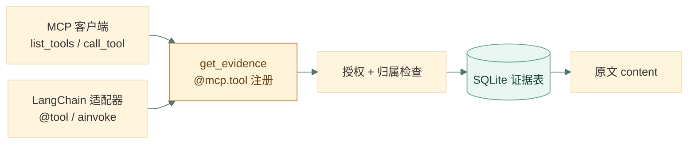
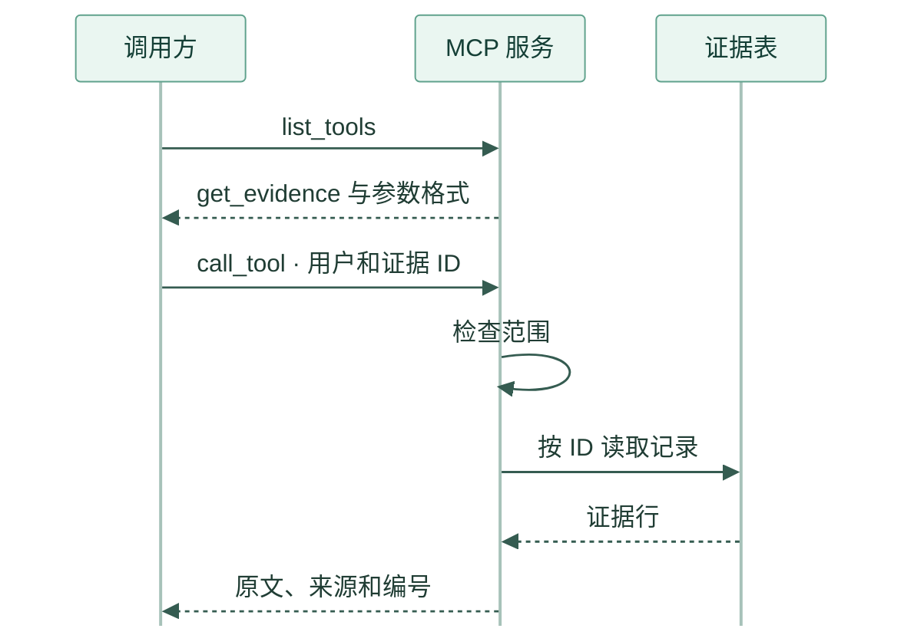

# 01-B0 · 用 @mcp.tool 注册工具，再用 @tool 调同一条证据

这一关补 CareerLens 真实的 `get_evidence`。你会用 MCP 客户端发现它、给它送参数，再从 SQLite 读回一条原文。最后写一个 LangChain 的 `@tool` 适配器，调用同一个真实工具。练习只用合成数据，在本机进程中执行。 [准备练习副本](01-A-Agent工作流.md)

阅读约 22–26 分钟，动手约 25 分钟。学完你能说清 MCP 的 Host/Client/Server 分工、工具/资源/提示词三种能力、`list_tools` 与 `call_tool` 的区别，以及为什么同一条读取要包两层装饰器。

## 先把这一关放在整条链里看

前面几关，聊天图和检索函数都在 CareerLens 后端内部，节点拿着这次请求的数据库会话，直接执行 `search_knowledge(...)`。但如果**另一个应用**也想读 CareerLens 的证据，它没法直接调 Python 函数——它需要先知道：有哪些工具、每个工具叫什么、参数怎么填、失败会收到什么。

MCP 就是为这种「跨应用调用工具」约定的协议。这一关把 `get_evidence` 做成对外可用的工具，再用一个真正的客户端走一遍发现→调用→读原文，最后用 LangChain 的 `@tool` 把它包装成模型也能提议调用的形式。



## 第 1 块：MCP 为什么出现在这里

**MCP** 的全称是 **Model Context Protocol（模型上下文协议）**，它为应用之间连接工具约定统一的消息和操作。原文仍由 CareerLens 查询——MCP 不改变数据在哪，只改变「别人怎么调用它」。 [MCP 架构](https://modelcontextprotocol.io/docs/learn/architecture) · [图内检索](../../backend/app/graph/career.py#L96-L127)

| 角色 | 在读取证据时做什么 | 本课由谁扮演 |
| --- | --- | --- |
| Host（宿主应用） | 管理连接和工具怎样呈现给用户 | 小测试程序主动发起调用 |
| Client（客户端） | 维持与服务的会话，发出发现工具、调用工具的请求 | `lab/mcp_tool_check.py` 里创建的 `Client` |
| Server（服务端） | 公布能力、接收调用并执行逻辑 | `backend/app/mcp/server.py` 的 `build_mcp_server` 和 `mcp` |

三个角色是**调用关系**，不是三个进程。本课用 `Client(server.mcp)` 在同一个进程里连真实服务对象，方便教学。真实部署时它们常常分开：客户端通过 stdio（子进程的标准输入输出）或 Streamable HTTP（HTTP 地址）连到服务端。 [CareerLens 的传输入口](../../backend/app/mcp/server.py#L455-L481) · [后续接入课](../07-A-MCP服务与ACP对照.md)

### 工具、资源、提示词：三种能力

MCP 服务能暴露三类东西，别混：

| 能力 | 干什么 | 例子 |
| --- | --- | --- |
| **工具（tool）** | 执行带参数的操作，会有副作用或返回计算结果 | 按 ID 查原文 `get_evidence`、导入文本 `import_text_evidence` |
| **资源（resource）** | 按 URI 读取内容，偏「只读数据」 | `evidence://{user_id}/{evidence_id}` |
| **提示词（prompt）** | 可由宿主请求的模板 | `explain_profile_claim` |

本节只动手写工具。你可以在 `backend/app/mcp/server.py` 的 `@mcp.resource(...)` 和 `@mcp.prompt()` 后面找到另外两种。 [证据资源](../../backend/app/mcp/server.py#L406-L413) · [提问模板](../../backend/app/mcp/server.py#L426-L433)

### 为什么读取要用工具，也能用资源

同一条证据既可以做成工具（传参数查），也可以做成资源（按 URI 读）。区别在于调用方的意图：工具像「发起一个操作」，资源像「打开一个地址」。模型调用场景更常用工具，因为工具的参数格式容易交给模型生成；资源更像给人或宿主按地址取值。这里选工具，是因为后面要让 LangChain 的 `@tool` 包它。

## 第 2 块：两种装饰器分别登记什么

打开原项目的 `backend/app/mcp/server.py`，往上追 `mcp` 来自哪里。`build_mcp_server` 先创建服务对象，`@mcp.tool()` 把下面的函数登记到这个服务上。Python 里这种写在 `def` 上方、接收函数并可为它增加行为的写法叫**装饰器**。这里 SDK 会利用函数名、类型注解和说明文字生成工具描述和输入格式。 [服务对象的创建](../../backend/app/mcp/server.py#L52-L85) · [真实注册位置](../../backend/app/mcp/server.py#L186-L201)

### 装饰器到底做了什么

`@mcp.tool()` 写在函数上方，等价于 `get_evidence = mcp.tool()(get_evidence)`：把原函数交给 SDK 登记， SDK 读它的名字、参数注解、docstring，生成一份「工具清单」，然后返回一个登记后的函数。所以客户端 `list_tools()` 能看到工具名和输入格式——那些信息是从你的函数签名里提取的。

这也解释了为什么**参数的注解和说明文字很重要**：它们不是给人看的注释，而是会变成工具描述的一部分，模型/客户端靠它们决定怎么填参数。

### list_tools 与 call_tool 的分工

`list_tools()` 对应**发现工具**。客户端会看到 `get_evidence` 和它的输入格式，例如属性名 `user_id` 和 `evidence_id`，类型为字符串。此时数据库还没有执行这次读取。接着 `call_tool("get_evidence", {"user_id": "agent-lesson", "evidence_id": item.id})` 明确指定工具和实参，才真正执行。

`ctx: Context` 由 SDK 注入，框架可借它取得本次调用的信息，因此输入格式里没有 `ctx`——它是框架给的，不是调用方填的。参数格式只约束数据长什么样，读取时仍要检查归属和权限。 [客户端实验](lab/mcp_tool_check.py)

### 两种 @tool，两个层次

稍后还会遇到 `from langchain_core.tools import tool`。这个库的 `@tool` 将 Python 函数包装成 **LangChain 工具对象**，调用方式为 `ainvoke`。本课用它把「读取原文」包装成只要 `evidence_id` 的工具，其中再用 `call_tool` 访问前面登记的 MCP 工具。

两种装饰器各自服务于不同的调用方：

| 装饰器 | 来自 | 服务于 | 调用方式 |
| --- | --- | --- | --- |
| `@mcp.tool()` | MCP SDK | 外部应用通过 MCP 协议调用 | `client.call_tool(...)` |
| `@tool` | LangChain | 模型/Agent 通过工具调用提议 | `adapter.ainvoke(...)` |

它们不冲突，而是叠成两层：LangChain 工具在里面调 MCP 工具。 [00-6 LangChain 入门](../00-foundations/00-6-LangChain与模型工具.md)



## 第 3 块：亲手敲出 get_evidence

```bash
python tutorials/01-agent-design/lab/practice.py open tools
```

打开练习的 `.cache/agent-practice/backend/app/mcp/server.py`，找到 `@mcp.tool()` 和下面的 `async def get_evidence`。装饰器和函数签名已经备好。按注释先写权限和查询，再试着写记录检查。假设从库里查出的 `item.user_id` 是 `"agent-other"`，即使编号有效，下面这条条件也会挡住读取。

```python
if item is None or item.user_id != user_id:
    raise ToolError("Evidence not found for this user")
```

`or` 会从左向右判断。查不到时左边先成立，安全地跳进错误分支。若查到了，才读取对象上的 `user_id`。

### 为什么两种失败给同一个错误

「证据不存在」和「证据属于别人」是两种不同的情况，但这里返回同一个 `ToolError("Evidence not found for this user")`。这是**有意的**：如果把「存在但属于别人」明确说出来，就等于告诉调用方「这个 ID 是有效的，只是你没权限」，泄漏了资源存在的信息。统一说「找不到」，调用方无法据此探测别人的数据。这叫**避免信息泄漏**，是权限边界的常见做法。

再补齐剩下的步骤。

| 第几步 | 写什么 | 为什么放在这里 |
| --- | --- | --- |
| 1 | `_authorized_principal(user_id, "read")` | 读取操作使用对应的权限。开启鉴权时，检查令牌归属和 Scope |
| 2 | `async with SessionFactory() as session` | 为这次调用取得数据库会话，结束时自动关闭 |
| 3 | `await session.get(Evidence, evidence_id)` | 按主键拿一条记录，取不到返回 `None` |
| 4 | 判断记录存在并核对 `item.user_id` | 当前教学账号只能读本账号的证据 |
| 5 | 用 `_commit_audit` 记下 `evidence.read` | 成功读取时能查到一次审计动作，实际存的名字带 `mcp.` 前缀 |
| 6 | `return _evidence_payload(item)` | 把数据库对象整理为含 `content`、`source_name`、`evidence_id` 的结果 |

### async with 是什么

`async with SessionFactory() as session:` 组合了两件事：`with` 保证「离开这段就关闭会话」——哪怕中间抛错也会关，不会泄漏数据库连接；`async` 表示创建/关闭会话可能涉及异步 I/O，要等。你只需要知道：进这段拿到 `session`，出这段它就被妥善关掉，不用自己写关闭代码。

### 审计为什么值得单独记

第 5 步的 `_commit_audit` 把「谁在什么时候读了哪条证据」写进审计表。这不只是日志：安全要求高的场景里，读敏感数据也要留痕，事后能追查。测试最后会断言审计表里有 `mcp.evidence.read` 记录，就是验这一步没漏。

<details>
<summary>对照 get_evidence 完整实现</summary>

```python
@mcp.tool()
async def get_evidence(user_id: str, evidence_id: str, ctx: Context) -> dict:
    """Read one Evidence record by ID. Requires read scope."""
    principal = _authorized_principal(user_id, "read")
    async with SessionFactory() as session:
        item = await session.get(Evidence, evidence_id)
        if item is None or item.user_id != user_id:
            raise ToolError("Evidence not found for this user")
        await _commit_audit(
            session,
            principal=principal,
            action="evidence.read",
            resource_type="evidence",
            resource_id=item.id,
        )
        return _evidence_payload(item)
```

</details>

[get_evidence 原函数](../../backend/app/mcp/server.py#L186-L201) · [授权边界](../../backend/app/mcp/server.py#L88-L98) · [证据返回字段](../../backend/app/mcp/server.py#L101-L111)

## 第 4 块：跟着真实客户端调用一次

测试会先把林澈的课程接口自述写进内存库，拿到 `item.id`。下面是测试中的调用部分。`client.list_tools()` 回来的 Python 对象字段用 `input_schema`。先预测其中会有哪些可填参数，然后用测试核对。

```python
async with Client(server.mcp) as client:
    discovered = await client.list_tools()
    registered = next(
        candidate for candidate in discovered.tools if candidate.name == "get_evidence"
    )
    assert set(registered.input_schema["properties"]) == {"user_id", "evidence_id"}

    native = await client.call_tool(
        "get_evidence", {"user_id": "agent-lesson", "evidence_id": item.id}
    )
    assert unpack(native)["evidence_id"] == item.id
    assert unpack(native)["content"] == CONTENT
```

这段调用已经写在练习的 `tests/test_tutorial_mcp_tool.py` 中。测试会先插入资料，得到这里用到的 `item.id`，运行 `check tools` 时就会执行它。

### next 与生成器

`next(candidate for candidate in discovered.tools if candidate.name == "get_evidence")` 从工具列表里挑出名字匹配的那个。`next()` 取生成器的第一项——生成器逐个产出「名字等于 get_evidence 的工具」，`next` 拿第一个就停。如果列表里没有匹配项，`next` 会抛 `StopIteration`，测试就失败了。所以它顺带也断言了「工具确实被登记了」。

### unpack 为什么需要

`call_tool` 的返回可能有结构化内容和文本两种形态，不同版本/配置不一样。`unpack` 优先使用结构化内容，必要时解析文本里的 JSON，把两种形态统一成字典。这样测试断言 `unpack(native)["content"]` 时不用关心底层用的是哪种传输形态。这是测试里常见的「适配层」，让断言稳定。

## 第 5 块：现在写一次 LangChain 的 @tool

打开练习的 `.cache/agent-practice/backend/tests/test_tutorial_mcp_tool.py`，补 `build_evidence_tool`。原始实验在 `tutorials/01-agent-design/lab/mcp_tool_check.py`，创建练习时会复制成这个测试文件。按第一条注释定义内部函数，只接收 `evidence_id`。接下来让它用外层传进来的 `client` 和 `user_id` 去调用 MCP。

内部函数能在调用时继续用到外层的这些值，这种用法叫**闭包**。 [原始实验文件](lab/mcp_tool_check.py)

### 闭包在这里解决什么问题

MCP 的 `call_tool` 需要 `client` 和 `user_id`，但 LangChain 工具的参数格式只能有 `evidence_id`（因为那是要交给模型填的）。怎么办？把 `client` 和 `user_id` 从外层函数传进来，内层工具函数「记住」它们，对外只暴露 `evidence_id`。

这就是闭包的价值：**把固定参数提前绑定，只把该让模型填的参数暴露出去**。`user_id` 尤其不能让模型填——它必须来自受控身份（见 00-2）。闭包把 `user_id` 锁在外层，模型碰不到，正合安全要求。

先想清两个返回值。内层返回 `unpack(result)["content"]`，所以调用工具得到的是原文。外层返回内层工具对象，所以测试可以继续检查 `adapter.args` 并执行 `adapter.ainvoke(...)`。`tool` 已在文件顶部导入。给内层函数写说明文字，让框架能生成工具的用途描述。

<details>
<summary>对照 build_evidence_tool 完整实现</summary>

```python
def build_evidence_tool(client, user_id):
    @tool
    async def read_careerlens_evidence(evidence_id: str) -> str:
        """Read the original text of a CareerLens Evidence record by ID."""
        result = await client.call_tool(
            "get_evidence", {"user_id": user_id, "evidence_id": evidence_id}
        )
        return unpack(result)["content"]

    return read_careerlens_evidence
```

</details>

回到测试，把 `Client` 交给 `build_evidence_tool`。工具描述来自函数的说明文字，参数格式能通过 `adapter.args` 查看。`ainvoke` 执行这个异步工具。它会经过刚才补写的 `@mcp.tool()` 端点，再回到同一条原文。

```python
adapter = build_evidence_tool(client, "agent-lesson")
assert set(adapter.args) == {"evidence_id"}
assert await adapter.ainvoke({"evidence_id": item.id}) == CONTENT
```

现在可以解释三处名字。`get_evidence` 是 CareerLens 的服务端工具名，`read_careerlens_evidence` 是此处适配器的名字，`ainvoke` 和 `call_tool` 分别执行这两个层次。在会让模型选择工具的应用中，程序也可以把工具说明和参数格式交给模型，收到调用建议后再执行。本课直接指定要执行的工具，因此每次能复跑相同结果。

## 第 6 块：验收工具真的跑到了数据库

```bash
python tutorials/01-agent-design/lab/practice.py check tools
```

应看到 `2 passed`。一条测试检查原仓库已有的 MCP 合约，另一条测试核对这五个结果。

- 能发现 `get_evidence` 并读到两项必用参数。
- 直接 `call_tool` 能返回同一个证据 ID 和原文。
- 用 LangChain `@tool` 的适配器也能读回同一句话。
- 换成不存在的证据或另一教学用户时返回工具错误。
- 审计表中有两条成功的 `mcp.evidence.read`，对应两次成功读取。

### 从失败反推

| 测试现象 | 最可能的原因 |
| --- | --- |
| `list_tools` 里没有 get_evidence | 装饰器没写，或写在了别的函数上 |
| 参数格式不对 | 函数签名/类型注解和预期不符 |
| 读别人的证据竟然成功 | 少了 `item.user_id != user_id` 检查 |
| 读不存在的证据没报错 | `item is None` 分支漏了 |
| 审计断言失败 | `_commit_audit` 漏了，或 action 名字不对 |
| `adapter.args` 多了 user_id | 内层函数参数写错，没用闭包 |

如果只把一个名字登记好，发现工具的检查会通过，真正读取原文的检查还会报到 `get_evidence`。用它定位函数里的失败。想看写操作的例子，接着打开相邻 `import_text_evidence`，找它为什么用了 `write` 权限、写完才记录审计。 [真实工具列表用例](../../backend/tests/test_mcp.py#L23) · [MCP 接入与协议](../07-A-MCP服务与ACP对照.md)

## 常见坑，提前绕开

- **把「不存在」和「无权限」返回不同错误。** 会泄漏资源是否存在，统一说找不到。
- **让模型填 `user_id`。** 身份必须来自外层闭包，不能进工具参数。
- **忘了审计。** 读敏感数据要留痕，测试会查审计表。
- **两种 @tool 混为一谈。** 一个登记 MCP 服务，一个登记 LangChain 工具，层次不同。
- **不用 `async with` 管理会话。** 忘了关会泄漏连接。
- **只看工具发现通过就以为读得通。** 发现和执行是两次调用，分别验证。

## 这些代码在真实项目里落在哪

| 这节课的词 | 项目位置 | 为什么这样设计 |
| --- | --- | --- |
| MCP 服务 | `backend/app/mcp/server.py` 的 `mcp` | 对外暴露工具/资源/提示词 |
| 工具注册 | `@mcp.tool()` + `get_evidence` | 签名和 docstring 生成工具描述 |
| 授权 | `_authorized_principal(..., "read")` | read/write 权限分开 |
| 归属检查 | `item.user_id != user_id` | 只认当前用户的证据 |
| 审计 | `_commit_audit` | 读操作留痕可追查 |
| 客户端 | `Client(server.mcp)` | 同进程连真实服务，便于教学 |
| LangChain 适配 | `@tool` + 闭包 | 只暴露 evidence_id，锁住 user_id |

## 下一步

到 [模型配置](模型配置.md)，接着用同一句「为什么认为我会 Python？」检查 Demo、兼容 API 或本地模型各从哪里得到答复。跑过 Demo 就可以进入写答复节点的一课。
