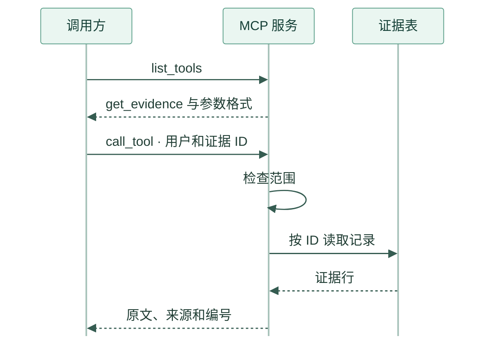

# 01-B0 · 用 @mcp.tool 注册工具，再用 @tool 调同一条证据

这一关补 CareerLens 真实的 `get_evidence`。你会用 MCP 客户端发现它、给它送参数，再从 SQLite 读回一条原文。最后写一个 LangChain 的 `@tool` 适配器，调用同一个真实工具。练习只用合成数据，在本机进程中执行。

```bash
python tutorials/01-agent-design/lab/practice.py open tools
```

## 按顺序分清函数、登记和执行

打开练习副本里的 `app/mcp/server.py`。文件先建立名为 `mcp` 的 FastMCP 服务，然后通过 `@mcp.tool()` 把 Python 函数登记给客户端。以 `get_evidence` 为例：

1. 函数提供可执行的工作，按编号从当前用户可读的记录中取一条证据。
2. 装饰器把函数名、参数类型和说明登记给 MCP。客户端可以通过 `list_tools()` 查到工具和输入格式。
3. 客户端用 `call_tool()` 指定名字和实参，服务才运行对应函数。函数可以成功交回原文，也可以报告记录找不到。

可以把装饰器读成「定义函数之后，把函数交给一个登记器」。看到 `@` 时先往上查它来自哪里。这里的 `mcp` 是由 `build_mcp_server()` 创建的服务对象。读仓库时，聊天图由 Python 函数直接调用检索，对外 MCP 入口在这个文件。 [FastMCP 的创建](../../backend/app/mcp/server.py#L52) · [上一关的图内检索](01-B-工具调用.md)



## 亲手敲出 get_evidence

找到 `@mcp.tool()` 和它下面的 `async def get_evidence`。 `ctx: Context` 由框架在调用时注入。外部调用者提供 `user_id` 和 `evidence_id` 两个文字参数。先按下面的顺序写函数体。

| 第几步 | 写什么 | 为什么放在这里 |
| --- | --- | --- |
| 1 | `_authorized_principal(user_id, "read")` | 读取操作使用对应的权限。开启鉴权时，检查令牌归属和 Scope |
| 2 | `async with SessionFactory() as session` | 为这次调用取得数据库会话，结束时关闭 |
| 3 | `await session.get(Evidence, evidence_id)` | 按主键拿一条记录，取不到返回空 |
| 4 | 判断记录存在并核对 `item.user_id` | 当前教学账号只能读本账号的证据 |
| 5 | 用 `_commit_audit` 记下 `evidence.read` | 成功读取时能查到一次审计动作，实际存的名字带 `mcp.` |
| 6 | `return _evidence_payload(item)` | 把数据库对象整理为含 `content`、`source_name`、`evidence_id` 的结果 |

源码如下。若使用完整代码对照，选中练习副本中原有的装饰器和函数一起替换，和后面的 `import_text_evidence` 保持各自一份登记。

```python
@mcp.tool()
async def get_evidence(user_id: str, evidence_id: str, ctx: Context) -> dict:
    """Read one Evidence record by ID. Requires read scope."""
    principal = _authorized_principal(user_id, "read")
    async with SessionFactory() as session:
        item = await session.get(Evidence, evidence_id)
        if item is None or item.user_id != user_id:
            raise ToolError("Evidence not found for this user")
        await _commit_audit(
            session,
            principal=principal,
            action="evidence.read",
            resource_type="evidence",
            resource_id=item.id,
        )
        return _evidence_payload(item)
```

`ToolError` 是调用方可看到的失败。找不到记录或者记录属于另一个用户时，这条函数都会返回同一类错误。用例会实际试这两次。

[get_evidence 原函数](../../backend/app/mcp/server.py#L186-L201) · [授权边界](../../backend/app/mcp/server.py#L88-L98) · [证据返回字段](../../backend/app/mcp/server.py#L101-L111)

## 跟着真实客户端调用一次

测试会先把林澈的课程接口自述写进内存库，拿到 `item.id`。下面是测试中的调用部分。 `client.list_tools()` 回来的 Python 对象字段用 `input_schema`。先预测其中会有哪些可填参数，然后用测试核对。

```python
async with Client(server.mcp) as client:
    discovered = await client.list_tools()
    registered = next(
        candidate for candidate in discovered.tools if candidate.name == "get_evidence"
    )
    assert set(registered.input_schema["properties"]) == {"user_id", "evidence_id"}

    native = await client.call_tool(
        "get_evidence", {"user_id": "agent-lesson", "evidence_id": item.id}
    )
    assert unpack(native)["evidence_id"] == item.id
    assert unpack(native)["content"] == CONTENT
```

这段代码位于测试的数据库准备之后。单独敲时可以从测试打开同一个上下文。 `unpack` 优先使用结构化内容，必要时解析文本里的 JSON。实际返回的 `content` 是导入的原文。 [完整客户端实验](lab/mcp_tool_check.py)

### 现在写一次 LangChain 的 @tool

`@tool` 来自 `langchain_core.tools`。它可以把你写的函数变成框架能描述和调用的工具。打开练习副本的 `tests/test_tutorial_mcp_tool.py`，补第二个待实现函数 `build_evidence_tool`。它拿到已建立的真实 MCP 客户端。闭包保存本次使用的教学 `user_id`，暴露给调用方的输入只剩 `evidence_id`。把 `@tool` 写到内部函数上，最后返回登记好的工具对象。

```python
from langchain_core.tools import tool
```

```python
def build_evidence_tool(client, user_id):
    @tool
    async def read_careerlens_evidence(evidence_id: str) -> str:
        """Read the original text of a CareerLens Evidence record by ID."""
        result = await client.call_tool(
            "get_evidence", {"user_id": user_id, "evidence_id": evidence_id}
        )
        return unpack(result)["content"]

    return read_careerlens_evidence
```

回到测试，把 `Client` 交给 `build_evidence_tool`。工具描述来自函数的说明文字，参数格式能通过 `adapter.args` 查看。 `ainvoke` 执行这个异步工具。它会经过刚才补写的 `@mcp.tool()` 端点，再回到同一条原文。

```python
adapter = build_evidence_tool(client, "agent-lesson")
assert set(adapter.args) == {"evidence_id"}
assert await adapter.ainvoke({"evidence_id": item.id}) == CONTENT
```

现在可以解释三处名字。 `get_evidence` 是 CareerLens 的服务端工具名，`read_careerlens_evidence` 是此处适配器的名字，`ainvoke` 和 `call_tool` 分别执行这两个层次。在会让模型选择工具的应用中，程序也可以把工具说明和参数格式交给模型，收到调用建议后再执行。本课直接指定要执行的工具，因此每次能复跑相同结果。

## 验收工具真的跑到了数据库

```bash
python tutorials/01-agent-design/lab/practice.py check tools
```

应看到 `2 passed`。一条测试检查原仓库已有的 MCP 合约，另一条测试核对这五个结果。

- 能发现 `get_evidence` 并读到两项必用参数。
- 直接 `call_tool` 能返回同一个证据 ID 和原文。
- 用 LangChain `@tool` 的适配器也能读回同一句话。
- 换成不存在的证据或另一教学用户时返回工具错误。
- 审计表中有两条成功的 `mcp.evidence.read`，对应两次成功读取。

如果只把一个名字登记好，发现工具的检查会通过，真正读取原文的检查还会报到 `get_evidence`。用它定位函数里的失败。想看写操作的例子，接着打开相邻 `import_text_evidence`，找它为什么用了 `write`，写完才记录审计。 [真实工具列表用例](../../backend/tests/test_mcp.py#L23) · [MCP 接入与协议](../07-A-MCP服务与ACP对照.md)

## 下一步

在 [01-B1 模型答复与引用](01-B1-模型答复与引用.md) 使用检索带回的原文。敲出模型上下文、输出约定、引用校验和回退。
