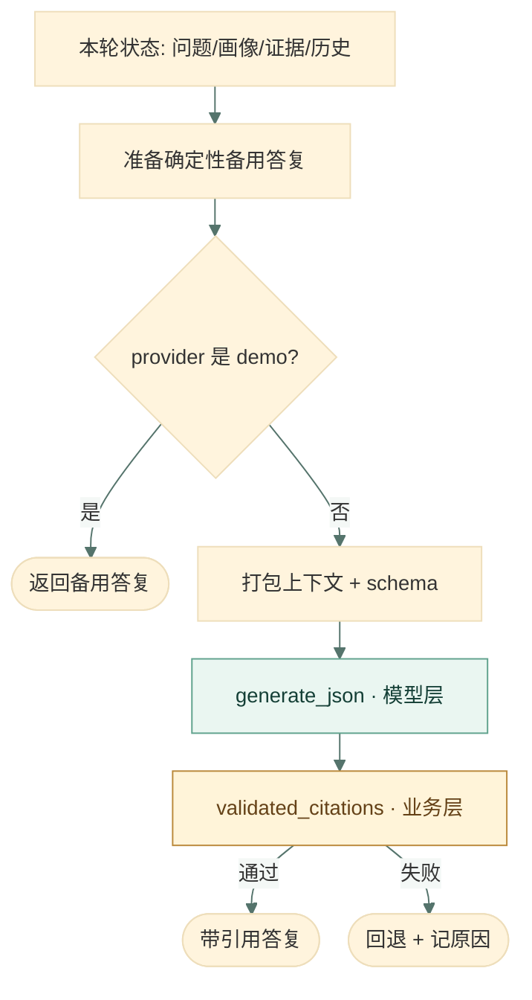

# 01-B1 · 写出带证据的答复，并拦住无效引用

现在副本已经能取得证据。接着补 `compose_answer` 和 `validated_citations`。课末会让两种答复通过同一接口，检查引用有效编号和编造编号各会得到什么结果。沿用 Demo 就能跑完本课的测试，需要自己发一次实际模型请求时可以回到 [模型配置](模型配置.md)。 [准备练习副本](01-A-Agent工作流.md)

阅读约 22–26 分钟，动手约 25 分钟。学完你能说清模型层与业务层的分工、结构化输出怎么约束、以及「格式/引用/支持」三关里程序到底能挡住哪一关。

## 先把这一关放在整条链里看

检索节点已经把候选和诊断写进状态。这一关要写的 `compose_answer` 是**答复节点**：它把问题、画像、证据、历史打包送给模型，拿到结构化输出，再用 `validated_citations` 检查引用，成功就带引用交付，失败就回退到确定性答复。

这里有个必须建立的分工直觉：

- **模型层**（`LLMProvider`）只负责「按 schema 生成一段 JSON」，不管这段内容对不对。
- **业务层**（`compose_answer` + `validated_citations`）负责「这段能不能用」：字段齐不齐、引用编号合不合法、要不要回退。

为什么这样拆？因为模型是不可靠的——它会超时、返回非法 JSON、编造引用编号。把「生成」和「验收」分成两层，才能让不可靠的生成被可靠的验收兜住。这正是整个项目「证据先于结论」原则在代码里的落点。



## 第 1 块：provider、提示词和结构化输出

在 `backend/app/graph/career.py` 中，`compose_answer` 负责准备材料并判断结果能否使用。在 `backend/app/llm/provider.py` 中，`get_llm_provider("answer")` 选择答复用的实现。Demo 由 `_fallback_answer` 直接组装文字。兼容接口通过 `OpenAICompatibleProvider.generate_json` 发送网络请求。把两件事写成两层，写完调用后可以用可控的假提供器测试引用。 [真实答复节点](../../backend/app/graph/career.py#L158-L216) · [提供器选择](../../backend/app/llm/provider.py#L163-L191)

**系统提示词**告诉模型回答规则。**本轮上下文**用 JSON 传问题、已有画像、候选原文和近期历史。**结构化输出**约定返回 `answer` 与 `cited_evidence_ids` 两个字段，Python 才能分别处理文字和编号。提供器把 Schema 放入系统消息，并请求 JSON 对象。业务层随后检查字段、空答复和引用归属。 [请求构造与解析](../../backend/app/llm/provider.py#L66-L119)

### 为什么按角色绑定不同的 provider

`get_llm_provider("answer")` 的参数 `"answer"` 是**角色名**。同一份项目里，回答、Wiki 编译、画像抽取、岗位分析可以指向不同模型（甚至有的走 Demo、有的走真实 API）。这样配置的好处：

- 简单角色用便宜/快的模型，复杂角色用强的。
- 某个角色出问题，不影响别的角色。
- 测试时只把 `answer` 换成假提供器，不用动其他。

这是一种「依赖注入」的轻量实现：节点不写死用哪个模型，而是向 provider 工厂要，要的时候按角色取。想换模型，改配置和工厂，不改节点代码。

### 结构化输出为什么不用「请用 JSON 回答」

因为自然语言约束不可靠。你说「只返回 JSON，不要加解释」，模型可能在前后加一句「好的」，或者把 `cited_evidence_ids` 写成字符串而不是数组。结构化输出（schema）把字段、类型、必填项明确告诉模型，提供器再按 schema 解析。它不能保证模型百分百听话，但比纯文字约定强得多——而且解析失败会抛错，触发回退。

假设本轮只检索出 `e1`，其中写了「用 Python 和 FastAPI 做过课程接口」。下面是一种模型返回，正文还没有引用标记。

```json
{
  "answer": "你曾用 Python 和 FastAPI 做过课程接口。",
  "cited_evidence_ids": ["e1"]
}
```

校验通过后，答复函数补上 `[Evidence: e1]`。如果正文换成 `[Evidence: e9]`，`e9` 超出这次候选范围，即使列表仍有 `e1` 也进入回退。编号可以证明引用指向这轮给出的某条资料。要判断「做过课程接口」能否支撑更强的说法，还得读回原文。 [真实编号检查](../../backend/app/services/citations.py#L8-L23)

## 第 2 块：打开练习，准备两条出口

```bash
python tutorials/01-agent-design/lab/practice.py open answer
```

打开练习的 `.cache/agent-practice/backend/app/graph/career.py`，先看已有的 `_fallback_answer`。问证据时，它把检索结果的编号列出来。问缺口却没有分析时，它会提示先提供岗位描述。按第一条注释，先用它准备备用答复，再取 `get_llm_provider("answer")`。写出 Demo 的提前返回后，再补非 Demo 的上下文。

- `provider="demo"` 时交回本地模板。你启动测试时会常看到这条。
- 启用真实模型的路径先组织上下文、调用 `generate_json`，再核对回答。测试会用一个返回固定 JSON 的替身进入这条路径。

### 为什么先准备备用答复，而不是失败时才造

代码第一行就 `fallback = _fallback_answer(state)`，哪怕后面可能不用。这叫「先备好退路」：备用答复是无依赖的（只看状态），随时可用。等真的走了模型路径又失败时，直接 `return fallback`，不用在 `except` 里临时组装——那样万一组装逻辑本身出错，就雪上加霜。把可靠的东西提前备好，是防御式编程的常用手法。

问「为什么认为我会 Python？」时，候选原文可以支持「用 Python 写过课程接口」。这里先写一个实际会送给提供器的上下文。

| 字段 | 来源 | 为什么要带 |
| --- | --- | --- |
| `question` | 这一次问题 `state["message"]` | 模型要知道回答什么 |
| `intent` | 路由关写出的分类 | 让模型知道这是核对依据类问题 |
| `profile` | 状态关整理好的画像 | 提供背景能力 |
| `evidence` | 检索关挑出的本轮候选 | 唯一允许的事实来源 |
| `history` | 此前消息，切片 `[-12:]` | 让模型理解「它」「为什么」等指代 |

### 为什么历史只取最近 12 条

`state.get("history", [])[-12:]` 的 `[-12:]` 从倒数第 12 条开始取到末尾。三个理由：

1. **成本**：按 token 计费，历史越长越贵。
2. **注意力**：关键证据淹没在几十轮闲聊里，模型更容易抓错重点。
3. **一致性**：很早以前的错误结论留在上下文里，模型可能引用它。

「最近 N 条」是可解释、可配置的简单边界。长期信息不放这里，而放画像，且画像修改要经过确认（见 01-B3）。

`schema` 描述模型应返回的结构。这里需要字符串 `answer`，以及一组字符串组成的 `cited_evidence_ids`。用 `json.dumps(..., ensure_ascii=False)` 打包上下文可以直接读中文——`ensure_ascii=False` 让中文不被转义成 `\uXXXX`，可读、也少占 token。写正常路径时，先呼叫提供器，再取正文并去掉首尾空白。

## 第 3 块：再敲一段独立的引用检查

到练习的 `.cache/agent-practice/backend/app/services/citations.py` 补 `validated_citations`。先标出它的三个参数。`texts` 是需要扫描的文本列表，`requested_ids` 是模型另给的编号，`allowed_ids` 则由本轮候选提供。现成的 `_INLINE_CITATION` 是正则表达式，用来找到形如 `[Evidence: e1]` 的文字，`match.group(1).strip()` 取中间那个 ID 并去掉空白。检索给的是 Wiki 页时，允许集合里也可能出现页 ID。

### 为什么正文引用和列表引用都要看

模型有两处可以「声明引用」：正文里的 `[Evidence: e1]` 标记，以及 `cited_evidence_ids` 列表。两处都要检查，因为：

- 正文标记是给人看的，读者顺着它打开原文。正文里出现未知 ID（`[Evidence: e9]`），读者会点开一个不存在的东西——必须拦。
- 列表 ID 是给程序统计的，模型可能往里塞没在正文出现的编号。这些不算错，但要去重、过滤。

`validated_citations` 把两者合起来：正文 ID 遇到不允许的**直接报错**（因为会误导读者），列表 ID 遇到不允许的**只丢弃**（它不影响显示）。这个区别体现了对「用户会看到什么」的保护。

1. 先取正文内每一个 ID，去掉两端空白。正文出现未知编号就抛 `ValueError`。
2. 把正文识别出的 ID 和列表里的 ID 接起来，过滤掉不允许的列表项。
3. 用 `dict.fromkeys` 保留首次出现的次序并去重，再还原为列表。答复函数会把有效但尚未写在正文的引用补到末尾。

### dict.fromkeys 为什么能去重又保序

字典的键天然不重复，且 Python 3.7+ 字典保持插入顺序。`dict.fromkeys([...])` 用列表元素当键造字典，重复的键只留第一次，顺序不变。再 `list(...)` 拿回键列表，就得到「去重且保序」的结果。比 `set` 好，因为 `set` 不保序（会打乱引用出现顺序）。

<details>
<summary>展开引用检查完整实现</summary>

```python
def validated_citations(
    texts: list[str], requested_ids: list[str], allowed_ids: set[str]
) -> list[str]:
    """Return allowed IDs in first-seen order, rejecting fabricated inline references."""
    inline_ids = [
        match.group(1).strip() for value in texts for match in _INLINE_CITATION.finditer(value)
    ]
    if any(evidence_id not in allowed_ids for evidence_id in inline_ids):
        raise ValueError("Model answer contains an unknown Evidence citation")
    return list(
        dict.fromkeys(
            evidence_id
            for evidence_id in [*inline_ids, *requested_ids]
            if evidence_id in allowed_ids
        )
    )
```

</details>

手算两次。假设允许集合是 `{"e1","e2"}`。正文写了 `[Evidence: fabricated]`、列表里有 `e1` 时，第一步就报错。正文用 `e1`、列表是 `["fake","e2","e1"]` 时，合并序列是 `e1, fake, e2, e1`，过滤掉 `fake`，去重复得到按序的 `e1, e2`。打开 e1 原文，你仍要核对「在本机运行」能支持到哪一步。

## 第 4 块：把生成、校验和备用结果连起来

回到 `compose_answer`。先从本轮候选写出 `allowed` 集合，再把答复和模型给的引用列表交给刚写的函数。试着把「候选为空」和「有候选却少引用」分别代入下面这一段。前者的 `allowed` 为空，后者才触发这一项错误。空正文还有单独的检查。

```python
cited = validated_citations([answer], generated.get("cited_evidence_ids", []), allowed)
if allowed and not cited:
    raise ValueError("Model answer has no valid Evidence citation")
```

### `if allowed and not cited` 的讲究

为什么加 `allowed and`？因为「有候选却一条引用都没有」才算问题。如果本轮候选本身就是空的（比如 Wiki 模式没建页），`allowed` 是空集，模型没有可引用的对象，这时 `cited` 必然为空——这是合法情况，不该报错。加上 `allowed and`，就只在「明明有证据可用，模型却一条都不引用」时拦截。少了这个 `and`，空候选的场景会被误判成失败。

成功时，把还没有出现在正文里的有效编号追加到末尾。失败时，在 `except` 中返回备用答复，并把 `fallback` 和异常类型放进诊断。

```python
suffix = " ".join(
    f"[Evidence: {item}]" for item in cited if f"[Evidence: {item}]" not in answer
)
```

这行的意思是：对每个有效引用 ID，如果它还没出现在正文里，就补一个 `[Evidence: ID]` 到末尾。这样即使模型只在列表里给了 ID、正文忘了标，读者仍能在文末看到引用。

<details>
<summary>展开 compose_answer 的完整实现</summary>

```python
async def compose_answer(state: CareerState) -> dict:
    fallback = _fallback_answer(state)
    provider = get_llm_provider("answer")
    if provider.diagnostics["provider"] == "demo":
        return {"answer": fallback, "model_diagnostics": provider.diagnostics}
    context = {
        "question": state["message"],
        "intent": state["intent"],
        "profile": state.get("profile", []),
        "evidence": state.get("retrieved_evidence", []),
        # Prior turns let the model resolve references ("它", "为什么") and keep
        # earlier constraints. Only the recent window is sent to bound the prompt.
        "history": state.get("history", [])[-12:],
    }
    schema = {
        "type": "object",
        "required": ["answer", "cited_evidence_ids"],
        "properties": {
            "answer": {"type": "string"},
            "cited_evidence_ids": {"type": "array", "items": {"type": "string"}},
        },
    }
    try:
        generated = await provider.generate_json(
            system_prompt=(
                "你是证据优先的职业顾问。只能基于给出的画像和证据回答；区分已证实、部分支持"
                "和缺口。不得捏造经历。结论后用 [Evidence: ID] 标注引用。"
            ),
            user_prompt=json.dumps(context, ensure_ascii=False),
            schema=schema,
            operation="career_chat",
        )
        answer = str(generated["answer"]).strip()
        allowed = {
            str(item.get("evidence_id") or item.get("page_id"))
            for item in state.get("retrieved_evidence", [])
            if item.get("evidence_id") or item.get("page_id")
        }
        if not answer:
            raise ValueError("Model answer is empty")
        cited = validated_citations([answer], generated.get("cited_evidence_ids", []), allowed)
        if allowed and not cited:
            raise ValueError("Model answer has no valid Evidence citation")
        suffix = " ".join(
            f"[Evidence: {item}]" for item in cited if f"[Evidence: {item}]" not in answer
        )
        return {
            "answer": f"{answer} {suffix}".strip(),
            "model_diagnostics": provider.diagnostics,
        }
    except Exception as exc:
        return {
            "answer": fallback,
            "model_diagnostics": {
                **provider.diagnostics,
                "fallback": True,
                "reason": type(exc).__name__,
            },
        }
```

</details>

### allowed 集合为什么要 `evidence_id or page_id`

候选既可能是原始证据（有 `evidence_id`），也可能是 Wiki 页（有 `page_id`）。允许集合要把两者都收进去，否则 hybrid 模式下 Wiki 命中会被当成非法引用。`or` 先取 `evidence_id`，没有就取 `page_id`。这个细节和 01-B 的 `source_kind` 是配套的：一个标识来源类型，一个提供允许 ID。

### 两处 fallback 的区别

代码里有两处 `fallback` 的线索。Demo 提供器的默认诊断本身可能带同名字段。看到它时先看 `model.provider`——如果是 `demo`，那是正常路径，不是失败。在非 Demo 路径，再看异常时附的 `model.reason`，可以知道这份答复为什么使用备用结果。 [完整答复节点](../../backend/app/graph/career.py#L158-L216) · [引用校验](../../backend/app/services/citations.py#L8-L23)

## 第 5 块：三关里，程序挡住了哪一关

回顾 [00-2 的三关](../00-foundations/00-2-提示词与证据.md)：格式、引用、支持。这一关的代码实际挡住了前两关：

- **格式**：schema 约束 + `str(...).strip()` + 空正文检查。
- **引用**：`validated_citations` 拦未知 ID、过滤越界列表项。
- **支持**：**程序挡不住**。模型可以合法引用 e1，却把「本机运行」写成「生产上线」。这要靠人打开 e1 原文判断。

分清「程序能挡的」和「必须人看的」，是对 AI 输出保持正确预期的关键。系统把前两关自动化，是为了让人把精力集中在第三关——真正需要判断力的部分。

## 第 6 块：用失败样例核对你的写法

```bash
python tutorials/01-agent-design/lab/practice.py check answer
```

预期 `3 passed`。正常对话会回到 Demo 路径，另外两条测试控制返回 JSON，分别检查未知正文引用引发回退，以及有效 ID 被保留且只出现一次。没有安装练习环境时，打开下面的两个测试，先找 `StubProvider` 给的输出，再读 `assert`。 [答复与引用回归](../../backend/tests/test_job_intelligence.py#L249)

### StubProvider 为什么重要

`StubProvider` 是一个假提供器，返回固定的 JSON。它让测试能确定性地制造「正文含未知引用」或「有效引用重复」等场景——真模型不会每次都按你的需要出错，假提供器可以。这就是分层的好处：把模型层换成可控的替身，业务层的验收逻辑就能被精确测试。

| 测试现象 | 最可能的原因 |
| --- | --- |
| 正常对话也回退 | `demo` 判断写错，没提前返回 |
| 未知引用没被拦 | `validated_citations` 少了正文 ID 检查 |
| 有效 ID 丢了 | 过滤条件写反，或 allowed 集合没收到 page_id |
| 空候选场景报错 | `if allowed and not cited` 少了 `allowed and` |
| 引用重复出现 | 去重没用 `dict.fromkeys` |

**再做一道设计题。** 如果找到了有效 ID，但原文写的是「本机运行」，回答写成「生产上线」，以上哪些断言还能通过？要增加哪一个样例才能发现语义跑偏？可以沿用 [00-2 的三关检查](../00-foundations/00-2-提示词与证据.md)，给这类结论加一条有明确参考答案的证据用例。答案是：现有断言大概率都过，因为引用合法、格式正确——这正说明第三关只能靠语义层的测试样例或人工核对来补。

## 常见坑，提前绕开

- **把模型层当验收层。** 生成归生成，校验归校验，别指望模型自己保证正确。
- **空候选也要求引用。** `if allowed and not cited` 的 `allowed and` 不能少。
- **allow 集合忘了 page_id。** hybrid 下 Wiki 命中会被误判非法。
- **用 set 去重引用。** 会打乱顺序，用 `dict.fromkeys`。
- **以为引用合法=语义正确。** 第三关程序挡不住，要人读原文。
- **误读 fallback。** demo 路径的诊断也可能带 fallback 字样，先看 provider。
- **让 user_id 进模型上下文。** 身份来自请求，不交给模型决定。

## 这些代码在真实项目里落在哪

| 这节课的词 | 项目位置 | 为什么这样设计 |
| --- | --- | --- |
| 答复节点 | `graph/career.py::compose_answer` | 生成与验收分两层 |
| provider 工厂 | `llm/provider.py::get_llm_provider` | 按角色绑定模型，便于替换 |
| 结构化输出 | `generate_json` + schema | 约束字段类型，解析失败可回退 |
| 上下文窗口 | `history[-12:]` | 控成本、保注意力、防旧错污染 |
| 引用校验 | `citations.py::validated_citations` | 正文未知 ID 报错，列表越界丢弃 |
| 保序去重 | `dict.fromkeys` | 引用顺序稳定 |
| 回退诊断 | `fallback` + `reason` | 出问题能定位到具体异常 |

## 下一步

在 [01-B2 两轮会话](01-B2-会话与画像确认.md) 写完整接口。追一遍 `thread_id` 从网页送回来以后怎样变成数据库里的四条消息。
