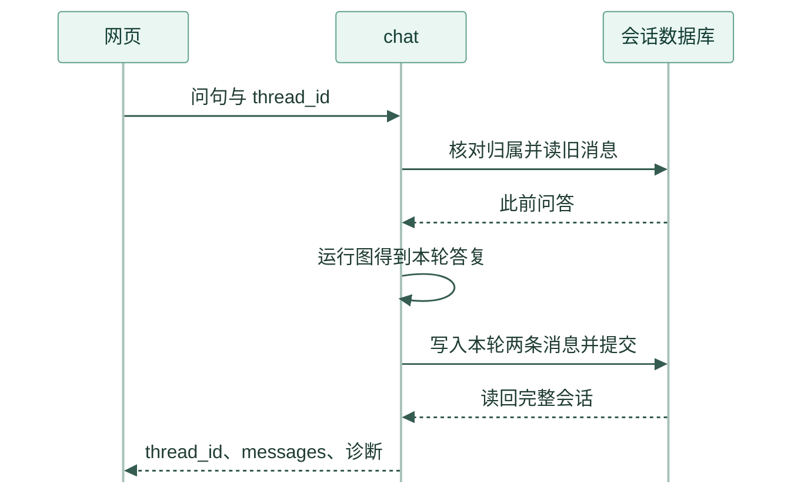

# 01-B2 · 两轮会话：从网页写到数据库，再读回来

这一关从网页里的一个 `thread_id` 开始，写回两个真实函数 `_load_history()` 和 `chat()`。做完能在同一线程保存两轮问答，能解释为什么请求少一个 ID 就会从新会话开始，并亲手从代码里区分「历史消息」和「模型这次看到的上下文」。

```bash
python tutorials/01-agent-design/lab/practice.py open conversation
```

## 用真实页面找到会话编号

工作台提交表单后在 `handleChat` 里读取现有答复。下面是页面的实际做法。

```typescript
function handleChat(event: FormEvent) {
  event.preventDefault();
  void run("chat", async () => {
    const result = await sendChat(userId, chatInput, chat?.thread_id, analysis?.id, knowledgeMode);
    setChat(result);
    setTelemetry(await getObservabilitySummary());
  });
}
```

`chat?.thread_id` 可以读成「已有答复就取它的编号」。第一次它还为空， `sendChat` 将 `thread_id: threadId ?? null` 放进请求。拿到后端响应后 `setChat(result)` 更新页面状态。再次提交就会带上一轮的编号。 [工作台的实际处理函数](../../frontend/app/workspace/page.tsx#L172) · [sendChat 请求](../../frontend/lib/api.ts#L475)

## 建立这两类数据库记录的读法

数据模型在练习文件里已备好。打开原项目的两个类，先给下面的字段找实际位置。

| 真实记录 | 你需要理解的一行 |
| --- | --- |
| `ConversationThread` | `thread_id` 标识会话，`user_id` 记录归属，创建及更新时间用来查会话 |
| `ConversationMessage` | 一条消息有用户、会话、说话角色、内容和出现时间 |
| `CareerState.history` | 运行时只需要把已读的行整理成 `{"role": ..., "content": ...}` |
| 模型上下文里的 `history` | 普通答复时取已有历史的最近 12 条。本轮问题放在 `question` |

在项目里，一轮会加一条 `user` 和一条 `assistant` 记录。同一轮内的创建时间保留足够精度。读取时按 `created_at`、`id` 排顺序。这样才能从数据库按时间还原对话。 [会话表](../../backend/app/models/conversation.py#L10-L25) · [消息表](../../backend/app/models/conversation.py#L28-L56)

## 第一步 写出读取历史的函数

打开副本的 `app/api/routes/chat.py`。没有传会话编号时返回空列表。传了时对消息表同时按用户和会话过滤，再按时间和消息 ID 取回结果。这里 `session.scalars` 返回的是符合条件的对象序列，`list(...)` 把它收成一组可以顺序处理的记录。

```python
async def _load_history(
    session: AsyncSession, user_id: str, thread_id: str | None
) -> list[ConversationMessage]:
    if not thread_id:
        return []
    result = await session.scalars(
        select(ConversationMessage)
        .where(
            ConversationMessage.user_id == user_id,
            ConversationMessage.thread_id == thread_id,
        )
        .order_by(ConversationMessage.created_at, ConversationMessage.id)
    )
    return list(result)
```

先完成这一步，再敲主入口。假设用户 A 和 B 都有自己的对话，读取条件要同时写出两个字段。只漏掉其中一个条件，哪个用例能查出来？后面会用仓库里的多会话测试核对。

## 第二步 把 chat 拆成准备、运行和保存

接口比较长。按三段写，每段写完就检查它给下一段留下的变量。函数的 `@router.post` 声明返回 `ChatResponse`，粘贴整段时保留一份装饰器。

### 准备这次能使用的数据

先用 `authorize_user` 检查访问范围。读取用户画像，空画像走 `422`。再用同一 `user_id` 取证据。如果请求带 `job_analysis_id`，要读取指定分析并检查归属。找不到或属于另一用户时报 `404`。省略时尝试读当前用户最近一次分析。如果分析不再有效，显式请求返回 `409`，隐式选中的旧分析会被置空，接着走后面步骤。

把这三个分支先写成条件，再去源码核对。到这里应该有 `profile`、`evidence`、`analysis` 三个变量。

### 按会话归属读历史，运行图

收到会话 ID 时先在会话表查归属。已经属于另一用户的会话会返回 `403`。随后调用你刚写的 `_load_history`，把已保存消息转成图使用的字典列表。到 `run_career_graph` 的参数时，场景就接上了你在 01-A1 写的入口。留意这次的 `message` 和此前的 `history` 分别进入哪一个参数。

### 保存一问一答，并返还这场会话

把返回里的 `thread_id` 取出来，用它写入用户和助手的两条消息。第一次遇到这个编号时创建 `ConversationThread`，否则更新它的时间。 `session.commit()` 保存记录后，再按同一个用户和会话读一遍历史。然后把本轮证据、检索诊断、模型诊断与会话消息一起组装为 `ChatResponse`。



<details>
<summary>展开可逐段核对的 chat 完整实现</summary>

```python
@router.post("", response_model=ChatResponse)
async def chat(
    payload: ChatRequest,
    session: Session,
    authorization: Annotated[str | None, Header()] = None,
) -> ChatResponse:
    await authorize_user(
        session,
        user_id=payload.user_id,
        authorization=authorization,
        required_scope="read",
    )
    profile = await read_profile(session, payload.user_id)
    if not profile:
        raise HTTPException(status_code=422, detail="Build the user profile before chatting")
    evidence = list(await session.scalars(
        select(Evidence).where(Evidence.user_id == payload.user_id)
    ))
    if payload.job_analysis_id:
        analysis = await session.get(JobAnalysis, payload.job_analysis_id)
        if analysis is None or analysis.user_id != payload.user_id:
            raise HTTPException(status_code=404, detail="Job analysis not found for this user")
    else:
        analysis = await session.scalar(
            select(JobAnalysis)
            .where(JobAnalysis.user_id == payload.user_id)
            .order_by(JobAnalysis.created_at.desc(), JobAnalysis.id.desc())
            .limit(1)
        )
    if analysis is not None and not job_analysis_is_current(
        analysis, profile, {record.id for record in evidence}
    ):
        if payload.job_analysis_id:
            raise HTTPException(
                status_code=409, detail="Job analysis is out of date. Analyze the JD again."
            )
        analysis = None
    thread = None
    if payload.thread_id:
        thread = await session.scalar(
            select(ConversationThread).where(
                ConversationThread.thread_id == payload.thread_id
            )
        )
        if thread is not None and thread.user_id != payload.user_id:
            raise HTTPException(status_code=403, detail="Thread belongs to another user")

    prior_messages = await _load_history(session, payload.user_id, payload.thread_id)
    history = [
        {"role": item.role, "content": item.content} for item in prior_messages
    ]
    result = await run_career_graph(
        user_id=payload.user_id,
        message=payload.message,
        profile=profile,
        evidence=evidence,
        job_analysis=analysis,
        thread_id=payload.thread_id,
        history=history,
        session=session,
        mode=payload.mode,
    )
    thread_id = result["thread_id"]

    session.add(
        ConversationMessage(
            user_id=payload.user_id,
            thread_id=thread_id,
            role="user",
            content=payload.message,
        )
    )
    session.add(
        ConversationMessage(
            user_id=payload.user_id,
            thread_id=thread_id,
            role="assistant",
            content=result["answer"],
            intent=result.get("intent"),
        )
    )
    if thread is None:
        session.add(
            ConversationThread(user_id=payload.user_id, thread_id=thread_id)
        )
    else:
        thread.updated_at = datetime.now(UTC)
    await session.commit()

    all_messages = await _load_history(session, payload.user_id, thread_id)
    return ChatResponse(
        thread_id=thread_id,
        intent=result["intent"],
        answer=result["answer"],
        evidence=result.get("retrieved_evidence", []),
        retrieval=result.get("retrieval_diagnostics", {}),
        model=result.get("model_diagnostics", {}),
        messages=[
            ChatMessage(
                role=item.role,
                content=item.content,
                intent=item.intent,
                created_at=item.created_at.isoformat() if item.created_at else None,
            )
            for item in all_messages
        ],
    )
```

</details>

这段实现会根据当前请求重新准备用户资料。图的 checkpoint 是运行状态的保存方式，聊天记录页面使用数据库消息作为事实来源。下一课会把这两个保存过程和长期画像放在一起核对。 [后端完整会话接口](../../backend/app/api/routes/chat.py#L38-L144)

## 实验 用两个会话同问一句

```bash
python tutorials/01-agent-design/lab/practice.py check conversation
```

预期 `8 passed`。其中一部分用例实际发两轮请求，检查同一编号下消息从 2 条变 4 条。另一个向同一账号发两次起始请求，断言两个会话各有自己的两条消息。岗位分析分支还会用到归属和过期判断。 [两轮会话测试](../../backend/tests/test_profile_jobs_chat.py#L107) · [过期的分析测试](../../backend/tests/test_job_intelligence.py#L157)

在综合课的 Swagger 中也可以手工做这三组。先以同一个 `user_id` 问 Python，记下 T。第二次仍用 T，看看 `messages` 增加到几条。第三次去掉 T，判断返回的新编号及消息条数。对每一组，选一个假设，指到真实代码中的处理点。

| 发出去的条件 | 应该核对的值 |
| --- | --- |
| 第一次没有 `thread_id` | 出现新编号，2 条消息 |
| 第二次带上第一次的 T | 编号还是 T，4 条消息 |
| 另开请求时不带 T | 新编号，另有 2 条消息 |

如果运行时第二轮仍只有 2 条，先检查第二个请求是否确实带回了 T，再看调用 `_load_history` 的过滤条件。遇到能看到历史、模型回答仍没引用很早的话，检查上节的 `[-12:]` 和本次的答复分支。

## 下一步

在 [01-B3 长期画像与确认写入](01-B3-长期画像与确认.md) 继续用 T。补上真实审批函数，验证一句「我更希望」到真正更新长期画像之间的每次写入。
