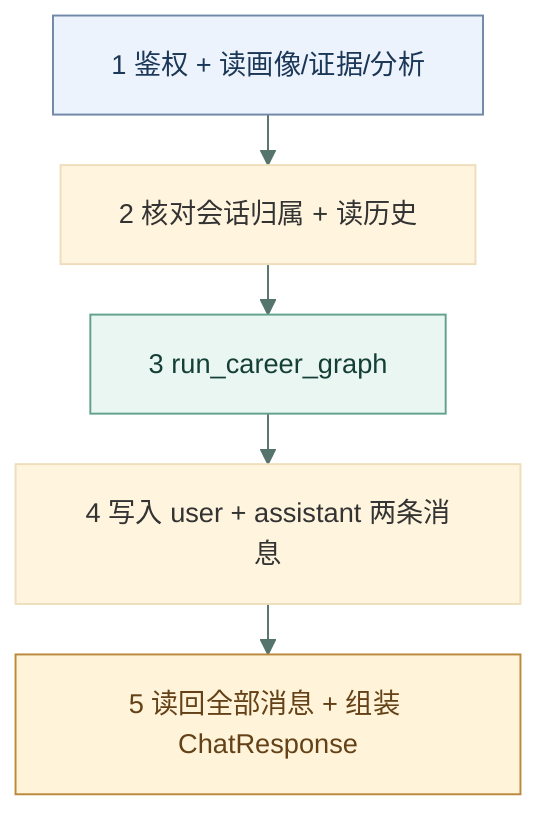
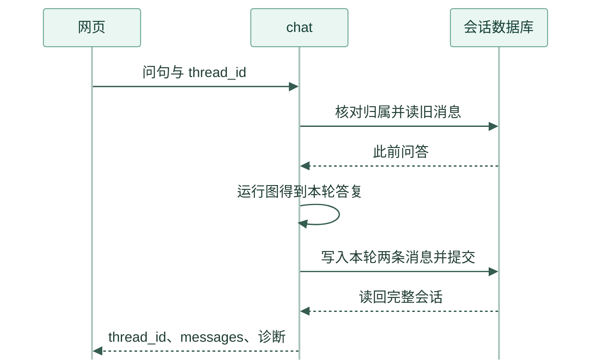

# 01-B2 · 两轮会话：从网页写到数据库，再读回来

这一关从网页里的一个 `thread_id` 开始，写回两个真实函数 `_load_history()` 和 `chat()`。做完能在同一线程保存两轮问答，能解释为什么请求少一个 ID 就会从新会话开始，并亲手从代码里区分「历史消息」和「模型这次看到的上下文」。 [准备练习副本](01-A-Agent工作流.md)

阅读约 24–28 分钟，动手约 30 分钟。学完你能说清会话的三类校验（归属、过期、404）、一问一答怎样落库、以及 checkpoint / 消息表 / 长期画像三者的分工。

## 先把这一关放在整条链里看

前面几关，`run_career_graph` 被调用时，`history` 和 `job_analysis` 都是接口层准备好的。这一关就是写那个「接口层」——`chat()` 函数。它是网页和图之间的总调度：

1. **准备数据**：鉴权、读画像、读证据、读岗位分析，还要判断分析是否过期。
2. **读历史**：按 `thread_id` 把上一轮的消息读回来。
3. **跑图**：把本轮问题 + 历史 + 业务数据交给 `run_career_graph`（01-A1 写的）。
4. **落库**：把本轮一问一答写进消息表。
5. **组装响应**：把图结果、消息、诊断打包交回网页。

这一关的代码最长，但它只是把前面所有关卡串起来的「胶水」。读的时候按这五段切，就不会乱。



## 第 1 块：会话编号、消息和数据库查询

一次 HTTP 请求只携带这次送来的内容。第二次想继续聊，需要把第一次响应中的 **`thread_id`** 传回去。CareerLens 用这个编号把多条消息归在同一会话中，每一轮有一条 `user` 消息和一条 `assistant` 消息。`user_id` 表示这组记录的归属。两处模型都定义在 `backend/app/models/conversation.py`，`ConversationThread` 保存会话，`ConversationMessage` 保存每句话。 [会话模型](../../backend/app/models/conversation.py#L10-L25) · [消息模型](../../backend/app/models/conversation.py#L28-L56)

### 为什么要分 thread 和 message 两张表

`ConversationThread` 是「这次会话」的元数据：编号、归属、创建/更新时间。`ConversationMessage` 是「每句话」的记录：归属、会话编号、角色、内容、时间。

分两张表的好处：

- 会话列表可以按 thread 表查，不用扫描所有消息。
- 更新会话的 `updated_at` 只改一行，不碰消息。
- 消息能按 `(user_id, thread_id)` 过滤，读回某一会话的历史。

一对多关系（一个 thread 多条 message）是关系数据库最典型的建模。读懂这两张表，后面 `_load_history` 的查询就顺理成章。

**SQLAlchemy** 用 Python 对象表示数据库行。接口里的 `Session` 通过 FastAPI 的 `Depends(get_session)` 为这次请求提供数据库会话。`select(ConversationMessage)` 构造查询，`.where(...)` 给查询加过滤条件，执行要等到 `await session.scalars(...)`。打开 `backend/app/api/routes/chat.py`，可以依次看到 `Session`、`_load_history` 和 `chat`。 [数据库会话与查询](../../backend/app/api/routes/chat.py#L18-L39)

### 查询是「先构造，后执行」

`select(...).where(...).order_by(...)` 这一串只是在**描述**查询，还没碰数据库。真正执行是 `await session.scalars(...)` 那一刻。`await` 是因为查库是异步 I/O。这个「构造 vs 执行」的分离是 SQLAlchemy 的核心写法：你能一步步拼条件，最后一次性发出去。初学者常以为 `select(...)` 就查了，其实它只是造了个查询对象。

## 第 2 块：用真实页面找到会话编号

打开 `frontend/app/workspace/page.tsx` 的 `handleChat`。工作台提交表单后从已有答复中取会话编号。下面是页面的实际做法。

```typescript
function handleChat(event: FormEvent) {
  event.preventDefault();
  void run("chat", async () => {
    const result = await sendChat(userId, chatInput, chat?.thread_id, analysis?.id, knowledgeMode);
    setChat(result);
    setTelemetry(await getObservabilitySummary());
  });
}
```

`chat?.thread_id` 可以读成「已有答复就取它的编号」。第一次它还为空，`frontend/lib/api.ts` 的 `sendChat` 将 `thread_id: threadId ?? null` 放进请求。拿到后端响应后 `setChat(result)` 更新页面状态。再次提交就会带上一轮的编号。 [工作台的实际处理函数](../../frontend/app/workspace/page.tsx#L172-L179) · [sendChat 请求](../../frontend/lib/api.ts#L475-L489)

### `?.` 和 `??` 两个符号

- `chat?.thread_id`：可选链。如果 `chat` 是 `null`/`undefined`，整个表达式返回 `undefined`，而不是抛「读空对象属性」的错误。第一次还没有答复时，`chat` 就是空的，这个符号让代码安全。
- `threadId ?? null`：空值合并。`threadId` 是 `null`/`undefined` 时取 `null`，否则取它本身。它和 `||` 不同——`||` 会把空字符串、0 也当成假值，而 `??` 只认 `null`/`undefined`。

这两个符号配合，实现了「第一次发 null，之后带上一次的编号」。

## 第 3 块：建立两类数据库记录的读法

数据模型在练习文件里已备好。打开原项目的两个类，先给下面的字段找实际位置。

| 真实记录 | 你需要理解的一行 |
| --- | --- |
| `ConversationThread` | `thread_id` 标识会话，`user_id` 记录归属，创建及更新时间用来查会话 |
| `ConversationMessage` | 一条消息有用户、会话、说话角色、内容和出现时间 |
| `CareerState.history` | 运行时只需要把已读的行整理成 `{"role": ..., "content": ...}` |
| 模型上下文里的 `history` | 普通答复时取已有历史的最近 12 条。本轮问题放在 `question` |

在项目里，一轮会加一条 `user` 和一条 `assistant` 记录。同一轮内的创建时间保留足够精度。读取时按 `created_at`、`id` 排顺序。这样才能从数据库按时间还原对话。 [会话表](../../backend/app/models/conversation.py#L10-L25) · [消息表](../../backend/app/models/conversation.py#L28-L56)

### 三样「记忆」别混

这一课正好把三样东西放一起，必须分清：

| 名字 | 存什么 | 作用域 | 谁来写 |
| --- | --- | --- | --- |
| 消息表 | 界面上看到的每句话 | 一个 thread，`user_id` 归属 | `chat()` 每轮写两条 |
| checkpoint | 图执行到某节点的状态快照 | 一个 `thread_id` | LangGraph 自动 |
| 长期画像 | 从证据抽取、经确认的能力条目 | 一个用户，跨会话 | 01-B3 的草案确认 |

`chat()` 直接管理的是消息表。checkpoint 由 LangGraph 在跑图时按 `thread_id` 保存，代码里不直接写。长期画像这一关完全不碰，要到 01-B3。把这三行抄进笔记，后面就不会混。

## 第 4 块：第一步——写出读取历史的函数

```bash
python tutorials/01-agent-design/lab/practice.py open conversation
```

打开练习的 `.cache/agent-practice/backend/app/api/routes/chat.py`。从 `_load_history` 的两条注释开始写。输入 `thread_id=None` 时，直接返回 `[]`。假设表里有用户林澈的 T1 两条消息和 T2 两条消息，传林澈和 T1 时，查询应只拿到 T1 的两条。用 `.where(...)` 加上用户和会话两个条件，再用 `.order_by(...)` 按时间及 ID 排。最后用 `list(...)` 收集 `session.scalars` 返回的对象。

### 为什么 where 要同时带 user_id 和 thread_id

只按 `thread_id` 查行不行？原则上 `thread_id` 是唯一的，但**安全上不够**。如果调用方传了一个属于别人的 `thread_id`，只按 thread 查就会把别人的消息读出来。加上 `user_id` 条件，即使编号撞了或被人乱传，也只能读到自己的记录。这是「纵深防御」——权限检查（后面 `chat()` 里有一道）之外，查询本身再兜一层。

### 为什么要排序

数据库不保证返回顺序。不排序，读出来的可能是乱序的对话，模型看到的「历史」前言不搭后语。按 `created_at, id` 排，`id` 作为并列时的稳定兜底（同一毫秒创建的两条消息也有确定顺序）。

<details>
<summary>对照 _load_history 完整实现</summary>

```python
async def _load_history(
    session: AsyncSession, user_id: str, thread_id: str | None
) -> list[ConversationMessage]:
    if not thread_id:
        return []
    result = await session.scalars(
        select(ConversationMessage)
        .where(
            ConversationMessage.user_id == user_id,
            ConversationMessage.thread_id == thread_id,
        )
        .order_by(ConversationMessage.created_at, ConversationMessage.id)
    )
    return list(result)
```

</details>

写完可先在纸上核对空输入、T1、T2 三种结果。综合测试会通过接口来调用这个函数，主入口完成后，才会真正走到这一段。

## 第 5 块：第二步——把 chat 拆成准备、运行和保存

接口按三段补写。每段写完先对照它交给下一段的变量。函数原有的 `@router.post` 将这条接口登记为 POST，并声明返回 `ChatResponse`。

### 准备这次能使用的数据

先用 `authorize_user` 检查访问范围。读取用户画像，空画像走 `422`。再用同一 `user_id` 取证据。如果请求带 `job_analysis_id`，要读取指定分析并检查归属。找不到或属于另一用户时报 `404`。省略时尝试读当前用户最近一次分析。如果分析不再有效，显式请求返回 `409`，隐式选中的旧分析会被置空，接着走后面步骤。

先实现能跑起来的起点。这里的 `raise` 让函数提前结束并返回指定的 HTTP 错误。`profile` 准备好了，再写证据查询与分析的「显式指定」「尝试取最近一次」两个分支。

```python
profile = await read_profile(session, payload.user_id)
if not profile:
    raise HTTPException(status_code=422, detail="Build the user profile before chatting")
```

到这里应有 `profile`、`evidence` 和 `analysis`。问缺口却没有有效分析时，`analysis` 为 `None`，允许图继续处理。

#### 三种错误码各管什么

| 状态码 | 触发条件 | 为什么是这个码 |
| --- | --- | --- |
| `422` | 没有画像 | 请求本身格式对，但业务前提缺失，无法处理 |
| `404` | 显式指定的分析找不到或不属于该用户 | 指向的资源不存在（对当前用户而言） |
| `409` | 显式指定的分析已过期 | 资源存在但状态冲突，需要重做分析 |
| `403` | thread 属于另一个用户 | 有资源但无权访问 |

这几个码不是随便选的。`409 Conflict` 专门用于「资源状态和你的请求冲突」——分析基于旧画像/旧证据，和你现在的数据冲突了，所以让你重做。隐式选中的旧分析则 quietly 置空（`analysis = None`），走保守路径，不报错打断用户。

### 按会话归属读历史，运行图

收到会话 ID 时先在会话表查归属。已经属于另一用户的会话会返回 `403`。然后写 `prior_messages = await _load_history(session, payload.user_id, payload.thread_id)`。把每条记录的 `role` 和 `content` 投影成字典，作为 `history` 交给 01-A1 写过的 `run_career_graph`。如果这是第二轮，`history` 里是先前的一问一答，新问题仍从 `payload.message` 传给 `message`。

### 保存一问一答，并返还这场会话

把图返回的 `thread_id` 取出来。练习时先在纸上写两行要保存的结果。第一行的角色是 `user`、内容是 `payload.message`，第二行的角色是 `assistant`、内容是 `result["answer"]`。两行用同一个 `thread_id`。首次创建 `ConversationThread`，后续更新它的时间。`session.commit()` 保存后，用图返回的编号读回历史，再把 `messages`、本轮证据和诊断组装为 `ChatResponse`。首次请求的 `payload.thread_id` 为空，最后一次查询尤其要用新编号。

#### 为什么最后一次读回要用图返回的 thread_id

首次请求时 `payload.thread_id` 是 `None`，但 `run_career_graph` 生成了一个新编号（`selected_thread`）。写入消息时用的是这个新编号。如果最后读回历史还用 `payload.thread_id`（None），`_load_history` 会返回空——刚写的消息查不到。所以必须用 `result["thread_id"]`。这是新会话最容易踩的坑。



<details>
<summary>展开可逐段核对的 chat 完整实现</summary>

```python
@router.post("", response_model=ChatResponse)
async def chat(
    payload: ChatRequest,
    session: Session,
    authorization: Annotated[str | None, Header()] = None,
) -> ChatResponse:
    await authorize_user(
        session,
        user_id=payload.user_id,
        authorization=authorization,
        required_scope="read",
    )
    profile = await read_profile(session, payload.user_id)
    if not profile:
        raise HTTPException(status_code=422, detail="Build the user profile before chatting")
    evidence = list(await session.scalars(
        select(Evidence).where(Evidence.user_id == payload.user_id)
    ))
    if payload.job_analysis_id:
        analysis = await session.get(JobAnalysis, payload.job_analysis_id)
        if analysis is None or analysis.user_id != payload.user_id:
            raise HTTPException(status_code=404, detail="Job analysis not found for this user")
    else:
        analysis = await session.scalar(
            select(JobAnalysis)
            .where(JobAnalysis.user_id == payload.user_id)
            .order_by(JobAnalysis.created_at.desc(), JobAnalysis.id.desc())
            .limit(1)
        )
    if analysis is not None and not job_analysis_is_current(
        analysis, profile, {record.id for record in evidence}
    ):
        if payload.job_analysis_id:
            raise HTTPException(
                status_code=409, detail="Job analysis is out of date. Analyze the JD again."
            )
        analysis = None
    thread = None
    if payload.thread_id:
        thread = await session.scalar(
            select(ConversationThread).where(
                ConversationThread.thread_id == payload.thread_id
            )
        )
        if thread is not None and thread.user_id != payload.user_id:
            raise HTTPException(status_code=403, detail="Thread belongs to another user")

    prior_messages = await _load_history(session, payload.user_id, payload.thread_id)
    history = [
        {"role": item.role, "content": item.content} for item in prior_messages
    ]
    result = await run_career_graph(
        user_id=payload.user_id,
        message=payload.message,
        profile=profile,
        evidence=evidence,
        job_analysis=analysis,
        thread_id=payload.thread_id,
        history=history,
        session=session,
        mode=payload.mode,
    )
    thread_id = result["thread_id"]

    session.add(
        ConversationMessage(
            user_id=payload.user_id,
            thread_id=thread_id,
            role="user",
            content=payload.message,
        )
    )
    session.add(
        ConversationMessage(
            user_id=payload.user_id,
            thread_id=thread_id,
            role="assistant",
            content=result["answer"],
            intent=result.get("intent"),
        )
    )
    if thread is None:
        session.add(
            ConversationThread(user_id=payload.user_id, thread_id=thread_id)
        )
    else:
        thread.updated_at = datetime.now(UTC)
    await session.commit()

    all_messages = await _load_history(session, payload.user_id, thread_id)
    return ChatResponse(
        thread_id=thread_id,
        intent=result["intent"],
        answer=result["answer"],
        evidence=result.get("retrieved_evidence", []),
        retrieval=result.get("retrieval_diagnostics", {}),
        model=result.get("model_diagnostics", {}),
        messages=[
            ChatMessage(
                role=item.role,
                content=item.content,
                intent=item.intent,
                created_at=item.created_at.isoformat() if item.created_at else None,
            )
            for item in all_messages
        ],
    )
```

</details>

这段实现会根据当前请求重新准备用户资料。图的 checkpoint 是运行状态的保存方式，聊天记录页面使用数据库消息作为事实来源。下一课会把这两个保存过程和长期画像放在一起核对。 [后端完整会话接口](../../backend/app/api/routes/chat.py#L38-L144)

### 逐段自查清单

把它拆成五块后，逐块对照：

1. **鉴权与数据**：`authorize_user` → `read_profile`（空则 422）→ 证据 → 分析（显式/隐式 + 过期判断）。
2. **会话归属**：有 `thread_id` 就查 thread，属于别人则 403。
3. **读历史、跑图**：`_load_history` → 投影 `history` → `run_career_graph` → 取 `thread_id`。
4. **落库**：加两条 `ConversationMessage`，首次加 `ConversationThread` 否则更新 `updated_at`，`commit`。
5. **读回组装**：用 `thread_id`（图的返回值）读全部消息，组装 `ChatResponse`。

## 第 6 块：实验——用两个会话同问一句

```bash
python tutorials/01-agent-design/lab/practice.py check conversation
```

预期 `8 passed`。其中一部分用例实际发两轮请求，检查同一编号下消息从 2 条变 4 条。另一个向同一账号发两次起始请求，断言两个会话各有自己的两条消息。岗位分析分支还会用到归属和过期判断。 [两轮会话测试](../../backend/tests/test_profile_jobs_chat.py#L107) · [过期的分析测试](../../backend/tests/test_job_intelligence.py#L157)

在综合课的 Swagger 中也可以手工做这三组。先以同一个 `user_id` 问 Python，记下 T。第二次仍用 T，看看 `messages` 增加到几条。第三次去掉 T，判断返回的新编号及消息条数。对每一组，选一个假设，指到真实代码中的处理点。

| 发出去的条件 | 应该核对的值 |
| --- | --- |
| 第一次没有 `thread_id` | 出现新编号，2 条消息 |
| 第二次带上第一次的 T | 编号还是 T，4 条消息 |
| 另开请求时不带 T | 新编号，另有 2 条消息 |
| 带别人的 thread_id | 403 |
| 指定过期的分析 ID | 409；隐式选中过期分析则置空继续 |

### 从失败反推

| 测试现象 | 最可能的原因 |
| --- | --- |
| 第二轮还是 2 条 | 请求没带回 T，或 `_load_history` 过滤条件错 |
| 首次请求读回空消息 | 最后读回用了 `payload.thread_id`（None）而非 `result["thread_id"]` |
| 消息顺序乱 | `_load_history` 少了 `order_by` |
| 过期分析没处理 | `job_analysis_is_current` 判断漏了 |
| 读别人的会话成功 | 会话归属检查漏了 |

如果运行时第二轮仍只有 2 条，先检查第二个请求是否确实带回了 T，再看调用 `_load_history` 的过滤条件。遇到能看到历史、模型回答仍没引用很早的话，检查 01-B1 的 `[-12:]` 和答复分支——历史进了图，不代表一定进了模型上下文。

## 常见坑，提前绕开

- **用 `payload.thread_id` 读回首次消息。** 要用 `result["thread_id"]`。
- **查询只按 thread_id 过滤。** 加上 `user_id`，防越权。
- **不排序历史。** 按 `created_at, id` 排，保证对话顺序。
- **把消息表、checkpoint、画像当一回事。** 三者分工不同。
- **显式过期分析和隐式过期分析同样处理。** 前者 409，后者置空继续。
- **把 `?.` 当 `??` 用。** 前者防空对象读属性，后者填默认值。

## 这些代码在真实项目里落在哪

| 这节课的词 | 项目位置 | 为什么这样设计 |
| --- | --- | --- |
| 会话/消息表 | `models/conversation.py` | 一对多，按 `(user_id, thread_id)` 查 |
| 历史读取 | `chat.py::_load_history` | 双条件过滤 + 排序 |
| 归属校验 | `chat` 里的 thread 检查 | 别人的 thread 返 403 |
| 分析校验 | 404 / 409 / 置空 | 找不到、过期、隐式的不同处理 |
| 落库 | 两条 `ConversationMessage` | 一轮一问一答 |
| 事实来源 | 数据库消息表 | checkpoint 会随进程结束，消息表持久 |
| 响应组装 | `ChatResponse` | 消息 + 证据 + 诊断一次交回 |

## 下一步

在 [01-B3 长期画像与确认写入](01-B3-长期画像与确认.md) 继续用 T。补上真实审批函数，验证一句「我更希望」到真正更新长期画像之间的每次写入。
