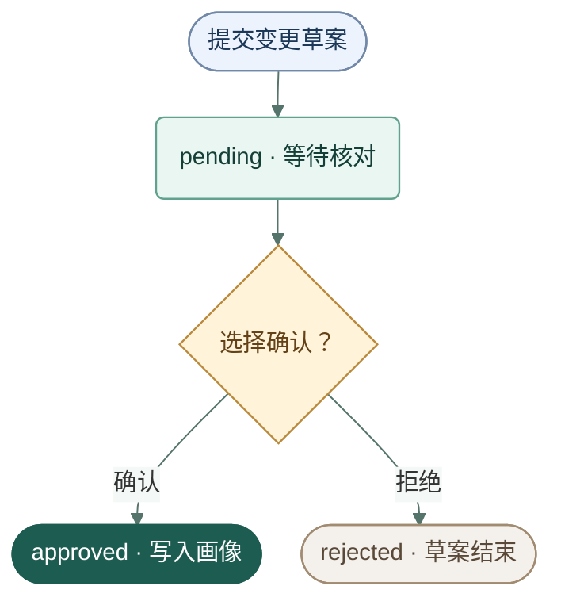

# 01-B2 · 会话与画像确认：第二句话发生了什么

林澈先问「为什么认为我会 Python？」，然后说「我更希望做后端开发。」如果第二句还在同一场聊天里，页面会多出一问一答。打开长期画像时，此时仍需走草案确认。这一课分别追两种保存过程。

## 同一个 thread_id，把两轮消息装进同一组

第一轮可以省略 `thread_id`。图用新编号运行，接口把编号随答复送回。第二轮带着它，接口先核对会话归属，再读取这组以前的消息。下面截取了读取历史的一段查询。

```python
result = await session.scalars(
    select(ConversationMessage)
    .where(
        ConversationMessage.user_id == user_id,
        ConversationMessage.thread_id == thread_id,
    )
    .order_by(ConversationMessage.created_at, ConversationMessage.id)
)
```

读法是「从消息记录里取两项都相同的行，再按时间和编号排好先后」。接口把每条历史整理为 `role` 和 `content` 传给图。当前轮答完后，接口又写入这轮用户问题和助手回答，再返回会话里的消息。 [历史查询与保存](../../backend/app/api/routes/chat.py#L22)

对着两次请求看就明白了。这里的 T 写的是同一个会话编号，动手时取第一次响应里的实际值。

| 请求 | 结果里的 `messages` |
| --- | --- |
| 第一次问 Python，省略 `thread_id` | 2 条，先是 `user` 再是 `assistant` |
| 第二次说偏好，使用 T | 4 条，顺序是 `user → assistant → user → assistant` |
| 用同一用户新开一个请求，不带 T | 新会话里的 2 条消息 |

后端拥有存储下来的会话消息。本课普通模型答复只取当时已有历史的最近 12 **条消息**。同时，图可以用同一个会话编号保存和恢复它的状态，配置可用内存或 PostgreSQL 的 checkpoint。checkpoint 是图的执行状态记录，页面上的聊天历史来自消息记录。 [模型上下文](../../backend/app/graph/career.py#L158) · [checkpoint 配置](../../backend/app/graph/checkpoint.py#L11)

## 一句「更希望」先触发指引

图按 `memory_update` 路由到 `memory_guidance`。这一步返回确认指引和 `model.provider="workflow"`。前一轮的检索结果已经从本轮状态清空，可以从响应里的 `evidence=[]`、`retrieval={}` 核对这一点。

若想更新长期画像，打开工作台里的「长期画像纠正」，或调用对应的草案接口。在本机 Demo 中，林澈的句子会被整理成一个名为「后端开发」的目标岗位候选。拿到草案后，用户可以核对要增删的条目，再作决定。



从源码找两个入口。第一个拿 `message` 调用 `create_proposal`，返回草案 ID、`changes` 和 `status`。第二个拿草案 ID，验证权限，再依据 `approve` 处理这份草案。当用户确认时，服务才执行核对后的画像变更。 [画像接口](../../backend/app/api/routes/profile.py#L48) · [草案服务](../../backend/app/services/profile_updates.py#L84)

### 练习：分别看聊天表和画像表

对照这三个时点，写出哪些内容变了。动手就使用教学账号，按综合课发请求。这里只打印哪些条目应出现。

| 时点 | 检查什么 |
| --- | --- |
| 同一会话说「我更希望做后端开发」之后 | 聊天消息多了一问一答，检查 `model.provider` |
| 草案创建之后 | 草案应处于 `pending`，检查 `changes` 及已有画像 |
| 草案被拒绝之后 | 草案应为 `rejected`，比对拒绝前后的画像项 |

<details>
<summary>参考结果和边界</summary>

会话多出两条消息。此时查看画像，仍没有因为这句对话多出「后端开发」。创建草案后，`changes` 可以先看到这项候选，状态是 `pending`。拒绝后草案状态变成 `rejected`，画像项保持和拒绝前一致。另创建一份草案并明确确认时，应该在画像看到确认后的变更。

若要写出复现记录，可以留三个值：会话编号 T、草案编号 P、画像里是否出现目标项。这样别人能分别找到对话、审批和最后的结果。

</details>

现有回归覆盖了同一会话保留多轮、确认写入、拒绝后画像保持原样。装好开发依赖时，可以从仓库根跑以下命令。 [开发环境](../../CONTRIBUTING.md)

```bash
cd backend
python -m pytest -q tests/test_profile_jobs_chat.py::test_chat_persists_history_across_turns tests/test_model_and_profile_updates.py
```

## 下一步

一轮对话会把必要的资料交给不同节点。到 [01-C Coordinator 与子 Agent](01-C-子Agent.md)，看后台岗位分析怎样进一步按责任分给两个角色，以及最终由谁写入。
