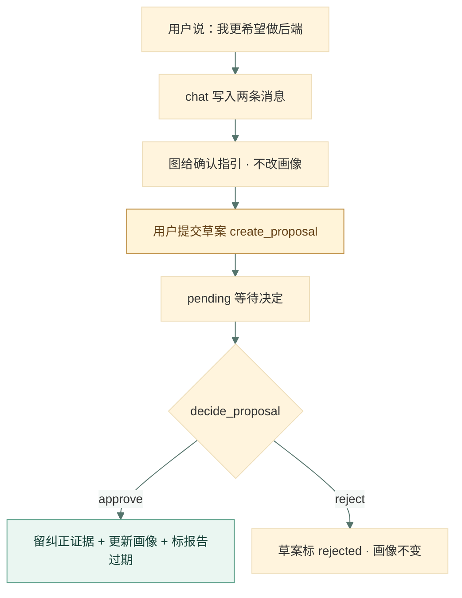

# 01-B3 · 会话之后怎样写入长期画像

上一关写完了消息读写。继续用同一个林澈账号说「我更希望做后端开发。」这句会进入聊天记录。长期画像要等另外一次动作。本关补 `create_proposal()` 和 `decide_proposal()`，分别跑创建、拒绝、确认的真实用例。 [准备练习副本](01-A-Agent工作流.md)

阅读约 24–28 分钟，动手约 30 分钟。学完你能说清四份数据（消息/checkpoint/画像/草案）的分工、事务怎样保证原子性、以及「移除抑制记录」为什么是必须的。

## 先把这一关放在整条链里看

这是整个对话链的最后一块，也是最容易被误解的一块。用户说「我更希望做后端开发」，会发生两次完全不同的写入：

1. **聊天写入**：`chat()` 把这句话作为一条 `user` 消息存进消息表（01-B2 已写）。图的 `memory_guidance` 节点给出一句「请去草案界面确认」的指引，也存成 `assistant` 消息。**到这里，长期画像一个字都没改。**
2. **画像写入**：用户另外打开确认界面，先 `create_proposal` 生成一份待确认草案，再 `decide_proposal` 批准或拒绝。**只有批准后才改长期画像，而且留一条 `user_correction` 证据。**

为什么这么绕？因为长期画像会影响后面的岗位匹配和报告，属于「重要且持久」的状态。让它经过人确认，能防止模型或一句随口的聊天偷偷改掉它。这是整个产品「机器不替人做重要写入」原则的最彻底体现。



## 第 1 块：四份数据，各管各的

发完「我更希望做后端开发。」后，可以有四份不同用途的数据。先分清，后面读代码才不混：

| 这份数据 | 去哪里读 | 它回答的问题 |
| --- | --- | --- |
| Chat 历史 | `conversation_messages`，按 `user_id`、`thread_id` 查询 | 以前对这个用户说过什么？ |
| 图的 checkpoint | `configure_checkpoint` 配置的内存或 PostgreSQL 保存器 | LangGraph 执行时保存了怎样的状态？ |
| 长期画像 | `ProfileItem`，用证据 ID 支持技能和偏好 | 现在可以用于分析的长期信息是什么？ |
| 草案 | `ProfileUpdateProposal`，有 `status` 和 `changes` | 有一次等待人决定的变更是什么？ |

草案是第四个位置，保存等待用户决定的一次变更。可以在 `backend/app/models/profile_update.py` 的 `ProfileUpdateProposal` 找到 `status` 和 `changes`。 [草案模型](../../backend/app/models/profile_update.py#L10-L35)

后端能用同一个会话 ID 从数据库读回消息。模型只在普通答复路径接收近期聊天窗口。刷新或重启后的调用者如果保留原 `thread_id`，就能用它重新取这组聊天消息。前端如何保存或恢复这个编号是调用层的另一项职责。 [真实 checkpoint 配置](../../backend/app/graph/checkpoint.py#L10-L27) · [历史查询](../../backend/app/api/routes/chat.py#L22-L35)

当 `understand_intent` 读到「更希望」时，图走 `memory_guidance`。它只输出一条去提交草案和确认的指引。已完成的 `chat()` 仍会写入这轮对话。此后由用户操作的**长期画像纠正**才会进入下面的逻辑。 [确认指引源码](../../backend/app/graph/career.py#L57-L64)

### 为什么确认要做成独立 API，而不是图的 interrupt

LangGraph 有 `interrupt()` 机制可以在节点里暂停、等人恢复（见 00-5）。CareerLens 没用它，而是做成独立 API。原因很实际：图的一次执行是同步的请求-响应，让它在中间挂起等待用户点击，会把 HTTP 请求拖很久、还会占用执行资源。独立 API 把「生成草案」和「确认草案」变成两次短请求，中间用户想多久再决定都行。效果同样是「机器不替人写入」，但实现更稳。

## 第 2 块：事务——把该一起成的写成一次提交

**事务**把应当一起完成的写入放在一次提交里。批准草案时，需要同时存入纠正证据、修改画像并标记草案。`commit=False` 让生成证据的函数先参与当前事务，随后由 `decide_proposal` 的 `await session.commit()` 一起提交。这样中途失败可以撤销这批变更。原项目入口是 `backend/app/services/profile_updates.py` 中的 `create_proposal` 与 `decide_proposal`。 [草案生成](../../backend/app/services/profile_updates.py#L96-L121) · [批准与提交](../../backend/app/services/profile_updates.py#L134-L243)

### 为什么原子性在这里特别重要

设想批准时做了三件事：存证据、改画像、标记草案。如果在「改画像」中途出错，而「存证据」已经提交，会怎样？数据库里多了一条纠正证据，但画像没改、草案还是 pending。下次用户再点确认，可能重复存证据。**这三件事要么全成，要么全不成**——这就是原子性。

`commit=False` 是关键：它让 `create_evidence_chunks` 生成的证据先加入当前会话但不提交，等所有步骤都成功，最后 `session.commit()` 一次性提交。中途任何一步抛错，事务回滚，证据也不留下。

## 第 3 块：写出一份待核对的草案

```bash
python tutorials/01-agent-design/lab/practice.py open memory
```

打开练习的 `.cache/agent-practice/backend/app/services/profile_updates.py`，从 `create_proposal` 开始。先用 `_deterministic_changes(message)` 得到初版。如果消息为「我更希望做后端开发。」，候选应更新 `target_role`，名称为「后端开发」。接着补模型分支。`ProposedChanges.model_validate(raw)` 会把模型给的字典转成经过校验的对象，有可用候选时再替换初版。调用或校验失败时保留初版。 [规则候选的代码](../../backend/app/services/profile_updates.py#L49-L93)

### 为什么是「规则初版 + 模型增强」，而不是只用模型

和前面的 Demo 思路一致：**先有一个确定性的、可复现的初版，模型只用来增强**。规则函数 `_deterministic_changes` 对明确的句式给出可靠候选；模型可以处理更复杂的表达。模型失败或给出垃圾时，`except: pass` 保留规则初版——系统不会因为模型闹脾气就完全不工作。这是一种「优雅降级」：主路径用强能力，失败回退到稳能力。

### 为什么模型只「提议」，不「执行」

提示词里明确写「不要执行，只输出待确认的变更」。模型给出的 `changes` 只是候选，存进 `ProfileUpdateProposal` 等待人决定。这把「理解用户意图」（模型擅长）和「决定是否写入」（人负责）分开。哪怕模型理解错了，也只是生成一份错误的草案，人看了可以拒绝——不会直接污染画像。

最后写入草案。先补齐 `ProfileUpdateProposal(user_id=user_id, message=message, changes=changes)` 和 `session.add(proposal)`，再提交。`refresh(proposal)` 从库里重新取值，这时返回的草案带有 ID 和 `pending` 状态。用这个 ID 可以在下一次请求决定是否采用候选。原话仍可以从草案的 `message` 查到。

### 为什么要 refresh

`session.add()` + `commit()` 后，Python 对象上的某些字段（如数据库自增/生成的 ID、服务端默认值）可能还没同步。`refresh(proposal)` 从数据库重新读一次，保证返回给调用方的对象带着完整的、真实的值——尤其是 `id` 和 `status`。没有这一步，调用方可能拿到 `id=None`，后面就没法用这个 ID 去决定。

<details>
<summary>展开 create_proposal 的完整实现</summary>

```python
async def create_proposal(
    session: AsyncSession, *, user_id: str, message: str
) -> ProfileUpdateProposal:
    provider = get_llm_provider("analysis")
    changes = _deterministic_changes(message)
    if provider.diagnostics["provider"] != "demo":
        try:
            raw = await provider.generate_json(
                system_prompt=(
                    "把用户对长期职业画像的纠正转成最少量变更。不要执行，只输出待确认的变更。"
                    "目标岗位用 target_role，偏好用 preference。"
                ),
                user_prompt=json.dumps({"message": message}, ensure_ascii=False),
                schema=ProposedChanges.model_json_schema(),
                operation="profile_update_proposal",
            )
            parsed = ProposedChanges.model_validate(raw)
            if parsed.changes:
                changes = [item.model_dump() for item in parsed.changes]
        except Exception:
            pass
    proposal = ProfileUpdateProposal(user_id=user_id, message=message, changes=changes)
    session.add(proposal)
    await session.commit()
    await session.refresh(proposal)
    return proposal
```

</details>

对应接口是 `POST /api/v1/profiles/{user_id}/proposals`，请求体只要 `{"message": "我更希望做后端开发。"}`。这回的 ID 是草案 ID。留住前一课的 `thread_id`，再单独记一个草案 ID。前者打开一组消息，后者用作接受或拒绝的请求参数。 [草案接口](../../backend/app/api/routes/profile.py#L48) · [草案生成源码](../../backend/app/services/profile_updates.py#L96-L121)

## 第 4 块：写出确认和拒绝，沿着提交位置读

接着补 `decide_proposal`。把它拆成三段敲。

1. **找待处理的行。** 读取草案的用户，使用 `scope` 与锁按用户处理，然后重新读取该行。找不到时报错，已有决定的草案也会报错。两次点击确认时能识别反复决定。
2. **根据批准执行变更。** 先用确认过的文字创建 `user_correction` 证据，参数 `commit=False`。再按草案里的动作移除或更新画像。移除时保留抑制记录，下次重建时能记住这次移除。再次明确添加时移除抑制记录。
3. **保存最终结果。** 确认或拒绝都更新草案状态。把证据、画像和决定放在本次提交内。确认成功后才尝试更新检索索引。

### `scope` 和 `with_for_update` 防的是并发冲突

`await scope(session, user_id, bump=approve)` 和 `.with_for_update()` 是两套并发控制：

- `scope` 用 fencing 代次确保「当前这个请求有权改这个用户的数据」。如果两个请求同时来，旧的那个会被挡住。
- `with_for_update()` 是数据库的行锁：读出草案时锁住这一行，别人改不了。

为什么要这么严？因为「确认草案」是敏感写入。如果用户快速点两次确认，没有这些保护，可能存两份纠正证据、画像改两次。加了锁和代次，第二次进来时发现 `status != "pending"`，直接报「already resolved」。

将目光停在 `create_evidence_chunks(..., commit=False)` 和最后的 `session.commit()`。假设刚生成新证据，处理画像时抛异常，哪个提交位置决定证据和画像还能不能一起保存？答案是最后的 `session.commit()`——没执行到它，前面加入会话的证据随事务回滚，不会留下半成品。

先实现比较短的拒绝路径。通过 `pending` 检查后，拒绝只需写 `proposal.status = "rejected"`。确认和拒绝共用 `resolved_at` 和最后的提交。然后补确认路径，先取新证据的 ID，再处理每条候选。看到 `continue` 时检查这条路径已经完成了删除与抑制，随后进入下一条变更。对于更新路径，已有条目就累加证据 ID，新条目就写一条画像。最后将已有报告标为过期，再记录 `approved`。

### 抑制记录（tombstone）为什么是必须的

这是这段代码最精妙的地方。用户「移除」一项偏好后，如果不留痕迹，下次 `rebuild_profile`（从所有证据重建画像）会**从原始证据里再次抽取**出这项——用户明明移除了，它又回来了。

`ProfileSuppression` 就是这块墓碑：移除时写一条，重建时跳过被抑制的项。反过来，如果用户后来又明确「添加」同一项，代码会先删掉抑制记录（`delete(ProfileSuppression)`），让重建时能保留它。这一删一写，让「移除」这个决定真正持久，而不是被下一次重建推翻。

### 为什么确认后要把报告标为过期

画像改了，基于旧画像生成的岗位报告就不再准确。把非过期的 `CareerReport` 全部标 `is_stale=True`，界面就能提示用户「画像已更新，请重新生成报告」。这是一种**缓存失效**处理——下游产物依赖上游数据，上游变了要标记下游过期，而不是假装它还有效。

<details>
<summary>展开 decide_proposal 的完整实现</summary>

```python
async def decide_proposal(
    session: AsyncSession, *, proposal_id: str, approve: bool
) -> ProfileUpdateProposal:
    user_id = await session.scalar(
        select(ProfileUpdateProposal.user_id).where(ProfileUpdateProposal.id == proposal_id)
    )
    if user_id is None:
        raise LookupError("Profile update proposal not found")
    await scope(session, user_id, bump=approve)
    proposal = await session.scalar(
        select(ProfileUpdateProposal)
        .where(ProfileUpdateProposal.id == proposal_id)
        .with_for_update()
        .execution_options(populate_existing=True)
    )
    if proposal is None:
        raise LookupError("Profile update proposal not found")
    if proposal.status != "pending":
        raise ValueError("This proposal has already been resolved")
    if approve:
        evidence = await create_evidence_chunks(
            session,
            user_id=proposal.user_id,
            source_type="user_correction",
            source_name="confirmed-profile-update",
            content=proposal.message,
            metadata={"proposal_id": proposal.id},
            commit=False,
        )
        evidence_ids = [item.id for item in evidence]
        for change in proposal.changes:
            query = delete(ProfileItem).where(
                ProfileItem.user_id == proposal.user_id,
                ProfileItem.category == change["category"],
                ProfileItem.name == change["name"],
            )
            if change["action"] == "remove":
                await session.execute(query)
                # Tombstone the removal so rebuild_profile does not re-extract
                # the same item from the original evidence later.
                existing_suppression = await session.scalar(
                    select(ProfileSuppression).where(
                        ProfileSuppression.user_id == proposal.user_id,
                        ProfileSuppression.category == change["category"],
                        ProfileSuppression.name == change["name"],
                    )
                )
                if existing_suppression is None:
                    session.add(
                        ProfileSuppression(
                            user_id=proposal.user_id,
                            category=change["category"],
                            name=change["name"],
                        )
                    )
                continue
            # An explicit upsert of a previously removed item revives it: drop
            # its tombstone so the next rebuild keeps it.
            await session.execute(
                delete(ProfileSuppression).where(
                    ProfileSuppression.user_id == proposal.user_id,
                    ProfileSuppression.category == change["category"],
                    ProfileSuppression.name == change["name"],
                )
            )
            existing = await session.scalar(
                select(ProfileItem).where(
                    ProfileItem.user_id == proposal.user_id,
                    ProfileItem.category == change["category"],
                    ProfileItem.name == change["name"],
                )
            )
            if existing:
                existing.level = change["level"]
                existing.confidence = change["confidence"]
                existing.evidence_ids = list(dict.fromkeys(existing.evidence_ids + evidence_ids))
                existing.details = {**existing.details, "source": "confirmed_user_update"}
            else:
                session.add(
                    ProfileItem(
                        user_id=proposal.user_id,
                        category=change["category"],
                        name=change["name"],
                        level=change["level"],
                        confidence=change["confidence"],
                        evidence_ids=evidence_ids,
                        details={"source": "confirmed_user_update"},
                    )
                )
        # A confirmed profile change invalidates reports built on the old
        # profile; mark them stale so the UI can prompt regeneration.
        reports = list(
            await session.scalars(
                select(CareerReport).where(
                    CareerReport.user_id == proposal.user_id,
                    CareerReport.is_stale.is_(False),
                )
            )
        )
        for report in reports:
            report.is_stale = True
        proposal.status = "approved"
    else:
        proposal.status = "rejected"
    proposal.resolved_at = datetime.now(UTC)
    await session.commit()
    await session.refresh(proposal)
    if approve:
        await try_index_now(session, [record.id for record in evidence])
    return proposal
```

</details>

`POST /api/v1/profiles/proposals/{proposal_id}/decision` 接收 `{"approve": true}` 或 `{"approve": false}`。接口先查草案归属并校验写入权限，再调用上面的决定函数。 [完整审批服务](../../backend/app/services/profile_updates.py#L134-L243) · [决定接口和错误码](../../backend/app/api/routes/profile.py#L74)

## 第 5 块：用四个实际测试验收

```bash
python tutorials/01-agent-design/lab/practice.py check memory
```

- 提交草案后，检查 `pending` 状态和还没改变的画像。
- 拒绝草案后，检查 `rejected` 状态及仍相同的画像。
- 新建一份草案并明确批准，应该能读到经过确认的条目。
- 在写入中途制造失败的回归会检查原子性。原子性的意思是应一起保存的内容一起成功，失败时一起撤销。

这里沿用了仓库自己的确认、拒绝和原子提交用例。普通读者可以先到测试里找 `assert`，然后用一位干净的教学账号手工重复。在记笔记时写清浏览器里看到的是答复、草案还是正式画像。 [确认与拒绝用例](../../backend/tests/test_model_and_profile_updates.py#L32) · [原子写入用例](../../backend/tests/test_atomic_profile_update.py#L9)

### 从失败反推

| 测试现象 | 最可能的原因 |
| --- | --- |
| 草案没有 id/status | `create_proposal` 漏了 `refresh` |
| 模型失败时草案也失败 | 少了 `except: pass` 回退到规则初版 |
| 重复确认没报错 | `status != "pending"` 检查漏了 |
| 移除的偏好又回来了 | 没写 `ProfileSuppression` 抑制记录 |
| 原子性测试失败 | `create_evidence_chunks` 传了 `commit=True` |
| 旧报告没标过期 | 遍历 `CareerReport` 标 `is_stale` 的循环漏了 |
| 画像没追到原文 | 更新条目时没累加 `evidence_ids` |

## 常见坑，提前绕开

- **把聊天写入当画像写入。** 说「更希望」只写消息 + 给指引，不改画像。
- **在草案阶段就改画像。** 草案只是候选，等 `decide_proposal` 批准。
- **忘了抑制记录。** 移除的项会被下次重建重新抽出来。
- **把证据和画像分开提交。** 要 `commit=False` + 最后统一 `commit`。
- **不检查 `status`。** 重复点确认会重复写入，要靠 pending 检查挡住。
- **忽略并发。** `scope` + `with_for_update` 是防同时操作的，别省。
- **画像改了不标报告过期。** 下游产物会假装还有效。

## 这些代码在真实项目里落在哪

| 这节课的词 | 项目位置 | 为什么这样设计 |
| --- | --- | --- |
| 草案 | `models/profile_update.py::ProfileUpdateProposal` | 存待确认的变更和状态 |
| 生成 | `services/profile_updates.py::create_proposal` | 规则初版 + 模型增强，只提议不执行 |
| 决定 | `services/profile_updates.py::decide_proposal` | 锁 + 代次 + 事务 |
| 原子性 | `commit=False` + 最后一次 `commit` | 证据/画像/决定一起成或一起撤 |
| 抑制记录 | `ProfileSuppression` | 让「移除」能扛住重建 |
| 缓存失效 | 报告 `is_stale=True` | 画像变了，下游报告要重生成 |
| 留证 | `user_correction` 证据 | 确认的改动也有出处，可回查 |

## 下一步

[01-C 实现 Coordinator 与子 Agent](01-C-子Agent.md) 会用同样的方法学习任务间交接。先看子角色拿到什么，再看谁有权提交结果。
