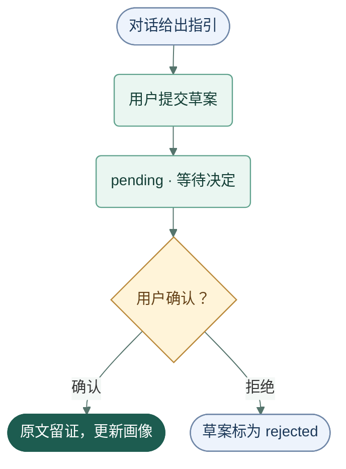

# 01-B3 · 会话之后怎样写入长期画像

上一关写完了消息读写。继续用同一个林澈账号说「我更希望做后端开发。」这句会进入聊天记录。长期画像要等另外一次动作。本关补 `create_proposal()` 和 `decide_proposal()`，分别跑创建、拒绝、确认的真实用例。

```bash
python tutorials/01-agent-design/lab/practice.py open memory
```

## 先把三类记录画在纸上

| 这份数据 | 去哪里读 | 它回答的问题 |
| --- | --- | --- |
| Chat 历史 | `conversation_messages`，按 `user_id`、`thread_id` 查询 | 以前对这个用户说过什么？ |
| 图的 checkpoint | `configure_checkpoint` 配置的内存或 PostgreSQL 保存器 | LangGraph 执行时保存了怎样的状态？ |
| 长期画像 | `ProfileItem`，使用证据 ID 支持技能和偏好 | 现在可以用于分析的长期信息是什么？ |

后端能用同一个会话 ID 从数据库读回消息。模型只在普通答复路径接收近期聊天窗口。刷新或重启后的调用者如果保留原 `thread_id`，就能用它重新取这组聊天消息。前端如何保存或恢复这个编号是调用层的另一项职责。 [真实 checkpoint 配置](../../backend/app/graph/checkpoint.py#L10-L27) · [历史查询](../../backend/app/api/routes/chat.py#L22-L35)

当 `understand_intent` 读到「更希望」时，图走 `memory_guidance`。它只输出一条去提交草案和确认的指引。已完成的 `chat()` 仍会写入这轮对话。此后由用户操作的 **长期画像纠正** 才会进入下面的逻辑。 [确认指引源码](../../backend/app/graph/career.py#L57-L64)



## 写出一份待核对的草案

练习文件是 `app/services/profile_updates.py`。打开 `create_proposal`，先构造候选变化，再保存。这一层用确定性规则得到一个初版。真实模型模式有机会产生更合适的候选，输出会按 `ProposedChanges` 验证，调用异常时仍可以用初版。此处保存 `ProfileUpdateProposal` 后便把草案交给客户端。

写的时候先用「我更希望做后端开发。」走一遍。候选应是对 `target_role` 的更新，名称为「后端开发」。在工作台先能查看这份候选，再来决定是否应用。

<details>
<summary>展开 create_proposal 的完整实现</summary>

```python
async def create_proposal(
    session: AsyncSession, *, user_id: str, message: str
) -> ProfileUpdateProposal:
    provider = get_llm_provider("analysis")
    changes = _deterministic_changes(message)
    if provider.diagnostics["provider"] != "demo":
        try:
            raw = await provider.generate_json(
                system_prompt=(
                    "把用户对长期职业画像的纠正转成最少量变更。不要执行，只输出待确认的变更。"
                    "目标岗位用 target_role，偏好用 preference。"
                ),
                user_prompt=json.dumps({"message": message}, ensure_ascii=False),
                schema=ProposedChanges.model_json_schema(),
                operation="profile_update_proposal",
            )
            parsed = ProposedChanges.model_validate(raw)
            if parsed.changes:
                changes = [item.model_dump() for item in parsed.changes]
        except Exception:
            pass
    proposal = ProfileUpdateProposal(user_id=user_id, message=message, changes=changes)
    session.add(proposal)
    await session.commit()
    await session.refresh(proposal)
    return proposal
```

</details>

对应接口是 `POST /api/v1/profiles/{user_id}/proposals`，请求体只要 `{"message": "我更希望做后端开发。"}`。这回的 ID 是草案 ID。留住前一课的 `thread_id`，再单独记一个草案 ID。前者打开一组消息，后者用作接受或拒绝的请求参数。 [草案接口](../../backend/app/api/routes/profile.py#L48) · [草案生成源码](../../backend/app/services/profile_updates.py#L96-L121)

## 写出确认和拒绝，沿着提交位置读

接着补 `decide_proposal`。把它拆成三段敲。

1. **找待处理的行。** 读取草案的用户，使用 `scope` 与锁按用户处理，然后重新读取该行。找不到时报错，已有决定的草案也会报错。两次点击确认时能识别反复决定。
2. **根据批准执行变更。** 先用确认过的文字创建 `user_correction` 证据，参数 `commit=False`。再按草案里的动作移除或更新画像。移除时保留抑制记录，下次重建时能记住这次移除。再次明确添加时移除抑制记录。
3. **保存最终结果。** 确认或拒绝都更新草案状态。把证据、画像和决定放在本次提交内。确认成功后才尝试更新检索索引。

将目光停在 `create_evidence_chunks(..., commit=False)` 和最后的 `session.commit()`。假设刚生成新证据，处理画像时抛异常，哪个提交位置决定证据和画像还能不能一起保存？

<details>
<summary>展开 decide_proposal 的完整实现</summary>

```python
async def decide_proposal(
    session: AsyncSession, *, proposal_id: str, approve: bool
) -> ProfileUpdateProposal:
    user_id = await session.scalar(
        select(ProfileUpdateProposal.user_id).where(ProfileUpdateProposal.id == proposal_id)
    )
    if user_id is None:
        raise LookupError("Profile update proposal not found")
    await scope(session, user_id, bump=approve)
    proposal = await session.scalar(
        select(ProfileUpdateProposal)
        .where(ProfileUpdateProposal.id == proposal_id)
        .with_for_update()
        .execution_options(populate_existing=True)
    )
    if proposal is None:
        raise LookupError("Profile update proposal not found")
    if proposal.status != "pending":
        raise ValueError("This proposal has already been resolved")
    if approve:
        evidence = await create_evidence_chunks(
            session,
            user_id=proposal.user_id,
            source_type="user_correction",
            source_name="confirmed-profile-update",
            content=proposal.message,
            metadata={"proposal_id": proposal.id},
            commit=False,
        )
        evidence_ids = [item.id for item in evidence]
        for change in proposal.changes:
            query = delete(ProfileItem).where(
                ProfileItem.user_id == proposal.user_id,
                ProfileItem.category == change["category"],
                ProfileItem.name == change["name"],
            )
            if change["action"] == "remove":
                await session.execute(query)
                # Tombstone the removal so rebuild_profile does not re-extract
                # the same item from the original evidence later.
                existing_suppression = await session.scalar(
                    select(ProfileSuppression).where(
                        ProfileSuppression.user_id == proposal.user_id,
                        ProfileSuppression.category == change["category"],
                        ProfileSuppression.name == change["name"],
                    )
                )
                if existing_suppression is None:
                    session.add(
                        ProfileSuppression(
                            user_id=proposal.user_id,
                            category=change["category"],
                            name=change["name"],
                        )
                    )
                continue
            # An explicit upsert of a previously removed item revives it: drop
            # its tombstone so the next rebuild keeps it.
            await session.execute(
                delete(ProfileSuppression).where(
                    ProfileSuppression.user_id == proposal.user_id,
                    ProfileSuppression.category == change["category"],
                    ProfileSuppression.name == change["name"],
                )
            )
            existing = await session.scalar(
                select(ProfileItem).where(
                    ProfileItem.user_id == proposal.user_id,
                    ProfileItem.category == change["category"],
                    ProfileItem.name == change["name"],
                )
            )
            if existing:
                existing.level = change["level"]
                existing.confidence = change["confidence"]
                existing.evidence_ids = list(dict.fromkeys(existing.evidence_ids + evidence_ids))
                existing.details = {**existing.details, "source": "confirmed_user_update"}
            else:
                session.add(
                    ProfileItem(
                        user_id=proposal.user_id,
                        category=change["category"],
                        name=change["name"],
                        level=change["level"],
                        confidence=change["confidence"],
                        evidence_ids=evidence_ids,
                        details={"source": "confirmed_user_update"},
                    )
                )
        # A confirmed profile change invalidates reports built on the old
        # profile; mark them stale so the UI can prompt regeneration.
        reports = list(
            await session.scalars(
                select(CareerReport).where(
                    CareerReport.user_id == proposal.user_id,
                    CareerReport.is_stale.is_(False),
                )
            )
        )
        for report in reports:
            report.is_stale = True
        proposal.status = "approved"
    else:
        proposal.status = "rejected"
    proposal.resolved_at = datetime.now(UTC)
    await session.commit()
    await session.refresh(proposal)
    if approve:
        await try_index_now(session, [record.id for record in evidence])
    return proposal
```

</details>

`POST /api/v1/profiles/proposals/{proposal_id}/decision` 接收 `{"approve": true}` 或 `{"approve": false}`。接口先查草案归属并校验写入权限，再调用上面的决定函数。 [完整审批服务](../../backend/app/services/profile_updates.py#L134-L243) · [决定接口和错误码](../../backend/app/api/routes/profile.py#L74)

## 用四个实际测试验收

```bash
python tutorials/01-agent-design/lab/practice.py check memory
```

- 提交草案后，检查 `pending` 状态和还没改变的画像。
- 拒绝草案后，检查 `rejected` 状态及仍相同的画像。
- 新建一份草案并明确批准，应该能读到经过确认的条目。
- 在写入中途制造失败的回归会检查原子性。原子性的意思是应一起保存的内容一起成功，失败时一起撤销。

这里沿用了仓库自己的确认、拒绝和原子提交用例。普通读者可以先到测试里找 `assert`，然后用一位干净的教学账号手工重复。在记笔记时写清浏览器里看到的是答复、草案还是正式画像。 [确认与拒绝用例](../../backend/tests/test_model_and_profile_updates.py#L32) · [原子写入用例](../../backend/tests/test_atomic_profile_update.py#L9)

## 下一步

[01-C 实现 Coordinator 与子 Agent](01-C-子Agent.md) 会用同样的方法学习任务间交接。先看子角色拿到什么，再看谁有权提交结果。
