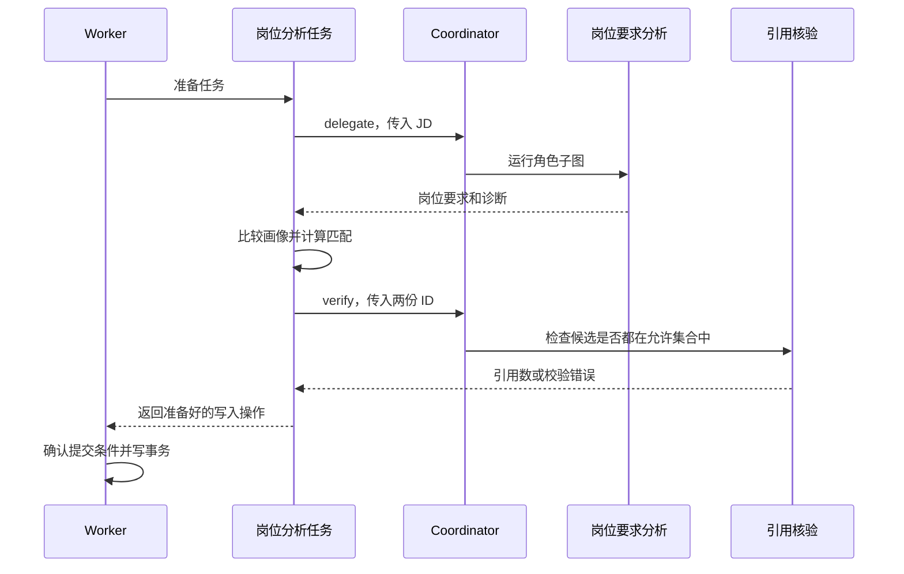

# 01-C · 子 Agent：谁读岗位，谁核对引用

**阅读约 9–12 分钟，练习约 10 分钟。** 先读过[工作流](01-A-Agent工作流.md)和[工具调用](01-B-工具调用.md)。会看 Python 函数即可开始。可以用测试或本地工作台验证下面的分工。

林澈点击「分析匹配度」。这件事至少分两步：从岗位描述里提取要求，再检查匹配结果提到的引用能否在本次资料里找到。它们需要的输入完全不同，把两份输入分别列出来，代码就清楚了。

## 先从调用方往下读

从 `runtime/operations.py` 找 `operation == "job_analysis"` 分支。它由后台 Worker 调用，顺序如下。

1. 读到本次用户的画像和可用证据 ID。
2. 让 `requirement_analyst` 处理岗位描述。这个角色收到的输入只有 `jd_text`。
3. 由 `prepare_analysis()` 比较要求和画像，计算匹配和缺口。
4. 把候选引用和获准的 ID 交给 `evidence_verifier`。
5. Worker 提交时调用准备好的写入操作，保存岗位分析，Run 结果记录 `job_analysis_id`。



报告和 Wiki 也沿用这种交接。后台报告只把整理后的报告上下文交给 `report_writer`，后台 Wiki 把标题和选中的证据摘录交给 `wiki_curator`。两种任务都会核对输出的引用。 [任务分支](../../backend/app/runtime/operations.py) · [Worker 提交](../../backend/app/runtime/worker.py)

## Coordinator 怎么调用一个角色

`SPECIALISTS` 为每个角色登记一个输入筛选函数和一个 LangGraph 小图。`Coordinator.delegate()` 用角色名查这张表，先筛出本次需要的字段，再用 `graph.ainvoke({"inputs": scoped})` 启动角色的图。角色图有一个执行对应函数的节点，跑完就结束。调用完成后会记步骤状态和简短诊断，给任务中心显示进度。

| 角色图 | 收到什么 | 交回什么 |
| --- | --- | --- |
| `requirement_analyst` | 岗位描述 | 提取后的要求和诊断 |
| `wiki_curator` | 标题、选中的证据 ID 和正文 | Wiki 草稿、引用和诊断 |
| `report_writer` | 岗位分析派生的报告上下文，含可用证据 ID | 报告叙述、引用和诊断 |
| `evidence_verifier` | 候选 ID 与允许的 ID | 核验后的引用数，或范围错误 |

每次创建 Coordinator 时有两次角色调用预算，核验也算一次。看 `delegate()` 中的 `self._remaining`，就知道第三次会在取角色之前报错。角色不会收到用户令牌或整段聊天历史。各任务的提交函数仍由 Worker 所在的运行时调用。 [角色定义与 Coordinator](../../backend/app/runtime/agents.py)

### 练习：追一次跨界的引用

假设本次只允许 `E-A`。在纸上把 `verify()` 的输入写成 `allowed={"E-A"}`、`refs=["E-A", "E-Z"]`。你预期任务继续提交，还是在计算阶段出错？接着把 `E-Z` 改成 `E-A`，再问一个问题：即使检查通过，能否确认正文支持「有生产上线经验」？

<details>
<summary>对照代码给出的结论</summary>

`verification_task()` 会将候选 ID 做成集合。因为 `E-Z` 不在允许集合里，核验报错，当前分支拿不到通过核验后的候选结果。改成允许的 ID 后，这一步能通过。要判断原文是否支持生产上线，仍要打开 `E-A` 并阅读原文。

</details>

用本地工作台时，提交一次后台岗位分析。打开任务详情，观察岗位要求分析和引用核验的步骤。已有[后端开发环境](../../CONTRIBUTING.md)时，也可以直接运行回归测试。第一条检查额外字段没有传给角色、超出范围的引用被拒、第三次调用被拦；第二条检查报告任务的结果与业务写入只提交一次。

```bash
cd backend
python -m pytest -q tests/test_run_runtime.py::test_coordinator_projects_context_and_rejects_foreign_citations
python -m pytest -q tests/test_run_runtime.py::test_report_result_and_business_write_commit_once
```

平时加角色前，写下它要返回的结果和允许读的数据。如果只执行一次简单计算，一个函数就够了。需要单独测输入、替换模型或在进度里观察这步时，上述角色接口会更容易解释。

## 下一步

多个角色都在用「证据 ID」说话。到 [02 数据模型](../02-数据模型.md)找出这类 ID 保存在哪，读完再用两份 DOCX 看它怎么生成。
