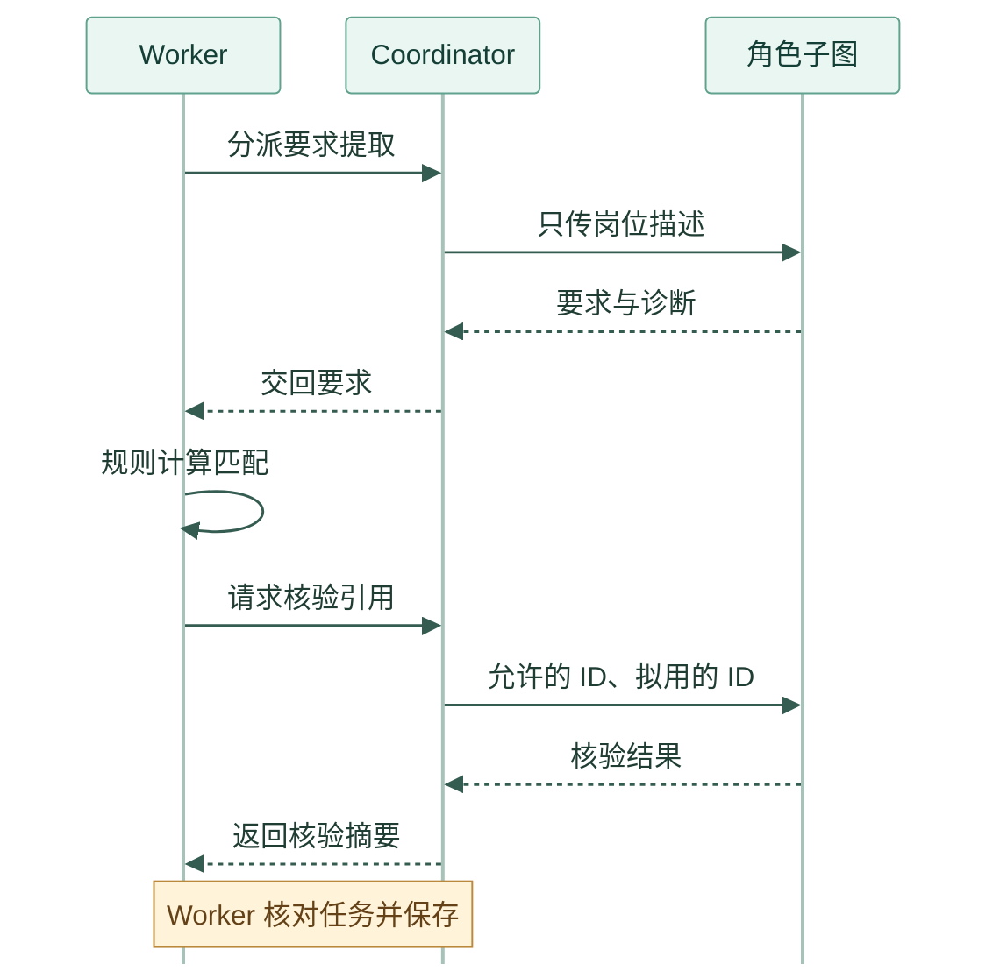

# 01-C · 写出 Coordinator 与子 Agent 的一次分工

这一关补协调器的派发、预算和核验。画面上的「分析匹配度」会提交后台岗位分析。要求提取角色只拿岗位描述，引用核验角色只拿两个 ID 列表。你会亲手把这两步接在一起，再看最后的保存为什么由 Worker 执行。

## 先认识 Worker、Coordinator 和子图

做岗位分析时，API 可以先回一个 **Run ID**，浏览器随后用它查询状态。另一个进程里的 **Worker** 领取 Run 并执行。**Coordinator** 管理本次任务的角色调用，记录进度和剩余次数。**子图**是被纳入这次任务的小工作流，例如一个角色提取 JD 要求，另一个角色用集合检查引用。两个角色的先后由岗位分析代码明确安排。 [任务入口](../../backend/app/api/routes/runs.py#L43-L71) · [岗位分析的调用顺序](../../backend/app/runtime/operations.py#L94-L110)

从 `backend/app/runtime/operations.py` 的 `prepare_operation` 找到 `job_analysis` 分支，再打开 `backend/app/runtime/agents.py` 的 `Coordinator` 和 `SPECIALISTS`。一次 `delegate("requirement_analyst", {"jd_text": ...})` 会按名字找到角色。**输入投影**仅向它交付所需的字段，`RequirementsTask.model_validate(inputs).model_dump()` 在检查岗位描述长度后只保留 `jd_text`。提取结果回到 Worker，用来计算匹配，再把引用 ID 送去核验。 [角色登记和投影](../../backend/app/runtime/agents.py#L123-L134)

## 从一次已运行的任务找代码

进入后台任务，`GET /api/v1/runs/{run_id}` 查结果，`/steps` 列出步骤。下面这组是课程末尾会用实际 Worker 复跑的结果。

| 步骤名 | 输入和输出 |
| --- | --- |
| `requirement_analyst` | 读取 JD，返回结构化岗位要求 |
| `evidence_verifier` | 看允许 ID 和拟用 ID，交回引用数量或范围错误 |
| `persist` | 复核任务条件，将分析、终态和进度写入数据库 |

在 `backend/app/runtime/operations.py` 找 `operation == "job_analysis"`。它先读当前画像和允许的证据 ID，再调用岗位角色。 `prepare_analysis` 比对要求和画像后，会把匹配所用的 ID 交给 `coordinator.verify`。匹配和排期的算法在后续章节可继续敲；本关先把角色交接做对。 [真实任务分支](../../backend/app/runtime/operations.py#L66-L162)



## 第一步 设计输入投影和单节点子图

打开原项目的 `backend/app/runtime/agents.py`，找到 `specialist`。已准备好的 `SPECIALISTS` 是字典。每个键是岗位提取、Wiki 整理、报告撰写或引用核验，对应值是一对数据，分别是投影函数和编译后的子图。

```python
def specialist(call: Callable[[dict], Awaitable[dict]]):
    async def perform(state: TaskState) -> dict:
        return {"result": await call(state["inputs"])}

    graph = StateGraph(TaskState)
    graph.add_node("perform", perform)
    graph.add_edge(START, "perform")
    graph.add_edge("perform", END)
    return graph.compile()
```

这里 `call` 本身是一个函数。小图从 `START` 到 `perform`，调用它，再把结果交到 `END`。像 `requirement_analyst` 这种只需要 JD 的角色，投影函数会用 `RequirementsTask` 检查长度并只保留 `jd_text`。角色任务因此可以单独运行，测试也能直接检查它到底收到了什么。 [子图定义](../../backend/app/runtime/agents.py#L42-L50) · [角色登记表](../../backend/app/runtime/agents.py#L123)

## 第二步 敲出带预算的派发和核验

```bash
python tutorials/01-agent-design/lab/practice.py open coordinator
```

在练习的 `.cache/agent-practice/backend/app/runtime/agents.py` 找到 `Coordinator.delegate` 和 `Coordinator.verify`。先敲预算和进度，再把下面的三行放在 `running` 之后。角色登记决定用哪个投影和子图，`scoped` 是清理后的输入，返回的状态里从 `result` 取角色产物。

```python
project, graph = SPECIALISTS[role]
scoped = project(inputs)
state = await graph.ainvoke({"inputs": scoped})
```

`Coordinator` 的构造函数会给本次调用两次预算。补回类里的方法，保持下面这几步。

1. 预算为零时报错，其他情况先扣一次。
2. 记 `running`，从登记表按角色名取投影函数和子图。
3. 先把输入缩到角色所需字段，再调用 `await graph.ainvoke({"inputs": scoped})`。
4. 拿到 `result` 后只把回退标识、引用数量等摘要交给进度。业务候选仍返回给调用者。
5. `verify` 也是一次 `delegate`。因此「提取一次、验证一次」正好用尽默认预算。

<details>
<summary>展开 Coordinator 的两个实际方法</summary>

```python
    async def delegate(self, role: str, inputs: dict) -> dict:
        if self._remaining <= 0:
            raise ValueError("Specialist budget exhausted")
        self._remaining -= 1
        await self._progress(role, "running")
        project, graph = SPECIALISTS[role]
        scoped = project(inputs)
        state = await graph.ainvoke({"inputs": scoped})
        result = state["result"]
        stats = {"fallback": bool(
            result["diagnostics"].get("fallback") or result["diagnostics"].get("fallback_reason")
        )}
        if "citation_count" in result:
            stats["citation_count"] = result["citation_count"]
        await self._progress(role, "succeeded", **stats)
        return result

    async def verify(self, allowed: set[str], refs: list[str]) -> TaskSummary:
        role = "evidence_verifier"
        result = await self.delegate(role, {"allowed_ids": sorted(allowed), "citation_ids": refs})
        return TaskSummary(role=role, citation_count=result["citation_count"])
```

</details>

注意缩进。这两个 `def` 放在现成的 `class Coordinator` 里面，类里原有的 `__init__` 也要保留。 `self` 是调用这个方法的协调器对象，读取的是这一次任务留下的预算。

现在写同一文件的 `verification_task`。先通过 `VerificationTask.model_validate` 读入两组 ID，再把候选转换成集合。`refs <= allowed` 在集合中判断每个候选是否都属于允许集合。若出现任何超出范围的 ID，抛出 `ValueError`，调用者因此不能进入后面的保存。核验通过时返回去重后的数量。

<details>
<summary>对照 verification_task 完整实现</summary>

```python
async def verification_task(inputs: dict) -> dict:
    task = VerificationTask.model_validate(inputs)
    refs = set(task.citation_ids)
    if not refs <= set(task.allowed_ids):
        raise ValueError("Citations are outside the task's evidence scope")
    return {"citation_count": len(refs), "diagnostics": {}}
```

</details>

用纸笔检查一遍。允许 `{"E1"}`，候选是 `["E1", "E2"]` 会失败。改成 `["E1", "E1"]` 时通过，引用数是 1。重复出现的编号不等于增加一条证据。 [实际派发方法](../../backend/app/runtime/agents.py#L92-L107) · [核验函数](../../backend/app/runtime/agents.py#L79-L84)

## 第三步 找谁真正写入

`prepare_operation` 的工作是计算并返回保存函数。打开 `backend/app/runtime/worker.py` 的 `execute`。Worker 进入提交事务后重新核对任务租约、用户访问与输入版本，执行 `effect(session)`，写 `persist` 步骤并结束 Run。租约用来确认当前进程仍有权完成这项任务。看到角色已返回 `succeeded` 时，也可以继续用 `persist` 和 Run 终态核对是否完成最终写入。 [真实 Worker 提交逻辑](../../backend/app/runtime/worker.py#L54-L86)

## 验收输入、预算和最终结果

```bash
python tutorials/01-agent-design/lab/practice.py check coordinator
```

预期 `2 passed`。一条测试把多余字段传给岗位角色，再断言它只收到 JD。它还让一个候选引用越界，最后验证第三次派发被预算拒绝。另一条测试跟真实后台报告确认结果与报告记录一同写入。 [投影和预算回归](../../backend/tests/test_run_runtime.py#L426) · [提交与结果回归](../../backend/tests/test_run_runtime.py#L363)

## 下一步

到 [01-D 启动自己写完的 Agent](01-D-综合跟做.md)。用这份练习副本启动真实 API 和 Worker，复跑一次会话与后台分析。
