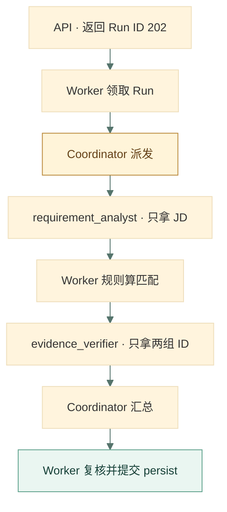
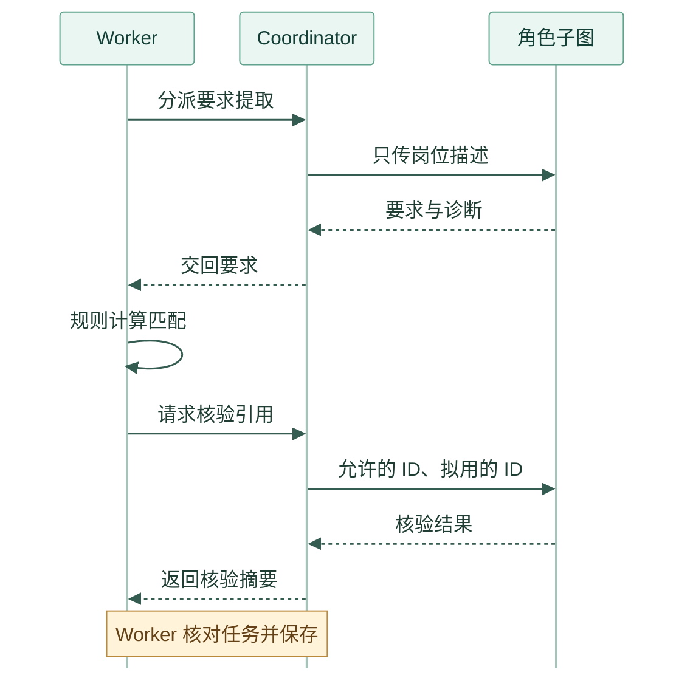

# 01-C · 写出 Coordinator 与子 Agent 的一次分工

这一关补协调器的派发、预算和核验。画面上的「分析匹配度」会提交后台岗位分析。要求提取角色只拿岗位描述，引用核验角色只拿两个 ID 列表。你会亲手把这两步接在一起，再看最后的保存为什么由 Worker 执行。 [准备练习副本](01-A-Agent工作流.md)

阅读约 22–26 分钟，动手约 25 分钟。学完你能说清 Worker/Coordinator/子图的职责边界、输入投影为什么是安全机制、预算为什么是资源护栏、以及谁有权提交结果。

## 先把这一关放在整条链里看

前面所有关卡都在**对话链**里：一次请求进来，同步跑完图，返回结果。这一关切换到**后台任务链**：点「分析匹配度」后，API 先回一个 `Run ID`（202），真正的活由另一个进程里的 Worker 慢慢做，浏览器用 Run ID 轮询状态。

为什么要分出去？因为岗位分析涉及模型调用、多步角色协作，可能耗时几十秒。让 HTTP 请求干等这么久，用户体验差、还容易超时。后台任务的模式是「先受理、慢慢做、随时查」。

这条链上有三个角色：

| 角色 | 职责 | 类比 |
| --- | --- | --- |
| **API** | 受理任务，返回 Run ID | 前台收单 |
| **Worker** | 领取 Run，执行任务，提交结果 | 后厨做菜 |
| **Coordinator** | 管理本次任务的角色调用、进度、预算 | 领班，分活给专业岗 |
| **子图 / 角色** | 做一件具体的小事（提取 JD、核验引用） | 专业岗 |



## 第 1 块：Worker、Coordinator 和子图

做岗位分析时，API 可以先回一个 **Run ID**，浏览器随后用它查询状态。另一个进程里的 **Worker** 领取 Run 并执行。**Coordinator** 管理本次任务的角色调用，记录进度和剩余次数。**子图**是被纳入这次任务的小工作流，例如一个角色提取 JD 要求，另一个角色用集合检查引用。两个角色的先后由岗位分析代码明确安排。 [任务入口](../../backend/app/api/routes/runs.py#L43-L71) · [岗位分析的调用顺序](../../backend/app/runtime/operations.py#L94-L110)

### 为什么 Coordinator 不自己做，要派给子图

Coordinator 本身不做具体工作，它只负责：派发、记进度、控预算、收结果。具体工作交给专门的「角色子图」。这样拆的好处：

- **输入隔离**：每个角色只拿到自己需要的字段（输入投影），看不到不该看的。
- **可独立测试**：角色子图能单独跑，验它到底收到什么、返回什么。
- **可替换**：某个角色换个实现，不影响 Coordinator 和其他角色。

这是一种「协调者 + 专家」的经典架构。Coordinator 是流程控，专家是执行者。

从 `backend/app/runtime/operations.py` 的 `prepare_operation` 找到 `job_analysis` 分支，再打开 `backend/app/runtime/agents.py` 的 `Coordinator` 和 `SPECIALISTS`。一次 `delegate("requirement_analyst", {"jd_text": ...})` 会按名字找到角色。**输入投影**仅向它交付所需的字段，`RequirementsTask.model_validate(inputs).model_dump()` 在检查岗位描述长度后只保留 `jd_text`。提取结果回到 Worker，用来计算匹配，再把引用 ID 送去核验。 [角色登记和投影](../../backend/app/runtime/agents.py#L123-L134)

### 从一次已运行的任务找代码

进入后台任务，`GET /api/v1/runs/{run_id}` 查结果，`/steps` 列出步骤。下面这组是课程末尾会用实际 Worker 复跑的结果。

| 步骤名 | 输入和输出 | 谁执行 |
| --- | --- | --- |
| `requirement_analyst` | 读 JD，返回结构化岗位要求 | 子图 |
| `evidence_verifier` | 看允许 ID 和拟用 ID，交回引用数量或范围错误 | 子图 |
| `persist` | 复核任务条件，将分析、终态和进度写入数据库 | Worker |

在 `backend/app/runtime/operations.py` 找 `operation == "job_analysis"`。它先读当前画像和允许的证据 ID，再调用岗位角色。`prepare_analysis` 比对要求和画像后，会把匹配所用的 ID 交给 `coordinator.verify`。匹配和排期的算法在后续章节可继续敲；本关先把角色交接做对。 [真实任务分支](../../backend/app/runtime/operations.py#L66-L162)



## 第 2 块：第一步——设计输入投影和单节点子图

打开原项目的 `backend/app/runtime/agents.py`，找到 `specialist`。已准备好的 `SPECIALISTS` 是字典。每个键是岗位提取、Wiki 整理、报告撰写或引用核验，对应值是一对数据，分别是投影函数和编译后的子图。

```python
def specialist(call: Callable[[dict], Awaitable[dict]]):
    async def perform(state: TaskState) -> dict:
        return {"result": await call(state["inputs"])}

    graph = StateGraph(TaskState)
    graph.add_node("perform", perform)
    graph.add_edge(START, "perform")
    graph.add_edge("perform", END)
    return graph.compile()
```

这里 `call` 本身是一个函数。小图从 `START` 到 `perform`，调用它，再把结果交到 `END`。像 `requirement_analyst` 这种只需要 JD 的角色，投影函数会用 `RequirementsTask` 检查长度并只保留 `jd_text`。角色任务因此可以单独运行，测试也能直接检查它到底收到了什么。 [子图定义](../../backend/app/runtime/agents.py#L42-L50) · [角色登记表](../../backend/app/runtime/agents.py#L123)

### 输入投影是安全机制，不只是省事

`project(inputs)` 看起来只是「挑字段」，其实是重要的安全边界。想想：Worker 手里有当前用户的全部数据——画像、所有证据、岗位要求。如果直接把这一大包传给每个角色：

- 要求提取角色可能把候选人的画像也送进模型，泄漏到不该去的地方。
- 引用核验角色可能拿到它不需要的正文，增加提示词长度和成本。
- 角色能看到越多，出错时越难判断是哪个数据导致的。

投影把输入削到「这个角色完成任务的最小集合」。`requirement_analyst` 只见 `jd_text`（岗位描述，本来就是公开的），不见候选人画像；`evidence_verifier` 只见两组 ID，不见正文。这是**最小权限原则**在 Agent 分工里的体现。

### Pydantic 校验顺带做长度检查

`RequirementsTask.model_validate(inputs)` 不只是挑字段，还在校验 JD 长度。如果传进来的岗位描述过长或格式不对，在这里就会被拦，不会送到模型。把校验放在投影这一步，等于在「进入角色」的门口设卡。

## 第 3 块：第二步——敲出带预算的派发和核验

```bash
python tutorials/01-agent-design/lab/practice.py open coordinator
```

在练习的 `.cache/agent-practice/backend/app/runtime/agents.py` 找到 `Coordinator.delegate` 和 `Coordinator.verify`。先敲预算和进度，再把下面的三行放在 `running` 之后。角色登记决定用哪个投影和子图，`scoped` 是清理后的输入，返回的状态里从 `result` 取角色产物。

```python
project, graph = SPECIALISTS[role]
scoped = project(inputs)
state = await graph.ainvoke({"inputs": scoped})
```

`Coordinator` 的构造函数会给本次调用两次预算。补回类里的方法，保持下面这几步。

1. 预算为零时报错，其他情况先扣一次。
2. 记 `running`，从登记表按角色名取投影函数和子图。
3. 先把输入缩到角色所需字段，再调用 `await graph.ainvoke({"inputs": scoped})`。
4. 拿到 `result` 后只把回退标识、引用数量等摘要交给进度。业务候选仍返回给调用者。
5. `verify` 也是一次 `delegate`。因此「提取一次、验证一次」正好用尽默认预算。

### 预算是资源护栏，不是流程控制

`_remaining` 初始为 2，每次 `delegate` 扣 1。为什么需要它？因为角色调用通常要花钱（模型 token）和时间。如果没有上限，一个写错的循环可能反复派发角色，烧掉大量成本。预算给每次任务设了个硬顶：两次调用用完，第三次直接报错。

注意预算**不是**用来决定任务的正常流程——正常流程就是要调用两次（提取 + 核验）。它是防止意外的护栏：如果代码出错想调第三次，会被挡住。测试里会故意让一个越界的引用触发第三次派发，验证预算确实拒绝了它。

### 进度里只放摘要，不放业务数据

`_progress(role, "succeeded", **stats)` 里只放 `fallback`、`citation_count` 这类摘要。为什么不放完整的 `result`？因为进度会写进 `Run.steps` 给界面显示、可能被日志收集。完整的业务候选（可能含大量正文或敏感信息）不该混进进度。摘要够让界面显示「这一步成功了、引用 3 条」，又不会撑爆存储。业务结果通过 `return result` 直接交给调用者，走另一条路。

<details>
<summary>展开 Coordinator 的两个实际方法</summary>

```python
    async def delegate(self, role: str, inputs: dict) -> dict:
        if self._remaining <= 0:
            raise ValueError("Specialist budget exhausted")
        self._remaining -= 1
        await self._progress(role, "running")
        project, graph = SPECIALISTS[role]
        scoped = project(inputs)
        state = await graph.ainvoke({"inputs": scoped})
        result = state["result"]
        stats = {"fallback": bool(
            result["diagnostics"].get("fallback") or result["diagnostics"].get("fallback_reason")
        )}
        if "citation_count" in result:
            stats["citation_count"] = result["citation_count"]
        await self._progress(role, "succeeded", **stats)
        return result

    async def verify(self, allowed: set[str], refs: list[str]) -> TaskSummary:
        role = "evidence_verifier"
        result = await self.delegate(role, {"allowed_ids": sorted(allowed), "citation_ids": refs})
        return TaskSummary(role=role, citation_count=result["citation_count"])
```

</details>

注意缩进。这两个 `def` 放在现成的 `class Coordinator` 里面，类里原有的 `__init__` 也要保留。`self` 是调用这个方法的协调器对象，读取的是这一次任务留下的预算。

### 现在写同一文件的 verification_task

先通过 `VerificationTask.model_validate` 读入两组 ID，再把候选转换成集合。`refs <= allowed` 在集合中判断每个候选是否都属于允许集合。若出现任何超出范围的 ID，抛出 `ValueError`，调用者因此不能进入后面的保存。核验通过时返回去重后的数量。

```python
refs = set(task.citation_ids)
if not refs <= set(task.allowed_ids):
    raise ValueError("Citations are outside the task's evidence scope")
return {"citation_count": len(refs), "diagnostics": {}}
```

### 为什么用集合的「子集」判断

`refs <= allowed` 是集合的子集运算：只有当 `refs` 的每一个元素都在 `allowed` 里，才返回 True。翻译成人话：「拟用的每一条引用，都必须来自允许集合」。这正好是引用核验要做的事——拦住越界引用。

用 `set` 还顺带去重：`["E1", "E1"]` 变成 `{"E1"}`，`len` 是 1。重复出现的编号不算增加证据条数。这和 01-B1 的 `dict.fromkeys` 是同一个目的（去重），只是这里不需要保序，用 `set` 更直接。

<details>
<summary>对照 verification_task 完整实现</summary>

```python
async def verification_task(inputs: dict) -> dict:
    task = VerificationTask.model_validate(inputs)
    refs = set(task.citation_ids)
    if not refs <= set(task.allowed_ids):
        raise ValueError("Citations are outside the task's evidence scope")
    return {"citation_count": len(refs), "diagnostics": {}}
```

</details>

用纸笔检查一遍。允许 `{"E1"}`，候选是 `["E1", "E2"]` 会失败。改成 `["E1", "E1"]` 时通过，引用数是 1。重复出现的编号不等于增加一条证据。 [实际派发方法](../../backend/app/runtime/agents.py#L92-L107) · [核验函数](../../backend/app/runtime/agents.py#L79-L84)

## 第 4 块：第三步——找谁真正写入

`prepare_operation` 的工作是计算并返回保存函数。打开 `backend/app/runtime/worker.py` 的 `execute`。Worker 进入提交事务后重新核对任务租约、用户访问与输入版本，执行 `effect(session)`，写 `persist` 步骤并结束 Run。租约用来确认当前进程仍有权完成这项任务。看到角色已返回 `succeeded` 时，也可以继续用 `persist` 和 Run 终态核对是否完成最终写入。 [真实 Worker 提交逻辑](../../backend/app/runtime/worker.py#L54-L86)

### 为什么保存由 Worker 做，不由角色做

角色（子图）只做事、返回结果，不碰数据库写入。最终保存集中在 Worker，原因有三：

1. **一处提交**：所有业务写入在一个事务里完成，保证原子性（和 01-B3 同理）。如果每个角色各写各的，就无法保证一起成功或撤销。
2. **统一复核**：Worker 在提交前重新核对租约、用户访问、输入版本。哪怕角色算完了，条件变了（比如任务被取消、输入过期），也不会写进去。
3. **职责清晰**：角色是「计算」，Worker 是「提交」。分开后角色可以无副作用地测试。

这和前面「检索节点不做判断」「模型只生成不验收」是同一种设计哲学：**把有副作用的、需要复核的动作集中到一层**。

## 第 5 块：验收输入、预算和最终结果

```bash
python tutorials/01-agent-design/lab/practice.py check coordinator
```

预期 `2 passed`。一条测试把多余字段传给岗位角色，再断言它只收到 JD。它还让一个候选引用越界，最后验证第三次派发被预算拒绝。另一条测试跟真实后台报告确认结果与报告记录一同写入。 [投影和预算回归](../../backend/tests/test_run_runtime.py#L426) · [提交与结果回归](../../backend/tests/test_run_runtime.py#L363)

### 从失败反推

| 测试现象 | 最可能的原因 |
| --- | --- |
| 角色收到了多余字段 | 投影函数没用，直接传了 inputs |
| 越界引用没被拦 | `refs <= allowed` 写反或漏了 |
| 第三次派发没被拒 | 预算检查漏了，或没扣减 |
| 重复引用数不对 | 用了列表没用集合去重 |
| 结果没写进数据库 | Worker 的 `persist` 分支漏了 |
| 进度里出现大段正文 | 误把完整 result 放进 `_progress` |

## 常见坑，提前绕开

- **把完整输入传给角色。** 用投影削到最小字段，既是安全也是成本。
- **以为预算管正常流程。** 它是防意外的护栏，不是流程编排。
- **把业务结果塞进进度。** 进度只放摘要，结果走返回值。
- **用列表判断引用范围。** 用集合子集，顺带去重。
- **让角色直接写库。** 保存集中在 Worker，保证原子性和复核。
- **忽略租约复核。** Worker 提交前要确认仍有权写。

## 这些代码在真实项目里落在哪

| 这节课的词 | 项目位置 | 为什么这样设计 |
| --- | --- | --- |
| 后台受理 | `api/routes/runs.py` | 先回 Run ID，异步执行 |
| Worker | `runtime/worker.py::execute` | 领取、执行、复核、提交 |
| Coordinator | `runtime/agents.py::Coordinator` | 派发、进度、预算、汇总 |
| 角色登记 | `SPECIALISTS` 字典 | 名字 → 投影函数 + 子图 |
| 输入投影 | `RequirementsTask` 等 | 最小权限，只给必要字段 |
| 子图 | `specialist()` 生成的 StateGraph | 单节点，可独立测试 |
| 预算 | `_remaining` | 资源护栏，防意外循环 |
| 引用核验 | `verification_task` | 集合子集判断 + 去重 |
| 集中提交 | `persist` | 原子性 + 租约复核 |

## 下一步

到 [01-D 启动自己写完的 Agent](01-D-综合跟做.md)。用这份练习副本启动真实 API 和 Worker，复跑一次会话与后台分析。
